# GPT Image2 23个场景大满贯！

> 来源：[https://aiwarts101.feishu.cn/docx/Gx4fdPkhYocLMbxPcIOc1ANWnZb](https://aiwarts101.feishu.cn/docx/Gx4fdPkhYocLMbxPcIOc1ANWnZb)

**正文：****https://mp.weixin.qq.com/s/1J**0FkFxKLpKTEVDrC22yWA

---

> 给我生成一张猫咪全品种科普图鉴图

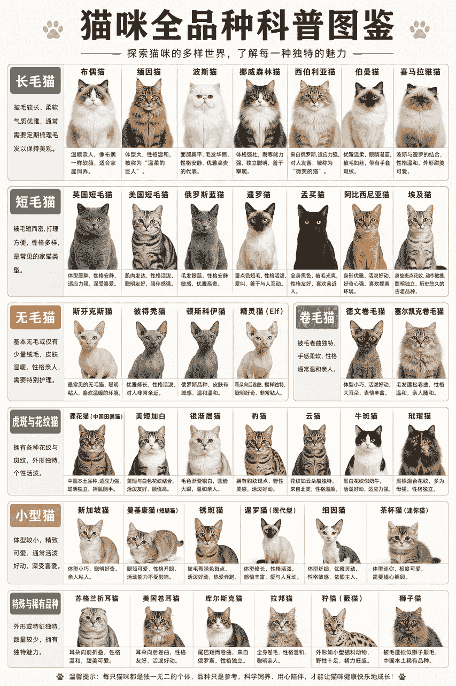

> 制作一个MBTI人格解释图鉴图

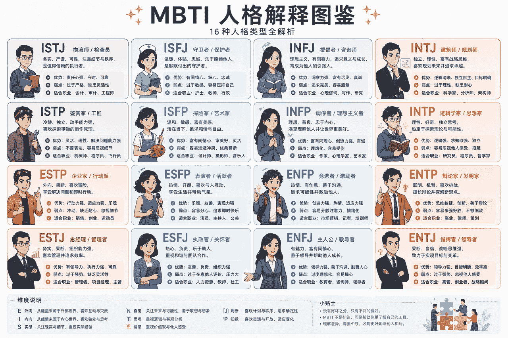

> 再给我生成一张人类常用摸鱼姿势科普图鉴图

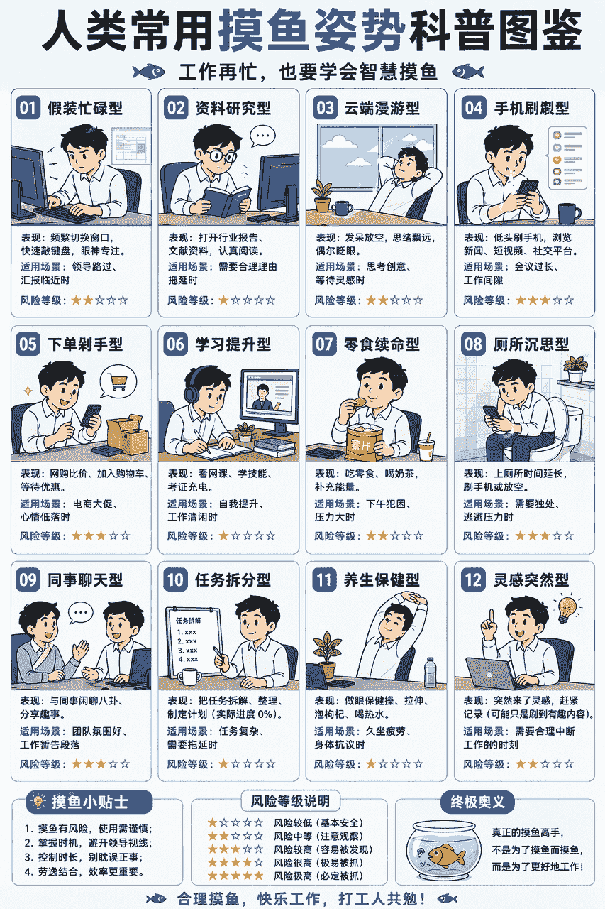

> 给我生成一份超高热量食物的热量组成分析图，你自己以一个具体的热量很高的食物为例

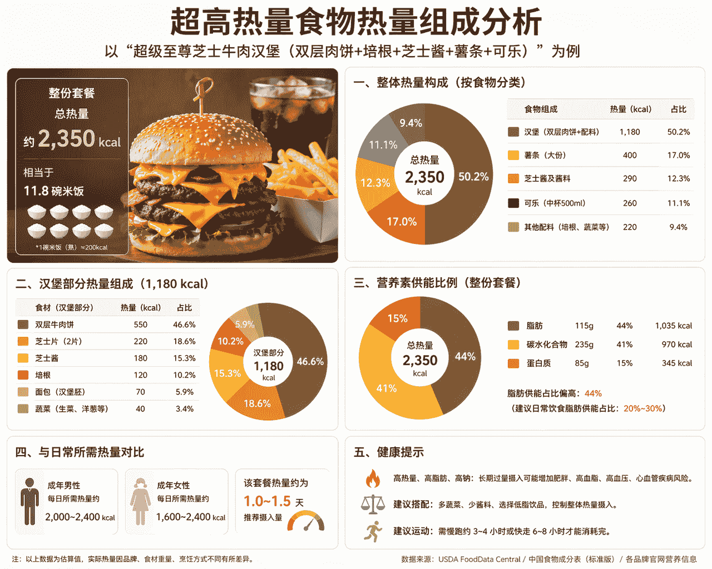

> 给我生成一张充电宝内部构造的深度分析图片

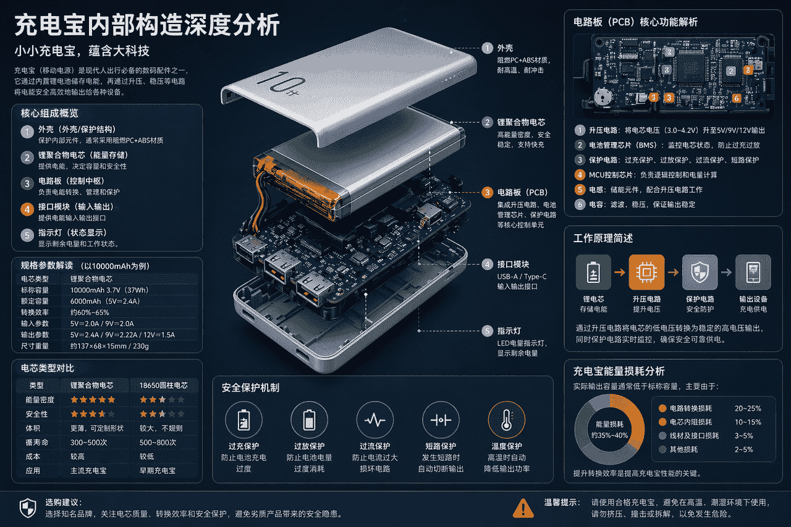

> 给我生成一张赤壁之战的历史事件分析图

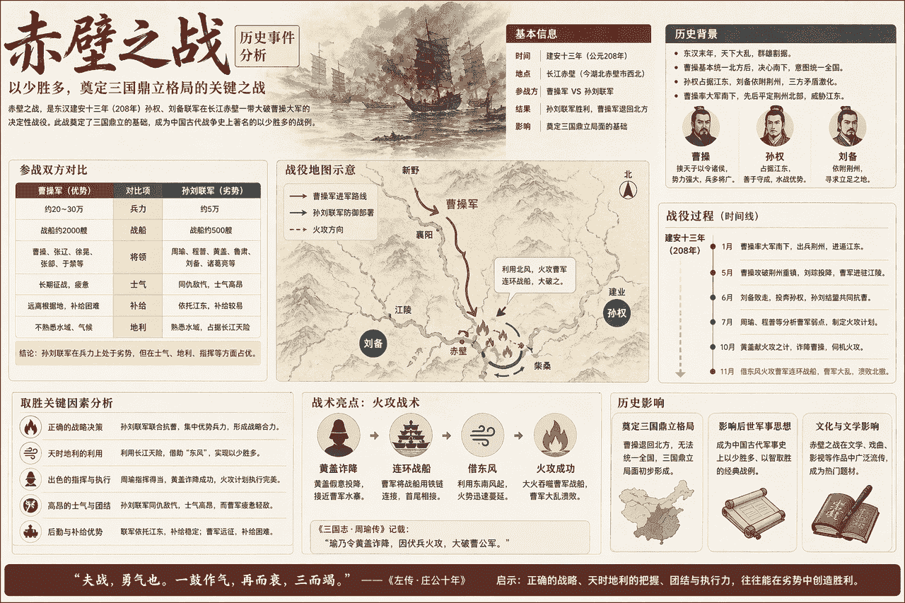

> 给我用一只三花猫设计一个动画IP形象，3：4图片比例，要很风格化，很有艺术风格，不要太AI感

> 给我用这个小猫的IP形象周边产品设计，潮流文创风格。以小猫的花色为主色调，搭配可爱图案。涵盖手机壳、帆布包、手提袋、抱枕、眼罩、贴纸、保温杯、遮阳帽、雨伞等周边。这些ip周边有序整齐的排列放置在几层黄色台阶上，处在一个黄色空间内，台阶的最上面一层只放置一个巨大的抱枕周边，营造轻松愉悦、充满潮流感的氛围，图片比例3:4

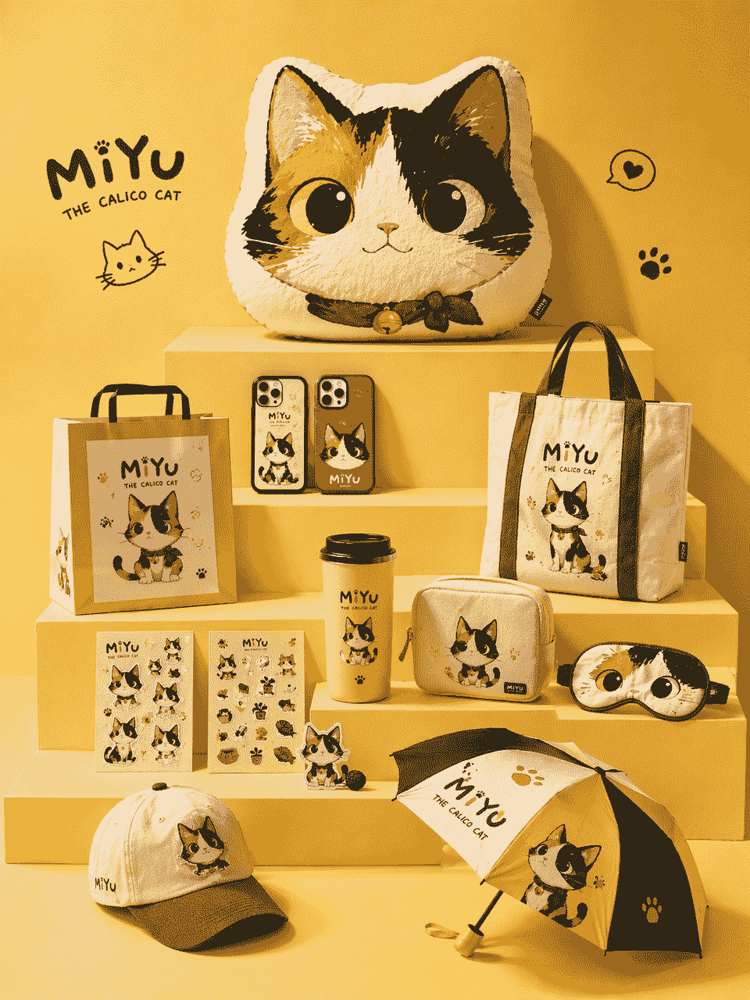

> 给我画一张图，是古早 🐧 空间非主流主页的那种图。要有那种非主流的感觉

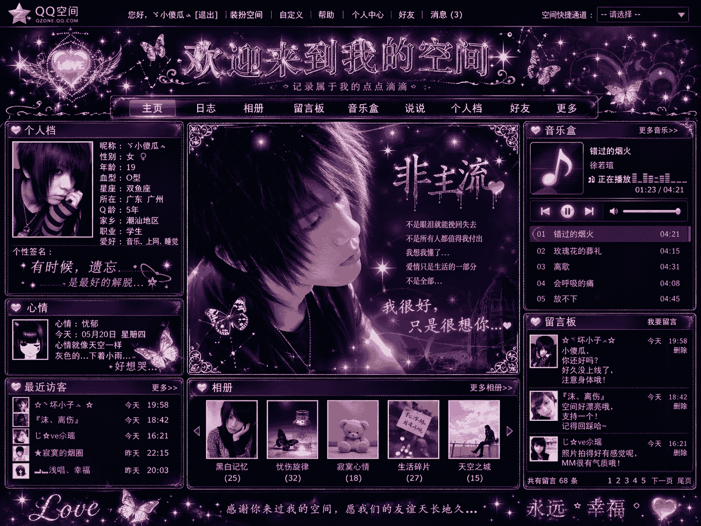

> 给我画一个以前🐧空间里🐧农场的游戏页面

> 生成古早4399小游戏网站首页图

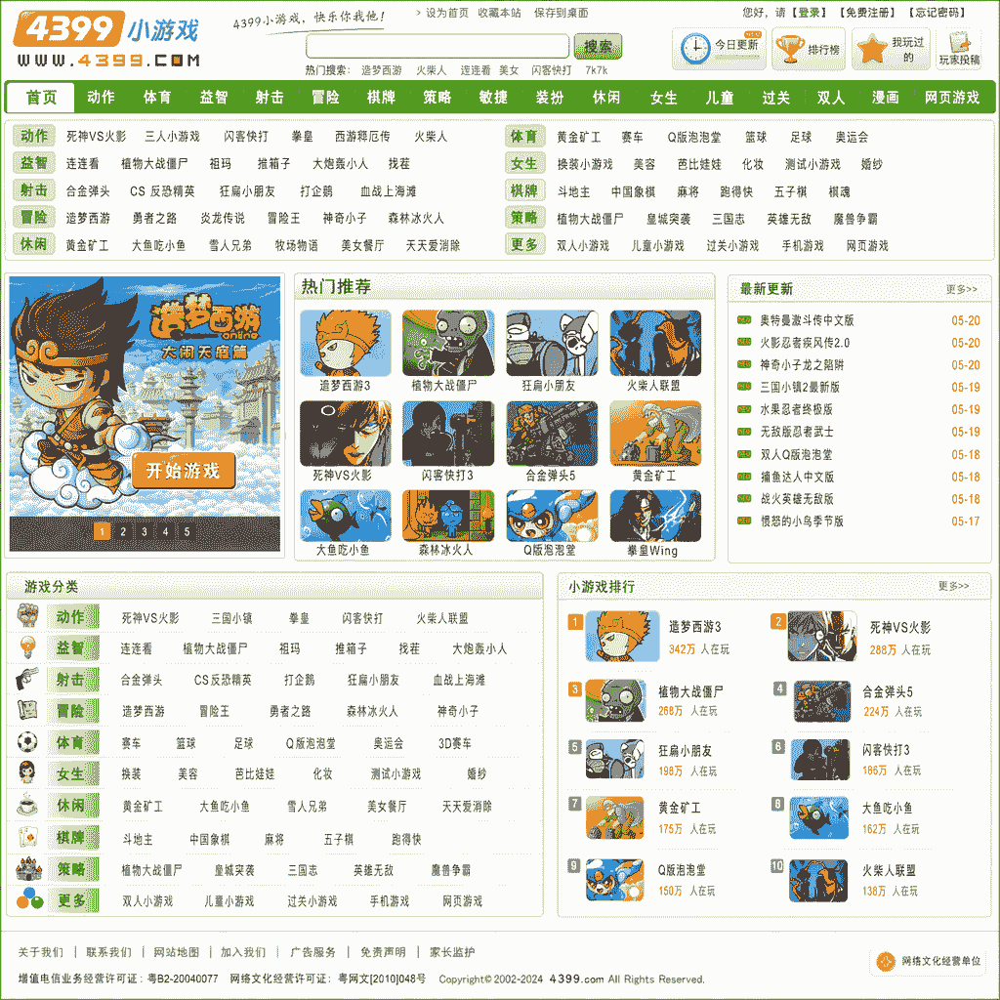

> 一张餐饮品牌开业促销海报，文字很多，还要保有品牌审美。

>

> 画面要求

> 整体为现代东方风，背景用暗红、米白、墨黑配色，加入局部器皿、餐盘、竹影、金属印章质感。中间可以放主打菜的精致摆盘。

>

> 海报文字内容

> 主标题

> 山止川行 新店开业

>

> 副标题

> 把东方风味，做得更轻、更准、更有当代感

>

> 开业福利

> 开业福利

> 全场堂食 8.8 折

> 指定套餐第二份半价

> 到店打卡送招牌冰酿青梅饮

> 晚市消费满 300 元赠限定甜品一份

>

> 主打推荐

> 本店招牌

> 金汤花胶鸡

> 炭烤黑叉烧

> 油泼青花鱼

> 桂花酒酿冰

> 山野菌菇焖饭

>

> 营业信息

> 营业时间

> 11:00 至 14:00

> 17:00 至 22:00

>

> 门店地址

> 杭州市天目里东区 1 号楼 2 层

>

> 提示文案

> 建议提前预约

> 周末午晚市高峰可能需排队

> 部分活动菜品不参与折扣

> 详情请咨询门店服务人员

>

> 重点测试

> 餐饮海报的信息密度、促销内容清晰度、菜品排布与品牌感统一。

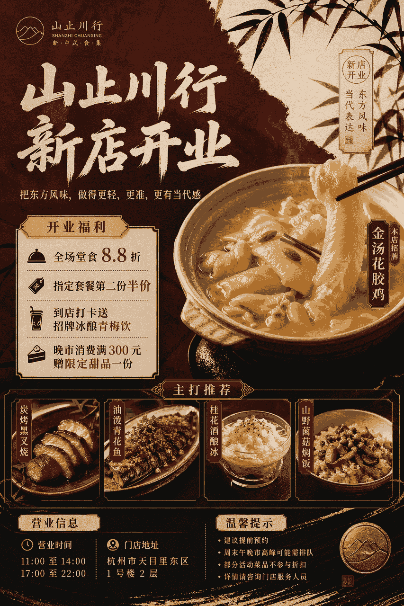

> 一张电影节官方排片海报，需要极多文字和清晰表格感。

>

> 画面要求

> 整体偏黑白红配色，结合胶片颗粒、电影画框、放映厅氛围和现代排版。设计上要像真正电影节物料，而不是普通表格。

>

> 海报文字内容

> 主标题

> 2026 青年作者电影周

>

> 副标题

> 用七天时间，看见一代人的影像表达

>

> 放映排期

> 4月12日

> 10:00 开幕影片 无风之地

> 13:30 单元一 城市与回声

> 16:00 导演交流场 河流尽头

> 19:30 特别展映 雨停之前

>

> 4月13日

> 10:30 新人竞赛单元 A

> 14:00 新人竞赛单元 B

> 16:30 纪录片单元 漫长白日

> 19:00 午夜展映 霓虹南方

>

> 活动信息

> 映后交流

> 主创见面

> 评审公开课

> 编剧工作坊

> 摄影指导圆桌

>

> 地点信息

> 地点

> 上海影城 1厅 2厅 5厅

> 艺术放映中心 黑匣子厅

>

> 购票信息

> 单场票 60 元

> 学生票 40 元

> 套票 299 元

>

> 备注说明

> 具体放映厅以现场电子屏为准

> 迟到 15 分钟后谢绝入场

> 部分场次谢绝拍摄与录音

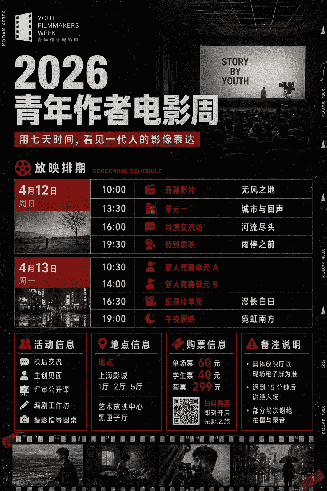

> 新中式博物馆特展海报

>

> 风格方向

> 当代东方审美，高级留白、古典材质、现代编排。不是传统古风海报，更接近美术馆级别的中式现代视觉。

>

> 画面设定

> 宣纸肌理背景，局部压印金色纹理，一件器物或一段山石轮廓作为主视觉。配色以米白、黛青、墨黑、暗金为主。

>

> 海报文字内容

> 主标题

> 器以载意

>

> 副标题

> 东方器物美学与当代生活特展

>

> 展览介绍

> 从器形、材料、工艺到日常使用方式，器物从来不只是功能的容器，它同时承载着时代的审美、人的节奏与观看世界的方法。本次展览尝试从日用之器、文人之器、空间之器三个维度，重新理解东方设计中被忽略的静与准。

>

> 展览单元

> 第一单元 日常之器

> 第二单元 书房与案头

> 第三单元 材料的温度

> 第四单元 东方器物的当代转译

>

> 展期信息

> 2026年5月10日 至 2026年8月2日

> 周二至周日 10:00 至 18:00

> 周一闭馆

>

> 地点信息

> 苏州东方设计博物馆 主展厅

>

> 票务信息

> 单人票 68 元

> 双人票 118 元

> 学生票 30 元

>

> 活动预告

> 策展人导览

> 器物修复工作坊

> 当代设计师对谈

> 传统工艺体验专场

> 一张美术馆艺术展导览海报，需要很多文字，但仍然显得文艺、高级。

>

> 画面要求

> 背景为浅米白纸张肌理，叠加极简建筑空间摄影和局部雕塑特写，版式偏瑞士风混合当代艺术馆海报风格。

>

> 海报文字内容

> 主标题

> 流动的边界

>

> 副标题

> 2026 城市当代艺术邀请展

>

> 本次展览邀请来自建筑、影像、装置、绘画与数字媒介领域的27位艺术家，共同讨论技术、城市与个体感知之间不断变化的边界。展览将通过四个章节展开，呈现当代视觉经验如何被重组、切分与再观看。

>

> 展览单元

> 01 看见城市

> 02 被记录的身体

> 03 数字自然

> 04 未来遗迹

>

> 展期

> 2026年6月2日 至 2026年8月21日

> 开放时间

> 10:00 至 18:00 每周一闭馆

> 地点

> 深圳当代艺术中心 3F 特展厅

>

> 单人票 68 元

> 学生票 38 元

> 双人票 108 元

>

> 策展人导览

> 每周六 15:00

> 艺术家分享会

> 6月18日 14:00

> 预约请前往官方小程序

> 轻奢香氛品牌故事海报

>

> 风格方向

> 高端生活方式品牌视觉，温柔克制、质感细腻，适合测品牌叙事型长文案海报。

>

> 画面设定

> 柔雾背景，一瓶香氛置于亚麻布、天然石材和微光之中。色调为灰粉、米白、浅棕、暗金，氛围轻柔但很精致。

>

> 海报文字内容

> 主标题

> No.07 晨雾花园

>

> 副标题

> 把一场缓慢清晨，留在空气里

>

> 香调结构

> 前调 佛手柑 白茶

> 中调 鸢尾 无花果叶 铃兰

> 后调 雪松 麝香 琥珀

>

> 卧室

> 书房

> 独处时刻

> 周末清晨

> 送礼收藏

>

> 100ml 香氛喷雾

> 限量香片礼盒同步发售

> 首发时间 2026年4月16日

>

> 线上首发

> 会员优先预约

> 限量编号发售

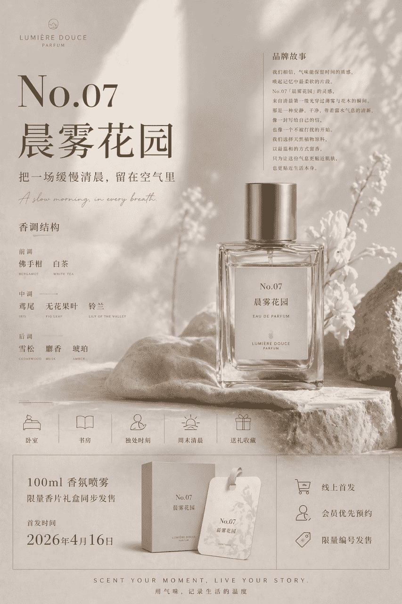

> 帮我制作一张一瓶洗发水新品上市的海报。

> 日系治愈手账类记账 App

>

> 风格方向

> 柔和、可爱、细腻、插画感、低饱和奶油色，偏日系生活方式产品。

>

> 界面设定

> 设计一张记账 App 首页。顶部显示本月支出与预算进度，中间是按类别统计的圆环图和每日支出列表，底部是四个主导航栏。界面里加入小插画、圆角标签、轻量贴纸元素、柔和阴影、手写风标题装饰，让它像一个很有陪伴感的生活记录产品。

>

> 重点测试

> 温柔系 UI 配色、图表融合、功能与装饰平衡、轻量插画组件协调能力。

>

> 为什么值得测

> 很多模型做可爱系 UI 会幼稚，或者失去产品感。这个 case 很容易看出审美控制力。

> 苹果系极简天气 App 首页

>

> 风格方向

> 极简、通透、克制、高级留白，接近高端系统原生应用的质感。

>

> 界面设定

> 设计一张手机竖屏天气 App 首页。顶部是城市名和实时天气，中央是超大号温度和天气状态，下方有未来 24 小时趋势卡片、未来 7 天天气列表、空气质量卡片、紫外线卡片、日出日落信息卡片。背景是模糊天空渐变，有轻微玻璃拟态效果。所有模块都要非常整洁，像系统级产品。

> 运动手表健康数据总览页

>

> 领域

> 健康硬件

>

> 风格

> 苹果系极简运动风，浅色背景，大量留白，荧光绿或活力橙作为强调色

>

> 页面内容

> 一个智能手表配套 App 的健康总览界面。页面显示今天的步数、心率、睡眠、训练时长、消耗卡路里、压力指数、血氧。每个模块都有不同的可视化组件，比如圆环进度、折线图、柱状图、小型趋势卡片。顶部是日期和用户头像，底部是健康、训练、设备、发现四个 tab。

> 请生成一张高保真、可商用感极强的移动端外卖平台 App 首页，风格为现代中文互联网平台 UI，要求界面真实、完整、信息丰富，像一款已经上线的大厂外卖 App 首页，不能只是概念图，必须有真实可用的界面结构和成熟的产品设计感。

>

> 整体风格要求

> 浅色主题，干净明亮，高级且有秩序感

> 主色调为温暖的橙色、奶油白、少量浅灰和深色文字

> 界面要有真实中文排版，文字清晰稳定，不能乱码

> 设计语言接近成熟的本地生活平台，卡片圆角自然，阴影轻，层级清楚

> 整体要让人一眼看出这是外卖平台首页，商业气息强，但不廉价

> 要有真实手机状态栏，时间、电量、信号、Wi Fi 图标完整

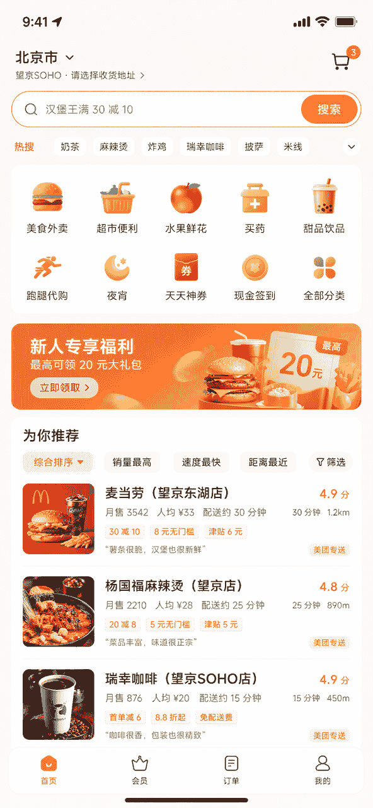

> 设计一个AI 助手的工作台UI界面，文字清晰稳定，你自己设计产品名字，

> 设计一张桌面端 AI 助手工作台。左侧是会话历史和工作区导航，中间是聊天区域，右侧是文件预览、工具调用结果、日程、待办、知识库引用。顶部有模型切换、插件状态、任务进度和协作入口。整体要像未来办公系统，模块非常多，但必须清晰、有秩序、可操作。

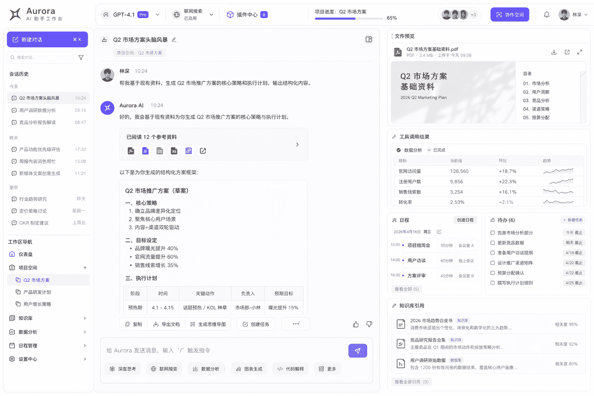

> 一款高品质二次元 RPG 的十连抽结果页，竖屏。中央是十张角色或武器卡牌展开，其中 1 张为超高稀有度角色，带更强光效和特殊边框。下方显示重复角色转化为碎片的提示，右侧有本次获得资源统计。顶部有抽卡池名称、剩余保底次数、限时结束倒计时。底部有再抽一次、确定、分享、前往养成按钮。背景要保留高端抽卡动画刚结束后的光粒子与能量残影感。

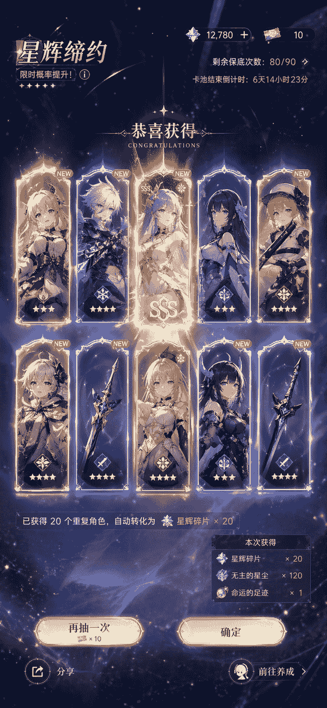

> 生成一张高保真女性向 3D 恋爱手游主界面 UI 设计稿，竖屏 9:16，未来都市浪漫科幻风，高级、细腻、梦幻、沉浸感强。画面中央是一位原创英俊男性角色的高质量 3D 立绘，穿轻科幻都市制服，气质温柔克制，站在未来城市夜景和高科技私人空间前。界面为完整手游首页，包含顶部玩家头像、等级、体力、金币、钻石、邮件和设置图标，左侧有任务追踪、签到奖励、限时活动和新人福利，右侧有剧情、约会、讯息、羁绊、活动、抽卡等快捷入口，中部有主线剧情卡片“第4章 星轨回响”和互动气泡“今天想先去约会，还是继续任务？”，底部导航栏包含首页、剧情、角色、祈愿、商城、我的。整体 UI 采用半透明玻璃质感卡片、细腻发光按钮、银白、深蓝、淡紫配色，中文文字清晰可读，图标统一精致，完成度像成熟女性向恋爱手游正式产品界面。

> 生成一张高保真女性向 3D 恋爱手游主界面 UI 设计稿，竖屏 9:16，未来都市浪漫科幻风，高级、细腻、梦幻、沉浸感强。画面中央是一位原创英俊男性角色的高质量 3D 立绘，穿轻科幻都市制服，气质温柔克制，站在未来城市夜景和高科技私人空间前。界面为完整手游首页，包含顶部玩家头像、等级、体力、金币、钻石、邮件和设置图标，左侧有任务追踪、签到奖励、限时活动和新人福利，右侧有剧情、约会、讯息、羁绊、活动、抽卡等快捷入口，中部有主线剧情卡片“第4章 星轨回响”和互动气泡“今天想先去约会，还是继续任务？”，底部导航栏包含首页、剧情、角色、祈愿、商城、我的。整体 UI 采用半透明玻璃质感卡片、细腻发光按钮、银白、深蓝、淡紫配色，中文文字清晰可读，图标统一精致，完成度像成熟女性向恋爱手游正式产品界面。

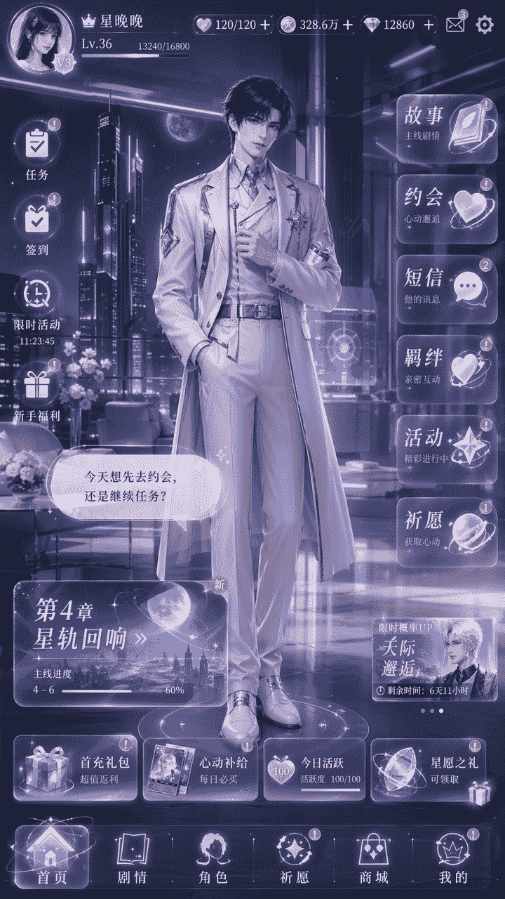

> 一款中世纪幻想 MMORPG 的背包仓库页，横屏 16:9。左侧是角色半身立绘与当前穿戴装备栏，包括头盔、护甲、武器、副手、饰品、鞋子。中间是 10 乘 6 的高密度物品格子仓库，包含不同稀有度边框、数量角标、锁定图标、新获得标记。顶部有筛选标签，武器、防具、材料、任务物品、消耗品、时装。右侧是当前选中物品详情，显示名称、战力、词条、套装效果、可出售价格、耐久度、强化等级、角色对比箭头。底部有整理、拆解、出售、批量选择、扩容、切换仓库页签。

> 一款高端动作游戏的 Boss 战实时战斗 HUD，横屏。背景是一个巨型古神 Boss 战场景，Boss 占据上半区域。顶部中央是 Boss 名称、三段式超长血条、阶段标记。左上角是玩家生命值、法力值、怒气值，右上角是小地图和战斗倒计时。底部右侧是技能轮盘，包含 4 个主动技能、闪避、终极技、药剂。底部中央有武器切换与连击数。左侧是 4 人队友状态栏。屏幕中有飘字伤害、弱点破坏提示、地面预警圈、机制播报。

> 一款开放世界奇幻冒险游戏的世界地图页面，横屏。大地图占据 70% 画面，包含山脉、森林、沙漠、雪原、港口、废墟、地下入口等区域。部分区域已探索，部分区域被半透明迷雾覆盖。地图上密集分布传送点、主线任务、世界 Boss、矿点、隐藏宝箱、限时事件图标。右侧是区域信息卡片，显示区域名称、探索度、已收集宝箱数、支线完成数、当地天气和推荐等级。左下角有图例筛选，右下角有导航追踪与快速传送按钮。

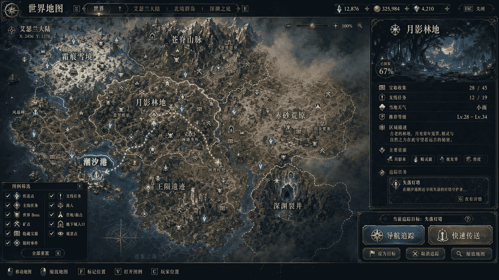