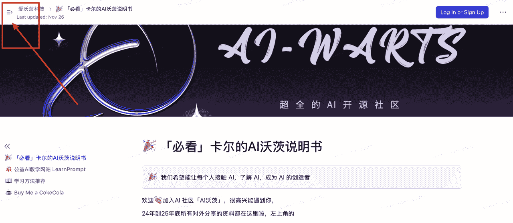
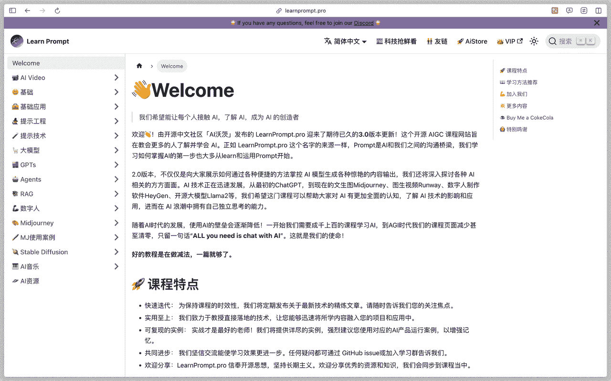
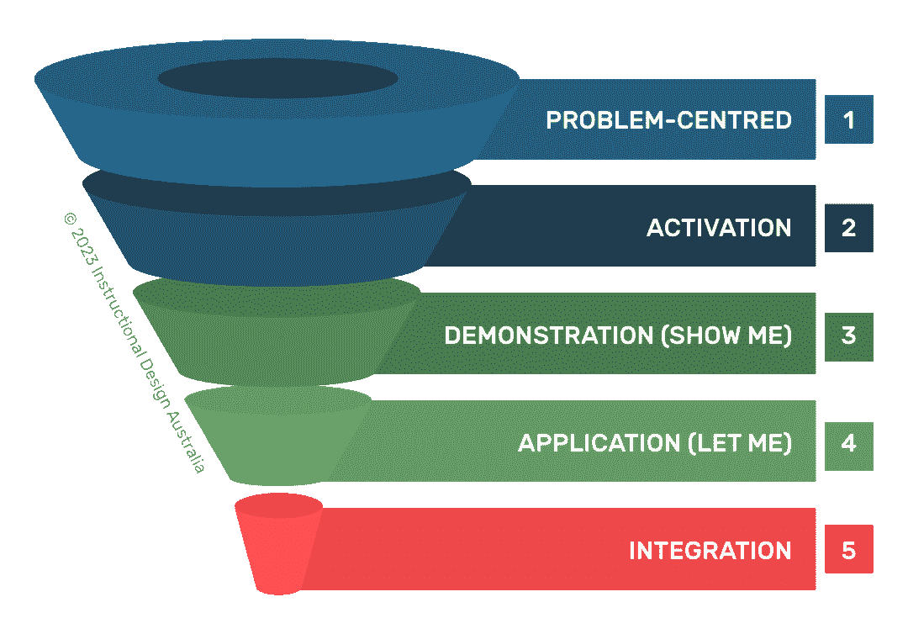
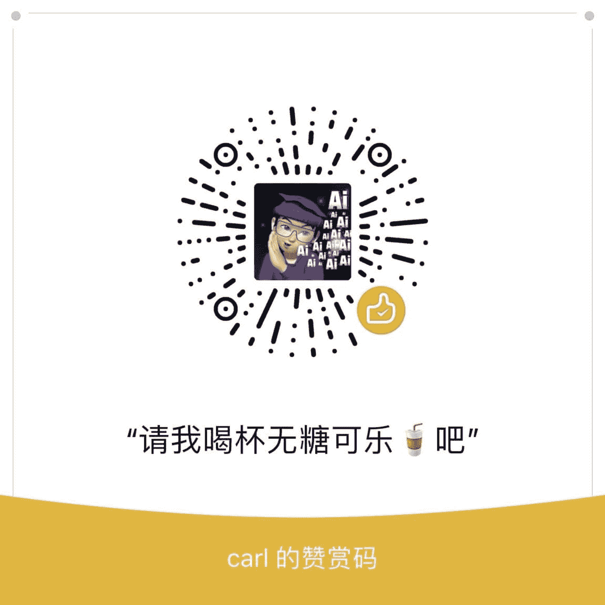

# 卡尔的AI沃茨

# 「必看」卡尔的AI沃茨说明书

> 来源：[https://aiwarts101.feishu.cn/docx/B3jmdr43DovcErxSWVMcFqcrnYv](https://aiwarts101.feishu.cn/docx/B3jmdr43DovcErxSWVMcFqcrnYv)

> 我们希望能让每个人接触 AI，了解 AI，成为 AI 的创造者

欢迎👏加入AI 社区「AI沃茨」，很高兴能遇到你，

**24年到25年底所有对外分享的资料都在这里啦，如图打开左上角的目**录，往下滑就能看到最新的，后面会加上目录和时间轴，也可以直接加我好友线下催更！！

+   [**公众号**](https://mp.weixin.qq.com/s/OAeFH-pSZNskAKEgg3TsPA)：卡尔的AI沃茨（公众号AI自媒体连续9个月前10）

+   **海外版 X ：**[**@aiwarts**](https://twitter.com/aiwarts?s=21&t=X4Wyu-b0lnJmwwLh9WXr7Q)（24小时在线，分享好玩的AI科技资讯）

+   **视频号 & 抖音号 &  **[**小红书**](https://xhslink.com/m/7FvSPc7wIDG)** & **[**B站**](https://space.bilibili.com/1820008345?spm_id_from=333.1007.0.0)：卡尔的AI沃茨（AI工具合集 & 超全操作指南）

+   [**小红书**](https://www.xiaohongshu.com/user/profile/5b003bce11be10430bf33433?m_source=pinpai)：阿汤AI搞事儿｜AI视频 & 画风壁纸 & 头像分享

中间是公众号👇商务合作🤝也可以直接加我

海外版我还有两个新号，刚刚起步会不定期发福利哦！

[youtube](https://www.youtube.com/@aiwarts101)

[ins](https://www.instagram.com/carllee2077)

# 💥 公益AI教学网站 LearnPrompt

账号和API问题不用担心，我们也有了小铺（[有号Friends）解决大家的账](https://www.learnprompt.pro/aiMarket)号问题：https://www.learnprompt.pro/aiMarket

# **📖 学习方法推荐**

推荐 David Merrill 教授提出的“首要教学原理”：

+   **原则一**：以问题为中心 —— 当学习者致力于解决现实世界的问题时，就会促进学习。

+   **原则二**：激活 —— 当现有知识被激活为新知识的基础时，学习就会得到促进。

+   **原则三**：示范 —— 当向学习者展示新知识时，就会促进学习。

+   **原则四**：应用 —— 当学习者应用新知识时，会促进学习。

+   **原则五**：整合 —— 当新知识融入学习者的世界时，学习就会得到促进。

# ☕️ Buy Me a CokeCola

如果您喜欢我们网站上的内容，并且愿意支持我们继续创作更多精彩内容，您可以向我们的“可乐”基金捐赠任意金额，感谢大家的每一杯可乐～！

