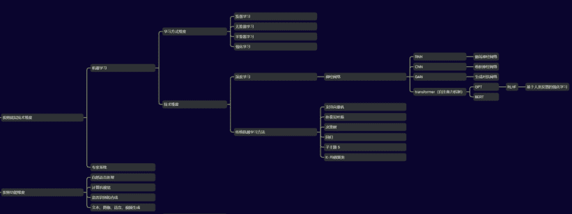
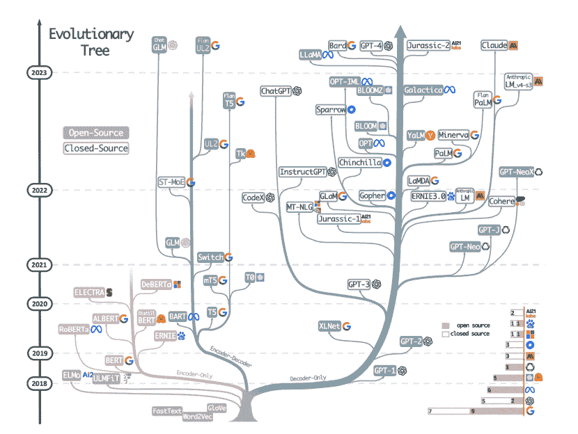

# 1.1 AI底层技术原理

> 来源：[https://jlqyxzzvbk.feishu.cn/docx/AStpdlC70oIIndxyhn1cUvvknwd](https://jlqyxzzvbk.feishu.cn/docx/AStpdlC70oIIndxyhn1cUvvknwd)

### **AI****技术分类**

想要深入了解AI底层逻辑，我们先看下AI技术分类，按照技术维度划分，可以划分为机器学习和专家系统，机器学习分支按照学习方式维度可以划分为监督学习、无监督学习、半监督学习、强化学习，机器学习按照技术维度可以划分为深度学习分支和传统机器学习方法，传统机器学习方法包括支持向量机、朴素贝叶斯、决策树等等，深度学习分支里主要是人工神经网络技术，包括大家可能熟悉的卷积神经网络CNN、循环神经网络RNN、生成对抗网络GAN，以及2017年谷歌提出的新型神经网络技术transformer，ChatGPT中的T正是这个transformer，包括现在和gpt对标的谷歌BERT技术也是基于transformer技术演化而来的。

### **ChatGPT****能力及技术发展路线**

我们下面看一下chatgpt的技术发展路线，2017年谷歌发明了Transformer技术，在transformer的基础上OpenAI在2018年推出了GPT1模型，GPT1模型有1.2亿的的参数，紧接着2019年推出GPT2模型，GPT2模型有15亿参数，2020年就推出了重要的包含有1750亿参数的GPT3模型，在GPT3的基础上分化了专注文本指令预训练模型InstructGPT和关注代码预训练模型Codex，后面在二者基础上融合微调并加入基于人类反馈的强化学习技术，2022年底推出了火爆全网的ChatGPT，然后再23年3月推出万亿参数模型GPT4。

**ChatGPT****能力**

+   知识量足够多（广度、深度）

+   自然语言理解能力

+   自然语言的生成能力

+   具备一定的推理能力

+   支持多模态（GPT4）

**技术发展路线**

