# ChatGPT注册及使用教程

> 来源：[https://jlqyxzzvbk.feishu.cn/docx/BMYIdYVUkoXVgUxaS8VcF4Ownnc](https://jlqyxzzvbk.feishu.cn/docx/BMYIdYVUkoXVgUxaS8VcF4Ownnc)

# ChatGPT使用注册下载使用教程

## 账号注册

**ChatGPT****注册教程（完整指南）**

### 1、进入注册

打开ChatGPT的官方网站，链接为 [chat.openai.com](https://link.juejin.cn/?target=https%3A%2F%2Fchat.openai.com%2F) ，然后点击【Sign Up】进入下一步。

如果页面无法正常显示，需要更换其他的网络节点，或者清理下浏览器cookie再次尝试。

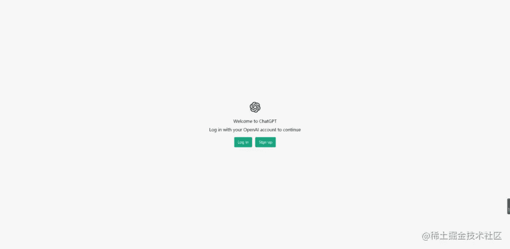

### 2、邮箱注册

注册方式为邮箱注册，可以用微软帐号或者谷歌帐号登录，微软账号或者谷歌账号好像不需要验证，国内或者其他邮箱地址都需要进行验证（比如QQ邮箱是需要验证的）。

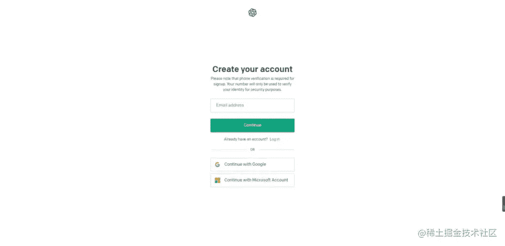

### 3、填写姓名信息

邮箱通过后，会提示你输入姓名，按照要求进行输入即可。如果显示该IP地址注册数量过多，则需要更换节点（更换节点时，无需对浏览器进行重启，刷新页面即可）。

### 4、验证手机号（重点！！！）

随后将会进入手机验证的环节，记住：这里不能选择国内的手机号，国内的手机号无法进行注册。

如果是只想体验一下产品的朋友，可直接在某海鲜市场购买服务，实时帮你接收验证码，非常快速。动手能力强一些的朋友，可以通过虚拟接码平台进行接收验证码。

接码平台推荐使用毛子的 sms-activate.org 这个平台，具体操作如下：

1）进入 SMS-Activate是在线接受短信的虚拟号码服务 首页，选择右上角【注册】按钮，在弹出的窗口中继续选择【注册】按钮：

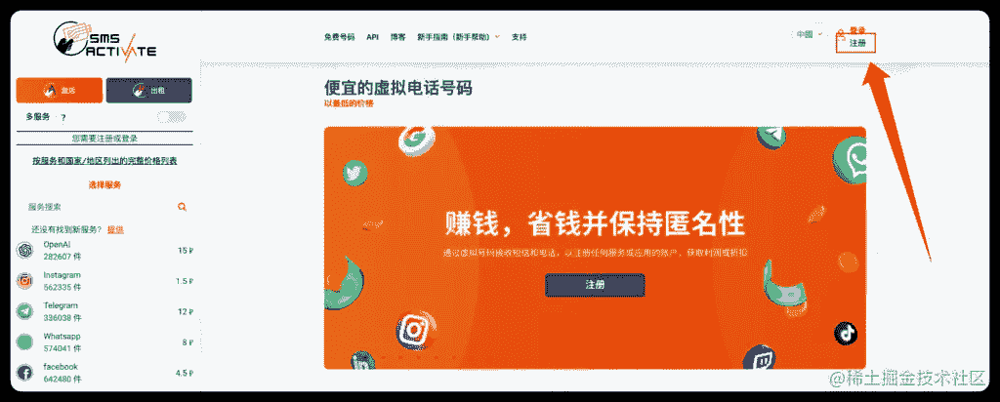

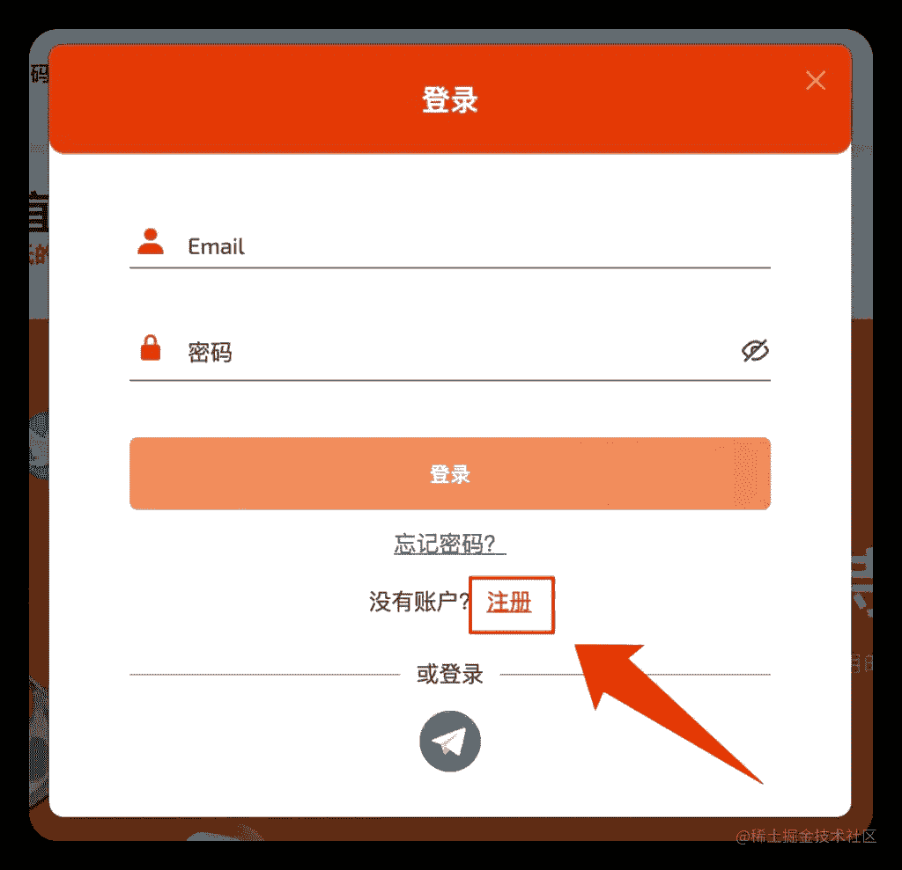

2）使用邮箱注册（不建议用国内的邮箱，避免收不到问题，最好是Gmail之类的），密码长度在8位以上且必须包含拉丁字母和数字，至少一个大写字母。

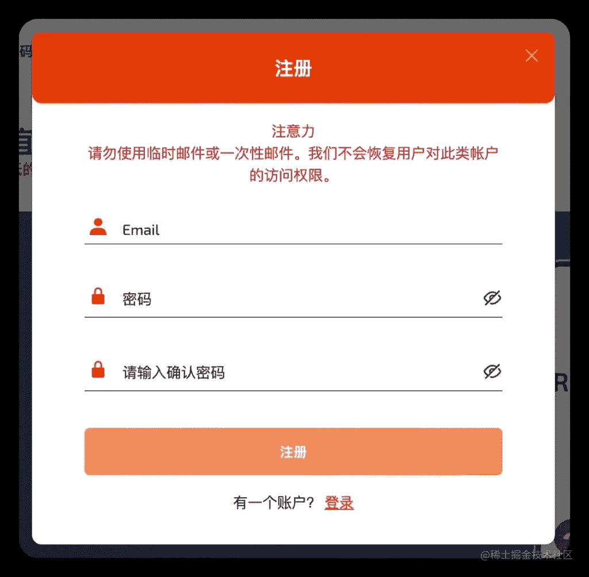

3）输入信息后，点击下方【注册】按钮，顶部会有提示“我们怀疑你是人类。请通过机器人验证”的字样（吐槽下，别的验证都是怀疑是机器人需要验证，这里是怀疑是人类需要验证，真的是……），不用任何操作，稍等一下就好（不超过5秒）。

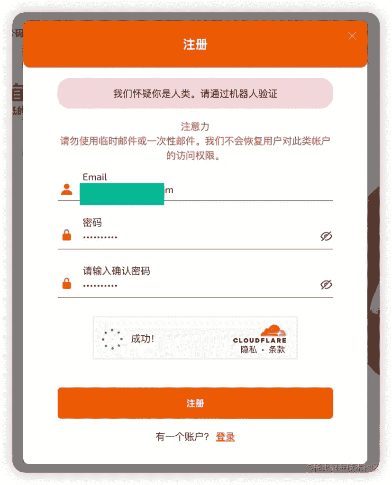

4）验证成功后，看到地步显示绿色钩状的“成功”，再次点击【注册】按钮。

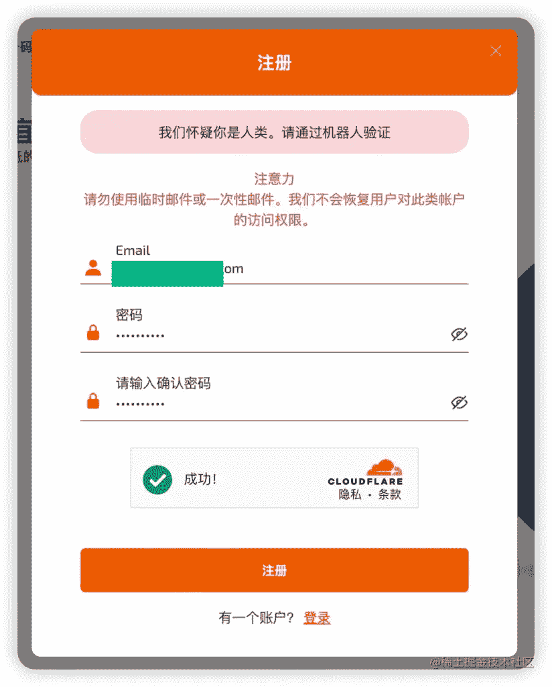

5）点击【注册】后，会自动清空注册的邮箱密码，然后提示你去看邮件。

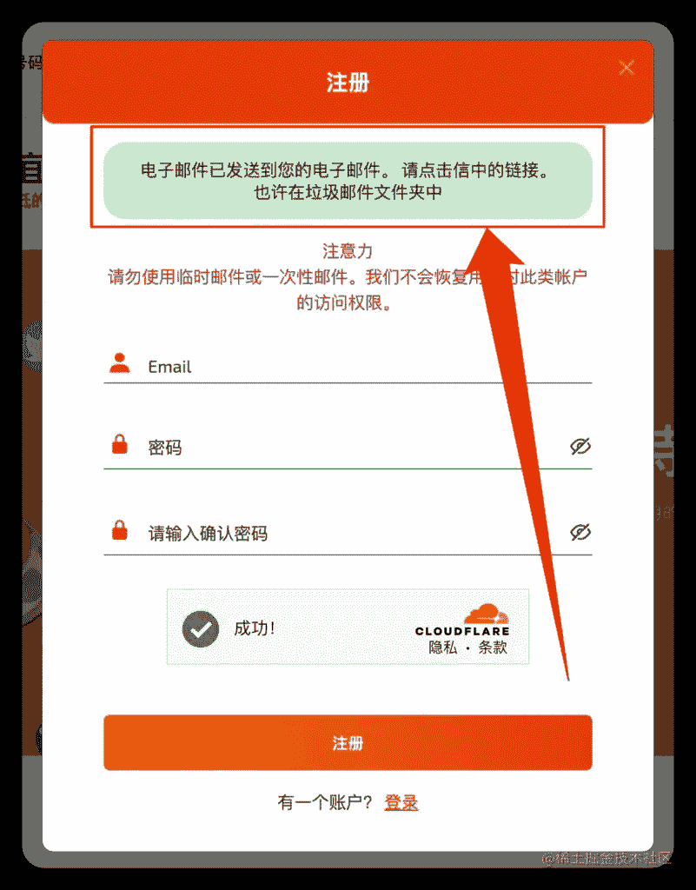

6）登录你的邮箱，然后你会收到一封标题为《确认电子邮件来注册SMS-Activate账户》这样的邮件，点击邮件中的【确认】按钮：

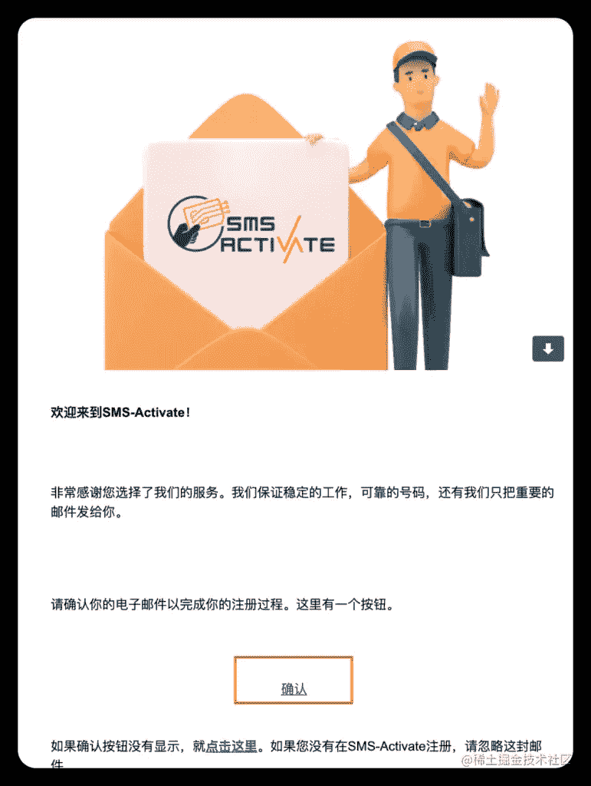

如果收件箱找不到，看一下垃圾箱或者黑名单/规则之类是不是过滤掉了。如果实在没有，建议换一个邮箱试试。

7）确认帐号注册成功后，登录平台，不过帐号还需要充值才能使用，可以使用支付宝充值。还是右上角，选择【余额】，然后选择【充值】按钮：

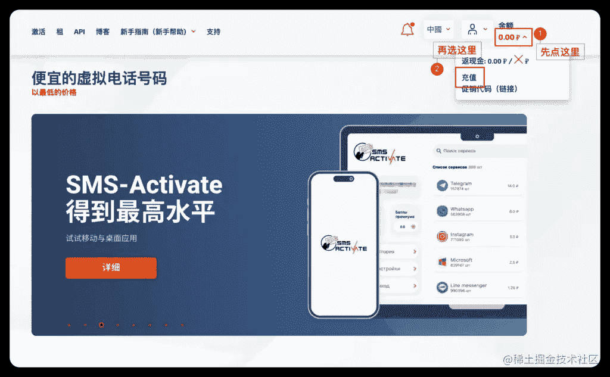

充值是充入美元，使用的是算卢布，具体原因大家自己发散～

8）渠道类型上，有对应银行卡的同学可以选择银行卡，没有咱就继续往下滑，选择支付宝：

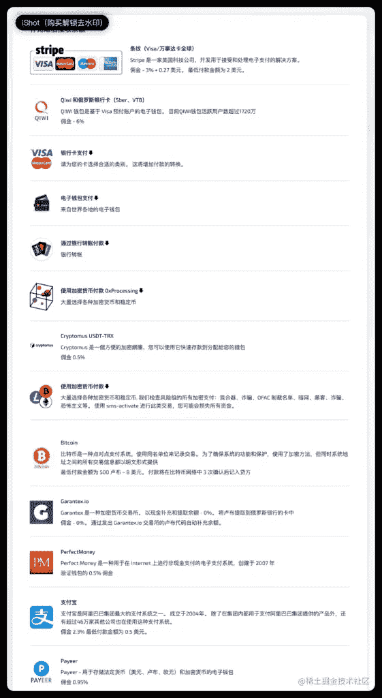

9）在支付页面上，应付金额填入1，充1美元，然后点击【支付】按钮，在弹出的支付宝页面扫码付款哈（这里我就不截图了）：

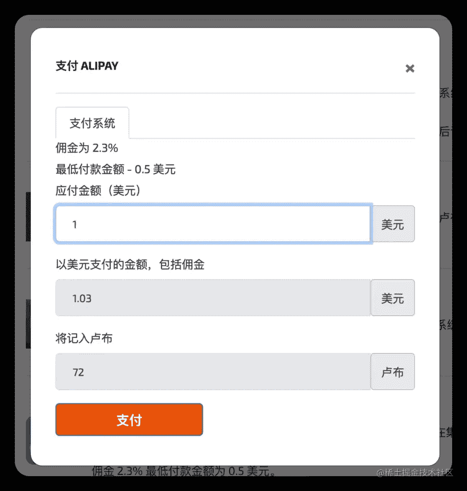

付完款后，按当天的汇率，1美元能换72卢布这样，然后一个号码好像是15卢布，也就是大概可以注册4次这样。

10）充值完成后，注意看个人页面右上角的余额有没有变化。然后看左侧，找到“openAI”这个，点击展开（如果没有，在选择服务-服务搜索里直接搜索一下）：

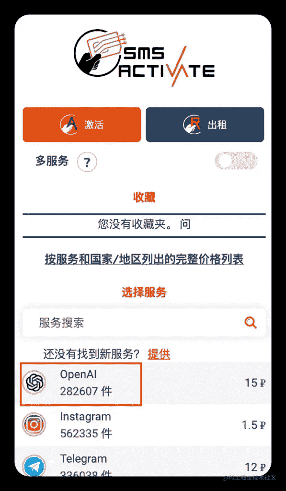

11）在展开的列表里，姓名随便输一个，第二个是加载方式随便选，然后打开【号码验证】的开关：

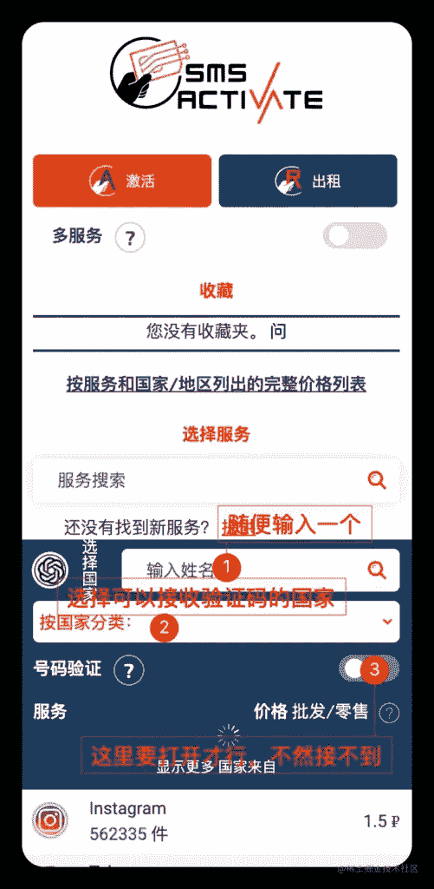

12）接着，选择手机号码的归属地，哪个便宜买哪个。选好后直接点击对应国家后面的购物车图片即可：

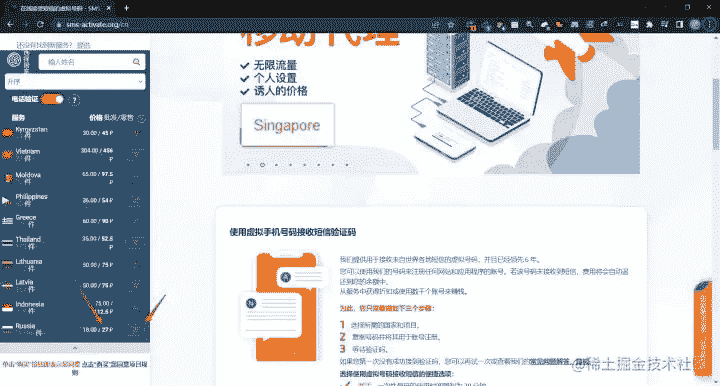

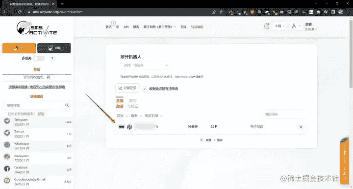

13）如果确认这个手机号可以使用，那么点击激活。激活后返回到ChatGPT的页面，填入对应的手机号码，页面会自动显示出收到的短信。

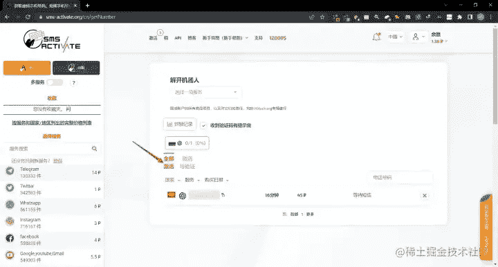

注意，这里显示的号码是包含国家代码的。比如美国手机号+19784348561，这里显示为19784348561，你在网站上填写手机号时，需要去掉前面的 1 这个国别代码。另外在接收验证码时，建议使用低价的印尼等手机号，印度经常挤爆收不到；如果长时间没有收到验证码，可更换成其他区域尝试。

重点是：在手机验证页面，一定要注意选择正确的国家（注意国旗）！一定要注意选择正确的国家！一定要注意选择正确的国家！

### 5、注册完毕

就可以自由自在的使用ChatGPT了。

## APP下载安装

### IOS

自从ChatGPT大火以后，一直以来大家使用ChatGPT都是通过网页版来使用的，对于一些想要在手机上使用的网友来说，确实非常不方便。不过，就在2023年的5月18日，ChatGPT官方宣布，在美国AppStore正式上架APP版本，提供给大家下载。

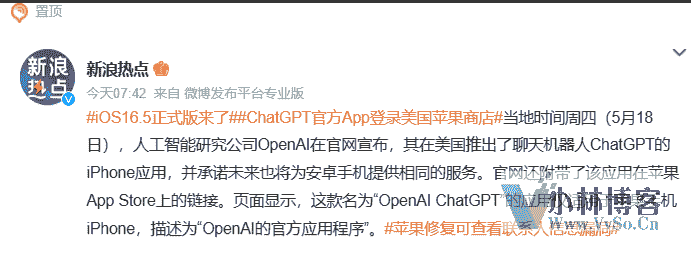

大家注意，官方说的是，在美区上架了，也就是说，除了美区，别的国家也是无法下载的。比如说，国内的网友，使用的国内AppStore，也是无法搜索下载的。

针对想在手机上使用ChatGPT的网友，今天，小编来做一篇教程，来教大家进入美区AppStore，成功下载安装ChatGPT手机版！

**ChatGPT****苹果手机怎么下载？**

其实，苹果手机想要下载ChatGPT方法非常简单，我们只需要在AppStore里面登录一个美国苹果ID就可以成功切换到美区，并下载ChatGPT。但是，这里要求我们要有一个美国苹果ID账号，很多网友是没有的，没有的可以找地方购买一个，或者参考下方的链接注册一个

https://quanmin.baidu.com/sv?source=share-h5&pd=qm_share_search&vid=3976083880274575042

准备好美国ID过后，我们就可以按照下面的步骤一步一步来下载ChatGPT了。

1、退出AppStore里面登录的国内ID账号，点击手机桌面的AppStore，点击右上角头像，拉到最底部，点击退出。

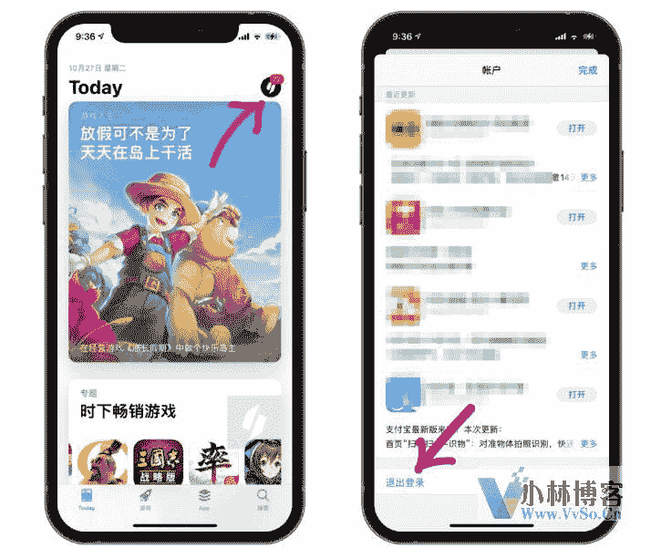

2、再到AppStore里面登录我们准备好的美国苹果ID账号，一定要按下图流程操作。

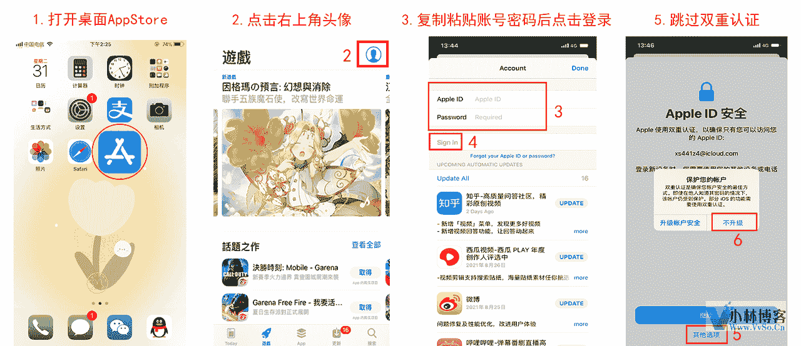

登录成功以后，点击完成，等待AppStore刷新一次，即可进入美区。

这个时候，我们再去搜索“ChatGPT”，就可以成功搜出来，点击下载即可成功下载安装。

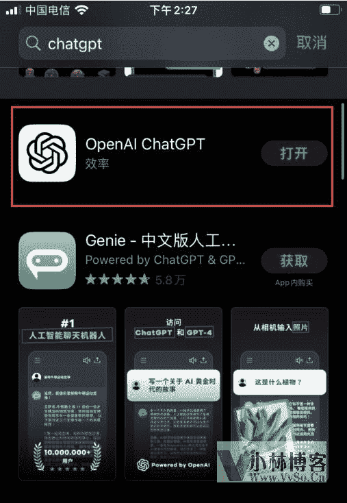

好了，以上就是小编为大家分享的，关于苹果版ChatGPT在国内的下载教程，希望对大家有帮助。这里需要提醒一下大家，下载ChatGPT只是第一步，怎么用，大家还得自己研究哈。小编知道的是，在国内使用ChatGPT，是需要加速器的，代理IP需要使用美国、日本等国外IP进行访问，才可以使用。而且，注册账号是需要国外邮箱和国外手机号的，这些大家要自己研究哈。

### 安卓

一、如何在安卓设备上下载ChatGPT应用？

在安卓设备上下载ChatGPT应用，你可以通过以下方式：

1.使用Google Play商店：Google Play商店是安卓设备上最大的应用商店，你可以在商店中搜索ChatGPT应用，然后下载安装。

2.使用第三方应用商店：有些第三方应用商店，如APKMirror、APKPure、酷安等，也提供ChatGPT应用程序的下载。

二、可能需要面临的问题及解决方案

在下载和安装ChatGPT应用时，你可能会遇到以下问题：

1.无法在Google Play商店中搜索到ChatGPT应用：如果你无法在Google Play商店中搜索到ChatGPT应用，可能是因为你的地区不支持或者Google Play商店没有ChatGPT应用程序。你可以尝试使用VPN或者使用第三方应用商店下载。

2.安装不了应用程序：如果你安装应用程序时遇到问题，可能是因为你的设备不兼容或者存储空间不足。你可以尝试清除一些存储空间或者更新你的设备系统，以解决这个问题。

**三、如何保护您的隐私？**

在使用ChatGPT应用时，您需要注意保护自己的隐私。因为ChatGPT应用需要获取用户的输入，才能够给出相应的回答。如果您使用第三方应用商店下载ChatGPT应用，应该确保这些应用商店不会泄露您的个人信息。同时，您也应该避免在与ChatGPT进行交互时，输入敏感信息。

您可以通过Google Play商店或者第三方应用商店，在安卓设备上下载ChatGPT应用。在下载和安装ChatGPT应用时，可能会遇到一些问题，例如：无法在Google Play商店中搜索到ChatGPT应用，安装不了应用程序等，需要通过VPN、清除存储空间等方法解决。在使用ChatGPT应用时，您需要注意保护自己的隐私。

## ChatGPT的玩法介绍

一、开始使用

就是这样。现在你已经知道如何使用 ChatGPT了。你可以向这个语言模型询问你可能遇到的任何迫切的问题，并看看可以得到什么样的答案。

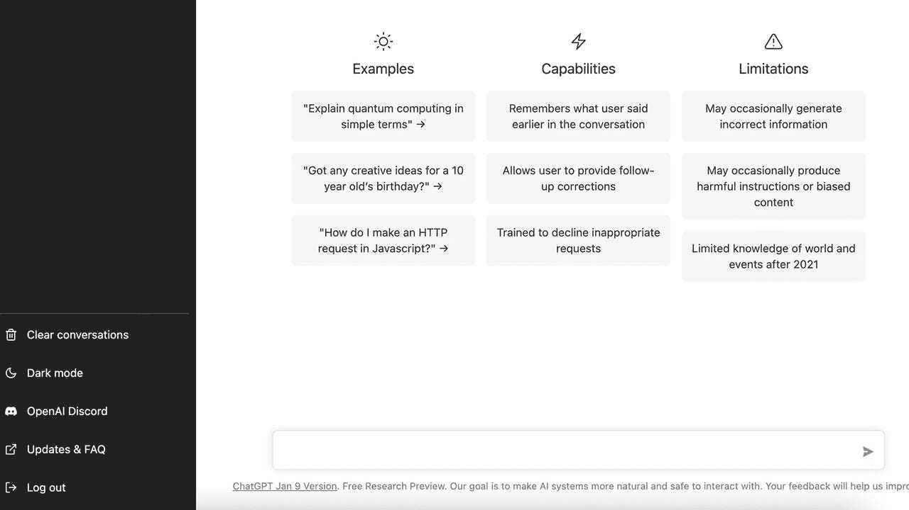

**开始使用 ****ChatGPT**** 。**

二、更多 ChatGPT 的提示示例

+   什么是量子物理学？

+   用沃尔特·惠特曼的风格写一首关于头痛的诗。

+   写一首关于一只爱跑的名叫 Speckles 的狗的乡村歌曲。

+   给我总结一下《傲慢与偏见》这本书。

+   为我的孩子写一张缺课的病假条。

**三、 常见问题解答**

**3.1 我可以用 ****ChatGPT**** 做什么？**

几乎所有你能想到的，它都能做，所以你的想象力就是极限。ZDNET团队的大卫·格维茨（David Gewirtz）曾要求 ChatGPT 为他写一个 WordPress 插件。其他人则用它来编写过恶意软件。下面是一些低技术含量的想法：

+   写一首关于[此处插入主题]的歌，并尝试添加更过的细节。

+   写一首关于[此处插入主题]的诗，同样，添加尽可能多的细节。

+   问它一些哲学问题。

+   让它总结一些想法或概念。

**3.2 如何访问 ****ChatGPT****？**

你可以通过登录 chat.OpenAI.com 来访问 ChatGPT。如果你在 OpenAI 的网站上，你还可以登录个人账户，然后向下滚动，直到在页面的左下角看到 ChatGTP，然后点击它开始聊天。

**3.3 ****ChatGPT**** 是免费的吗？**

是的，ChatGPT 目前是免费使用的。由于自然语言处理模型仍处于“学习”阶段，所以人们可以免费使用 ChatGPT。你所需要的只是一个免费的 OpenAI 账户。不过，该公司确实计划在未来推出付费计划，但目前还不清楚何时会推出。

还有一个新的选择，就是使用 ChatGPT Plus 进行无限制地访问，没有屏蔽窗口，响应速度也更快，并且至少是常规每日使用限额的两倍。使用 ChatGPT Plus 每月需要付费20美元。

**3.4 如何注册 ****ChatGPT**** ？**

要注册 ChatGPT，你所需要做的就是用电子邮件地址注册一个免费的 OpenAI 账户。

**3.5 什么是 ****ChatGPT****？**

ChatGPT 是一个大型语言模型，它使用人工智能与用户进行文本对话，感觉很自然，就像你在问别人问题一样。当你需要从一种语言翻译到另一种语言，寻找如何做某事的指示，以及生成书面内容时，类似人类的回答是非常有用的。

该语言模型和其他语言模型的多功能性，在未来有能力取代谷歌搜索，使其成为通过训练数据来持续发展的实质性创新。

**3.6 ****ChatGPT**** 是如何工作的？**

ChatGPT 使用带有人类反馈的强化学习（RLHF），通过人类示范智能地处理其环境，并通过学习所需的行为适应不同的情况。它已经接受了大量数据的训练，并通过用户提供的人类知识持续学习，使其能够就各种各样的主题给出有根据的回答。

**3.7 ****ChatGPT**** 会给出错误的答案吗？**

ChatGPT 可能会提供不准确和不正确的信息，因此仔细检查它提供的信息是非常重要的。ChatGPT 总是从提供给它的文本数据中进行学习，这可能使它容易产生错误信息。OpenAI 建议用户对 ChatGPT 使用“大拇指向上/大拇指向下“按钮提供内容反馈，以便更好地改进模型。

另外，人工智能聊天机器人也没有连接到互联网，无法确定当前的日期，所以询问 ChatGPT “距离复活节还有多少天”并不能得到确切的天数。

**3.8 为什么 ****ChatGPT**** 提示说我的访问被拒绝了？**

对 ChatGPT 的访问可能因各种原因而被拒绝，在使用 VPN 时会被拒绝。如果你在登录到语言模型时收到一条消息，说你的访问被拒绝，那么这可能是以下问题之一：

+   违反 API 的服务条款

+   用户试图访问 GPT 的一个不可用版本

+   API 密钥可能无效

+   用户已超过使用限制

+   违反 OpenAI API服务条款