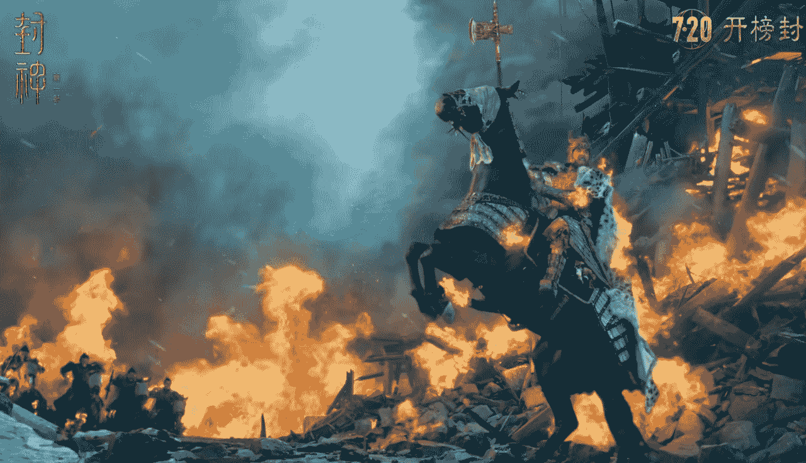
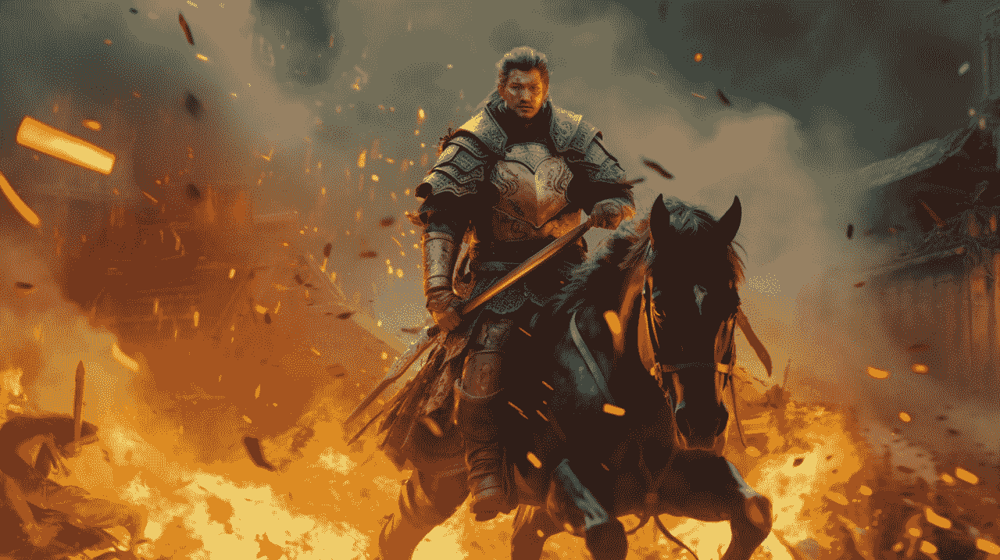
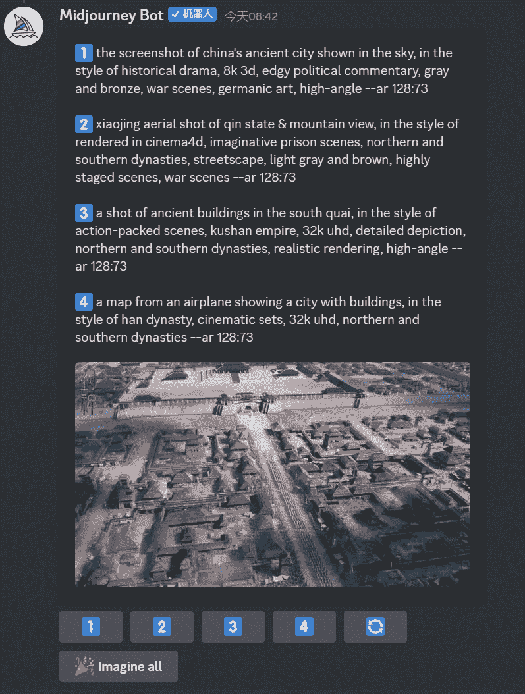
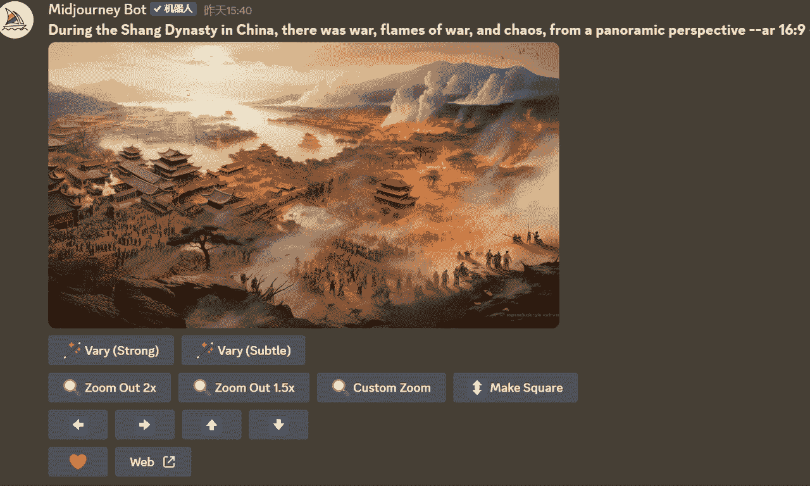

# AI制作电影预告片（封神第一部为例）

> 来源：[https://jlqyxzzvbk.feishu.cn/docx/PZA3dt0HloDQJsxVsi8cEqkxnwc](https://jlqyxzzvbk.feishu.cn/docx/PZA3dt0HloDQJsxVsi8cEqkxnwc)

### 电影预告片分镜制作

#### 主要步骤

1）文案，找到原始预告片，一般预告片有多个版本，可以直接复制一个版本，或者重新整理成自己想要的文案。

2）配图，下载或者录制预告片，并根据文案构想配图。

#### 封神第一部举例

#### 工具推荐

录屏工具：OBS

### 图生图、文生图

#### 主要步骤：

1）基于参考图生成图片，通过AI绘画Midjourney工具，基于上一步骤的配图作为参考图片，来生成新的图片。

主要--iw参数使用，权重系数范围0-2，权重系数越大与原图越相似。

2）图片最好生成系列图片，比如可以基于已经生成的图片进行左右、上下扩展，Zoomout画面扩展等。多张图片       方便出剪辑效果，另外可以方便后续为图生视频提供更多的素材。

#### 举例：

原图

AI生成图

参考提示词：https://s.mj.run/Il928GKqss8 A handsome warrior, war, flames of war --iw 2 --ar 16:9

#### TIPS：

1）如果参考图生成的效果不好，可以试用/describe命令根据图片查看反向提示词。

2）zoomout时如果画面不是自己想要的元素，或者想出现自己想象的元素，可以通过zoom custum重新修改提示词自定义图片中想要的元素，下面几个按钮非常好用，一定要学会并习惯熟练应用。

#### 工具推荐

图生图：Midjourney、StableDiffusion，MJ容易上手推荐使用。

翻译工具：百度翻译，写英文提示词用。

### 图生视频

#### 主要步骤

1）基于生成图片作为初始图生成视频，风景推荐使用RunwayGen2，人物特写推荐DID。

2）一次生成效果可能不尽人意，可以多次尝试，并逐一使用文字提示词。

#### 工具推荐

1）Runway Gen2

重点推荐，初始图片中人物和风景尽量同时出现时效果可能不尽人意，1）多次尝试 2）添加提示词精准控制

https://runwayml.com/

2）PikaLabs

参考了MJ的Discord对话方式，易用性比较好，目前还不支持2K高分辨率。

https://www.pika.art/

3）D-ID

人物特写，主要是口播视频使用，对于runway生成效果不好的人物特写可以尝试使用DID

https://www.d-id.com/

4）HeyGen

### 剪辑成片

#### 推荐工具

剪映

### 成片效果（抖音链接）

3.35 TYz:/ 复制打开抖音，看看【看见AI的作品】AI制作# 封神第一部 预告片，Midjourne... https://v.douyin.com/iJVGdmVK/

### 欢迎大家加🛰️详细交流

13858104569 看见AI

