# Vidu 提示词指南

> 来源：[https://jlqyxzzvbk.feishu.cn/docx/M4I1dx5fVofxoexn4ELcMfN4nNc](https://jlqyxzzvbk.feishu.cn/docx/M4I1dx5fVofxoexn4ELcMfN4nNc)

> 我们希望 **Vidu** 的无限可能，可以帮助实现您的个人艺术创想。为了保证更好地画面效果，**丰富而准确的提示词**对于将要创作的视频至关重要。

> 本指南提供了**基本示例结构**、**关键词**以及**风格化提示技巧**，以帮助您更好地呈现创意灵感。请谨记，这些示例仅仅只是起点，您可以自由探索和创新，发挥自己天马行空的想象。

# 一、Vidu Prompt 基本构成

## 1、提示词基础架构

> **主体/场景**——**场景描述**——**环境描述**——**艺术风格/媒介**

+ 调整句式和语序，避免主体物过多/复杂，主体物分散的句式描述；
+ 避免模糊的术语表达，尽可能准确；
+ 使用更加流畅准确的口语化措辞，避免过度文学化的叙述；
+ 丰富、准确和完整的描述才能生成特定艺术风格、满足需求的视频。

## 2、提示词与画面联想程度的说明

为了帮助你更好的地理解，让我们使用单帧图像作为最简单的例子，来向您介绍提示词与画面联想的关系。

示例图如下：

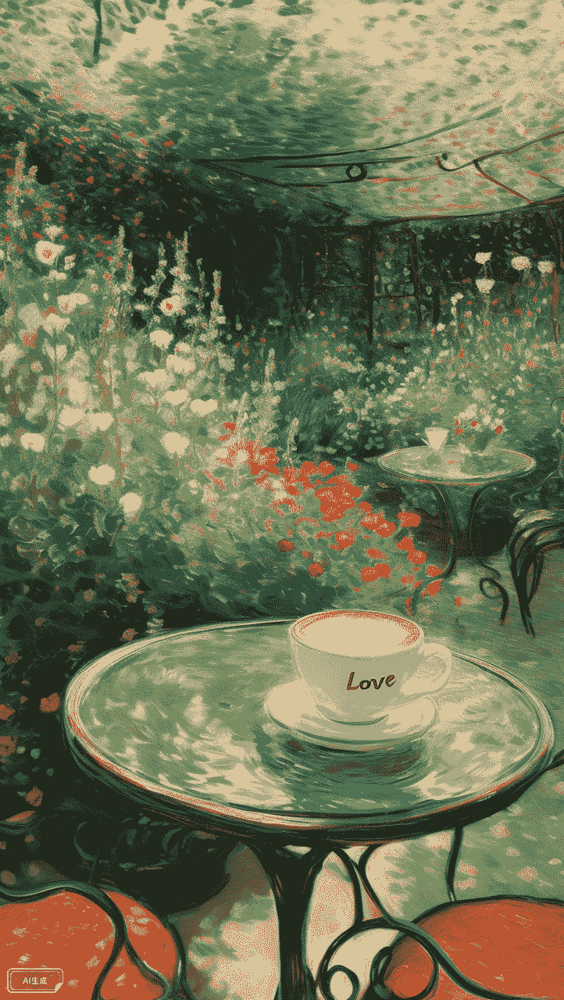

+ **基础词**：玻璃桌上的咖啡杯，杯子外面写着单词 LOVE。

+ **适度联想扩充：**花园里（具体的位置描述）的透明（材质描述）**玻璃桌上的**咖啡杯，杯子外面写着单词 LOVE，周围满是盛开的鲜花（具体的位置描述/环境描述），和煦的阳光洒满整个花园（环境描述），Claude Monet（艺术家风格），印象派风格（艺术流派风格）。

+ **联想关键点：**

1. 具体详实的位置描述/环境描述：笼统来讲就是在进行构图，可以帮助构建画面的基本呈现效果；
2. 艺术风格描述：进一步提升效果和氛围，统一画面风格。

## 3、效果示例

### 3.1 概述

当提示词遵循**主体/场景（主要指具体内容）**，**场景描述**，**环境描述**和**艺术风格/媒介**的基本结构时，可以在一定程度上提升视频生成效果。

在提示词的不同位置**重复和强化关键内容**的风格描述，可以适度提高输出风格的一致性和画面丰富程度。

### 3.2 具体示例

**以“柯基犬游泳”为例**

[a94bc656_fi.mp4](https://internal-api-drive-stream.feishu.cn/space/api/box/stream/download/all/Gh6gb1mqZoDr0PxwG6mc62hAnCc)

Capture a serene moment featuring a baby Corgi swimming gracefully in a large, sunlit pool. The underwater perspective showcases the puppy, its gentle smile illuminated by soft, golden hour lighting that filters through the water, creating a dance of light and shadow on the pool's bottom. The scene is set in soft pastel colors, enhancing the dreamlike, ethereal quality of the atmosphere. The high-resolution photography captures every delicate detail of the water's texture and the Corgi's joyful expression, creating a simple yet cinematic portrait of tranquility and innocence. This minimalist yet emotive setup conveys a sense of calm and happiness, ideal for a serene and visually captivating film sequence.

捕捉柯基犬宝宝在阳光照耀下的大泳池中优雅游泳的宁静时刻。水下的视角展现了小狗温柔的笑容，柔和的金色灯光穿过水面，在池底形成光影的舞动。场景以柔和的粉色为主色调，烘托出梦幻般的空灵氛围。高分辨率的摄影作品捕捉到了水的纹理和柯基犬欢快表情的每一个精致细节，创造出一幅简单而又充满电影感的宁静和纯真的肖像。这种简约而富有情感的设置传达出一种平静和幸福的感觉，是宁静而具有视觉吸引力的电影镜头的理想选择。

### 3.3 提示词分析

[71cbe2f0_fi.mp4](https://internal-api-drive-stream.feishu.cn/space/api/box/stream/download/all/NiptbMb63o0cv2xwdyqc5HyvnRf)

**原始提示词：**A baby corgi swims in a large pool

[a94bc656_fi.mp4](https://internal-api-drive-stream.feishu.cn/space/api/box/stream/download/all/HjAnbqx3RoDERXxNh9ScJ381nTc)

**联想提示词：**Capture a serene moment featuring a baby Corgi swimming gracefully in a large, sunlit pool. The underwater perspective showcases the puppy, its gentle smile illuminated by soft, golden hour lighting that filters through the water, creating a dance of light and shadow on the pool's bottom. The scene is set in soft pastel colors, enhancing the dreamlike, ethereal quality of the atmosphere. The high-resolution photography captures every delicate detail of the water's texture and the Corgi's joyful expression, creating a simple yet cinematic portrait of tranquility and innocence. This minimalist yet emotive setup conveys a sense of calm and happiness, ideal for a serene and visually captivating film sequence.

#### 3.3.1 “柯基犬游泳”视频生成需求

+ 温馨宁静的氛围
+ 电影画面及质感
+ 柔和的光影效果

> 基于上述的视频生成需求，按照提示词基本架构进行调整和优化，在基本的框架下对主体/场景（“柯基犬游泳）进行扩写，重点在于营造视频整体温馨纯真的电影视觉效果。
>
> 同时，为了强化效果和氛围的一致性，需要对整体氛围进行多次强调和细化，在提示词的不同位置也可以适度强调氛围提示词内容。
>
> 注：氛围提示词，可以重复进行强调和细化。如“柯基犬游泳”的提示词所示，为了整体温馨宁静的氛围，提示词内多次出现温柔、柔和、优雅、宁静等符合整体氛围的不同氛围词，以此强化整体的氛围效果。

#### 3.3.2 “柯基犬游泳”视频提示词架构

# 二、Vidu Prompt 关键词

**以“Teddy bear/泰迪熊”为主角进行风格化的效果演示，通过关键词的使用，帮助实现多种电影风格以及拍摄方式的呈现，更好地完成个人的视频生成需求。**

[116b86c5_fi.mp4](https://internal-api-drive-stream.feishu.cn/space/api/box/stream/download/all/ClDQb0BnQok39xxLMfQcqOh6nWb)

**基础提示词：**A melancholic teddy bear, dressed in rugged attire with a wide-brimmed hat and a bandolier, gazes at the camera, its lips trembling slightly as it exhales a puff of smoke. The warm glow of its cigarette illuminates its face, casting shadows that emphasize its somber mood. Its paws rest on the porch railing in a relaxed pose, but its button eyes betray a deeper sadness. As it slowly turns its head to the left, its gaze shifts to the distant horizon, lost in thought. The lighting is low, with cool blue tones contrasting the warm light from the cigarette, enhancing the mood of quiet reflection. The setting, a porch with wooden panels and a window behind it, completes the Western ambiance, capturing a moment of introspective solitude amidst the vast, open landscape.

[3273b954_fi.mp4](https://internal-api-drive-stream.feishu.cn/space/api/box/stream/download/all/UDZMbEAYEodkUUxj5BtcWbhmnOb)

**风格化提示词：**In classical romantic movie style（电影风格/拍摄方式/媒介）, a melancholic teddy bear, dressed in rugged Western attire with a wide-brimmed hat and a bandolier, gazes at the camera, its lips trembling slightly as it exhales a puff of smoke. The warm glow of its cigarette illuminates its face, casting shadows that emphasize its somber mood. Its paws rest on the porch railing in a relaxed pose, but its button eyes betray a deeper sadness. As it slowly turns its head to the left, its gaze shifts to the distant horizon, lost in thought. The lighting is soft, with a blend of pink and golden hues from a setting sun, enhancing a romantic atmosphere. The setting, a porch with wooden panels and a window behind it, completes the Western ambiance, capturing a moment of introspective solitude amidst the vast, open landscape.

## 1、电影风格

| keyword | Output |
| --- | --- |
| 基础风格 | |
| 科幻 | |
| 西部 | |
| 浪漫 | |
| 犯罪 | |
| 恐怖 | |
| 黑色 | |
| 喜剧 | |
| 剧情 | |
| 动作 | |
| 纪录片 | |
| 动画 | |

[116b86c5_fi.mp4](https://internal-api-drive-stream.feishu.cn/space/api/box/stream/download/all/QmSsbVNg0oUd4Cx53i8cIKmInof)

[746ebe3e_fi.mp4](https://internal-api-drive-stream.feishu.cn/space/api/box/stream/download/all/QJhybh98Lowfa1xrbQucWfr2n8d)

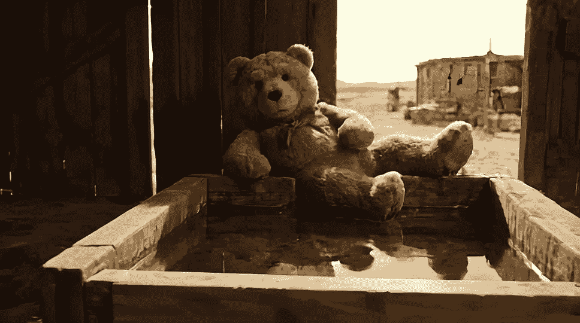

[b2a64add_fi.mp4](https://internal-api-drive-stream.feishu.cn/space/api/box/stream/download/all/IogRb5Es9o1SqexE4kach0K5ngh)

[3273b954_fi.mp4](https://internal-api-drive-stream.feishu.cn/space/api/box/stream/download/all/NiMpbmxw6oJBOgxE7IlcmXqunUf)

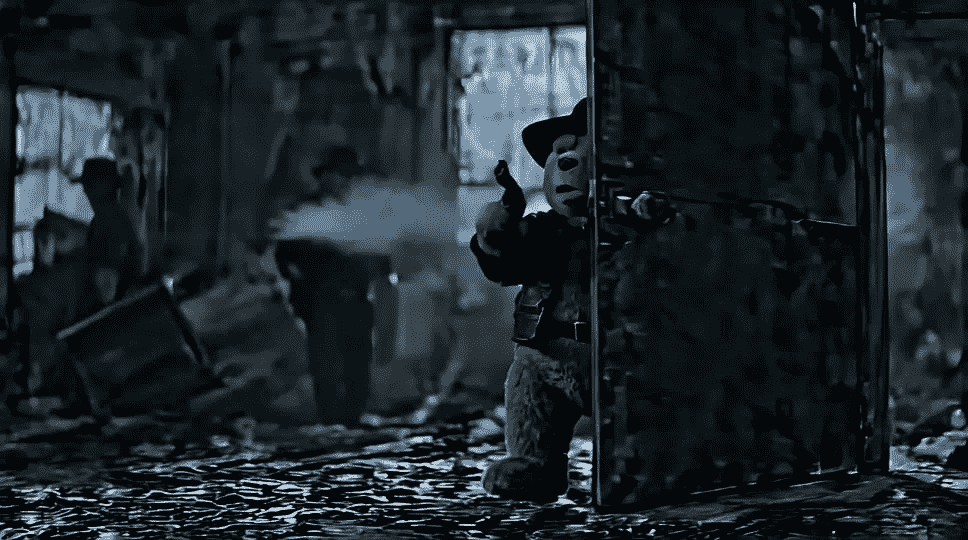

[crime_1080.mp4](https://internal-api-drive-stream.feishu.cn/space/api/box/stream/download/all/BpXnbk38mogAGsxsTvKci5bnnGc)

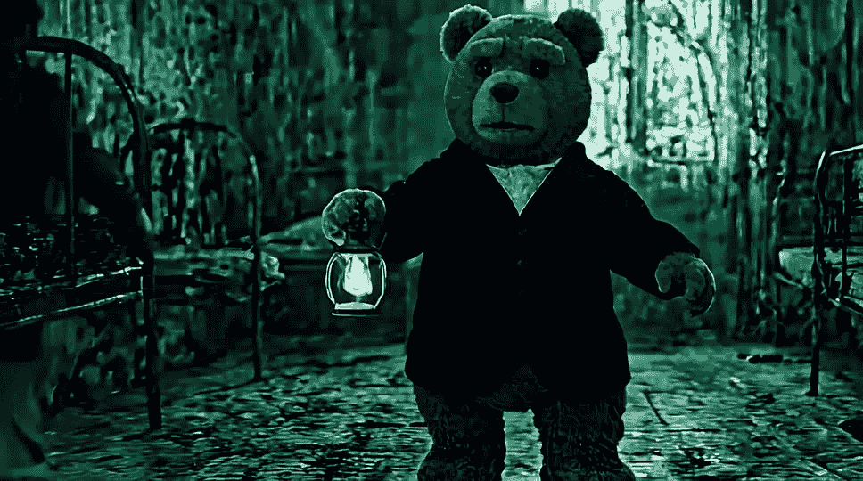

[4ad7fc28_fi.mp4](https://internal-api-drive-stream.feishu.cn/space/api/box/stream/download/all/F5TwbXdgVogqy7x68MXcJwSYnIg)

[64f4f2ea_fi.mp4](https://internal-api-drive-stream.feishu.cn/space/api/box/stream/download/all/IVV4bbze1o40MMxUDV6cIPwineg)

[39c75bc9_fi.mp4](https://internal-api-drive-stream.feishu.cn/space/api/box/stream/download/all/IqCAbVqX7osLmIxEpCHclxmbneh)

[04998c1e_fi.mp4](https://internal-api-drive-stream.feishu.cn/space/api/box/stream/download/all/RD3abCKqCopHdcxhec7cfrC9nAd)

[8398b7e6_fi.mp4](https://internal-api-drive-stream.feishu.cn/space/api/box/stream/download/all/LFN5bryAoovBQlxmGlxcDbqhn0g)

[48a7828c_fi.mp4](https://internal-api-drive-stream.feishu.cn/space/api/box/stream/download/all/BFzMbZv2bo24VExBUZ7clw7rnib)

[6c706dfc_fi.mp4](https://internal-api-drive-stream.feishu.cn/space/api/box/stream/download/all/Mzp0bb1PKoRzSHxlw0lcbml7nAg)

## 2、视觉艺术风格

| keyword | Output |
| --- | --- |

| 艺术家/艺术作品 (Artist/Artwork) |  |

| 波普艺术 |  |

| 蒸汽朋克 （Steampunk） |  |

| 粘土动画 （Claymation） |  |

| 冰雕 |  |

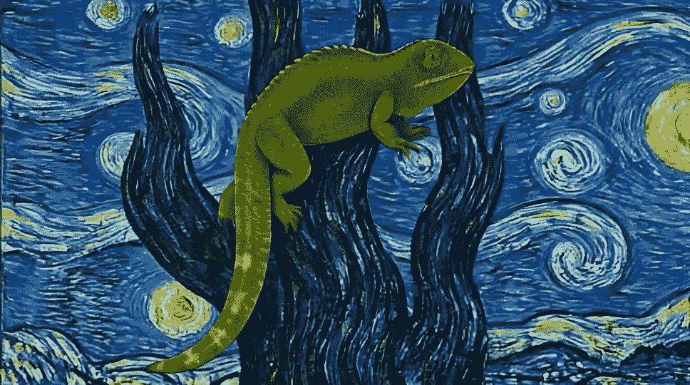

[44dd2d6c_fi.mp4](https://internal-api-drive-stream.feishu.cn/space/api/box/stream/download/all/B32xbLecWodKxGx7IHWcwg5wnVh)

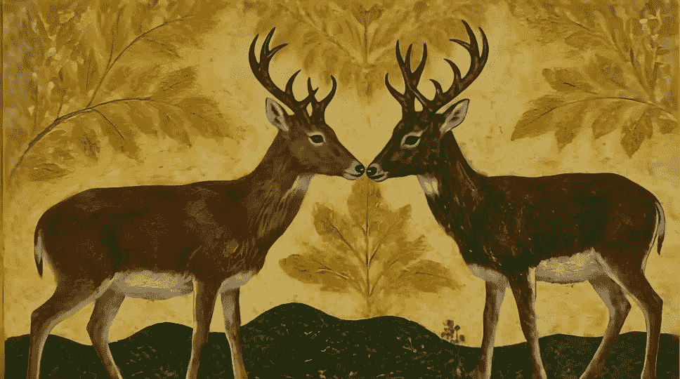

[6f5a789d_fi.mp4](https://internal-api-drive-stream.feishu.cn/space/api/box/stream/download/all/Ye4TbCCGZoZxoYxFFEUc5CwPnoh)

[fedc6d1a_fi.mp4](https://internal-api-drive-stream.feishu.cn/space/api/box/stream/download/all/X5SzbpbnNoWDLfxPXIscwpX8nEh)

[48e02ab3_fi.mp4](https://internal-api-drive-stream.feishu.cn/space/api/box/stream/download/all/XMb0biAZtoXxPqxKb48cmiAqnpd)

[664ffe9f_fi.mp4](https://internal-api-drive-stream.feishu.cn/space/api/box/stream/download/all/OvzWbBKAFow8rRxvZxCcsayonBe)

[5c9c167e_fi.mp4](https://internal-api-drive-stream.feishu.cn/space/api/box/stream/download/all/OMmKbObMAo4icNxQjZZcgAZ9nvb)

[6e652e54_fi.mp4](https://internal-api-drive-stream.feishu.cn/space/api/box/stream/download/all/NcX0bpZnVosfbdxCMjoc5WYAnGc)

[2bcc9463.mp4](https://internal-api-drive-stream.feishu.cn/space/api/box/stream/download/all/ZDi9bRU2pogRptxe6lEceIVpn8c)

## 3、拍摄及动作方式

| `keyword` | `Output` | 备注 |

| --- | --- | --- |

| 延时 |  |  |

| 水下摄影 |  |  |

| 第一人称视角 |  | 以下建议使用`Recaption`功能 |

| 俯视 |  |  |

| 手持 |  |  |

| 特写 |  |  |

| 生长 |  |  |

| 爆炸 |  |  |

| 粉碎 |  |  |

[848fa11a.mp4](https://internal-api-drive-stream.feishu.cn/space/api/box/stream/download/all/AIQWbVnDqoYX0SxNvpYcBSFHn5c)

[2203e047_fi.mp4](https://internal-api-drive-stream.feishu.cn/space/api/box/stream/download/all/KSjkbby3kozAtDxMxNycInRTnxa)

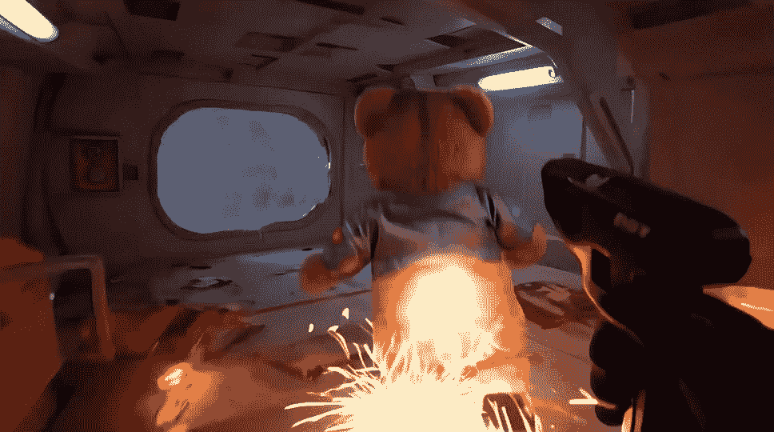

[cf5e730f_fi_sr.mp4](https://internal-api-drive-stream.feishu.cn/space/api/box/stream/download/all/Q5vcbJUs4oHRCyxS41jcwcz6nhh)

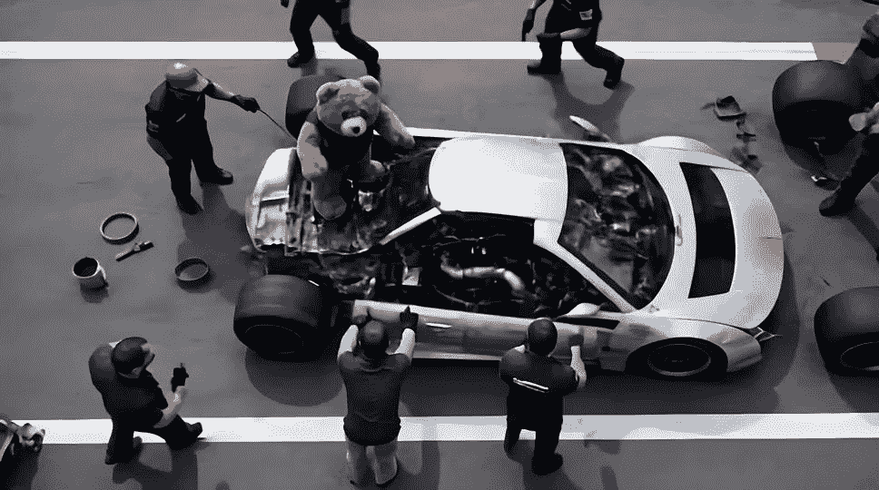

[019121ae_fi_sr.mp4](https://internal-api-drive-stream.feishu.cn/space/api/box/stream/download/all/IHKubGLquoFmTqxJOZGcj3V2nGe)

[3b53cae3_fi.mp4](https://internal-api-drive-stream.feishu.cn/space/api/box/stream/download/all/MYlebIu7MoDXQWxKKnrcNG3pn4b)

[615c6fe4_fi_sr.mp4](https://internal-api-drive-stream.feishu.cn/space/api/box/stream/download/all/M4OVbwEBBow8sUxn857cyIAxnah)

[6f23d6e0_fi.mp4](https://internal-api-drive-stream.feishu.cn/space/api/box/stream/download/all/AQDmb03ExoGvf9x31RYcyfcvnyd)

[19c297cf_fi.mp4](https://internal-api-drive-stream.feishu.cn/space/api/box/stream/download/all/WFI5bIG1PooGiVxuWg5cx7UCnn7)

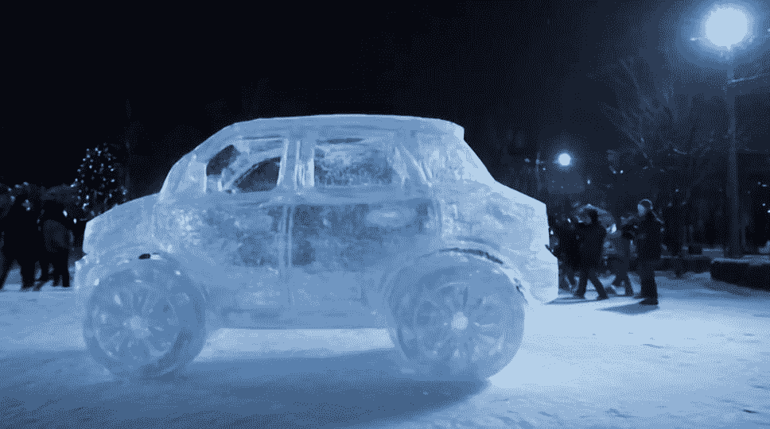

[b4013127_fi.mp4](https://internal-api-drive-stream.feishu.cn/space/api/box/stream/download/all/LoZObPl2joXseZxdsUjcwBD8nOc)

## 4、文字特效

| 视频效果 | 原始图 | 关键点 |

| --- | --- | --- |

|  |  |  |

|  |  | 特效：镜头推进 |

|  |  |  |

[04d9d67f_fi_sr.mp4](https://internal-api-drive-stream.feishu.cn/space/api/box/stream/download/all/FUyKb2ryeoeb4vxrtNjcPmhYnrc)

[c62d26f8 (1).mp4](https://internal-api-drive-stream.feishu.cn/space/api/box/stream/download/all/UMG0bBnOEoCaKHxhvGzcayQcnae)

[94612b42_fi_sr.mp4](https://internal-api-drive-stream.feishu.cn/space/api/box/stream/download/all/ZiZ7b4yMSo0563xn6RzcEeq3nmc)

[837e9780_fi_sr.mp4](https://internal-api-drive-stream.feishu.cn/space/api/box/stream/download/all/IlFybJoPEoAG29x9S5ccwgDQnEb)

[ed00e7dc_fi_sr.mp4](https://internal-api-drive-stream.feishu.cn/space/api/box/stream/download/all/LTLDbZ2aZob2CwxYXFCcB6rfnlh)

[3be4dd7a_fi_sr.mp4](https://internal-api-drive-stream.feishu.cn/space/api/box/stream/download/all/BVHMbGQDBowY7GxAV6dcTHJ2nlg)

[d07fb7fc_fi_sr.mp4](https://internal-api-drive-stream.feishu.cn/space/api/box/stream/download/all/NG53bPX6roIldzxxfm9cJ9o8n2g)

# 三、风格化效果示例

## 1、文生视频

| 序号 | 视频效果 | 关键点 |

| --- | --- | --- |

| 1 |  | 基础风格： |

|  |  | 风格升级： |

| 2 |  | 基础风格： |

|  |  | 风格升级： |

| 3 |  | 基础风格： |

|  |  | 风格升级： |

| 4 |  | 基础风格： |

|  |  | 风格升级（1）： |

|  |  | 风格升级（2）： |

| 5 |  | 基础风格： |

| 6 |  | 基础风格： |

| 7 |  | 基础风格： |

[file_v3_00ct_3199764e-7859-4fc3-b600-b5381c5b14fg.mp4](https://internal-api-drive-stream.feishu.cn/space/api/box/stream/download/all/WSeLbZR4xouat0xETMXcDWkVn9O)

[76003bde_fi_sr.mp4](https://internal-api-drive-stream.feishu.cn/space/api/box/stream/download/all/EEkJbtTAKoX7k7xbDSfcbsstn0b)

[c9d532d4_fi_sr.mp4](https://internal-api-drive-stream.feishu.cn/space/api/box/stream/download/all/GLDIbzFKuoPIPpxEH2ScuagbnMf)

[61e93ef3_fi_sr.mp4](https://internal-api-drive-stream.feishu.cn/space/api/box/stream/download/all/P5lJbyu7xoYla3xfXmYcZlJmnsd)

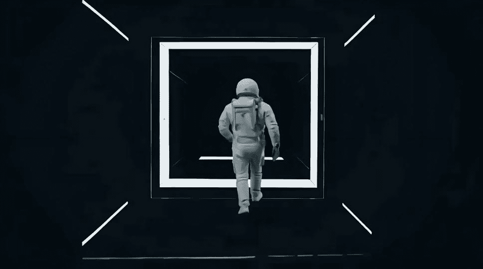

[0859253b_fi_sr.mp4](https://internal-api-drive-stream.feishu.cn/space/api/box/stream/download/all/BJh3b3O9XoKOm0xJMUAcvX5QnYb)

[92d35756_fi_sr (1).mp4](https://internal-api-drive-stream.feishu.cn/space/api/box/stream/download/all/BC5Xbo4lno4fenx688Pc7UXJngh)

[a5ce6066_fi_sr.mp4](https://internal-api-drive-stream.feishu.cn/space/api/box/stream/download/all/RxtDbZaUBo9LDMxerK5cg2PLn2c)

[eaa5bfd4_fi_sr.mp4](https://internal-api-drive-stream.feishu.cn/space/api/box/stream/download/all/LLH8bLKyKod3RmxDuYlchLqGnHb)

[1954f318_fi_sr.mp4](https://internal-api-drive-stream.feishu.cn/space/api/box/stream/download/all/PPpqbbDLHogOdUxarvvctQMWn5H)

[d3f5d983_fi_sr.mp4](https://internal-api-drive-stream.feishu.cn/space/api/box/stream/download/all/ZWzbb4rpOoZmLLxQV4ncAdVNn1e)

[8dec395f_fi_sr.mp4](https://internal-api-drive-stream.feishu.cn/space/api/box/stream/download/all/ZVMOb96xaoCnKDxAK9rc1dAQnmh)

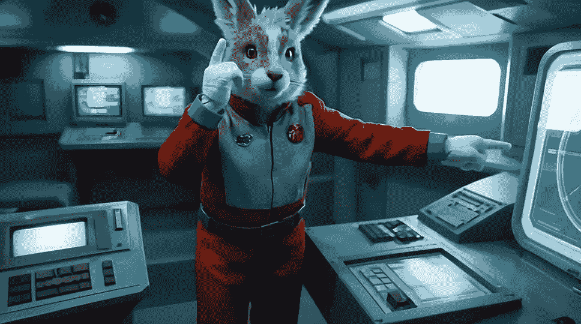

[13f050d2_fi_sr.mp4](https://internal-api-drive-stream.feishu.cn/space/api/box/stream/download/all/MScJbkGujoulP0x398sc58CxnG8)

[674d4c87_fi_sr.mp4](https://internal-api-drive-stream.feishu.cn/space/api/box/stream/download/all/LPL8bZBoAo2Ui8xRpgHc0Qhpnid)

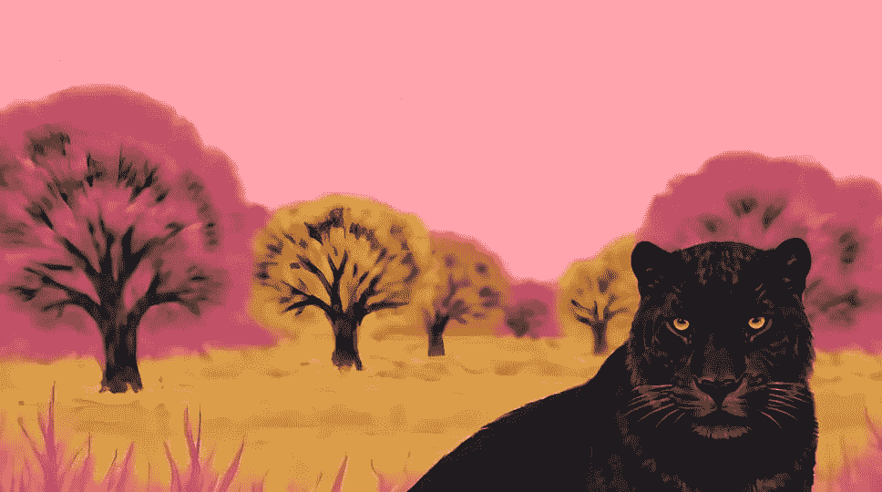

[1c1a6974_fi_sr.mp4](https://internal-api-drive-stream.feishu.cn/space/api/box/stream/download/all/ETXnbRlIjoVaZUx1MFjcDOsDned)

## 2、图生视频

符合场景/氛围的适度/合理的变化和联想

| 序号 | 视频效果 | 原始图 | 关键点 |

| --- | --- | --- | --- |

|  |  | 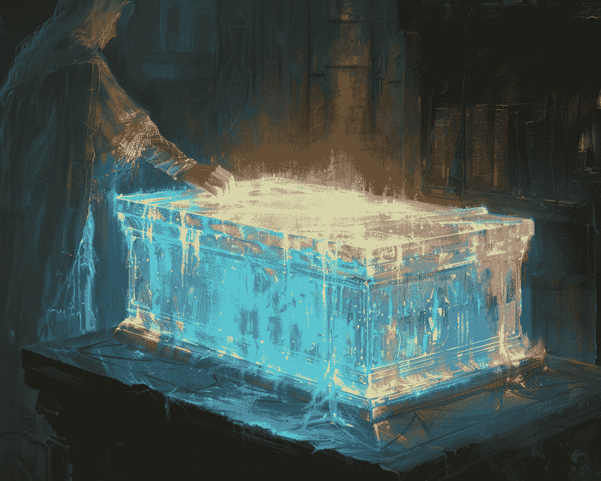 | 符合画面的动作延续 |

|  |  | 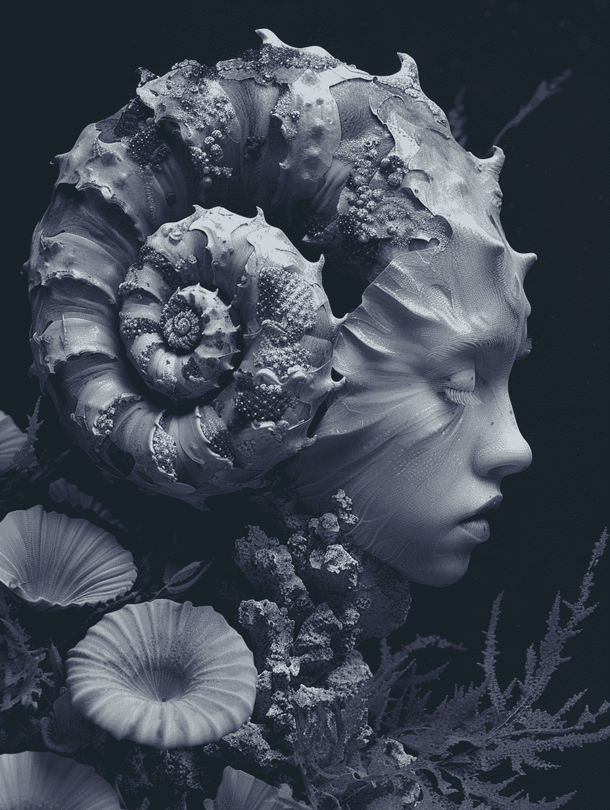 | 符合画面氛围的场景效果 |

|  |  |  | 符合画面氛围的情绪表达 |

|  |  |  | 符合画面氛围的电影氛围、拍摄方式 |

|  |  | 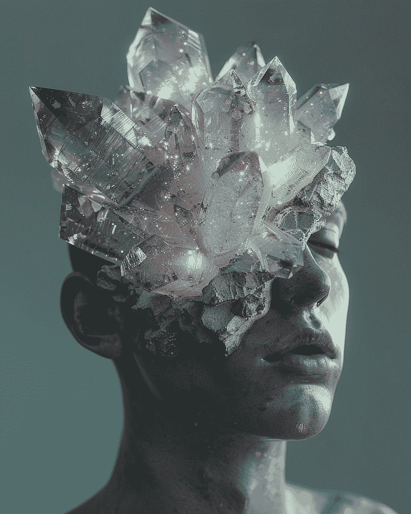 | 符合画面效果的材质表达 |

|  |  |  | 风格升级： |

[356e8cef_fi_sr.mp4](https://internal-api-drive-stream.feishu.cn/space/api/box/stream/download/all/EVPfbqeCLo23chxbUKWc1qLKnGp)

[610416cc_fi_sr.mp4](https://internal-api-drive-stream.feishu.cn/space/api/box/stream/download/all/JBuDbmDvqoFo6SxUQNmcnt1XnQe)

[42da898a_fi_sr.mp4](https://internal-api-drive-stream.feishu.cn/space/api/box/stream/download/all/NG0ebGbGToHj7jxI6KAcC1u3nRk)

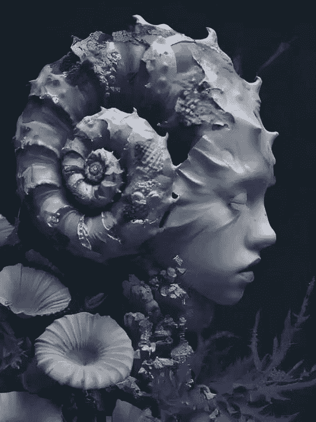

[b73b06ec 1_fi_sr.mp4](https://internal-api-drive-stream.feishu.cn/space/api/box/stream/download/all/NqODbvk3RoJi8kxS1EFcx3HEnFb)

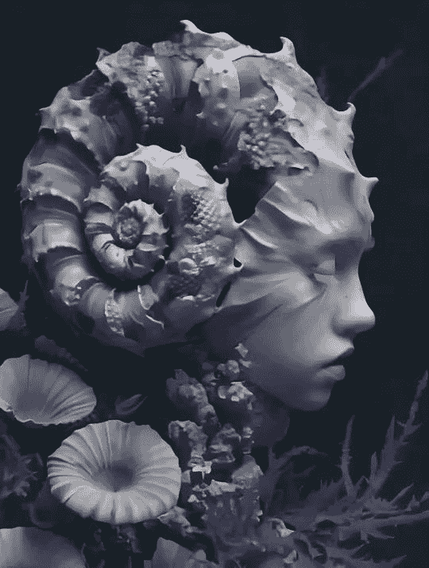

[0e54b268_fi_sr.mp4](https://internal-api-drive-stream.feishu.cn/space/api/box/stream/download/all/YM30bwHhqoGY2jxYALYcLr9pnzd)

[1e074d25_fi_sr.mp4](https://internal-api-drive-stream.feishu.cn/space/api/box/stream/download/all/A2x1bBm8HoQDIsxWX69ct1DvnWg)

[1dc4ad36_fi_sr.mp4](https://internal-api-drive-stream.feishu.cn/space/api/box/stream/download/all/IDdpbS0zdonqYdxBkiscyxHsn9e)

[136547b7_fi_sr.mp4](https://internal-api-drive-stream.feishu.cn/space/api/box/stream/download/all/SuqXbHwXao5yzHx0GsPccnsdn3g)

[04ab66be_fi_sr.mp4](https://internal-api-drive-stream.feishu.cn/space/api/box/stream/download/all/VQhzbmrA8o582dx5TK4c9toHnYb)

[3cc7d849_fi_sr.mp4](https://internal-api-drive-stream.feishu.cn/space/api/box/stream/download/all/YCV8b92RloS4V4xxORxcAw3snpf)

# 四、Vidu1.5版本新功能介绍

## 1、新功能介绍

### 1.1 复杂主体的精准控制

无论是细节丰富的角色，还是复杂的物体，Vidu都能保证其在多个不同视角下的一致性。

**示例**

造型复杂的3D动画风格角色，无论视角如何变化，Vidu始终确保头型、服饰的全角度细节一致，避免了传统视频模型在复杂视角切换时产生的瑕疵。

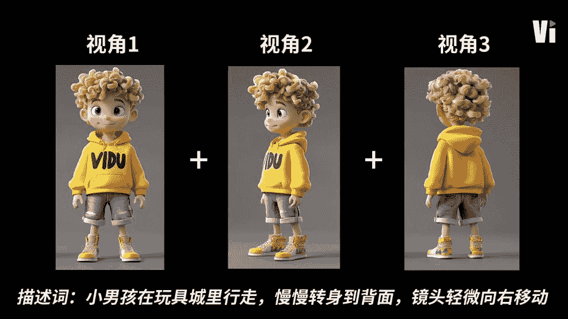

[案例1.mp4](https://internal-api-drive-stream.feishu.cn/space/api/box/stream/download/all/MOjRb6BbFokPjux3VQjc4jLJnBe)

### 1.2 人物面部特征和动态表情的自然一致

在人物特写镜头中，Vidu能够自然且流畅地保持人物面部特征和表情的连贯性，避免了面部僵硬或失真的现象。精细的面部控制使Vidu在创作细腻、真实角色时具有显著的优势。

**示例**

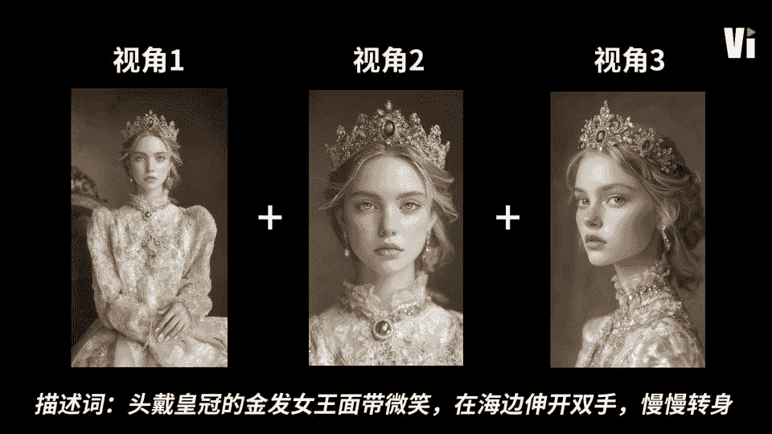

[案例2.mp4](https://internal-api-drive-stream.feishu.cn/space/api/box/stream/download/all/Ex00bcwOsokh69xx3DgcjSQ2nzh)

### 1.3 多主体一致性

Vidu允许用户上传多个主体图像，包括人物角色、道具物体、环境背景等，并在视频生成中实现这些元素的交互。例如，用户可以上传主体、客体和环境的图片，创建定制角色身穿特定服装、在定制空间内自由动作的场景。Vidu还支持多个主体之间的互动，用户可以上传多个自定义角色，让它们在指定空间内进行交互。

此外，Vidu还支持融合不同主体特征，例如将角色A的正面与角色B的反面无缝融合，创造出全新的角色或物体。

[飞书20241113-173737.mp4](https://internal-api-drive-stream.feishu.cn/space/api/box/stream/download/all/Hc2DbbMvKoM4nVxx4cAciDlEnSh)

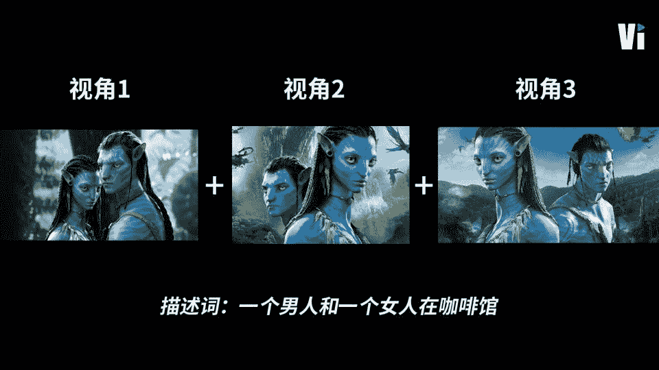

[案例4.mp4](https://internal-api-drive-stream.feishu.cn/space/api/box/stream/download/all/LIcrbuBAdoGosQxHAm1ckW5Nnpe)

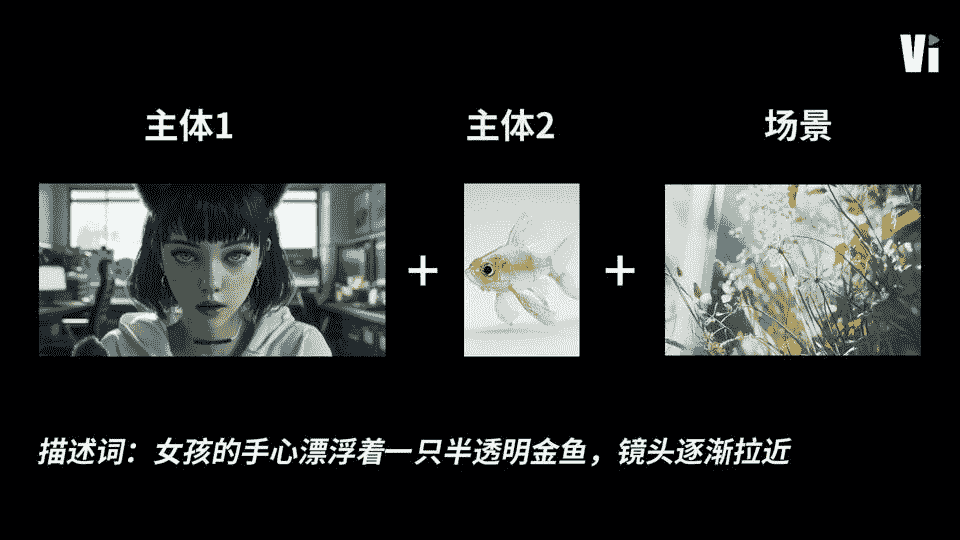

[案例5.mp4](https://internal-api-drive-stream.feishu.cn/space/api/box/stream/download/all/IQpMbWpyjochhaxOIsgciJpCnxd)

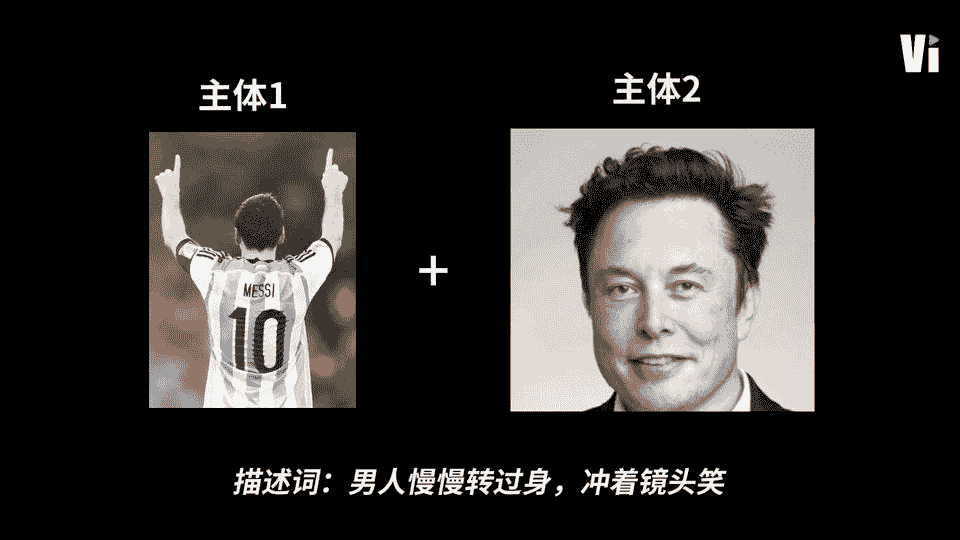

[案例6.mp4](https://internal-api-drive-stream.feishu.cn/space/api/box/stream/download/all/TSqGbVwPPoVuZvxu6FOcLaYsnsv)

### 1.4 镜头控制

通过镜头提示词的使用，可以控制镜头的运动方式，并可实现两种镜头的组合使用。

| 镜头组 | 单镜头 | 镜头运动 |
| --- | --- | --- |
| 推+顺时针旋转 | 左移跟踪 | 升 |
| 拉+逆时针旋转 | 右移跟踪 | 拉 |
| 降+推 | 顺时针旋转 | 推 |
| 升+拉 | 逆时针旋转 | 固定镜头 |

[08ae0d79.mp4](https://internal-api-drive-stream.feishu.cn/space/api/box/stream/download/all/ORwcbUGXQocxMuxqQy4crnd9nFb)

[39be7d3b.mp4](https://internal-api-drive-stream.feishu.cn/space/api/box/stream/download/all/NpH9bHgAZoWTk6xm6Ebc40YrnSf)

[9f28089f.mp4](https://internal-api-drive-stream.feishu.cn/space/api/box/stream/download/all/VbqubjlbQoTWIDxMTA9cSDnWntc)

[31360db8.mp4](https://internal-api-drive-stream.feishu.cn/space/api/box/stream/download/all/OwEtbp3cqo2agCxDt9JcLYrbnKc)

[a4b57db6.mp4](https://internal-api-drive-stream.feishu.cn/space/api/box/stream/download/all/CUS1bEcU6oSUUdxTk2gcULKTnlW)

[12d5bac7.mp4](https://internal-api-drive-stream.feishu.cn/space/api/box/stream/download/all/TJ0TbRlm8oArRZxPKXCct5FIn9b)

[fd451a72.mp4](https://internal-api-drive-stream.feishu.cn/space/api/box/stream/download/all/BYKbbOL6GoO8jYxKOvCc6r8DnIe)

[32a4b903.mp4](https://internal-api-drive-stream.feishu.cn/space/api/box/stream/download/all/Lf5RbipOxosbAxxnSYIc954Kncg)

[fee304bf.mp4](https://internal-api-drive-stream.feishu.cn/space/api/box/stream/download/all/VakcbYBEzonFjNxAcb8cJVrLnbb)

[8186f638.mp4](https://internal-api-drive-stream.feishu.cn/space/api/box/stream/download/all/MFMabp5S1odOvqx5i0qc2s3Fntb)

[ba9ec775.mp4](https://internal-api-drive-stream.feishu.cn/space/api/box/stream/download/all/NeRabRfQ9opQRKxuGq2cZeFXn8c)

[444a27fb.mp4](https://internal-api-drive-stream.feishu.cn/space/api/box/stream/download/all/I1DqbXohzoC4svxisRycbE7MnTc)
