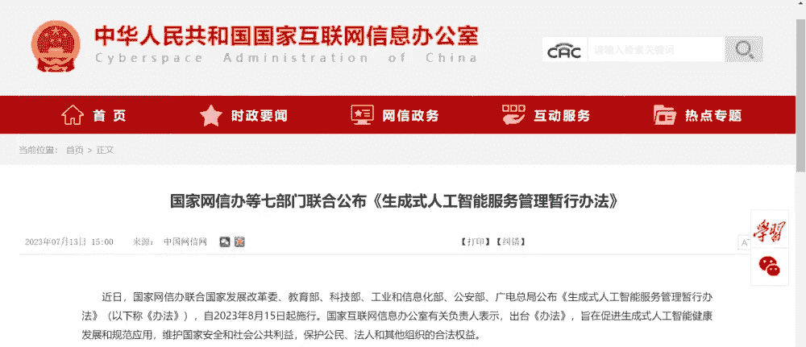
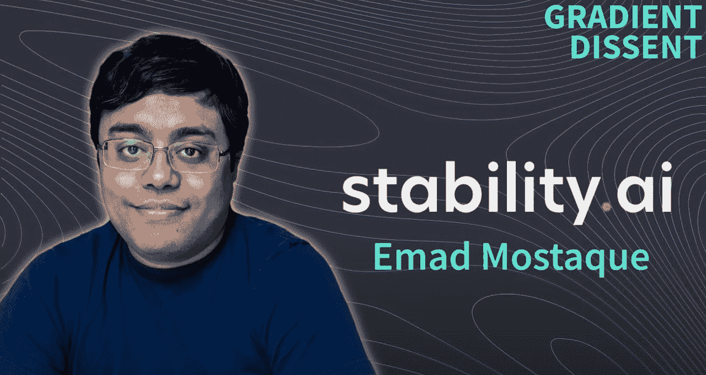
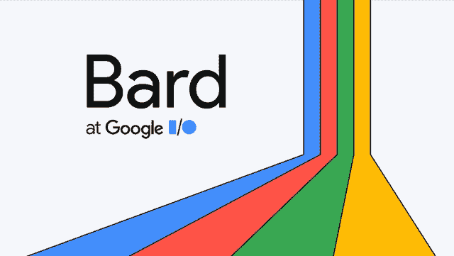
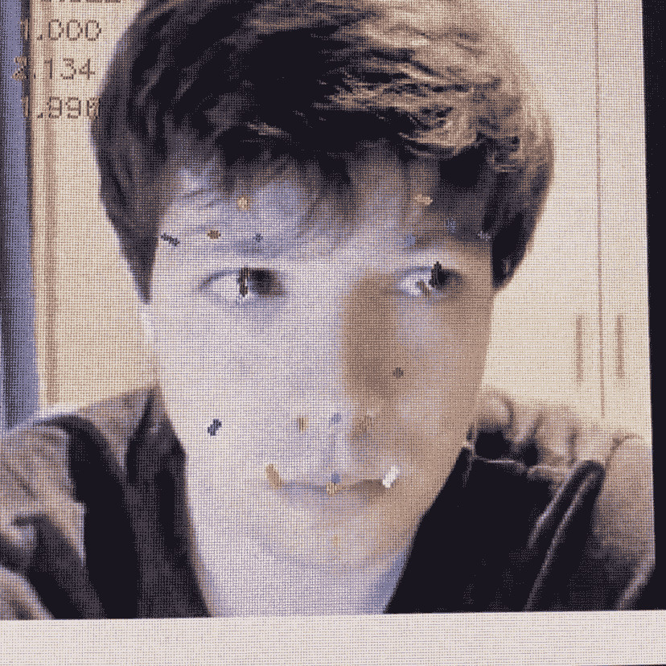
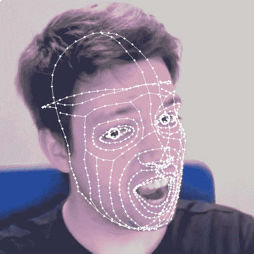
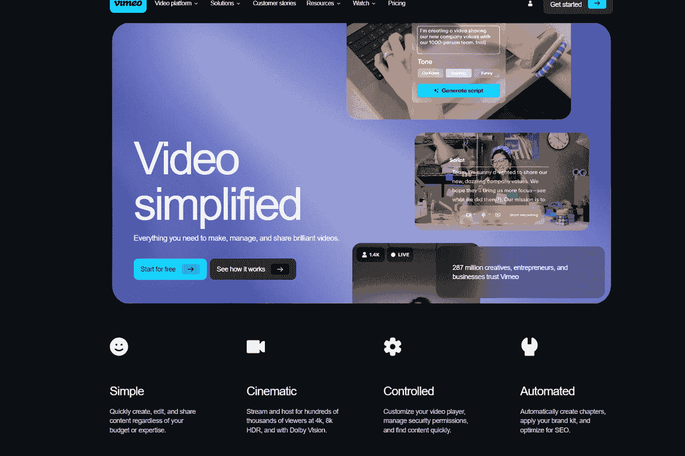
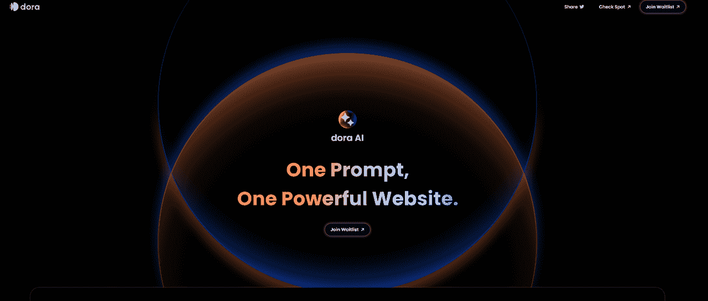
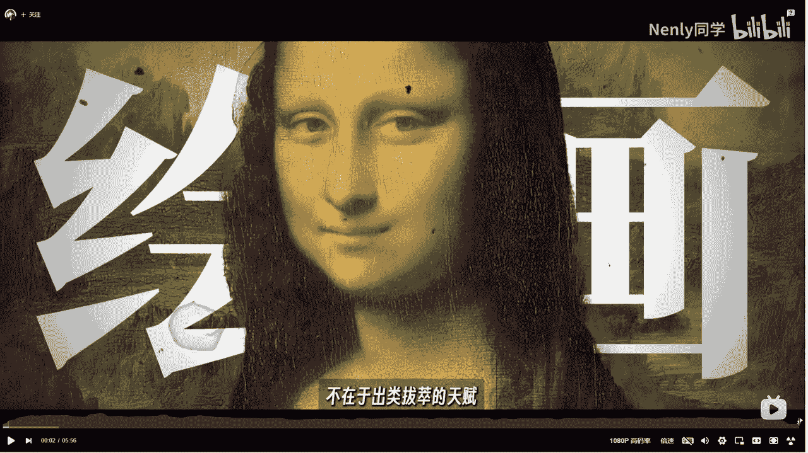
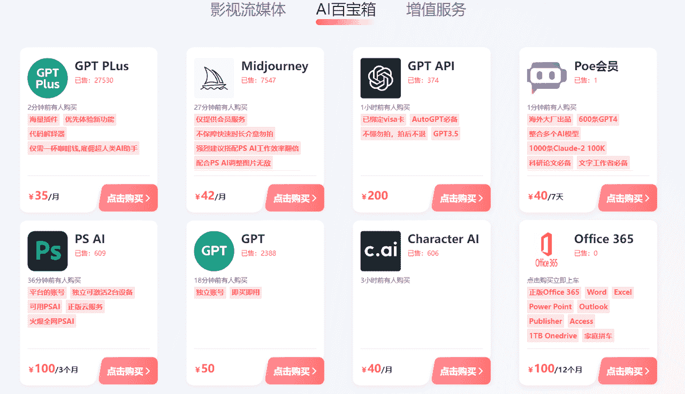

# 看见AI日报（20230714）

> 来源：[https://jlqyxzzvbk.feishu.cn/docx/UyF0dgpsioRVaaxpbdkcKvUgnNl](https://jlqyxzzvbk.feishu.cn/docx/UyF0dgpsioRVaaxpbdkcKvUgnNl)

> 快报时间：2023/7月/14日 周五 16:00

**欢迎进群交流**

# AI资讯精选

## **七部门联合公布****AIGC****管理办法**

根据“网信中国”微信公众号，国家网信办联合国家发展改革委、教育部、科技部、工业和信息化部、公安部、广电总局近日公布《生成式人工智能服务管理暂行办法》（简称《办法》），自2023年8月15日起施行。

根据《办法》，国家坚持发展和安全并重、促进创新和依法治理相结合的原则，采取有效措施鼓励生成式人工智能创新发展，对生成式人工智能服务实行包容审慎和分类分级监管，明确了提供和使用生成式人工智能服务总体要求。

同时，《办法》提出了促进生成式人工智能技术发展的具体措施，明确了训练数据处理活动和数据标注等要求；规定了生成式人工智能服务规范，明确生成式人工智能服务提供者应当采取有效措施防范未成年人用户过度依赖或者沉迷生成式人工智能服务，按照《互联网信息服务深度合成管理规定》对图片、视频等生成内容进行标识，发现违法内容应当及时采取处置措施等。

此外，《办法》还规定了安全评估、算法备案、投诉举报等制度，明确了法律责任。

更多信息请访问：https://baijiahao.baidu.com/s?id=1771370752945109178&wfr=spider&for=pc

## **Stability ****AI**内讧：创始人起诉CEO Emad Mostaque涉嫌欺骗

DoNews7月14日消息，Stability AI 联合创始人 Cyrus Hode 13日起诉这家人工智能初创公司及其 CEO Emad Mostaque，Cyrus Hode 声称 Emad Mostaque 欺骗他以共计 100 美元（约 714.98 元人民币）的价格出售了他在 Stability AI 公司中 15% 的股份。

据路透社报道，在旧金山联邦法院提起的诉讼中，Cyrus Hodes 表示，Stability AI 的现任 CEO Emad Mostac 此前告诉他，Emad Mostac 正在研究的图像生成器 Stable Diffusion “基本上毫无价值”，因此不如出售该公司的股份，以换取更多机会。Cyrus Hodes 据此认为 Emad Mostaque 欺骗了他。

Cyrus Hodes 撰写的起诉书中称，Emad Mostaque 的行为“集中体现了企业最糟糕的贪婪，简直震惊了良心”。他同时表示，在 Emad Mostaque 于 2021 年 10 月和 2022 月 5 月购买他的股份之前，Emad Mostaque 从未透露过他已经开始和风险投资公司接触。

Cyrus Hodes 希望恢复他在 Stability AI 的 15% 股份，以及要求向 Emad Mostaque 索取“涉嫌欺诈和违反信托义务”的惩罚性赔偿。

更多信息请访问：https://www.infoq.cn/article/xb8tyd9bvdztudesmequ

## 谷歌聊天机器人Bard登陆欧盟和巴西市场

[Al](https://stock.finance.sina.com.cn/usstock/quotes/GOOG.html)phabet Inc. (GOOGL.US) 旗下的谷歌(124.83, 5.21, 4.36%)在欧盟和巴西发布了聊天机器人Bard，并表示这款人工智能工具现在可以用40多种语言生成回答，其中包括中文、印地语和西班牙语。

欧盟是全球最后一批获得Bard访问权限的地区，该工具在今年早些时候已在约180个国家推出。公司表示，由于对该人工智能服务符合欧盟《通用数据保护条例》存在不确定性，导致在欧盟推出的时间延迟。

谷歌高级产品总监 Jack Krawczyk 在Bard在欧盟推出之前表示，公司希望与隐私监管机构和用户之间保持持续的对话，以确保在建立透明度、选择权和控制权方面持续改进。他表示，谷歌将告知用户，他们的数据如何被使用和存储，并可以选择不允许公司员工审查对话内容。这是为了了解和改进产品。这些控制选项将在全球范围内提供，而不仅限于欧盟。

更多信息请访问：https://finance.sina.com.cn/stock/hkstock/ggscyd/2023-07-13/doc-imzaprut6052957.shtml

# AI软件精选

## **Reshot ****AI****（AI****修图****）**

Reshot AI 是一款帮助您使用 AI 编辑照片的工具。编辑面部姿势、灯光、调整表情、背景等等，所有这些都通过 AI 进行。

链接：https://www.reshot.ai/

## **Vimeo ****AI****（AI****视频剪辑****）**

Vimeo 官宣了AI视频创作套件，能让小白用户 0 门槛创作视频

核心功能一、用 ChatGPT写脚本，说出你的想法，指定视频时长，AI即刻生成指定语气的脚本

核心功能二、内置提词器，跟随语速同步节奏

核心功能三、编辑文本同步编辑视频，

链接：https://vimeo.com/

## Dora ai**（AI****无代码建网站****）**

Dora是一个无代码网站制作平台，5月17日 Dora AI重磅发布，动动嘴皮子，AI帮你生成3D动效网站

一、文本转网站：仅需一行文本，你就能创造出令人惊叹且完全可编辑的网站

二、静态转3D：利用我们的3D交互生成器，你能将静态设计提升至全新的维度

三、高级AI动画：通过自动化的动画过程，能大大节省手动操作的时间

借助Flutter，Dora能实现响应式布局，同时为AI提供UI组件原子化能力

链接：https://www.dora.run/ai

**更多****AI****工具请访问：**https://nav.6aiq.com/

# AI课程精选

## 免费课程（AI绘画）

https://www.bilibili.com/video/BV16u411j7u3/?spm_id_from=333.788&vd_source=3f7939551b27a57d8c51bdca93356279

主要讲述SD的各个模块模式逻辑，以授人以渔的形式教授，大量使用实践教程，上手率高，大大提高学习效率。从浅入深，内容详细，逻辑清晰，适合新手入学，视频质量极高。

## 付费课程（GPT）

混沌微软CTO韦青讲GPT：如何用第一性思维驾驭AI

优惠购课链接：https://v.douyin.com/ifsv5JJ/

#

**欢迎进群交流**

# 4.会员精选

访问地址：https://nf.video/kkF8Y  下单时输入：kanAI  九五折优惠，或者直接二维码访问

**国内镜像****GPT****，**支持GPT，比官方更便宜，访问更快，无需魔法，直接访问，九折购买，（购买后联系客服，返还10%购买费用）

客服二维码（返现客服)

