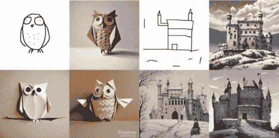
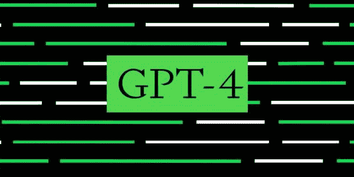
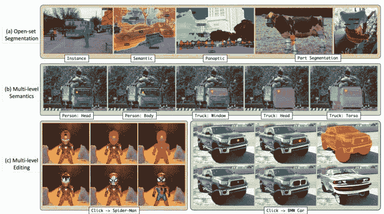
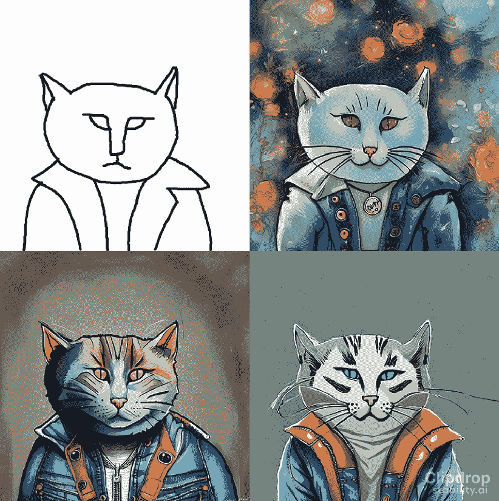
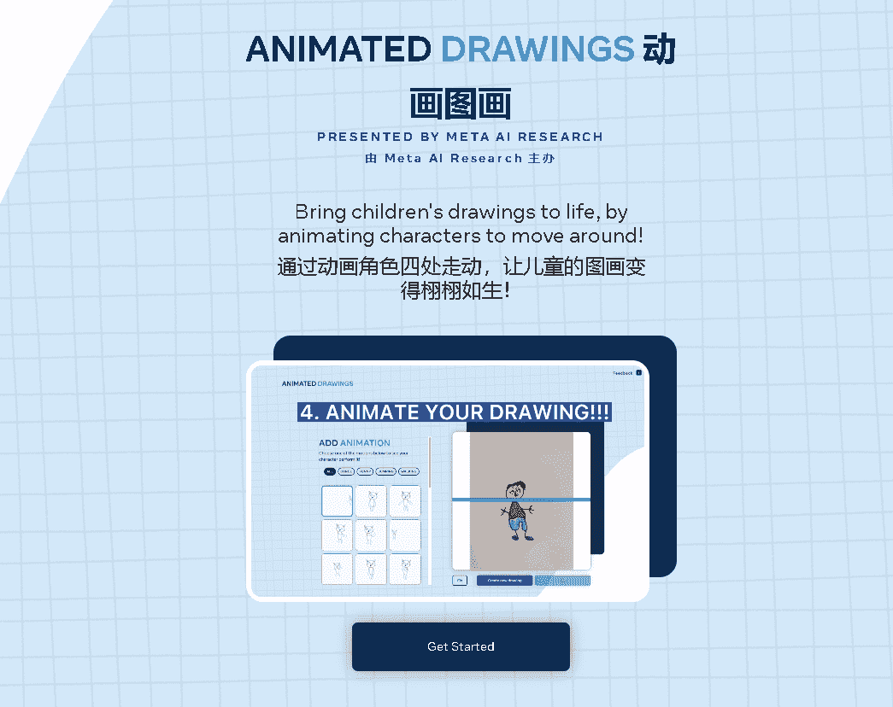

# 看见AI日报（20230717）

> 来源：[https://jlqyxzzvbk.feishu.cn/docx/XL7jdYoYEown5ExAVkGcH4stnCd](https://jlqyxzzvbk.feishu.cn/docx/XL7jdYoYEown5ExAVkGcH4stnCd)

> 快报时间：2023/7月/17日 周一 16:00

**欢迎进群交流**

# AI资讯精选

## **Stability ****AI**新推出的Stable Doodle

7月17日消息，图像生成模型 Stable Diffusion 背后的初创公司 Stability AI 近日推出了一项新的服务，可以将素描转换为图像。这项服务名为 Stable Doodle，利用最新的 Stable Diffusion 模型分析素描的轮廓，并生成“视觉上令人愉悦”的艺术作品。

目前用户已经可以通过 ClipDrop 平台使用这项服务，ClipDrop 是 Stability AI 三月收购的一个平台，其前身是由前谷歌员工创立的 AI 创业公司 Init ML。

Stability AI 在一篇博客文章中透露，Stable Doodle 面向专业人士和新手，无论他们对 AI 工具有多熟悉，“有了 Stable Doodle，任何具有基本绘画技能和网络接入的人都可以在几秒钟内生成高质量的原创图像。”

市面上已经有很多素描转图像的 AI 工具，包括开源项目等。但 Stability AI 声称，Stable Doodle 的独特之处在于它允许用户对图像生成过程进行更“精确”的控制。

除了素描外，Stable Doodle 还接受输入提示来指导图像生成过程，例如“一个舒适的椅子，‘等轴’风格”或“穿着牛仔夹克的猫，‘数字艺术’风格”。不过，定制性也有限度，目前 Stable Doodle 只支持 14 种艺术风格。

更多信息请访问：https://mp.weixin.qq.com/s/_u-6JoqoV93JWCWBG9-B2A

## GPT-4 被用户抱怨变得“懒”且“蠢” 或是重设架构惹的祸

近日，CNMO 注意到，网上开始出现了一些质疑声，不少用户抱怨 OpenAI 的 ChatGPT-4 变得不那么强大了，有人称这个模型与先前的推理能力以及其他输出相比变得 " 更懒惰 " 和 " 更愚笨 "。部分业内人士认为，这可能和 OpenAI 对该系统的重大重新设计有关，他们推测 OpenAI 为让生成式模型输出质量更高、成本更低、响应更快，使用了混合专家（MoE）模型。

用户抱怨道：GPT-4 开始一遍又一遍地循环输出代码和其他信息。与之前相比，它就像脑死亡了一样。如果你没有真正见识过它之前的能力，你可能不会注意到，但如果你之前充分使用了 GPT-4，你会明显感觉到它变得更愚蠢。

更多信息请访问：http://www.myzaker.com/article/64b0aa8d8e9f092f925eaa98

## 香港科技大学联手微软等机构，公布图像分割模型 Semantic-SAM

据 [Arxiv ](http://iphone.myzaker.com/zaker/link.php?pk=64ae5278b15ec033cc5683fb&b=aHR0cHM6Ly9hcnhpdi5vcmcvYWJzLzIzMDcuMDQ3Njc=&bcode=4c97f2fa&target=_new)页面显示，来自香港科技大学、微软研究院、IDEA 等多个机构的学者近日联合发布论文，公布了一款图像分割模型 Semantic-SAM。

论文显示，该模型具有两个关键优势：语义感知和粒度丰富性。为了实现语义感知，研究者们整合了三个粒度上的多个数据集，并引入了对象和部分的解耦分类。这使得 Semantic-SAM 能够捕捉丰富的语义信息。对于多粒度能力，研究者在训练过程中提出了一种多选择学习方案，使每次点击可以生成与多个标准掩膜相对应的多个级别的掩膜。

实验结果和可视化展示表明，Semantic-SAM 成功实现了语义感知和粒度丰富性。

更多信息请访问：https://baijiahao.baidu.com/s?id=1771555481557737781&wfr=spider&for=pc

# AI软件精选

## **stable doodle（****AI****绘画）**

Stability AI 推出了 Stable Doodle，这是一款草图到图像工具，可将简单的绘图转换为动态图像，为一系列专业人士和爱好者提供无限的成像可能性。

将绘画变为现实从未如此简单。 Stability AI 推出的 Clipdrop 的这款新工具能够显着增强从教育到创意设计，再到时尚和艺术等一系列行业的能力。 Stable Doodle 以及最新的 Stable 扩散模型 SDXL 0.9 均可在 Clipdrop by Stability AI 网站上免费试用。

链接：https://clipdrop.co/stable-doodle

## **sk****etc**h metademolab（AI绘画）

当你上传完绘画作品之后，即可在线编辑作品人物的身体节点，调整不同动作，生成动图，让画作中的人物 "活" 起来

这个工具的使用方式也很简单，大体分为这几个步骤：图片上传、编辑、提取、标记，生成动画。

链接：https://sketch.metademolab.com/canvas

## Photoshop AI**（AI修图/绘画）**

链接：https://www.adobe.com/products/photoshop/generative-fill.html

**更多****AI****工具请访问：**http://ai.kcodez.com/

# AI课程精选

## 免费课程（GPT）

https://www.bilibili.com/video/BV16M4y1b7yR/?spm_id_from=333.788&vd_source=3f7939551b27a57d8c51bdca93356279

GPT内容由浅入深，层层递进，逻辑清晰，诙谐幽默越带有夸张的授课风格，讲述GPT的各种用法，以及如何讲自身结合

## 付费课程（ai绘画）

AI绘画基础课Midjourney

优惠购课链接：3- 4:/ 【AI绘图基础课 Midjourney】复制此条消息打开抖音，查看商品详情。【ÊÊPcFWKFONWI3E8￠￠】         https://v.douyin.com/ixcenrM/

#

**欢迎进群交流**

# 4.会员精选

访问地址：https://nf.video/kkF8Y  下单时输入：kanAI  九五折优惠，或者直接二维码访问

**国内镜像****GPT****，**支持GPT，比官方更便宜，访问更快，无需魔法，直接访问，九折购买，（购买后联系客服，返还10%购买费用）

客服二维码（返现客服)

