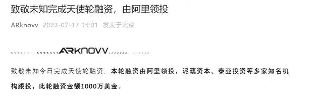
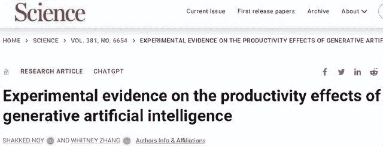
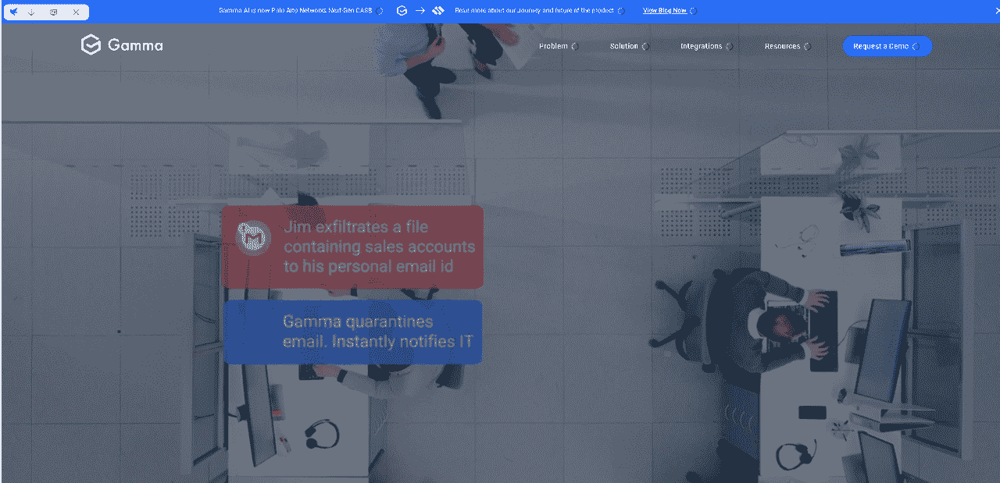
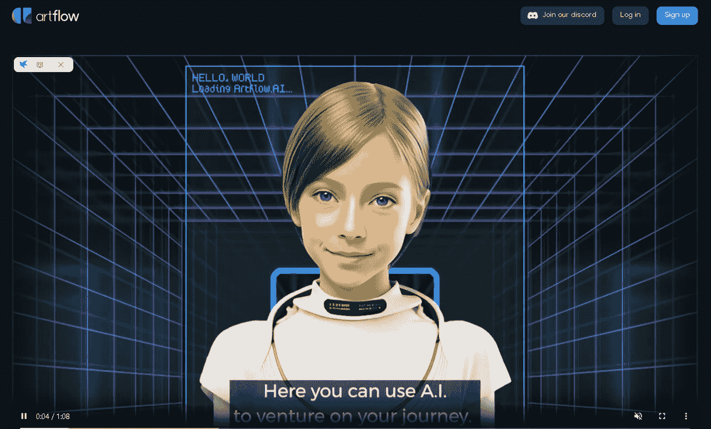
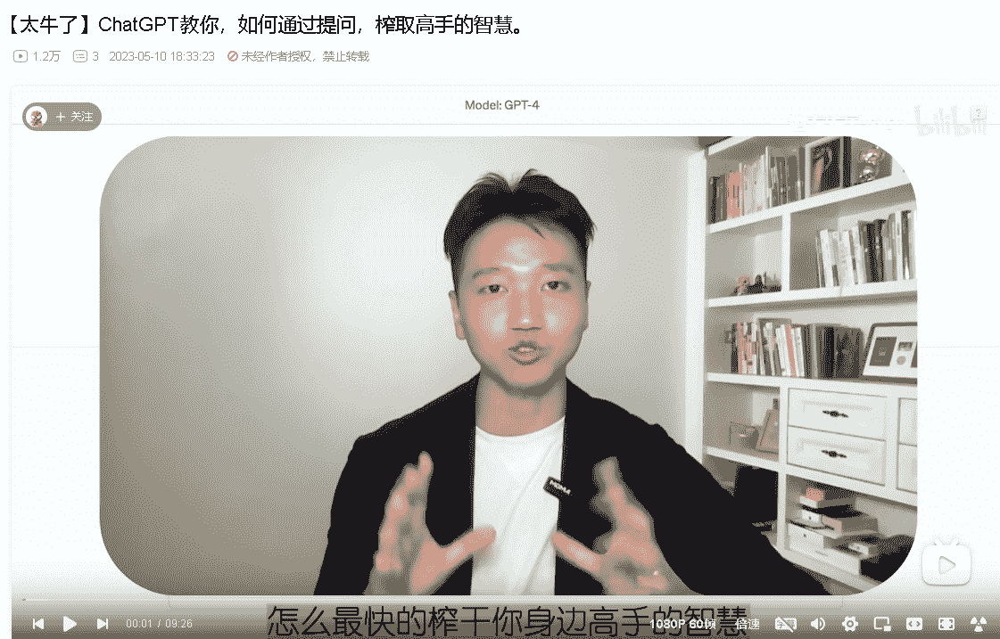
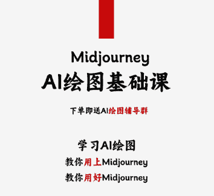

# 看见AI日报（20230718）

> 来源：[https://jlqyxzzvbk.feishu.cn/docx/OoowdkRJPoxs4AxwpnSc8mZCn2f](https://jlqyxzzvbk.feishu.cn/docx/OoowdkRJPoxs4AxwpnSc8mZCn2f)

> 快报时间：2023/7月/18日 周二 16:00

**欢迎进群交流**

# AI资讯精选

## 自动生成恶意代码与钓鱼邮件：黑客展示“没有道德”的人工智能

据安全分析公司 SlashNext 表示，有黑客日前开发出了一款名为 W**ormGPT 的 AI 工具，黑客声称“该 AI 工具没有任何**限制，专为协助网络犯罪分子而设计，可以自由生成一系列恶意代码，或创建网络钓鱼攻击”。

SlashNext 表示，WormGPT 最早在今年 3 月首次出现，并在 6 月推出了正式版本，黑客当下正在对外销售该 AI 工具的使用权限。

黑客在售卖页表示：“该 AI 工具旨在提供 ChatGPT 的替代方案，便于用户执行各种与黑帽相关的活动，让任何人都可以在家中舒适地进行恶意活动。”

黑客声称，为了创建这个聊天机器人，他们使用了 2021 年推出的一种名为 GPT-J 的较旧但开源的大型语言模型。然后，该模型经过对恶意软件创建相关数据的训练，从而最终形成了 WormGPT。

更多信息请访问：https://www.ithome.com/0/706/357.htm

## AR厂商致敬未知完成天使轮融资 由阿里领投

官方介绍，致敬未知由前锤子科技合伙人，原华为荣耀产品线总经理吴德周创立，团队成员均来自华为、字节跳动、锤子手机、联想等企业高管，深耕AI及AR算法多年。

官方还表示，将于7月底召开ARknovv品牌发布暨新品上市发布会，正式推出“可戴出门的消费级 AR 眼镜”。

致敬未知创始人兼CEO吴德周表示：“人工智能是 AR 发展的关键推动因素，对于AR眼镜来说，深度融合AI技术，能极大地提升用户与现实环境之间更自然高效的交互，提升生活和工作效率。我们很高兴得到投资者的支持，本轮融资将主要用于产品研发和公司运营，我相信，完成天使轮融资也使得公司的发展迈出了坚实的一步，我们对未来的发展充满信心。”

更多信息请访问：https://baijiahao.baidu.com/s?id=1771659970579704014&wfr=spider&for=pc

## Science：ChatGPT缩小了打工人的差距

巴比特讯，量子位今日发文表示，学术期刊《Science》正刊发表对 ChatGPT 的调查报告，《生成式人工智能对生产力影响的实验证据》。对于一些文书任务，ChatGPT 不仅能在节省 40% 时间的同时提高 18% 的绩效，还降低了不同人之间的绩效差异。

这场实验一共邀请了 453 名受试者，分为实验组和对照组。这些受试者是来自不同领域、受过高等教育的专业人士。在为期一个月的实验中，他们被要求完成与职业相关的写作任务。这些任务包括撰写新闻稿、简短报告、分析计划和电子邮件，时长约为 20 到 30 分钟。评估的指标包括效率和质量两部分，每份成果分别交由三名相关领域的专业人士进行盲评（1-7 分）。结果显示，实验组所用时间减少了 0.75 个标准差（约 11 分钟），评分则提高了 0.41 个标准差。如果换算成百分数，时间缩短和质量提高的比例分别是 40% 和 18%。

实验结束后，研究人员还对这些受试者进行了两次回访，分别有 92% 和 83% 的人给出了回复。第一次回访是在实验结束后两周，实验组和对照组分别有 34% 和 18% 的人仍在使用 ChatGPT。六周之后，也就是实验结束后两个月，这组数字分别提升到了 42% 和 27%。综上所述，研究人员认为，ChatGPT 在提升工作质效方面确实有显著作用，但其能否取代人类仍不明确。

更多信息请访问：https://baijiahao.baidu.com/s?id=1771555481557737781&wfr=spider&for=pc

# AI软件精选

## **Gamma.AI（****AI****云数据****）**

**Gamma.AI**是一种基于人工智能的云数据丢失防护 (DLP) 解决方案，适用于 SaaS 应用程序。主要特点和优势包括：

**99.5% 准确的数据分类**：利用高级深度学习进行上下文感知

**横向覆盖**：一键部署全设备、全应用、全用户

**用户民主化**：赋予最终用户即时补救能力

**集成**：支持超过 150 个 SaaS 应用程序，包括 Gmail、Slack、Outlook 和 Salesforce

Gamma.AI 的**用例**可满足各种组织的需求：

**寻求**减轻因人为疏忽造成的数据泄露的公司

**希望监****控员工**活动并保护敏感数据的IT 管理员

旨在解决内部威胁、云中的 DLP 和社会工程攻击的**组织**

链接：https://gamma.ai/

## **Artflow ****ai****（AI数字人）**

**Artflow.ai**是一款人工智能工具，旨在帮助用户创建自定义头像并让他们的故事栩栩如生。主要特点和优势包括：

**自定义创作**：从文本中生成角色、场景和声音，并编写独特的对话

**资产库**：访问数百万用户生成的资产，例如预制角色和场景

**语言支持**: 支持非英文描述，多样化创作

**API**** 和反馈**：使用 API 生成内容并接收有关创作的实时反馈

**社区**：通过 Discord 社区、教程和常见问题解答与他人联系

Artflow.ai 的**用例**非常适合各种创意人士：

寻求形象化他们的角色和场景的**作家和讲故事的人**

**寻找人**工智能工具来创建自定义头像的设计师

旨在为其项目生成独特资产的**内容创建者**

链接：https://app.artflow.ai/

## Fliki**（****AI****视频）**

**Fliki**是一种人工智能支持的文本转[视频](https://nav.6aiq.com/favorites/video_ai)和文本转语音工具，专为高效内容创建而设计。主要特点和优势包括：

**栩栩如生的声音**：75 种语言和方言的 900 多种声音，可提供逼真的画外音

**视觉和**[**音频**](https://nav.6aiq.com/favorites/audio_ai)**资源**：数以百万计的[图像](https://nav.6aiq.com/favorites/image_ai)、视频剪辑和背景音乐选项

**品牌字幕**：可定制的字幕颜色和字体

**受顶级公司信赖**：来自知名组织的 150,000 多名内容创作者使用

Fliki 的**用例**可满足各种内容创建者的需求：

寻求创建引人入胜的视频内容的**营销专业人士**

**希望开发具**有逼真声音的教学材料的教育工作者

**旨在**通过具有视觉吸引力的视频提升品牌知名度的企业

链接：https://fliki.ai/

**更多****AI****工具请访问：**http://ai.kcodez.com/

# AI课程精选

## 免费课程（GPT）

https://www.bilibili.com/video/BV16M4y1b7yR/?spm_id_from=333.788&vd_source=3f7939551b27a57d8c51bdca93356279

GPT内容由浅入深，层层递进，逻辑清晰，诙谐幽默越带有夸张的授课风格，讲述GPT的各种用法，以及如何讲自身结合

## 付费课程（ai绘画）

AI绘画基础课Midjourney

优惠购课链接：3- 4:/ 【AI绘图基础课 Midjourney】复制此条消息打开抖音，查看商品详情。【ÊÊPcFWKFONWI3E8￠￠】         https://v.douyin.com/ixcenrM/

#

**欢迎进群交流**

# 4.会员精选

访问地址：https://nf.video/kkF8Y  下单时输入：kanAI  九五折优惠，或者直接二维码访问

**国内镜像****GPT****，**支持GPT，比官方更便宜，访问更快，无需魔法，直接访问，九折购买，（购买后联系客服，返还10%购买费用）

客服二维码（返现客服)

