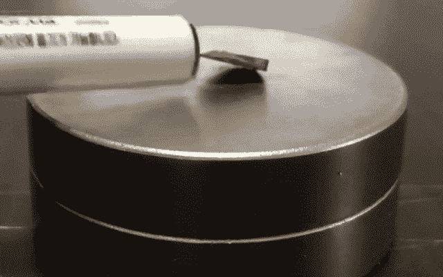
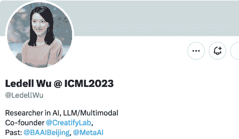
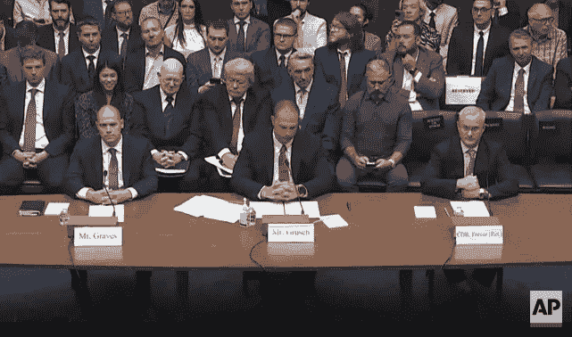
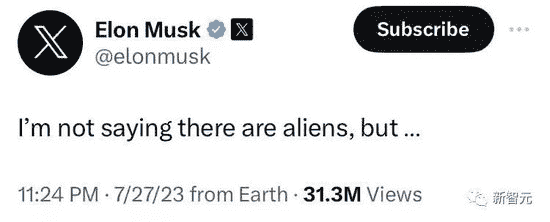
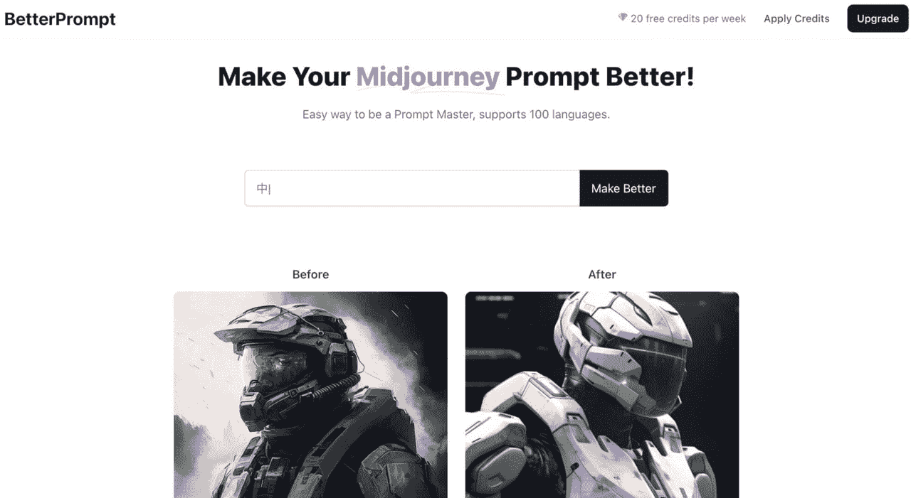

# 看见AI日报（20230728）

> 来源：[https://jlqyxzzvbk.feishu.cn/docx/Pkz3dMLFAoDu8zxgUpXcUWNpndd](https://jlqyxzzvbk.feishu.cn/docx/Pkz3dMLFAoDu8zxgUpXcUWNpndd)

> 快报时间：2023/7月/28日 周五 16:00

**欢迎进群交流**

# AI资讯精选

## 室温常压超导掀全球热度，数万人正在围观这个中国团队的复现进度

「一觉醒来，室温超导『又』被突破了。」最近几天，物理学界又见证了一份室温超导研究的问世。

为什么说「又」呢？看看之前的新闻报道就知道了：宣称实现「室温超导」的研究一个接一个，连 Science 杂志都忍不住在 2020 年打出「终于，室温超导实现了」的标题。但后续结果总是令人失望，没有人能够成功复现作者宣称的结果，部分研究还被撤稿。这使得「实现室温超导」成了一个「狼来了」的故事。谁也不敢轻信别人宣称的结果。

不过这次，事情看上去有点不同寻常。这份研究来自韩国的一个团队。他们在 arXiv 上上传了两篇论文，宣称他们合成了一种常压下的室温超导材料，其超导临界温度超过了水的沸点，最高达到 127 摄氏度。

这种材料被命名为 LK 99，是一种铜掺杂的铅磷灰石，化学式写作

更多信息请访问：https://baijiahao.baidu.com/s?id=1772559190929851201&wfr=spider&for=pc

## 北大校友论文获ICML时间检验奖，Hinton弟子一作，生成式AI受关注

ICML 2023时间检验奖出炉！

今年和往年一样，也是一篇获奖论文和两篇亚军（Runners Up），均从ICML 2023的论文集中选出，“在过去10年里持续产生影响力”。

**其中，获奖论文的第一作者是**Hinto**n弟**子Richard Zemel，第二作者伍昱（Ledell Wu）是北大元培校友，曾在智源和MetaAI工作过，如今是Creatify AI的联合创始人。

更多信息请访问：https://baijiahao.baidu.com/s?id=1772644875645759883&wfr=spider&for=pc

## **美飞行员****证实外星人存在**！美国对UFO已进行10年反向工程，马斯克不否认

就在昨天，美国国会获悉，美国政府已经找到了迫降的外星飞船和外星人尸体，并且正在掩盖这个事情。

周三，三位退伍军人在国会备受期待的UFO听证会上作证。

其中一位前空军情报官员声称，美国政府有一个运行了10多年，针对UFO的秘密反向工程项目。

他还表示，美国从所谓的坠毁现场回收了非人类的‘生物学物质’。

马老板也蹭了蹭热度，发推暗示……

在听证会上，Ryan Graves，一位曾在美国海军服役超过十年的前F-18飞行员，美国海军退役指挥官David Fravor，以及曾在美国空军和国家地理空间情报局工作的情报官员David Grusch，都宣誓称他们亲眼目睹或拥有第一手的信息，证实了不明飞行物的存在（UFO）。

官方现在把这些现象称之为‘不明航空现象’（UAP）。

他们三人警告称，这些UAP构成了国家安全威胁，并且美国政府对议员和公众隐瞒了重要的信息。

这次听证会最主要的内容就是质询3名爆料者的爆料内容。

更多信息请访问：https://finance.sina.com.cn/chanjing/gsnews/2023-07-28/doc-imzefkcy2222221.shtml

# AI软件精选

# **BetterPrompt （****AI****绘画提示词工具）**

Make Your Midjourney Prompt Better!

让您的中途更快捷！

Easy way to be a Prompt Master, supports 100 languages.

轻松成为提示大师，支持 100 种语言。

链接：https://better.avatarprompt.net/

# **ELBO ****Art**** （****AI****绘画）**

通过使用人工智能创作艺术来表达自己。使用我们的角色创建器创建您自己的头像

链接：https://art.elbo.ai/

# **Steve.Ai（****AI****动画）**

Steve.AI 是一款在线视频制作软件，可帮助任何人在几秒钟内创建视频和动画。

链接：https://www.steve.ai/

**更多****AI****工具请访问：**http://ai.kcodez.com/

# AI课程精选

## 免费课程（GPT）

https://www.bilibili.com/video/BV16M4y1b7yR/?spm_id_from=333.788&vd_source=3f7939551b27a57d8c51bdca93356279

GPT内容由浅入深，层层递进，逻辑清晰，诙谐幽默越带有夸张的授课风格，讲述GPT的各种用法，以及如何讲自身结合

## 付费课程（ai绘画）

AI绘画基础课Midjourney

优惠购课链接：3- 4:/ 【AI绘图基础课 Midjourney】复制此条消息打开抖音，查看商品详情。【ÊÊPcFWKFONWI3E8￠￠】         https://v.douyin.com/ixcenrM/

#

**欢迎进群交流**

# 4.会员精选

访问地址：https://nf.video/kkF8Y  下单时输入：kanAI  九五折优惠，或者直接二维码访问

**国内镜像****GPT****，**支持GPT，比官方更便宜，访问更快，无需魔法，直接访问，九折购买，（购买后联系客服，返还10%购买费用）

客服二维码（返现客服)

