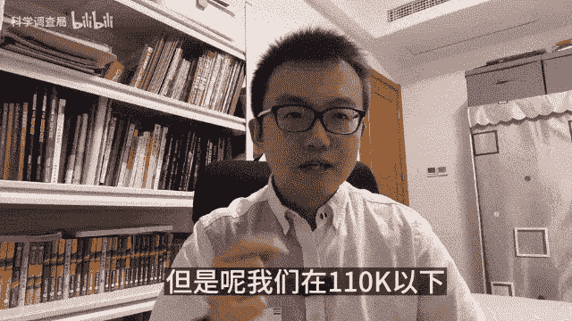
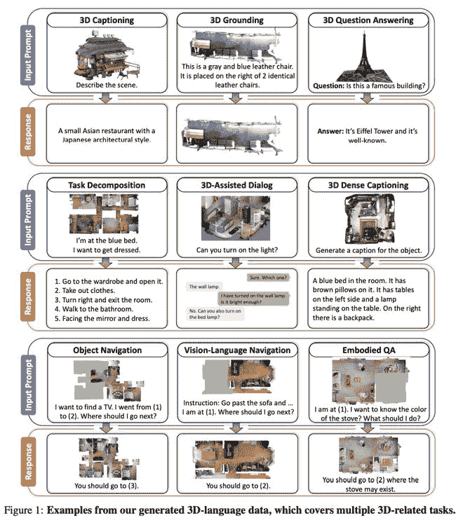
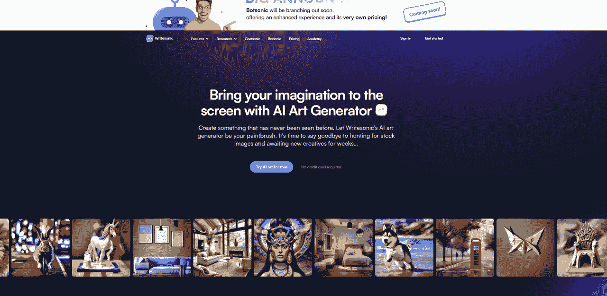
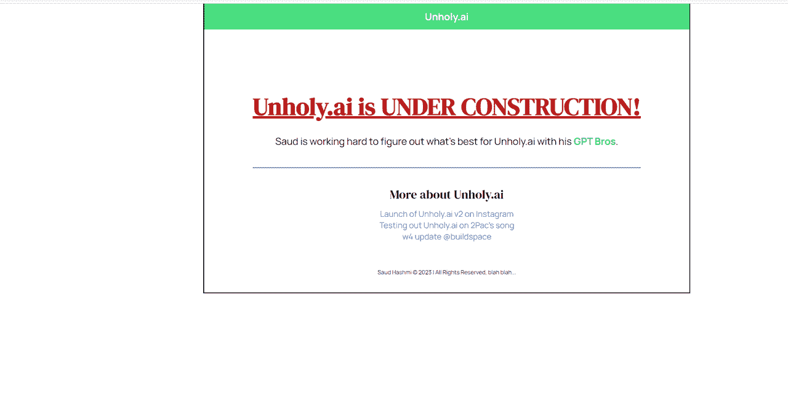

# 看见AI日报（20230803）

> 来源：[https://jlqyxzzvbk.feishu.cn/docx/PSrQdyJH9o5QL3xWMGtcGfwVnah](https://jlqyxzzvbk.feishu.cn/docx/PSrQdyJH9o5QL3xWMGtcGfwVnah)

> 快报时间：2023/8月/03日 周四 17:00

**欢迎进群交流**

# AI资讯精选

## **东南**大学全球首测LK-99零电阻成功！室温超导复现大爆发，人类历史接近跃迁点

视频中，孙悦教授表示，团队在110K（-163°C）温度以下的常压条件下，成功观测到了LK-99的零电阻。

这是一个很重要的证据，证明LK-99可能存在超导电性。

不过，孙悦教授也强调称，目前的结果并不能证实LK-99就是室温超导，具体还需要进一步的探索和测量。

与此同时，这项研究也再次登顶国外知名论坛热榜。

华南理工大学物理学教授「洗芝溪」对此的评价是——「东南大学的结果非常震撼，甚至比前天华科大的结果还要震撼。」

就在8月1日，华科大团队已经发现了LK-99材料的抗磁性。

也就是在同一天，中国科学院金属研究所沈阳材料科学国家研究中心和美国劳伦斯伯克利国家实验室也都通过理论计算，间接证明了LK-99可能有超导性。

这四个研究结合来看，韩国团队研究的置信度似乎又变高了很多。

而如果在大量杂质及常压条件下，就能在110K观测到0电阻，那么只要再提高纯度/增大压力，或许有望得到真正的「室温超导」材料！

如今看来，韩国团队的研究很可能让人类历史提前到达了跃迁点，如果这次点对了科技树，我们的想象力已然可以冲出地球、奔向宇宙了。

更多信息请访问：http://news.sohu.com/a/708589270_473283

## 懂3D的语言模型来了！UCLA、上交、MIT等联合提出3D-LLM：性能大涨9%

大型语言模型（LLM）和视觉语言模型（VLM）在各种评测基准中都展现出了强大的性能，比如可以看图说话、进行常识推理。

但这些模型的训练过程并没有引入3D物理世界，也就无法理解更丰富的现实概念，包括空间关系、布局、物体反馈等。

最近，加州大学洛杉矶分校、上海交大、华南理工大学、麻省理工学院等机构的研究人员联合提出了一个全新的3D-LLM任务，把3D世界的知识注入到大型语言模型中，以3D点云及其特征作为输入，从而可以执行各种3D相关的任务，包括描述生成、3D问题回答、任务分解、3D辅助对话、导航等。

这位官员补充说，经验丰富的网络犯罪分子正在利用 AI 技术，开发新的恶意软件攻击和更好的传播方法，包括使用 AI 生成的网站作为网络钓鱼页面，可以秘密地传播恶意计算机代码。同样的技术正在帮助黑客开发可以逃避防病毒软件的多态恶意软件。

更多信息请访问：https://www.163.com/dy/article/IB7I5JNH0511ABV6.html

## 苹果、英伟达和皮克斯等巨头成立联盟，制定元宇宙3D图形标准

美国3d内容行业的5家主要公司苹果、英伟达、皮克斯、adobe和autodesk联合成立了openusd联盟（aousd）。openusd技术是英伟达omniverse平台的基础，有一天可能成为“元宇宙”的3d图形标准。

openusd是皮克斯动画工作室开发的一种开放数据格式，允许团队能够在大规模3d工作流程上协同工作，并共享可在ar（增强现实）和vr（虚拟现实）项目中使用的3d对象和环境的信息。

openusd联盟将制定详细说明openusd特征的书面规范。这将提高openusd的兼容性，扩大其采用、集成和实施的范围，并使其他标准化组织也能够纳入此规范中。linux基金会旗下的联合发展基金会（joint development foundation，jdf）被选为该项目的托管机构，它将推动开放、高效和有效的openusd规范制定工作，并提供获取国际标准化组织（iso）认证的途径。

更多信息请访问：https://export.shobserver.com/baijiahao/html/638846.html

# AI软件精选

# Photosonic AI**（AI绘画）**

**hotosonic**是一种 AI 艺术生成器，可帮助用户创作独特而令人惊叹的数字艺术。它由 Writesonic 提供支持，无需水印。主要特点和优势包括：

**自动完成提示**：生成各种风格的[图像](https://nav.6aiq.com/favorites/image_ai)，从油画到赛博朋克，从正方形到高清分辨率的各种尺寸

[**绘画**](https://nav.6aiq.com/favorites/art-generator)**生成器**：通过高级升级提供高清质量和增强的面孔

**编辑推荐**和**最近几代人**：提供一系列功能来帮助用户释放他们内在的艺术家

[**3D**](https://nav.6aiq.com/favorites/3d-generator)[ i](https://nav.6aiq.com/favorites/3d-generator)m[ag](https://nav.6aiq.com/favorites/image_ai)es with Unreal Engine : 允许用户使用 Unreal Engine 生成 3D 图像

**用例：**

• 生成各种风格和大小的数字艺术供个人或专业使用。

• 借助人工智能技术探索您的创造力，创作独一无二的艺术品。

• 访问高级功能以获得增强的图像质量和无水印图像。

链接：https://writesonic.com/photosonic-ai-art-generator

# Fathom**（****AI****写作）**

**Fathom**是一款先进的人工智能会议助手，旨在自动执行记笔记和总结会议的日常任务。通过与 Zoom 通话无缝集成，Fathom 可以为您记录、转录、突出显示和总结对话。

**主要特点**：

**转录和突出显示**：自动转录并突出显示对话的重要部分。

**CRM**** 同步**：自动生成通话记录并将其同步到您的 CRM。

**分享亮点**：通过 Slack 与同事分享对话亮点。

**多语言支持**：提供七种语言，包括英语、法语、西班牙语、意大利语、德语和葡萄牙语。

**易于使用**：设置简单且用户界面友好。

**好处**：

通过自动记笔记和总结会议来节省时间和精力。

有助于与团队成员轻松共享重要的对话亮点。

与 Zoom 和 Slack 无缝集成。

支持多语言操作，提高不同语言背景用户的易用性。

**安全特性**：

所有录音都是 100% 私密且安全的，具有端到端加密、严格监控和定期第三方渗透测试。

链接：https://fathom.video/

# Unholy.ai**（****AI****音乐）**

Un**holy.**ai **是一种**创新的 AI 工具，旨在评估歌曲并识别任何不洁的主题或元素，例如情色、亵渎和通奸。主要特点： AI 驱动的歌曲分析：Unholy.ai 使用尖端的 AI 算法快速准确地检测歌曲中的不洁主题和元素。广泛的主题：该工具能够识别各种有争议的主题，包括情色、亵渎、通奸等。用户友好的体验：只需输入您想要分析的歌曲，Unholy.ai 将以易于理解的格式为您提供结果。用例： • 想要确保孩子正在收听的音乐合适的父母。 • 希望探索符合其价值观和偏好的歌曲的音乐爱好者。 • 内容创作者试图避免在他们的项目中使用具有潜在争议主题的歌曲。立即尝试 Unholy.ai 以获得对您最喜爱歌曲内容的宝贵见解，并确保您正在聆听符合您价值观的音乐。

链接：https://unholyai.vercel.app/

**更多****AI****工具请访问：**http://ai.kcodez.com/

# AI课程精选

## 免费课程（GPT）

https://www.bilibili.com/video/BV16M4y1b7yR/?spm_id_from=333.788&vd_source=3f7939551b27a57d8c51bdca93356279

GPT内容由浅入深，层层递进，逻辑清晰，诙谐幽默越带有夸张的授课风格，讲述GPT的各种用法，以及如何讲自身结合

## 付费课程（ai认知提升）

AI的30种用法！亚伦哥的AI实用课！工作效率提升数倍

4.61 Jvf:/ 【AI的30种用法！亚伦哥的AI实用课！工作效率提升数倍！】https://v.douyin.com/iKRq5Br/ 长按复制此条消息，打开抖音搜索，查看商品详情！

#

**欢迎进群交流**

# 4.会员精选

访问地址：https://nf.video/kkF8Y  下单时输入：kanAI  九五折优惠，或者直接二维码访问

**国内镜像****GPT****，**支持GPT，比官方更便宜，访问更快，无需魔法，直接访问，九折购买，（购买后联系客服，返还10%购买费用）

客服二维码（返现客服)

