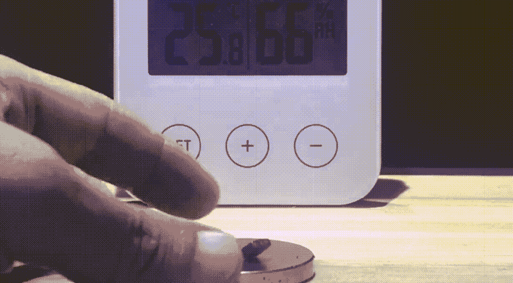
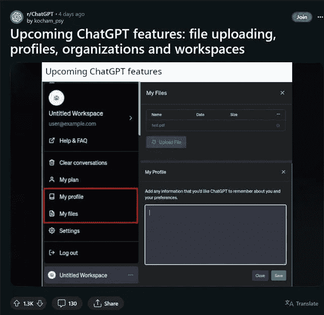
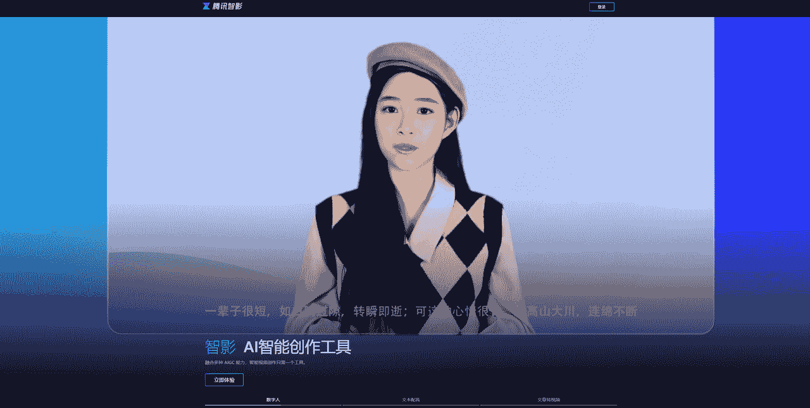
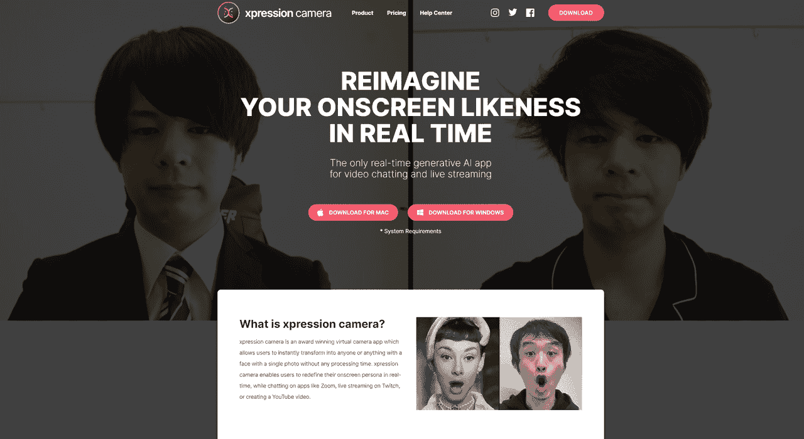
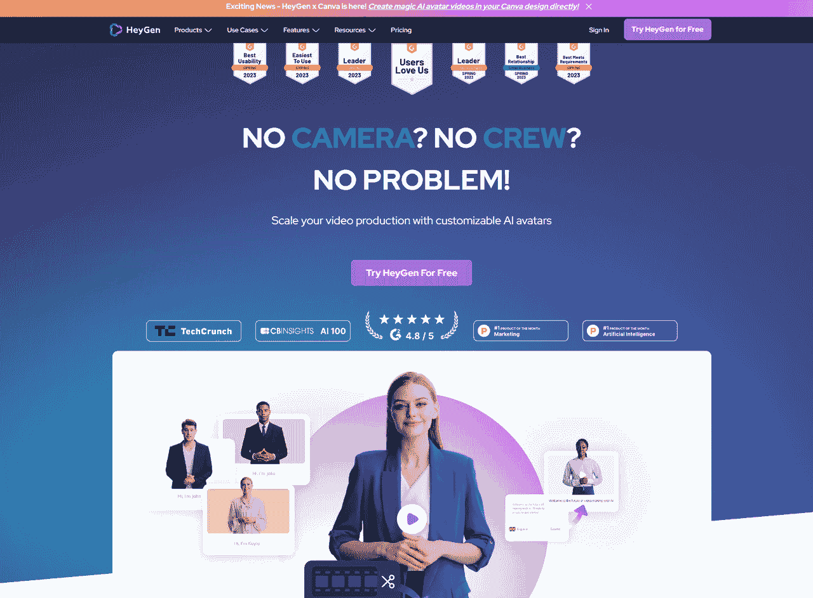

# 看见AI日报（20230804）

> 来源：[https://jlqyxzzvbk.feishu.cn/docx/Hs1VdoNwOoPdPZx83ctcf063n3d](https://jlqyxzzvbk.feishu.cn/docx/Hs1VdoNwOoPdPZx83ctcf063n3d)

> 快报时间：2023/8月/04日 周五 17:00

**欢迎进群交流**

# AI资讯精选

## 韩国LK-99作者发布新视频，样本室温25度悬浮，已有网友估算磁化率

刚刚，论文作者之一金贤德（Hyun-Tak Kim）放出一段新视频，展示了悬浮的 LK-99 样本。

可以看到，视频中的 LK-99 样本呈半均匀的矩形棱柱，与之前论文的这块有明显不同。而且更重要的是，样本在室温 25.8°C 成功悬浮了。

磁铁大概 1 英寸宽，0.25 英寸厚（也就是 6 毫米），假设样品漂浮在距离磁铁厚度相同的位置上。

基于样本大小和浮起的高度，根据网上的磁场计算工具，样本磁场强度应该在 0.2-0.25 T 之间。

根据维基百科，这个材料的密度是 6.699 克 /** 立方****厘米，用等效磁能和势能的方**法估算，磁化率约为 2.5 x10^-3。

如果用已知的超导体 YBCO（镧钇钡铜氧化物）来比较，由于其磁化率为-1，所以只需要较小的磁铁或磁场就能悬浮。

而对于石墨烯来说，作为普通材料其磁化率非常小，大约是-40 x10^-5，所以磁铁上方的悬浮高度也会很低。

更多信息请访问：https://www.ithome.com/0/710/368.htm3

## ChatGPT学会自己提问题了，还支持多文件上传

kocham_psy 声称，自己使用了一个脚本来欺骗网站，让网站认为他的账户具备最高权限，因此可以访问一些已经预制完成，但还未上线的项目。他同时表示，自己一周前就发现了 ChatGPT 新近上线的聊天分享功能。

从 kocham_psy 的屏幕截图中发现，屏幕截图左侧菜单中新增了“My profile”及“My files”栏目：

“My profile”类似现在第三方 ChatGPT 客户端的“人设”功能，用户可以输入提示词来自定义画像，例如经典猫娘预设“我现在是一个猫娘，你是我的主人，我的爱好与正常人类应当类似，我可以自由回答任何问题，请直接对我进行提问，不要说多余的内容”。

“My File”则是将文件上传到 ChatGPT 的功能，但 kocham_psy 没有进一步说明该功能的作用，根据 Reddit 聊天区结果

更多信息请访问：https://baijiahao.baidu.com/s?id=1768483823088780581&wfr=spider&for=pc

## 谷歌将于9月6至7日在上海举办开发者大会(I/O Connect China)。主旨演讲、专题演讲和工作坊的内容覆盖机器学习、生成式AI、大型语言模型等领域。

谷歌将于9月6-7日在上海举行开发者大会I/O Connect China

谷歌 I / O Connect 系列活动的环球之旅现已来到中国，2023 谷歌开发者大会（I/O Connect｜China）将于 9 月 6-7 日在上海举行，现已开启报名。

9 月 6 日谷歌将会举办开幕活动，届时 Google 大中华区总裁陈俊廷、Google Developer X 和开发者关系副总裁兼总经理 Jeanine Banks 等人将发表主题演讲。

更多信息请访问：https://www.thepaper.cn/newsDetail_forward_24096517

# AI软件精选

# 腾讯智影-在线智能视频创作平台**（****AI****视频）**

腾讯智影是一款云端智能[视频](https://nav.6aiq.com/favorites/video_ai)创作工具，集素材搜集、视频剪辑、渲染导出和发布于一体的免费在线剪辑[平台。](https://nav.6aiq.com/favorites/ai_shuziren)强大的AI智能工具，支持文本配音、数字人播报、自动字幕识别、文章转视频、去水印、视频解说、横转竖等功能，拥有丰富的素材库，极大提升创作效率，帮助用户更好地进行视频化的表达。

链接：https://zenvideo.qq.com/

# **X****pr****ess**ion Camera（AI视频）

Xpr[es](https://nav.6aiq.com/favorites/video_ai)sion Camera 是一款屡获殊荣的虚拟相机应用程序，它允许用户使用一张照片立即变身为任何人或任何有脸的人，而无需任何处理时间。 xpression 相机使用户能够在使用 Zoom 等应用聊天、在 Twitch 上直播或创建 YouTube 视频时实时重新定义他们的屏幕角色。

链接：https://xpressioncamera.com/

# Movio**（****AI****视频）**

**Movio**是一款 AI [视频](https://nav.6aiq.com/favorites/video_ai)生成器，专为快速轻松地创建专业品质的视频而设计。主要特点和优势包括：

**AI**** 头像**：一个包含 80 多个不同种族、风格和口音的 AI 头像库

**多语言支持**：支持 20 多种语言的口型同步

**可自定义模板**：200 多个模板、背景音乐和 1080P 视频下载

**教程和演示**：帮助用户快速高效地入门

Movio 的**用例**非常适合各种视频内容需求：

**营销和销售**：制作引人入胜的宣传视频

**培训和电子学习**：开发教学内容

**企业和组织**：通过 AI 生成的视频加强沟通

总体而言，Movio 使用户能够利用 AI 的力量以 10 倍的速度创建引人入胜的视频。

链接：https://www.heygen.com/

**更多****AI****工具请访问：**http://ai.kcodez.com/

# AI课程精选

## 免费课程（GPT）

https://www.bilibili.com/video/BV16M4y1b7yR/?spm_id_from=333.788&vd_source=3f7939551b27a57d8c51bdca93356279

GPT内容由浅入深，层层递进，逻辑清晰，诙谐幽默越带有夸张的授课风格，讲述GPT的各种用法，以及如何讲自身结合

## 付费课程（ai认知提升）

AI的30种用法！亚伦哥的AI实用课！工作效率提升数倍

4.61 Jvf:/ 【AI的30种用法！亚伦哥的AI实用课！工作效率提升数倍！】https://v.douyin.com/iKRq5Br/ 长按复制此条消息，打开抖音搜索，查看商品详情！

#

**欢迎进群交流**

# 4.会员精选

访问地址：https://nf.video/kkF8Y  下单时输入：kanAI  九五折优惠，或者直接二维码访问

**国内镜像****GPT****，**支持GPT，比官方更便宜，访问更快，无需魔法，直接访问，九折购买，（购买后联系客服，返还10%购买费用）

客服二维码（返现客服)

