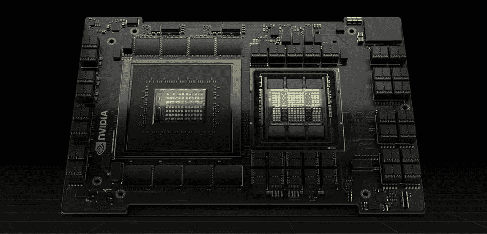
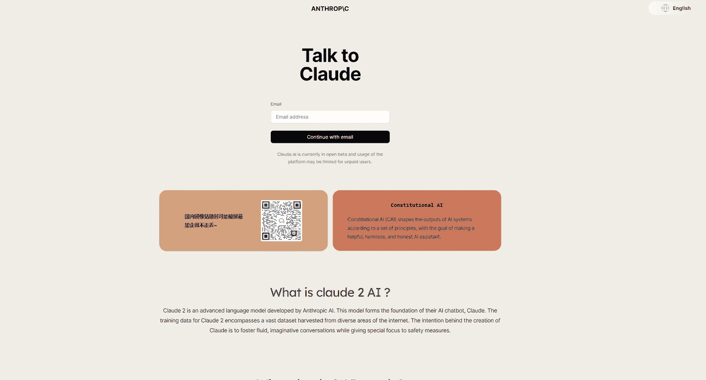

# 看见AI日报（20230806）

> 来源：[https://jlqyxzzvbk.feishu.cn/docx/XXqyd2wyQoZKHOxpdvvc0gLlnbe](https://jlqyxzzvbk.feishu.cn/docx/XXqyd2wyQoZKHOxpdvvc0gLlnbe)

> 快报时间：2023/8月/06日 周日 17:00

**欢迎进群交流**

# AI资讯精选

## GPT-5出世，需5万张H100！全球H100总需求43万张， 英伟达GPU陷短缺风暴

- GPT-4可能在大约10000-25000张A100上进行了训练- Meta大约21000 A100- Tesla大约7000 A100- Stability AI大约5000 A100- Falcon-40B在384个A100上进行了训练

– Inflection使用了3500和H100，来训练与GPT-3.5能力相当的模型

另外，根据马斯克的说法，GPT-5可能需要30000-50000个H100。

此前，摩根士丹利曾表示GPT-5使用25000个GPU，自2月以来已经开始训练，不过Sam Altman之后澄清了GPT-5尚未进行训。

更多信息请访问：https://mp.weixin.qq.com/s/aPMq4iVZPMiK0QZFDhOzag

## 编辑器之神**Vim**之父，Bram Moolenaar逝世，享年62岁。

Bram的一生将大部分时间都奉献给了Vim，甚至在一个月前，他还在对Vim做着更新、修改工作。

Vim凭借它的高效、可扩展、完全免费开源等特性，在程序员群体的影响力可以说是不言而喻的，毫不夸张地评价是：

一个程序员，只要用熟了Vim，**没有不爱的**。

**任何Linux用户，**几乎都无法绕开命令行，也绕不开Vim编辑器。

甚至程序员圈里经常会存在“鄙视链”——用Vim的瞧不起用图形界面的。

即便现在很多段子都会围绕Vim难上手而展开，例如“如何退出Vim”，但这也一定程度上从侧面反应了它的影响力。

而Bram的奉献精神除了体现在对Vim的热爱之外，还体现在他数十年如一地做着慈善活动，为乌干达贫困儿童捐款。

更多信息请访问：https://mp.weixin.qq.com/s/PTS0KyTWE0Ick6w6pUbzYwl

## 苹果正招聘生成式AI人才，让生成式AI能在iPhone上本地运行

财经网科技8月6日讯，据网易科技消息，招聘信息显示，苹果正在扩充生成式人工智能方面的专业人才队伍，并计划将成果应用于iPhone和iPad等产品，不断提升生成式人工智能在移动设备本地运行的效果。

据悉，苹果正在为加州、西雅图、巴黎等全世界各地办公室招聘几十个岗位，主要工作内容是从事大语言模型研究，根据用户的简单提示生成文本、图像或代码。

更多信息请访问：https://www.163.com/dy/article/IBF8ABC50530IP7Q.html

# AI软件精选

# Claude2**（****AI****聊天）**

Claude 2被称为ChatGPT最强劲的竞争对手，支持100K上下文对话，并且可以同时和5个文档进行对话。使用流畅，且语言和逻辑推理能力仅次于GPT4。

但是Claude2目前只开放给美国和英国的节点使用，所以我们做了一个国内镜像站：https://claudeai.ai ，最大的特点是：

1.  和官网体验完全一致，包括对话能力、文档处理能力以及前端界面；

1.  国内可以方便使用，不需要梯子；

1.  只需要邮箱验证码即可（和官网一样），免费使用，不需付费。

链接：https://www.claudeai.ai/

# Glasp**（****AI****写作）**

LogoLuck-在线logo设计-好设计多幸运

链接：https://logoluck.nolibox.com/home

# Vidyo**（****AI****视频）**

从长视频立即制作短视频。使用强大的AI从现有视频中创建短剪辑✨节省90%的时间和精力。

链接：https://vidyo.ai/

**更多****AI****工具请访问：**http://ai.kcodez.com/

# AI课程精选

## 免费课程（GPT）

https://www.bilibili.com/video/BV16M4y1b7yR/?spm_id_from=333.788&vd_source=3f7939551b27a57d8c51bdca93356279

GPT内容由浅入深，层层递进，逻辑清晰，诙谐幽默越带有夸张的授课风格，讲述GPT的各种用法，以及如何讲自身结合

## 付费课程（ai认知提升）

AI的30种用法！亚伦哥的AI实用课！工作效率提升数倍

4.61 Jvf:/ 【AI的30种用法！亚伦哥的AI实用课！工作效率提升数倍！】https://v.douyin.com/iKRq5Br/ 长按复制此条消息，打开抖音搜索，查看商品详情！

#

**欢迎进群交流**

# 4.会员精选

访问地址：https://nf.video/kkF8Y  下单时输入：kanAI  九五折优惠，或者直接二维码访问

**国内镜像****GPT****，**支持GPT，比官方更便宜，访问更快，无需魔法，直接访问，九折购买，（购买后联系客服，返还10%购买费用）

客服二维码（返现客服)

