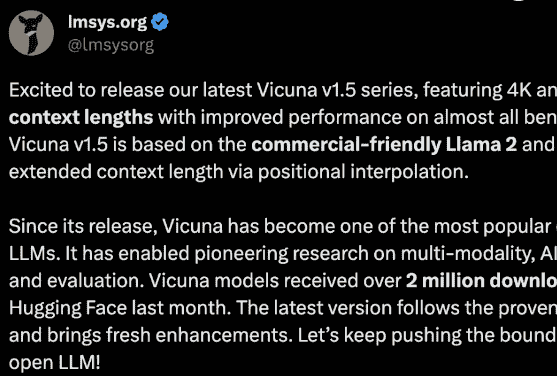
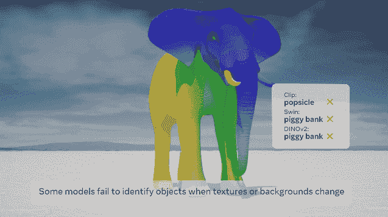
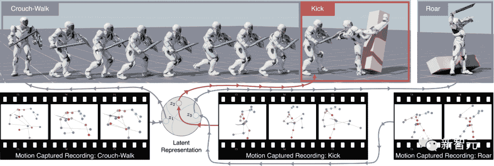
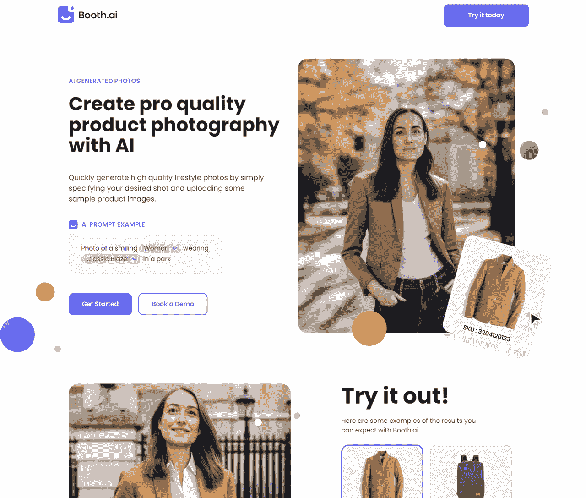
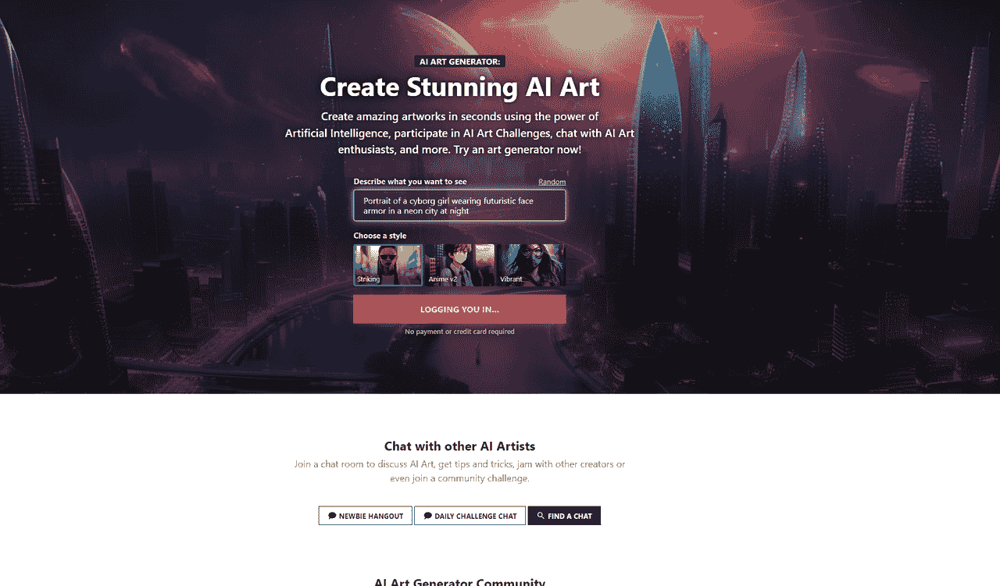
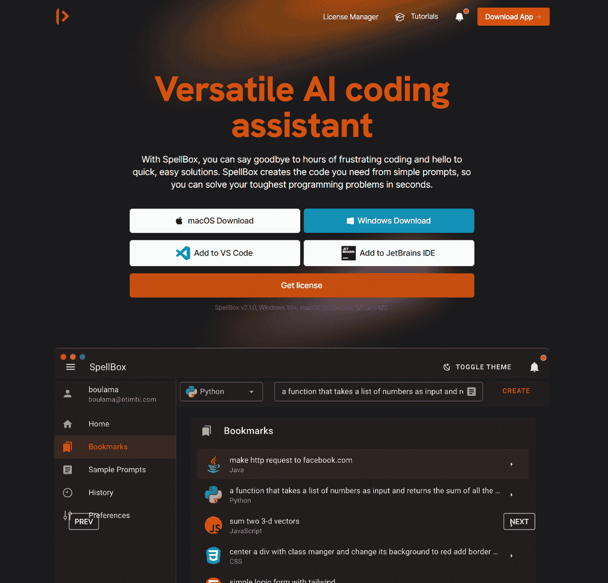
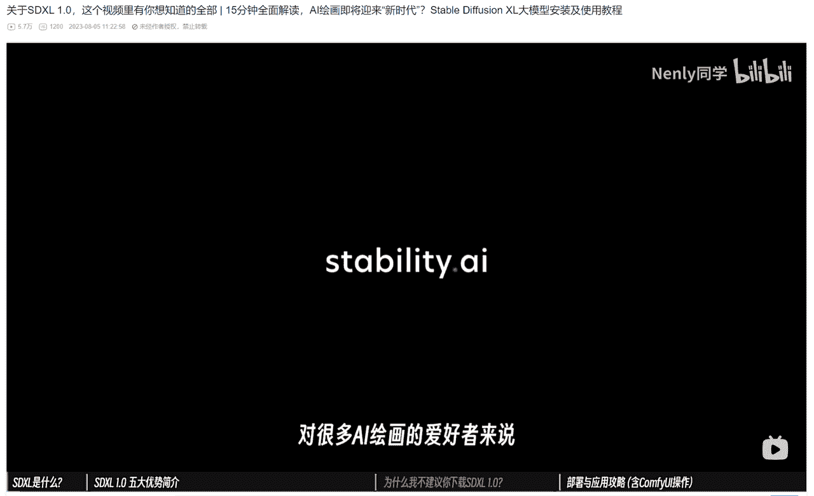
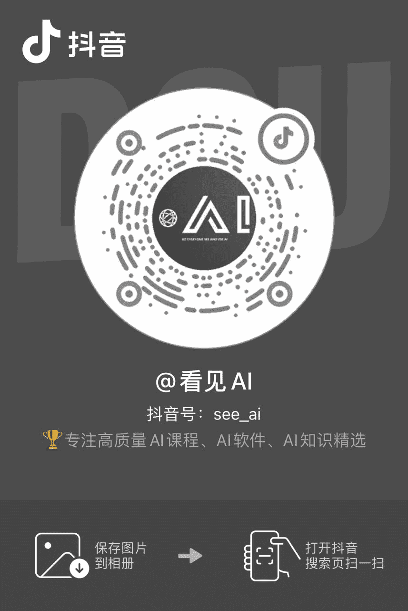

# 看见AI日报（20230812）

> 来源：[https://jlqyxzzvbk.feishu.cn/docx/LqaXdjlaHoxCuQx301rcEv8znvd](https://jlqyxzzvbk.feishu.cn/docx/LqaXdjlaHoxCuQx301rcEv8znvd)

> 快报时间：2023/8月/12日 周六 17:00

**欢迎进群交流**

# AI资讯精选

## GPT-4最强平替更新！UC伯克利发布Vicuna v1.5，支持4K和16K上下文，刷新SOTA，LeCun转赞

GPT-4最强平替更新了！

这次，基于全新的Llama 2，UC伯克利发布了更新版Vicuna v1.5。

不仅支持4K和16K上下文，并且在几乎所有基准测试中取得了SOTA。

自3月发布以来，Vicuna已成为最受欢迎的聊天LLM之一。它在多模态、AI安全和评估方面的研究具有开创性。

上个月，Vicuna模型在Hugging Face上的下载量超过了200万次。

更多信息请访问：https://mp.weixin.qq.com/s/OWPQtFaww1vAqLoQuTxI6Q

## 被裁员工回归，Meta重建元宇宙！发布逼真图像数据集，全球巡回组装AR眼镜

Meta的元宇宙探索，还在继续。

最近，Meta用虚幻引擎开发了全新的逼真合成数据集，希望拉近合成数据与真实世界数据的距离。

他们还计划制作一款全新的AR眼镜，仅用于内部开发和公众展示。

据悉，这款眼镜的制造流程涉及中国大陆、中国台湾和美国的工厂。原因是镜片内包含一款军用材料，无法轻易出口到美国以外的地方。

另外，Meta甚至还成立了一个「前员工门户」，把从前解雇的员工慢慢招了回来。

更多信息请访问：https://mp.weixin.qq.com/s/-xlwUcY3ahlsw_zpxguClw

## 单张A100，50亿步训练！英伟达开源最强虚拟角色定制模型，超逼真动作零样本生成，游戏动画行业要变天

8月8日深夜，英伟达CEO黄仁勋，再次登上了世界顶级计算机图形学会议SIGGRAPH的舞台，用一系列重磅更新展示了在AI和元宇宙方向上的野心。而就在最近，被SIGGRAPH 2023收录的CALM模型的正式开源，也让游戏和动画开发直接飙上了AI加持的快车道。CALM可以自学「人类的动作」，无需额外训练就能自由合成和控制虚拟角色的动作，效果逼真自然。也许很快整个游戏、动画工业的格局就要彻底改变，而VR场景中的人物和角色也将从此不再生硬，元宇宙可能真的要加速到来了！

更多信息请访问：https://mp.weixin.qq.com/s/51gYbrckeukWoME8YOJOEA

# AI软件精选

# Booth.ai**（****AI****绘画）**

通过人工智能生成快速、廉价、高质量的图像，无需实物样本。通过上传您自己产品的图像，并通过编写简单的提示轻松生成专业级产品照片，并创建您想要的结果。

链接：https://www.booth.ai/

# **N****ig****htC**afe Studio（AI绘画）

用人工智能创造令人惊叹的艺术品。

链接：https://creator.nightcafe.studio/

# SpellBox**（****AI****写代码）**

为忙碌的程序员提供AI编码助手。用人工智能在几秒钟内解决任何编程或工程问题。

链接：https://spellbox.app/

**更多****AI****工具请访问：**https://www.ainavpro.com/

# AI课程精选

## 免费课程（GPT）

https://www.bilibili.com/video/BV1TM4y1p7RJ/?spm_id_from=333.788&vd_source=3f7939551b27a57d8c51bdca93356279

关于SDXL 1.0，这个视频里有你想知道的全部 | 15分钟全面解读，AI绘画即将迎来“新时代”？Stable Diffusion XL大模型安装及使用教程

## 付费课程（ai认知提升）

AI的30种用法！亚伦哥的AI实用课！工作效率提升数倍

4.61 Jvf:/ 【AI的30种用法！亚伦哥的AI实用课！工作效率提升数倍！】https://v.douyin.com/iKRq5Br/ 长按复制此条消息，打开抖音搜索，查看商品详情！

#

**欢迎进群交流**

# 4.会员精选

访问地址：https://nf.video/kkF8Y  下单时输入：kanAI  九五折优惠，或者直接二维码访问

**国内镜像****GPT****，**支持GPT，比官方更便宜，访问更快，无需魔法，直接访问，九折购买，（购买后联系客服，返还10%购买费用）

客服二维码（返现客服)

