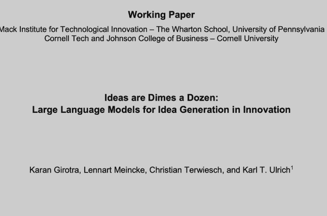
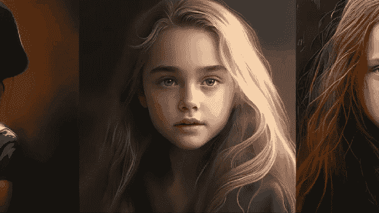
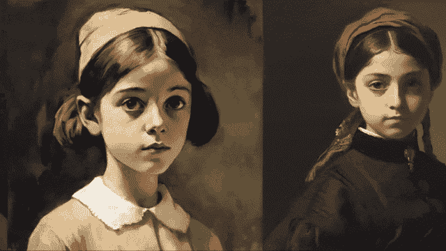
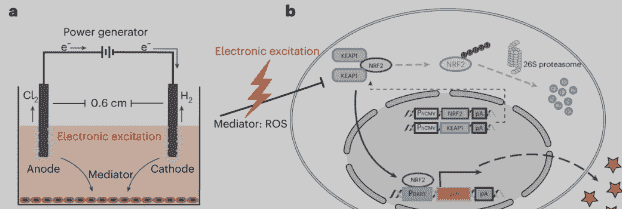
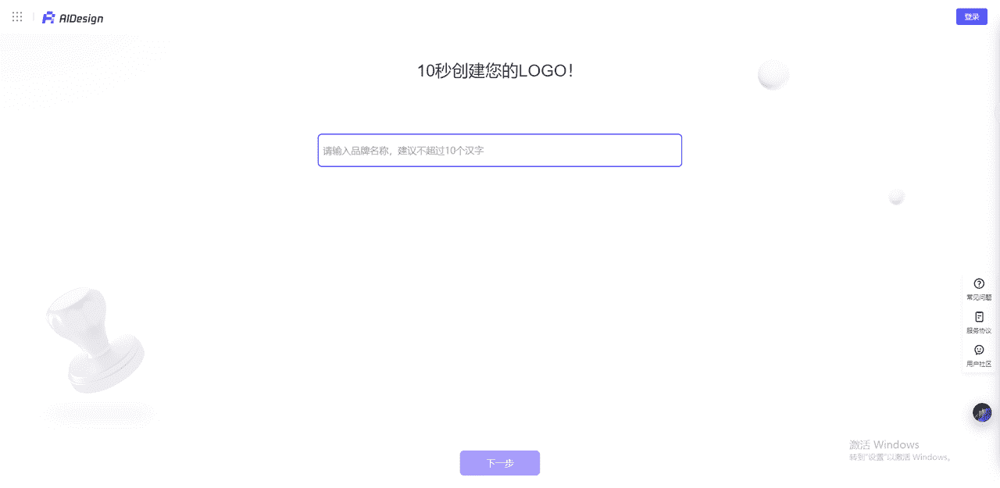
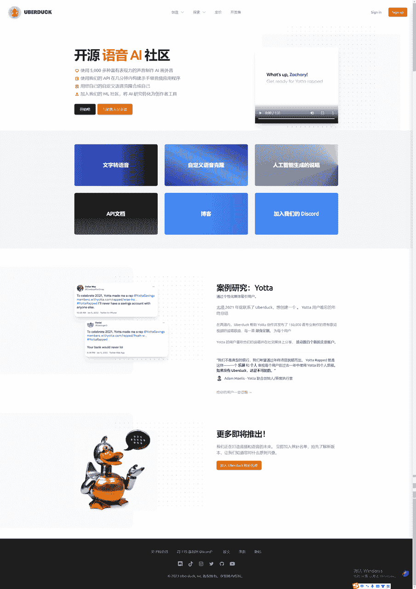
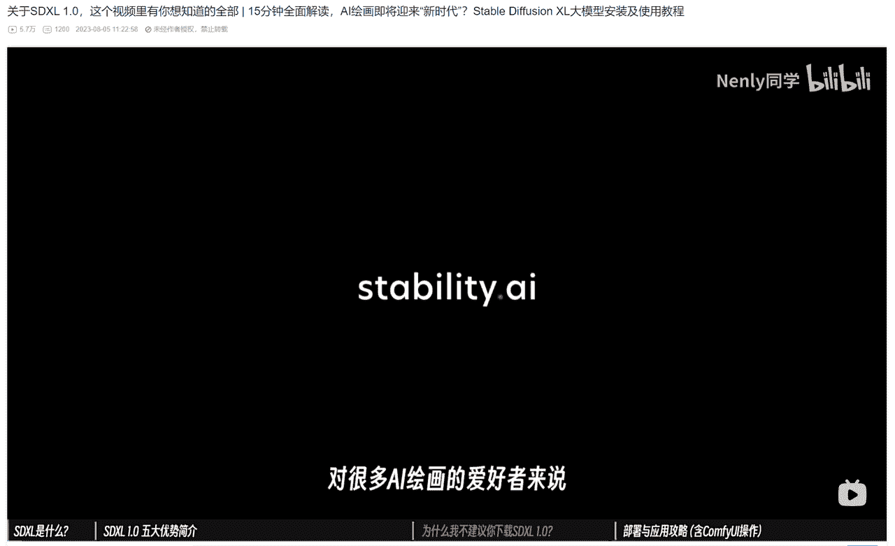

# 看见AI日报（20230813）

> 来源：[https://jlqyxzzvbk.feishu.cn/docx/P2xadzNckocdYhxDmG5cEh4qnJe](https://jlqyxzzvbk.feishu.cn/docx/P2xadzNckocdYhxDmG5cEh4qnJe)

> 快报时间：2023/8月/13日 周日 17:00

**欢迎进群交流**

# AI资讯精选

## 宾大最新研究：AI产生创意的效率比人类高7倍，GPT创意能力击败99%的人类！

从围棋到游戏，再到完成各种重复性的劳动，AI在很多方面的能力已经远超人类。

很多人已经在畅想，未来AI将人类从无聊的工作中解放出来，让人类能专注于只有人类才能完成的工作上。

比如和人类之间的情感交流，或者需要创造力的工作。

但是最近已经有不少研究证实，AI对于人类情感的感受和表达，比很多人做得都要好。

同样的，创造力这个事情，AI似乎也不比人类差。

最近，人机交互专家雅各布尼尔森（Jakob Nielsen）写了一篇专栏文章，用3个最近的科学研究和一篇由ChatGPT创作的短文，向我们证明了：

对于需要创造力的工作，也快没人类什么事了！

更多信息请访问：https://mp.weixin.qq.com/s/a_72QdXCIG9yKU4vw0eE4w

## Midjourney一周年！从V1到V5，画出的美女有何不同？

7月14日，Midjourney距离初次发布已经一周年了！就在一年前的这一天，Midjourney开始公测。而我们，也眼看着它从v1进化到了v5.2。在今天，网友们纷纷刷起了「Midjourney生日快乐」，并且纷纷刷起了同样的prompt从V1到V5.2的变化。

**v1**

**v2**

**v3**

**v4**

**v5**

**v5.1**

**v5.2**

更多信息请访问：https://mp.weixin.qq.com/s/Y_TuydFiV8u3kQi9FRarZA

## 《终结者5》lite版！华人博士生用电控制基因表达，成果登上Nature子刊

来自苏黎世联邦理工学院的华人博士生Jinbo Huang和团队研制了一种新的生物接口。

这种接口名为「直流电激活的调节技术」(**D**C-**A**ctuated **R**egulation **T**echnology)。

它可以通过电信号对细胞进行刺激，进而启动或暂停某个基因的表达。

现在，这项研究已经登上了Nature子刊。

https://mp.weixin.qq.com/s/6Ct20Dw-L5936evkRRTkXA

# AI软件精选

# 节奏照片**（****AI****数字人）**

能让你开心一笑的网站！它提供在线人像图片动态化处理，可以让一张照片变成一个活生生的人物在唱歌。。。

链接：https://nodtotherhythm.com/

# AIDesign AI Logo生成**（AI绘画）**

腾讯自研的智能设计平台，免费在线生成品牌logo、企业VI，仅需3步助您开启业务。

链接：https://ailogo.qq.com/guide/brandname

# uberduck**（****AI****语音）**

内置以电影、动漫人物为原型的语音。可以结合文案语音和剧情编排一段同人作品。

链接：https://www.uberduck.ai/

**更多****AI****工具请访问：**https://www.ainavpro.com/

# AI课程精选

## 免费课程（GPT）

https://www.bilibili.com/video/BV1TM4y1p7RJ/?spm_id_from=333.788&vd_source=3f7939551b27a57d8c51bdca93356279

关于SDXL 1.0，这个视频里有你想知道的全部 | 15分钟全面解读，AI绘画即将迎来“新时代”？Stable Diffusion XL大模型安装及使用教程

## 付费课程（ai认知提升）

AI的30种用法！亚伦哥的AI实用课！工作效率提升数倍

4.61 Jvf:/ 【AI的30种用法！亚伦哥的AI实用课！工作效率提升数倍！】https://v.douyin.com/iKRq5Br/ 长按复制此条消息，打开抖音搜索，查看商品详情！

#

**欢迎进群交流**

# 4.会员精选

访问地址：https://nf.video/kkF8Y  下单时输入：kanAI  九五折优惠，或者直接二维码访问

**国内镜像****GPT****，**支持GPT，比官方更便宜，访问更快，无需魔法，直接访问，九折购买，（购买后联系客服，返还10%购买费用）

客服二维码（返现客服)

