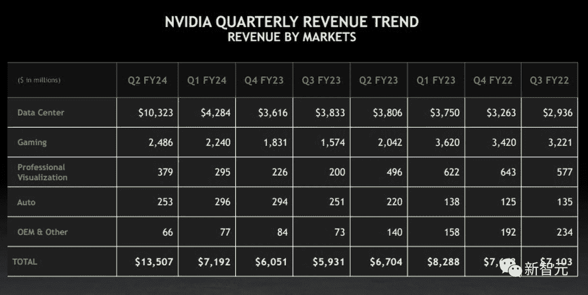
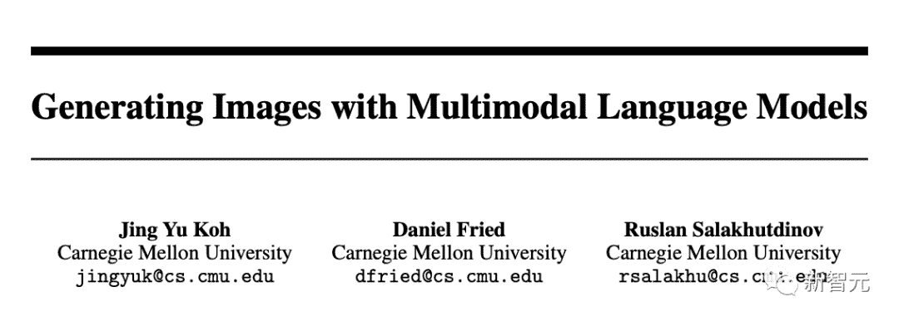
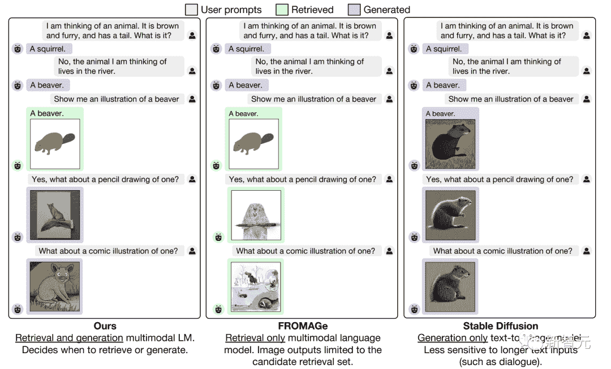
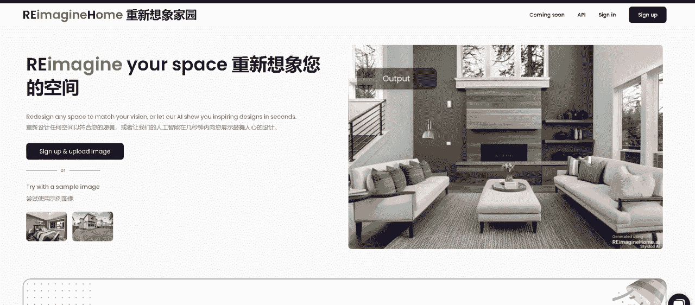
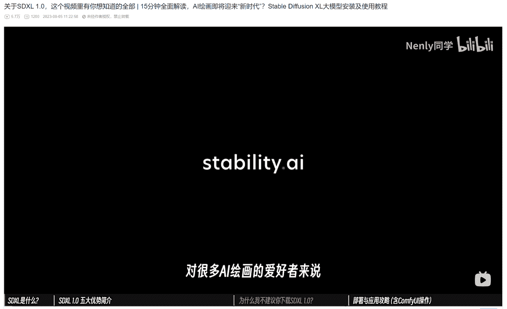

# 看见AI日报（20230824）

> 来源：[https://jlqyxzzvbk.feishu.cn/docx/AdXTdwmKVomf07x0QyhcvRgynYf](https://jlqyxzzvbk.feishu.cn/docx/AdXTdwmKVomf07x0QyhcvRgynYf)

> 快报时间：2023/8月/24日 周四 17:00

**欢迎进群交流**

# AI资讯精选

## 英伟达利润暴涨843%，股价突破500美元！H100成AI黄金，订单排到明年

英伟达在周三收盘后一公布2季度财报，股价盘后大涨6.6%，一度跨过了500美元大关，最高达到517美元。

如果按照500美元来算，英伟达市值将超过1.2万亿，再创历史新高！

**英伟达财报出炉**

自5月份以来，英伟达的收入已经达到了135亿美元。

其中，数据中心收入占该收入的创纪录的103.2亿美元，仅一个季度就翻了一番多，英伟达因此获得了61.88亿美元的利润，同比增长843%！

尽管游戏行业的收入比疫情期间的最高点还差10亿美元，但实际上它的收入也同比增长了22%，达到24.8亿美元。

更大的亮点是截至10月底的第三财季的业绩预期，英伟达给出的营收预测区间中值为160亿美元，远高于分析师普遍预期的126亿美元。

更多信息请访问：https://mp.weixin.qq.com/s/3nk62P3xHeDSWihm6NkUEQ

## GPT-4生图未解禁？CMU华人博士新作，大模型GILL能生图能检索，人人可玩

近日，来自CMU的研究人员全新提出了一种多模态模型GILL。

论文地址：https://arxiv.org/pdf/2305.17216.pdf它可以将文本或图像作为prompt，完成多模态对话。具体来说，可以实现生成文本、检索图像、生成新图像。

甚至，GILL还能从预先指定的数据集中进行图像检索，并在推理时决定是检索还是生成。

更多信息请访问：https://mp.weixin.qq.com/s/TjqUH2SuUHNKvyMOmRAJAw

## Midjourney新功能上线，对图片内容修改

Midjourney 今天宣布更新，增加了新的Vary (Region) 功能，可对已生成的图片内容进行修改。

这个功能允许用户对画面中的选定区域进行修改，在不影响画面大部分内容的情况下，重新绘制选定区域的内容。目前该功能一次只能选择一个区域进行修改，不过用户可以通过多次操作来获得想要的内容。

更多信息请访问：https://www.uisdc.com/group/527923.html

# AI软件精选

# RoomGPT**（AI3D）**

建筑ai，给你的房间拍张照片，看看你的房间在不同的主题下看起来如何。改造您的房间。

链接：https://www.reimaginehome.ai/

# RE**imagine **Home: AI（AI3D建模）

用人工智能的室内设计和虚拟舞台重新想象你的家。产生个性化的设计概念和灵感来重新设计您的家。

链接：https://www.reimaginehome.ai/

# Krikey AI**（AI3D建模）**

Krikey是一家AI工具公司，其产品包括AI文本到动画工具，自定义3D Avatar工具，AR游戏工具包等。

链接：https://www.krikey.ai/

**更多****AI****工具请访问：**https://www.ainavpro.com/

# AI课程精选

## 免费课程（GPT）

https://www.bilibili.com/video/BV1TM4y1p7RJ/?spm_id_from=333.788&vd_source=3f7939551b27a57d8c51bdca93356279

关于SDXL 1.0，这个视频里有你想知道的全部 | 15分钟全面解读，AI绘画即将迎来“新时代”？Stable Diffusion XL大模型安装及使用教程

## 付费课程（ai认知提升）

AI的30种用法！亚伦哥的AI实用课！工作效率提升数倍

4.61 Jvf:/ 【AI的30种用法！亚伦哥的AI实用课！工作效率提升数倍！】https://v.douyin.com/iKRq5Br/ 长按复制此条消息，打开抖音搜索，查看商品详情！

#

**欢迎进群交流**

# 4.会员精选

访问地址：https://nf.video/kkF8Y  下单时输入：kanAI  九五折优惠，或者直接二维码访问

**国内镜像****GPT****，**支持GPT，比官方更便宜，访问更快，无需魔法，直接访问，九折购买，（购买后联系客服，返还10%购买费用）

客服二维码（返现客服)

