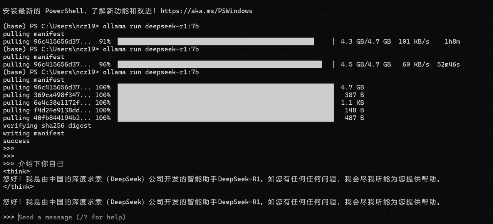
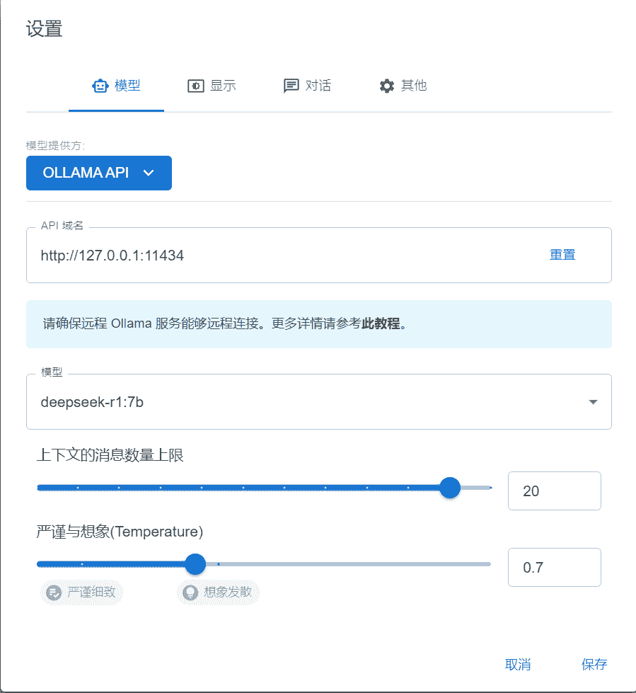
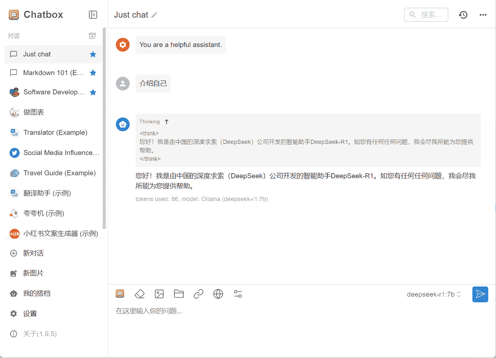
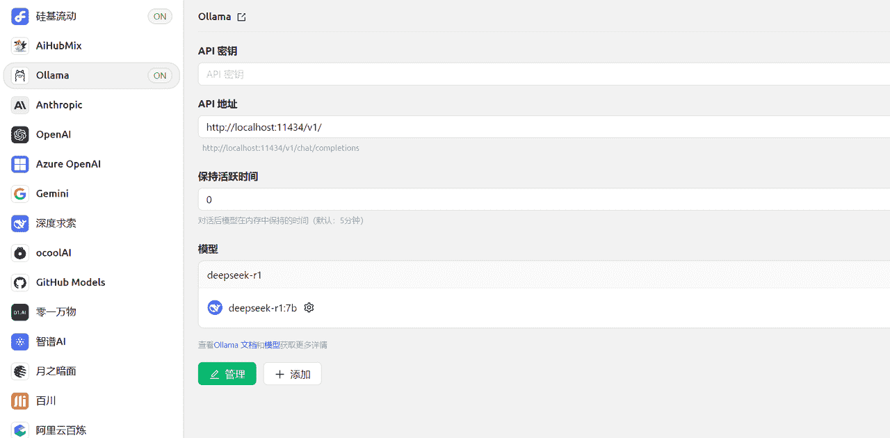
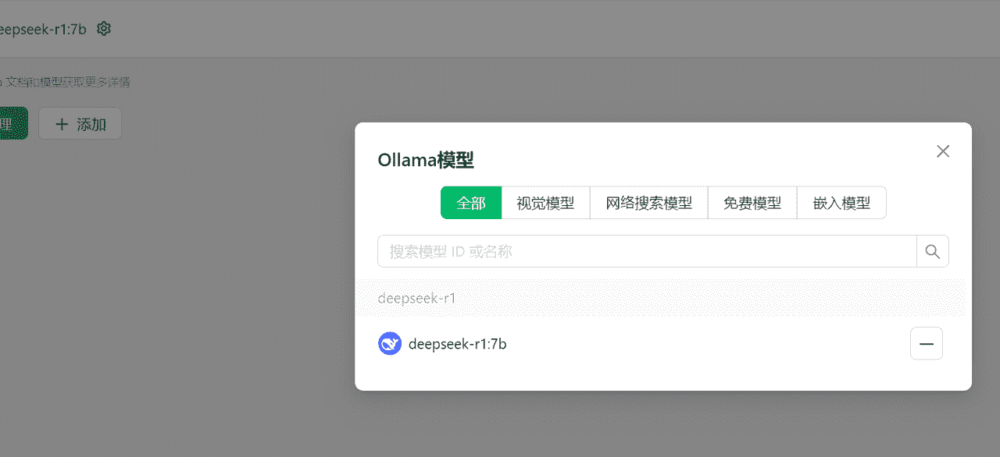
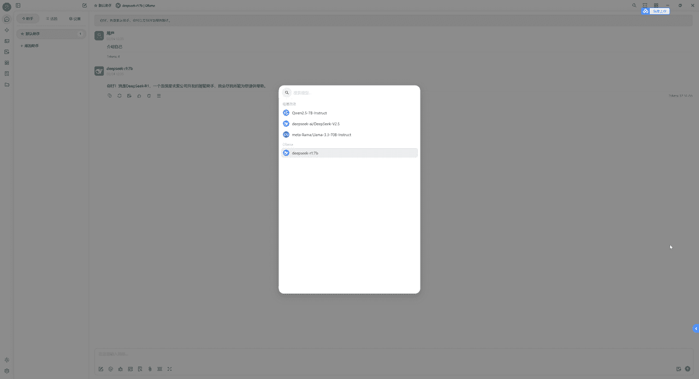

# DeepSeek本地部署

> 来源：[https://jlqyxzzvbk.feishu.cn/docx/JGG4d6Eupo84qAxWf5RcFHcznUe](https://jlqyxzzvbk.feishu.cn/docx/JGG4d6Eupo84qAxWf5RcFHcznUe)

！！！请按照如下文档步骤进行安装，如果有问题请优先咨询客服🛰️ seeai01或13858104569

需求比较大，请大家耐心等待，只要下单的用户，一定帮您完成本地安装部署。

## 本地安装方案：

1、安装AI启动平台Ollama

2、下载安装Deepseek

3、安装应用界面（可选）

安装包：

链接：https://pan.baidu.com/s/1Hf0KISJLpOozYlSS_vxD9A?pwd=799b

提取码：799b

## Ollama安装

### 下载地址

https://ollama.com/download

### 安装

windows下exe文件直接安装即可

macos安装指导可以详见：[Macos安装Ollama](https://jlqyxzzvbk.feishu.cn/wiki/FJKXw7ciwiGP36kI8NTcoaDmnTd)

### 安装ollama到指定路径（可选）

windows下命令行：

.\OllamaSetup.exe /DIR=D:\software\ollama

## 安装Deepseek

### 选择模型

https://ollama.com/library/deepseek-r1:7b（根据本地PC硬件配置来选择模型）

[模型对应硬件需求](https://jlqyxzzvbk.feishu.cn/wiki/RANUwYryui40AQkg1rNctlsbnmf)

### 安装命令

#### windows在powershell下运行：

ollama run deepseek-r1:7b

#### mac环境在终端中运行

在终端中输入：ollama run deepseek-r1:7b

打开终端方法 1：使用「聚焦搜索」(Spotlight)

1.  按下 Command (⌘) + 空格键，打开 Spotlight 搜索框。

1.  输入 终端 或 Terminal，然后按 Enter 键，即可打开终端。

打开终端方法 2：从「访达」(Finder) 打开

1.  打开 **访达**（Finder）。

1.  在顶部菜单栏点击 **前往 > 实用工具**（Go > Utilities）。

1.  在 **实用工具** 文件夹内找到 **终端**（Terminal），双击打开。

### **更改模型存储位置（可选）**

如果 Ollama 已经安装，你可以通过设置环境变量 OLLAMA_MODELS 来更改默认的模型存放目录。步骤如下：

+   右键“此电脑”（或“我的电脑”）→属性→高级系统设置→环境变量，

+   在“系统变量”中新建或修改变量名为 OLLAMA_MODELS，变量值设为你想要存储模型的目录（例如 E:\Ollama\models），

+   重启电脑或重新启动 Ollama 服务后，所有模型数据将下载并存放到新目录中。如果原来已有模型数据存放在默认路径（如 C:\Users\<用户名>\.ollama\models），可以手动将它们复制到新目录

## 安装运行UI界面

### 方案1 ChatBox

#### 安装包下载地址

https://chatboxai.app/zh#download

#### 安装并配置

#### 大功告成

## 方案2 （Cherry Studio）

https://cherry-ai.com/download

1、安装好Cherry Studio，打开界面，点击左下角设置

2、点击左侧Ollama

3、点击管理，选择添加Deepseek模型

4、返回主界面，左上角助手，正上方选择模型，确认为Deepseek即可

## 方案3 OpenWebUI

## 更多内容请见

[看见AI知识库](https://jlqyxzzvbk.feishu.cn/wiki/BqGzwyRGJiPGZ7kZ644cexvFnLd)