# DeepSeek使用技巧

> 来源：[https://jlqyxzzvbk.feishu.cn/docx/Fqcqd6Xjao1aUkxLKmrcXwUnnwh](https://jlqyxzzvbk.feishu.cn/docx/Fqcqd6Xjao1aUkxLKmrcXwUnnwh)

## 重点技巧

1、直接描述需求，说人话

2、让它进行参考某种风格、或者某个标准去仿写

3、提示词技巧：我要xx，要给xx用，希望达到xx效果，但担心xx问题...

4、官方样例：https://api-docs.deepseek.com/zh-cn/prompt-library

## 文档

清华大学DeepSeek教程，从入门到精通104页

[DeepSeek Guide.pdf](https://internal-api-drive-stream.feishu.cn/space/api/box/stream/download/all/LnNZbpTcNoTmoDxJKZscmvnfn5d)

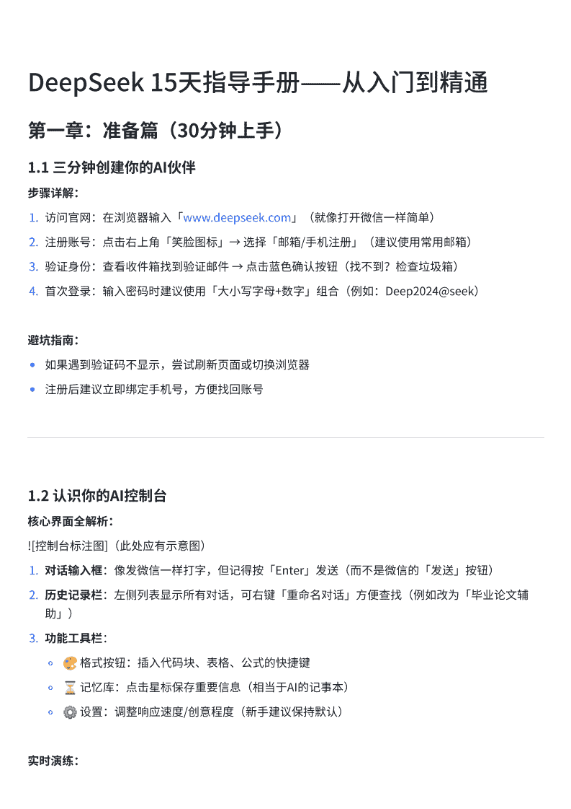

[DeepSeek 15天指导手册——从入门到精通 (2)(1).pdf](https://internal-api-drive-stream.feishu.cn/space/api/box/stream/download/all/GvFFbi20KoyM0cxzGe7c3HhhnTg)

[清华大学第三弹：普通人如何抓住 DeepSeek 红利.pdf](https://internal-api-drive-stream.feishu.cn/space/api/box/stream/download/all/Ms0ub6qbzohOsRxVNuRcwYzjnXB)

[清华大学第二弹：DeepSeek 赋能职场.pdf](https://internal-api-drive-stream.feishu.cn/space/api/box/stream/download/all/Jl3RbYztjoknbpxdtsTcgvHAnih)

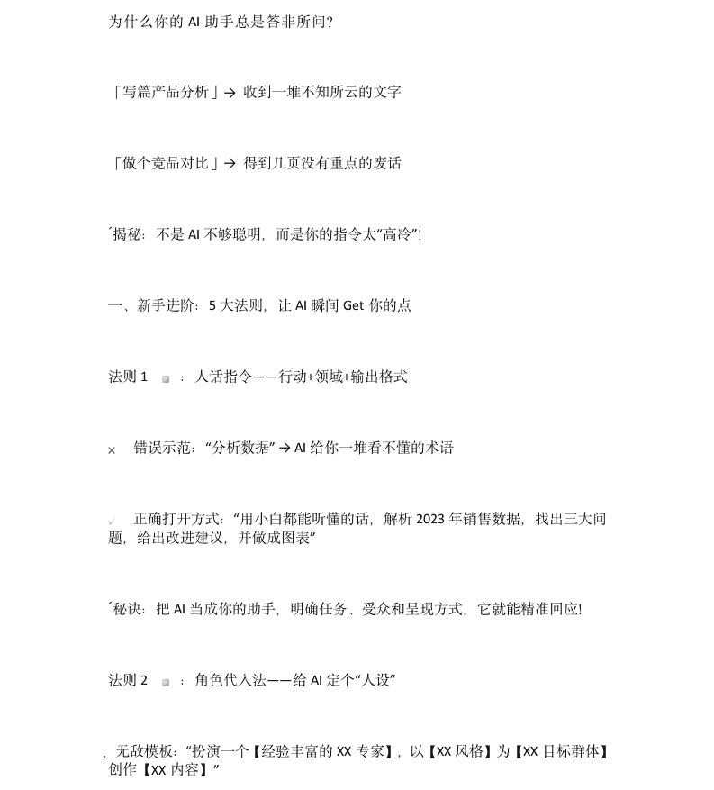

[1000个DeepSeek神级提示词，让你轻松驾驭AI【赶紧收藏】.docx](https://internal-api-drive-stream.feishu.cn/space/api/box/stream/download/all/VnGqbMdm3o815PxAYDCcQoSJnpf)

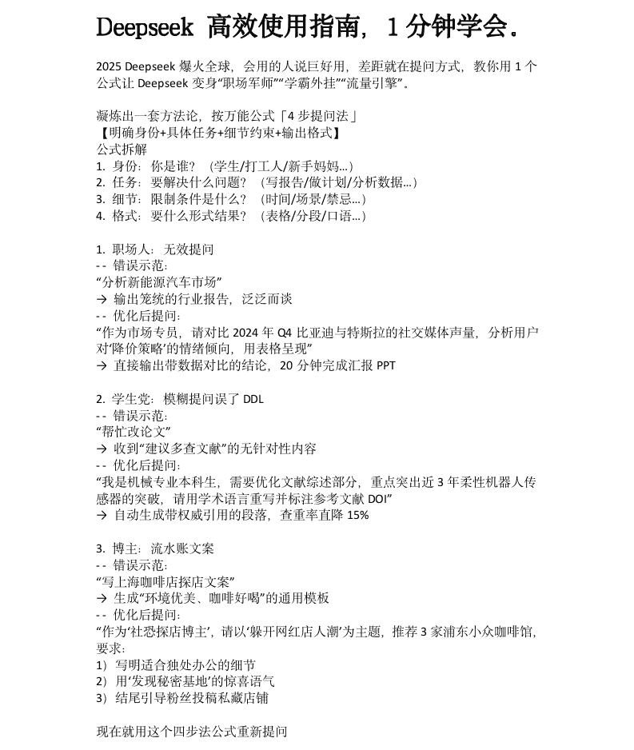

[Deepseek 高效使用指南.docx](https://internal-api-drive-stream.feishu.cn/space/api/box/stream/download/all/AinsbaZdEoDy80xI6iDcdYh8nxd)

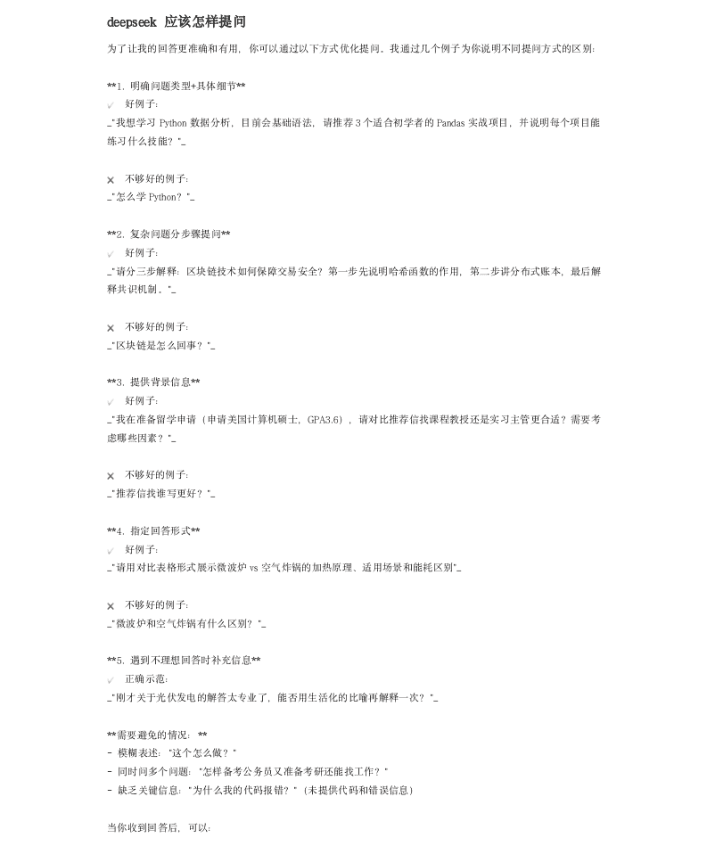

[deepseek 应该怎样提问.docx](https://internal-api-drive-stream.feishu.cn/space/api/box/stream/download/all/BNZRbT3qdooE0Oxpandck81Rnoh)

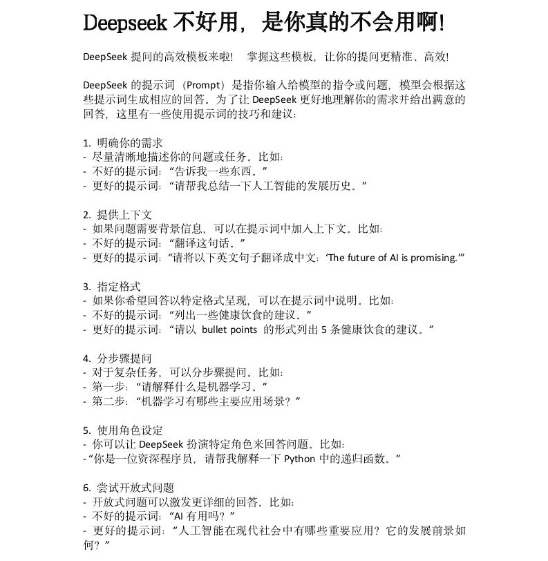

[Deepseek不好用，是你真的不会用啊！.docx](https://internal-api-drive-stream.feishu.cn/space/api/box/stream/download/all/PpDhb5n5GoxdspxCzA2cSCcqn7b)

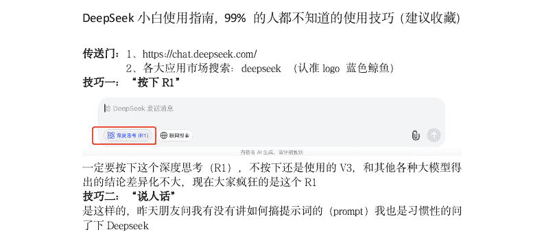

[DeepSeek小白使用指南，99% 的人都不知道的使用技巧（建议收藏）docx.docx](https://internal-api-drive-stream.feishu.cn/space/api/box/stream/download/all/HnXbblLQwoFStexSGiYcUghlnxe)

[DeepSeek最强使用攻略，放弃复杂提示词，直接提问效果反而更好？.docx](https://internal-api-drive-stream.feishu.cn/space/api/box/stream/download/all/QYeabskOGoCkCpxyRzncMPW4ntc)

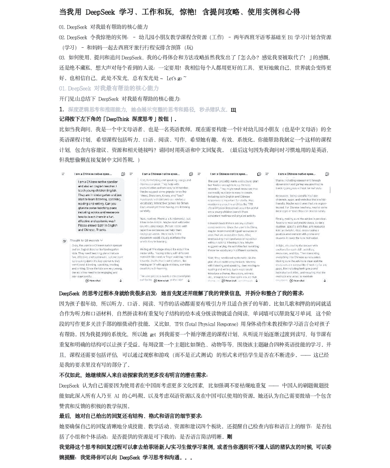

[当我用 DeepSeek 学习、工作和玩，惊艳！含提问攻略、使用实例和心得.docx](https://internal-api-drive-stream.feishu.cn/space/api/box/stream/download/all/ZKnbbQBdRo40joxLwfQc2QX1ngc)

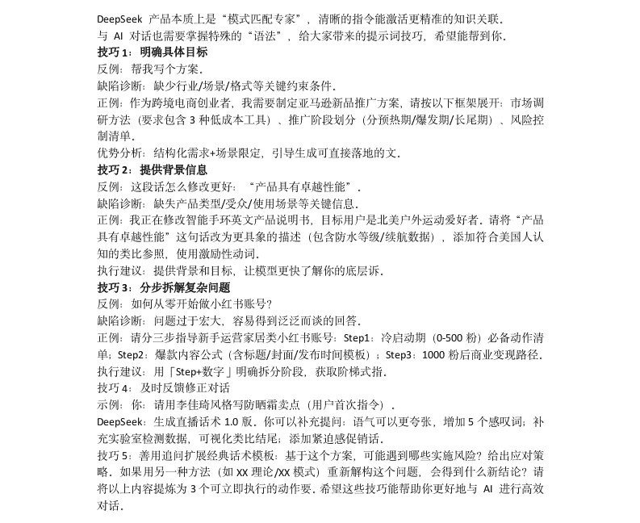

[零基础使用DeepSeek高效提问技巧.docx](https://internal-api-drive-stream.feishu.cn/space/api/box/stream/download/all/BJo5bo4NVo644cxUHFTcgiQunQc)

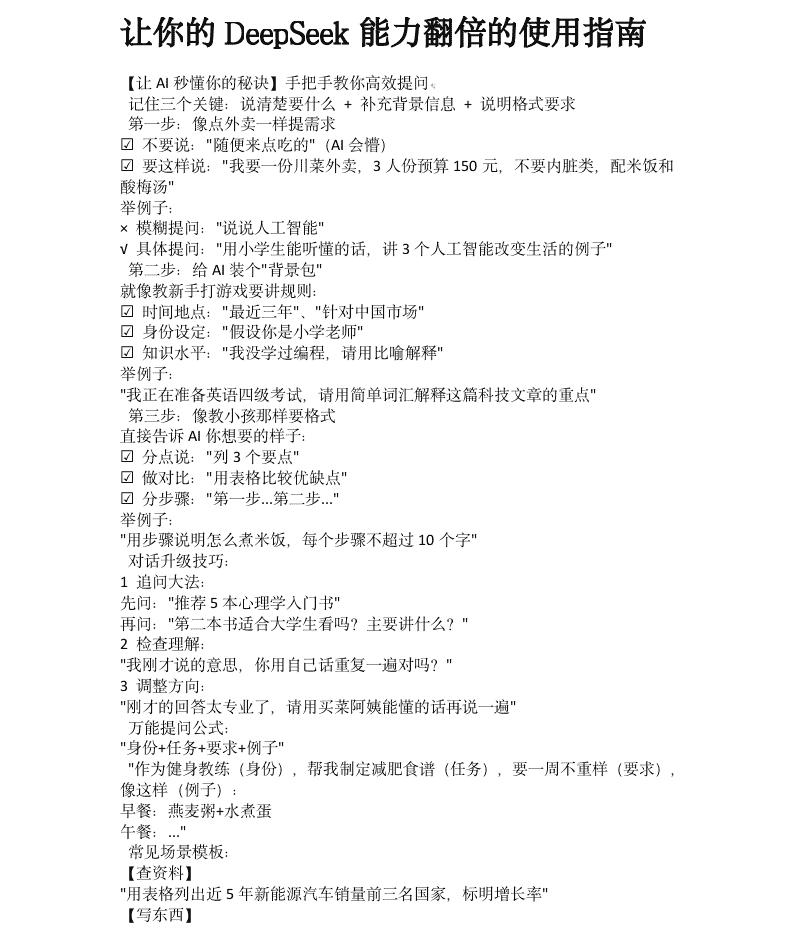

[让你的DeepSeek能力翻倍的使用指南.docx](https://internal-api-drive-stream.feishu.cn/space/api/box/stream/download/all/XK5wbPsCXoYbYOxwpQichXNgn7b)

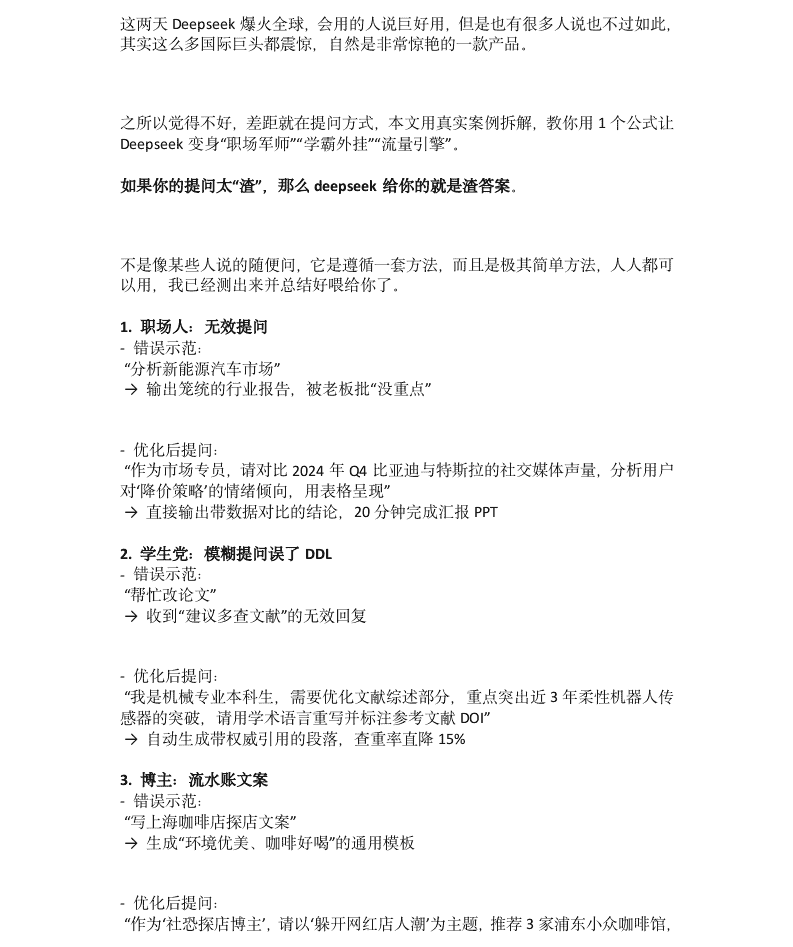

[如何正确使用deepseek？99%的人都错了.docx](https://internal-api-drive-stream.feishu.cn/space/api/box/stream/download/all/Crz7b0onxoy2KyxjFYDc6N54nAb)

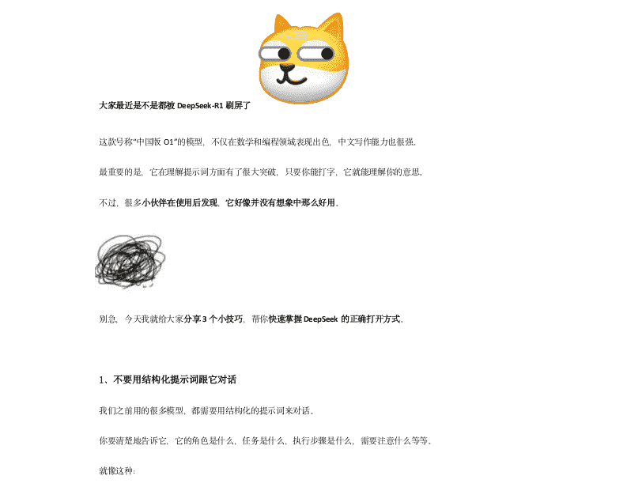

[3个DeepSeek隐藏玩法，99%的人都不知道！.docx](https://internal-api-drive-stream.feishu.cn/space/api/box/stream/download/all/XKPEbTq1uoSFCoxkBU1cFOCUn6e)