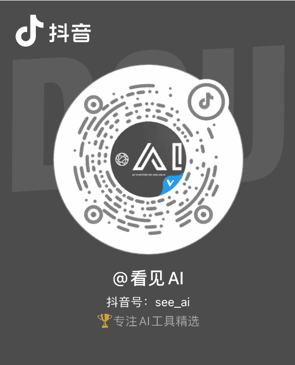
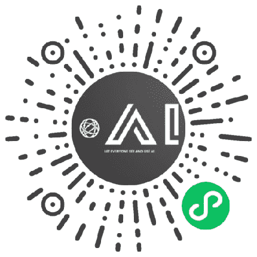
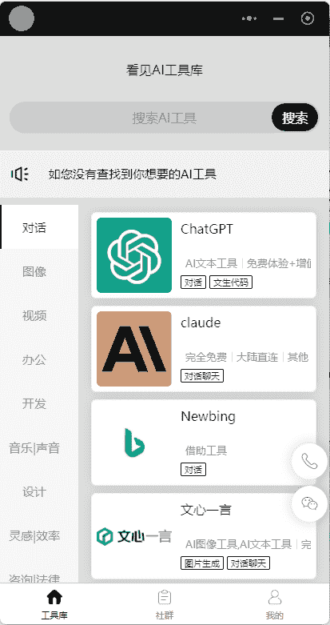
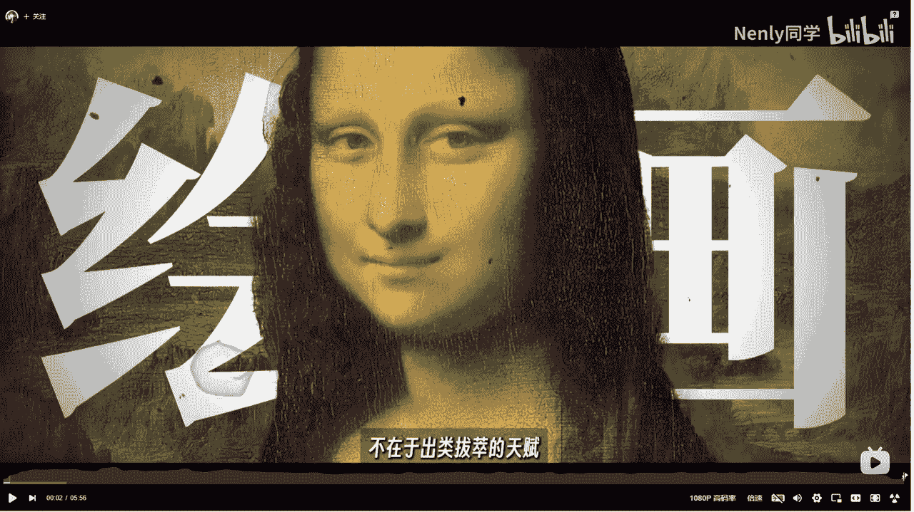
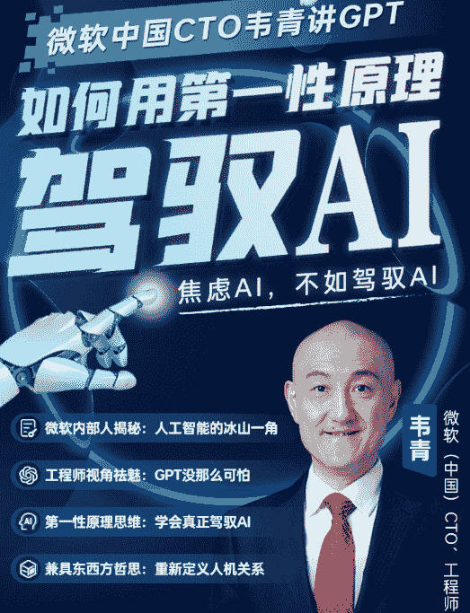

# 看见AI粉丝福利

> 来源：[https://jlqyxzzvbk.feishu.cn/docx/TDJldLhWUoZdyoxJ0oUcfNIznig](https://jlqyxzzvbk.feishu.cn/docx/TDJldLhWUoZdyoxJ0oUcfNIznig)

> **欢迎关注看见****AI****账号**

> **AI****工具搜索小程序**

# AI工具汇总

[AI工具汇总1000+.xlsx](https://jlqyxzzvbk.feishu.cn/wiki/VR3jw5UzFi4yCUkjVqNclVVFnqe)

GPT平替工具列表，无魔法访问

1、https://gpt.instpower.net/i/PnnsBjpQo

2、https://www.hayo.com/

# AI导航网站地址汇总

# AI研报

1.  [AIGC时代的多模态知识工程思考与展望.pdf](https://jlqyxzzvbk.feishu.cn/wiki/Q6h9w6WCNiwmopkciaEcs2j1nUo)

1.  [AIGC系列之七：国产AI芯片的百倍算力需求.pdf](https://jlqyxzzvbk.feishu.cn/wiki/L7NkwonL3ivD8OkMzHxc4xQknmh)

1.  [ChatGPT跨行业专题报告：AIGC发展大年，推动新一轮产业革命.pdf](https://jlqyxzzvbk.feishu.cn/wiki/Ejlewp9LQipQ5GkXZZLcxlyan1g)

1.  [传媒行业深度研究报告：ChatGPT：技术原理、演进路线和应用场景.pdf](https://jlqyxzzvbk.feishu.cn/wiki/Ka1mwTRUGiESgikXsHScmAf3nCg)

1.  [哈尔滨工业大学：ChatGPT调研报告–20230308.pdf](https://jlqyxzzvbk.feishu.cn/wiki/UFlSwyiaBiyA7ikK7stc3RQSnfb)

1.  [互联网电商：AIGC之AI绘画：技术与应用双突破，生产力变革在即.pdf](https://jlqyxzzvbk.feishu.cn/wiki/Pcl3wGdxIia6EnkHGtHc2oK8nvh)

1.  [计算机行业周报：AIGC从算法+算力已到场景！谁是“格局型”标的？.pdf](https://jlqyxzzvbk.feishu.cn/wiki/WZ3GwFBfQimEF5klnppcxAYpn7e)

1.  [人工智能行业：ChatGPT的宏观视角.pdf](https://jlqyxzzvbk.feishu.cn/wiki/TOuMwpcJeirXIhkdTh2c4oRnn3g)

1.  [序幕揭开：ChatGPT将AIGC推向“平民化”时代.pdf](https://jlqyxzzvbk.feishu.cn/wiki/W41JwLWVKiLeKNkulQ2cewoSnJg)

# AI教程

## GPT教程

GPT学习网站：https://learningprompt.wiki/docs/chatgpt-learning-path

[chatGPT提示词.docx](https://jlqyxzzvbk.feishu.cn/wiki/ES2HwzsZFixnr4kKYz4cVJAtnjg)

GPT平替网站：[平替GPT.xlsx](https://jlqyxzzvbk.feishu.cn/wiki/PQjdwAq9jimZ4mkXX0QcKAVKned)

GPT4插件汇总：[GPT4的71个插件_230513.xlsx](https://jlqyxzzvbk.feishu.cn/wiki/XBkTwWnMfibzFRkC7BgcUTYJnuf)

## AI绘画教程

### **midjourney**

midjourney学习网站：https://learningprompt.wiki/docs/midjourney/mj-tutorial-basics/midjourney-common-parameters

midjourney官方文档:https://docs.midjourney.com/docs/community-guidelines

提示词网站分享：http://www.atoolbox.net/Tool.php?Id=1101

整理了一些各种风格的[midjourney提示词.docx](https://jlqyxzzvbk.feishu.cn/wiki/NAGzwoVg3iVm4nk5IJWcMICZnWb)

### Stable diffusion

Controlnet1.1 B站安装教程：

https://www.bilibili.com/video/BV1uo4y1c78k/?spm_id_from=333.337.search-card.all.click&vd_source=3f7939551b27a57d8c51bdca93356279

1.   controlnet1.1 for Web UI下载链接：https://github.com/Mikubill/sd-webui-controlnet

1.   controlnet1.1官方说明：https://github.com/lllyasviel/ControlNet-v1-1-nightly

1.  controlnet控制模型下载链接：https://huggingface.co/lllyasviel/ControlNet-v1-1/tree/main

整理了一些各种风格的[stable diffusion提示词.docx](https://jlqyxzzvbk.feishu.cn/wiki/AxfHwIxokiQ0ljkcV1TcXB1gnjb)

##

## 4.3 免费课程

AI绘画

https://www.bilibili.com/video/BV16u411j7u3/?spm_id_from=333.788&vd_source=3f7939551b27a57d8c51bdca93356279

主要讲述SD的各个模块模式逻辑，以授人以渔的形式教授，大量使用实践教程，上手率高，大大提高学习效率。从浅入深，内容详细，逻辑清晰，适合新手入学，视频质量极高。

## 4.4 付费课程（GPT）

混沌微软CTO韦青讲GPT：如何用第一性思维驾驭AI

优惠购课链接：https://v.douyin.com/ifsv5JJ/

**欢迎进群交流**

# 会员精选

访问地址：https://nf.video/kkF8Y  下单时输入：kanAI  九五折优惠，或者直接二维码访问

**国内镜像****GPT****，**支持GPT，比官方更便宜，访问更快，无需魔法，直接访问，九折购买，（购买后联系客服，返还10%购买费用）

