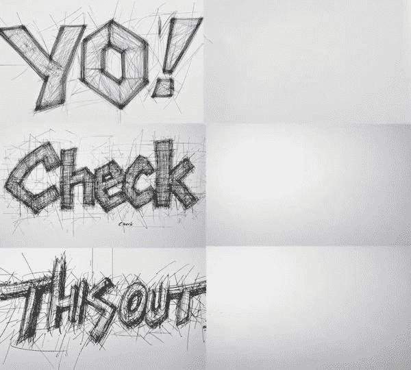
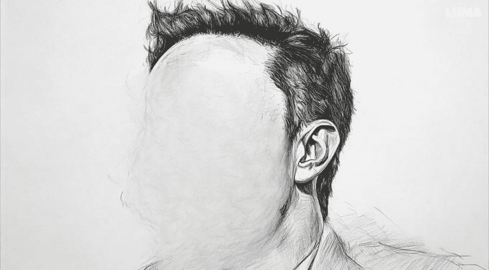

# AI素描绘画过程视频

> 来源：[https://jlqyxzzvbk.feishu.cn/docx/XG4ddaRdtonGrbxo0ZmcNEaInLc](https://jlqyxzzvbk.feishu.cn/docx/XG4ddaRdtonGrbxo0ZmcNEaInLc)

##  演示案例

**素描文字**

[f8wsAmatEmU5hAe0.mp4](https://internal-api-drive-stream.feishu.cn/space/api/box/stream/download/all/QtuLb2FFWokZkOx8ze2c51wtnpc)

素描肖像

[sketch_drawing_of_the_Portrait__starting_with_a_blank_page_and_being_created_line_by_line_305b27.mp4](https://internal-api-drive-stream.feishu.cn/space/api/box/stream/download/all/AWTAbvHnGoCaomxuvpjc0eCMnDc)

使用工具

MJ

中文提示词： 技术草图绘制“[插入单词]”，铅笔素描作品，CAD，--ar 16:9 --stylize 50 --v 6.1            英文：technical sketch drawing of JMKJMN/the word(s) "[insert word(s)]", pencil sketch work, cad, --ar 16:9 --stylize 50 --v 6.1

工具地址

看见AI助手

https://seeaix.com

官网地址

https://www.midjourney.com/

Runway

中文提示词：： "[插入单词] "的素描，从空白页面开始，一笔一划地创作

英文提示词：sketch drawing of the word "[insert word(s)]", starting with a blank page and being created line by line

Crayon drawing, starting from semi-finished products, and finally drawing faces, drawing one stroke at a time

官网地址：

https://runwayml.com/

基础指导

使用了文生图工具先生成素描图片+图片转视频尾帧功能