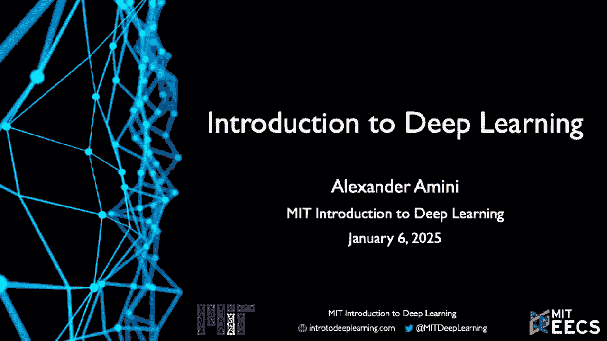
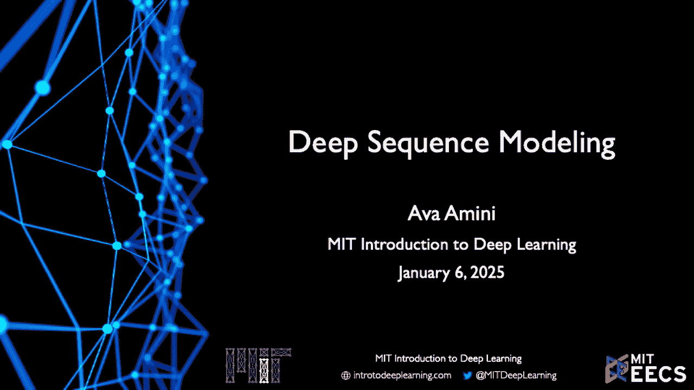
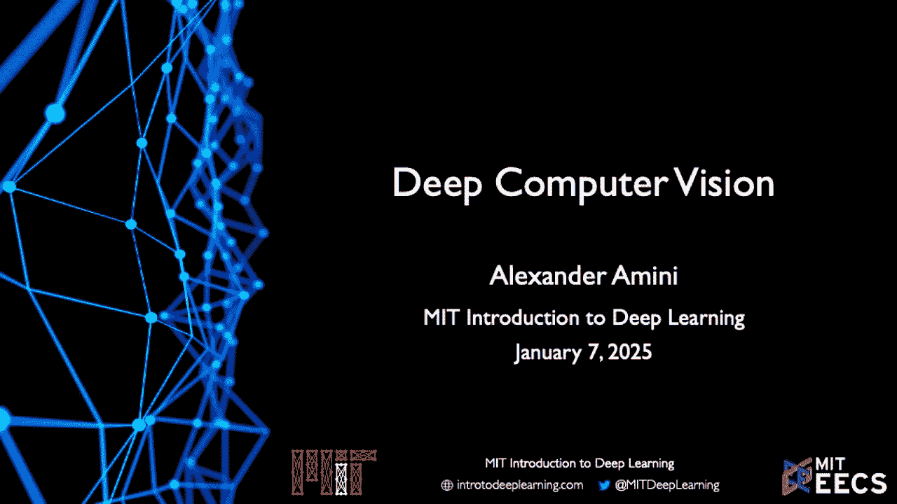
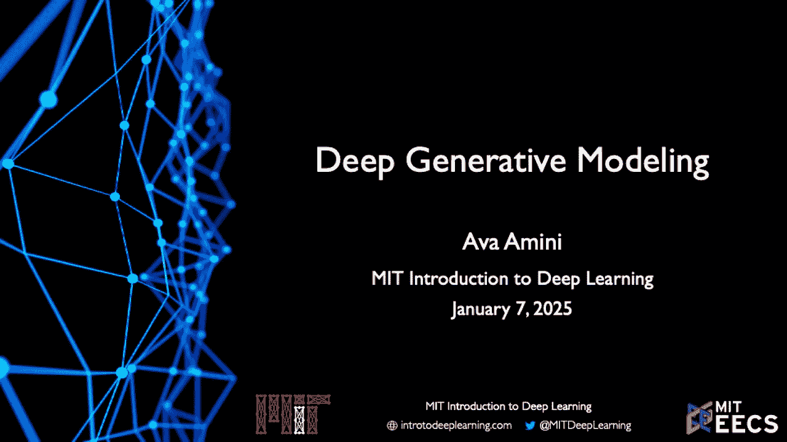

# 【MIT】6.S191-深度学习导论

> 来源：[https://kcn9ut4m7icc.feishu.cn/docx/GLP5dpfNHoqm6hxSjVkcmRS8ngf](https://kcn9ut4m7icc.feishu.cn/docx/GLP5dpfNHoqm6hxSjVkcmRS8ngf)

# 课程主页

https://introtodeeplearning.com/

# 课程简介

#### **高效密集型深度学习速成训练营**

由麻省理工学院打造的深度学习入门项目，涵盖自然语言处理、计算机视觉、生物科学等前沿应用领域！学员将通过本课程掌握：

+   深度学习算法的**核心原理**

+   神经网络搭建的**实战经验**

+   大语言模型与生成式AI等**尖端技术动态**

课程最终以**项目提案竞赛**收官，优胜方案将获得导师团队及行业赞助商的专项指导。

#### **基础要求**

▸ 微积分基础（如求导运算）

▸ 线性代数基础（如矩阵乘法）

其他必备知识我们将在课程中逐一解析！Python编程经验有益但非必需，欢迎旁听生加入！

# 课程视频全集

+   [【中英双语字幕】深度学习导论](https://www.bilibili.com/video/BV1sq9jYcEk6)

## 【第1课】课程简介（Introduction to Deep Learning）

+

[6S191_MIT_DeepLearning_L1.pdf](https://internal-api-drive-stream.feishu.cn/space/api/box/stream/download/all/PRREbkrlFok29mxyQlRcb06gn1d)

+   [YouTube原视频-第1课](https://www.youtube.com/watch?v=alfdI7S6wCY)

## 【第2课】循环神经网络，Transformers，注意力（Recurrent Neural Networks, Transformers, and Attention）

[6S191_MIT_DeepLearning_L2.pdf](https://internal-api-drive-stream.feishu.cn/space/api/box/stream/download/all/KET0b07A6oYKW7x8knwcKtmxnxI)

+   [YouTube原视频-第2课](https://www.youtube.com/watch?v=GvezxUdLrEk)

## 【第3课】卷积神经网络 CNN

[6S191_MIT_DeepLearning_L3.pdf](https://internal-api-drive-stream.feishu.cn/space/api/box/stream/download/all/A3rFbAcBJoGM7Fxyiovc3Ug3nyX)

+   [YouTube原视频-第3课](https://www.youtube.com/watch?v=oGpzWAlP5p0)

## 【第4课】深度生成建模

+

[6S191_MIT_DeepLearning_L4.pdf](https://internal-api-drive-stream.feishu.cn/space/api/box/stream/download/all/GMGgbrlABoghkRxFlPgcQL3OnHd)

+   [YouTube原视频-第4课](https://www.youtube.com/watch?v=SdTZAMDKrNY&list=PLtBw6njQRU-rwp5__7C0oIVt26ZgjG9NI)