# 【斯坦福】CS224N-深度学习与自然语言处理

> 来源：[https://kcn9ut4m7icc.feishu.cn/docx/MMNGditrToHKcKxu2nmcZarvnCf](https://kcn9ut4m7icc.feishu.cn/docx/MMNGditrToHKcKxu2nmcZarvnCf)

# 课程官网

https://web.stanford.edu/class/archive/cs/cs224n/cs224n.1246/

# 课程简介

自然语言处理（NLP）或计算语言学是信息时代最重要的技术之一。由于人类几乎所有的交流都通过语言进行，NLP的应用无处不在：网络搜索、广告投放、电子邮件、客户服务、语言翻译、虚拟助手、医疗报告、政治分析等领域都可见其身影。

2010年代，深度学习方法通过端到端的单一神经网络模型（无需传统针对特定任务的特征工程），在众多NLP任务中取得了卓越性能。进入2020年代后，随着ChatGPT等大型语言模型（LLM）的发展，该领域又取得了惊人突破。

本课程将全面介绍NLP深度学习的核心基础，以及大型语言模型的最新前沿研究。通过课堂讲授、实践作业和期末项目，学生将掌握使用PyTorch框架设计、实现和理解神经网络模型的关键技能。

# 课程视频

+   【中英双语字幕】CS224N-深度学习与自然语言处理

+   [YouTube原视频](https://www.youtube.com/watch?v=DzpHeXVSC5I)

# 课程讲义

## 第1讲 - 简介与词向量

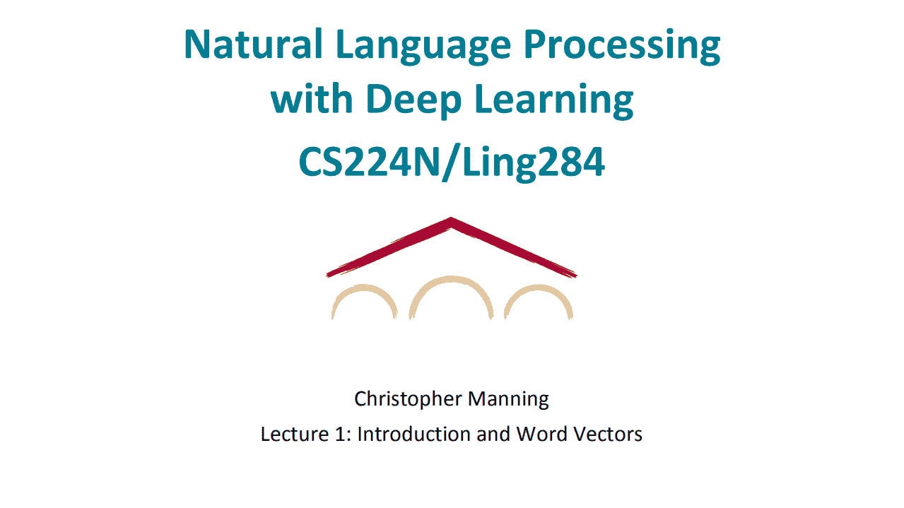

[cs224n-spr2024-lecture01-wordvecs1.pdf](https://internal-api-drive-stream.feishu.cn/space/api/box/stream/download/all/MnrNbkBgRodBn1xkVqocZqqInlg)

## 第2讲 - 词向量与语言模型

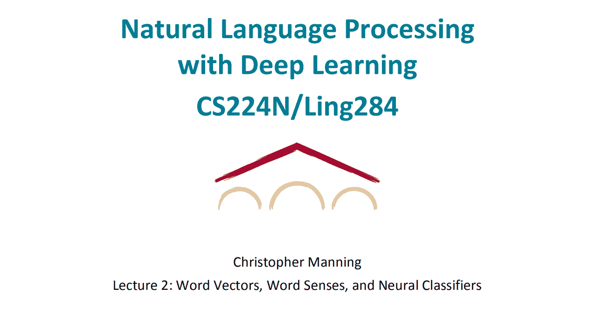

[cs224n-spr2024-lecture02-wordvecs2.pdf](https://internal-api-drive-stream.feishu.cn/space/api/box/stream/download/all/HPgibECA0ojejZx8FKsceISInqN)

## 第3讲：反向传播与神经网络

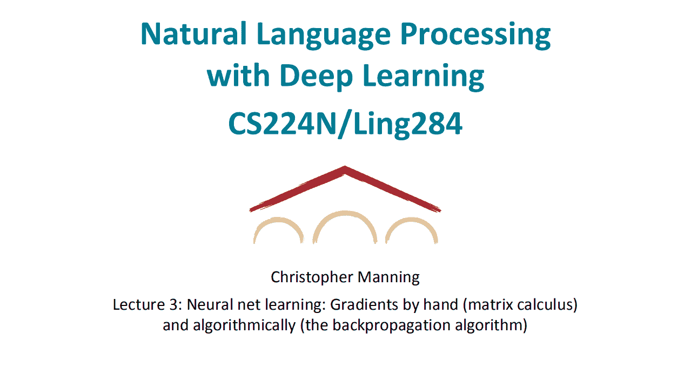

[cs224n-spr2024-lecture03-neuralnets.pdf](https://internal-api-drive-stream.feishu.cn/space/api/box/stream/download/all/PyScb6uimoS7N0xFviBcEFDbnBg)

## 第4讲：依存句法分析

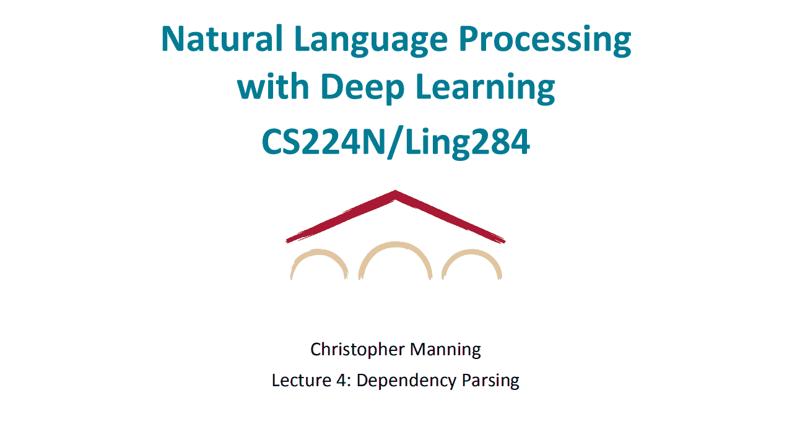

[cs224n-spr2024-lecture04-dep-parsing.pdf](https://internal-api-drive-stream.feishu.cn/space/api/box/stream/download/all/T6Wcbh9D3oDK9Dxe3lwcnMnln2c)

## 第5讲：循环神经网络（Recurrent Neural Networks）

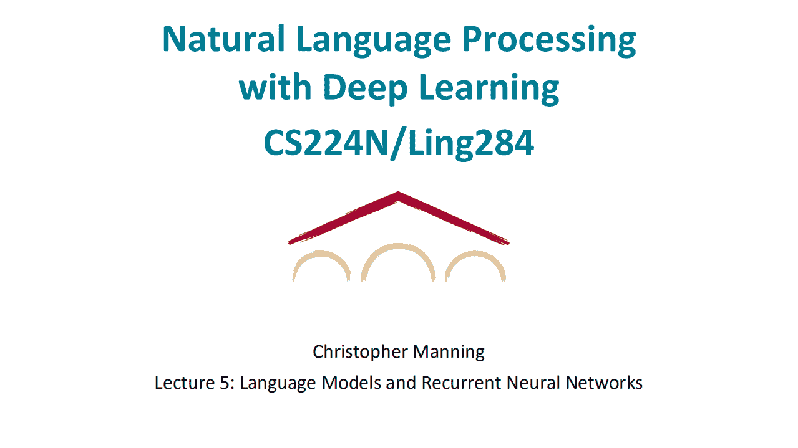

[cs224n-spr2024-lecture05-rnnlm.pdf](https://internal-api-drive-stream.feishu.cn/space/api/box/stream/download/all/H90eb7WqnoLioaxRTPUcHQBIn4b)

## 第6讲：序列到序列模型（Sequence to Sequence Models）

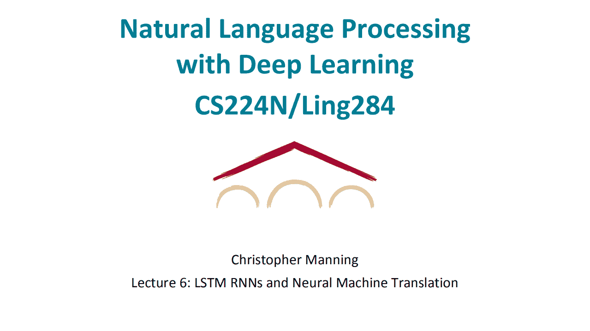

[cs224n-spr2024-lecture06-fancy-rnn.pdf](https://internal-api-drive-stream.feishu.cn/space/api/box/stream/download/all/UGXaba2Uto7KrZxoeTscpvnsndf)

## 第7讲：注意力机制、最终项目与大语言模型简介

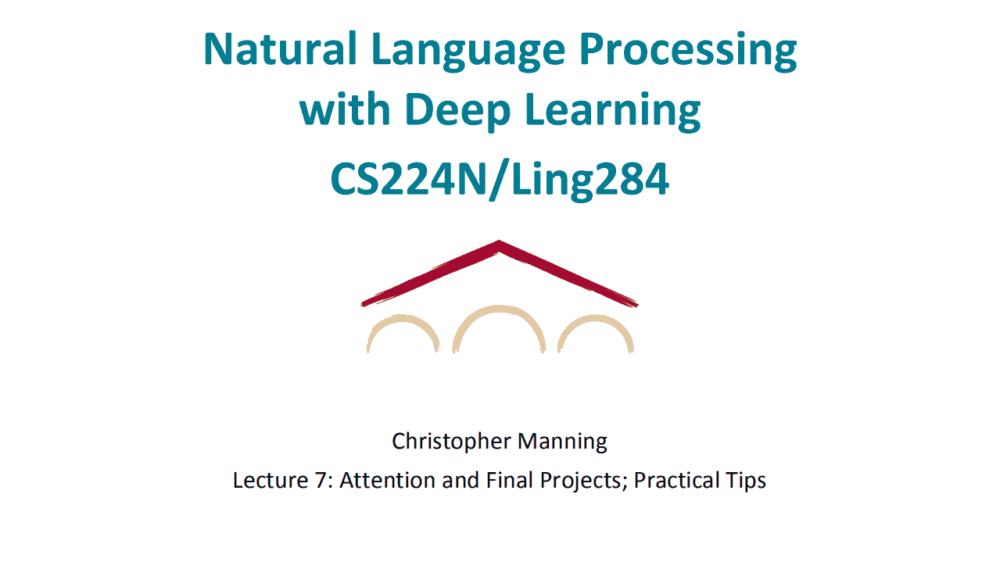

[cs224n-spr2024-lecture07-final-project.pdf](https://internal-api-drive-stream.feishu.cn/space/api/box/stream/download/all/GAT7bZNtiofsN8xJNUWcclddn0g)

## 第8讲：Transformers

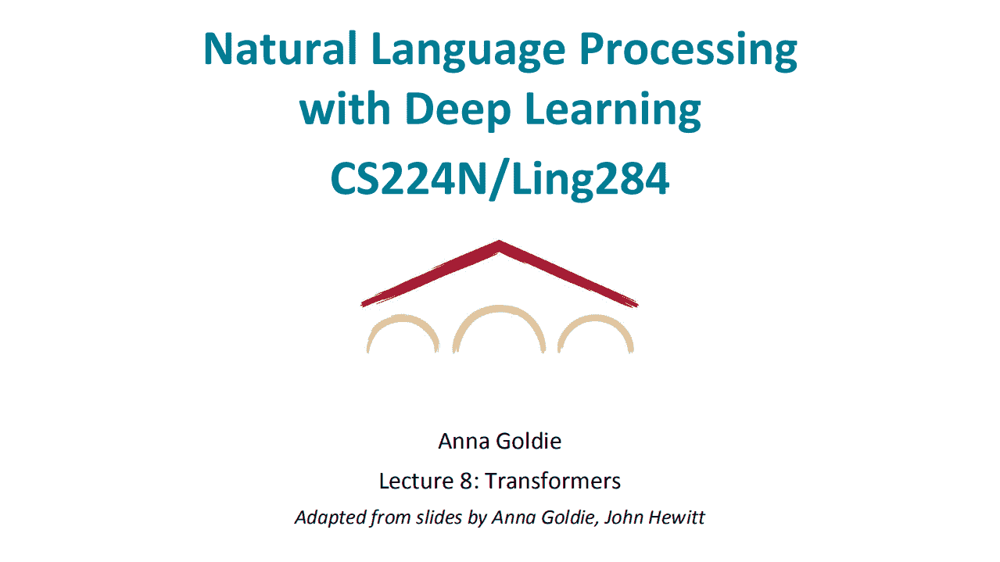

[cs224n-spr2024-lecture08-transformers.pdf](https://internal-api-drive-stream.feishu.cn/space/api/box/stream/download/all/HMM5bC148oJBOIxIY9EcgnRVnjc)

## 第9讲：预训练（Pre training）

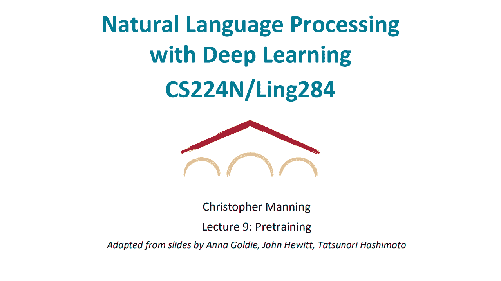

[cs224n-spr2024-lecture09-pretraining-updated.pdf](https://internal-api-drive-stream.feishu.cn/space/api/box/stream/download/all/S96KbPKbPoofqnxwGMdcXHJtnBZ)

## 第10讲：提示词，指令微调，RLHF（Prompting, Instruction Finetuning, DPO/RLHF）

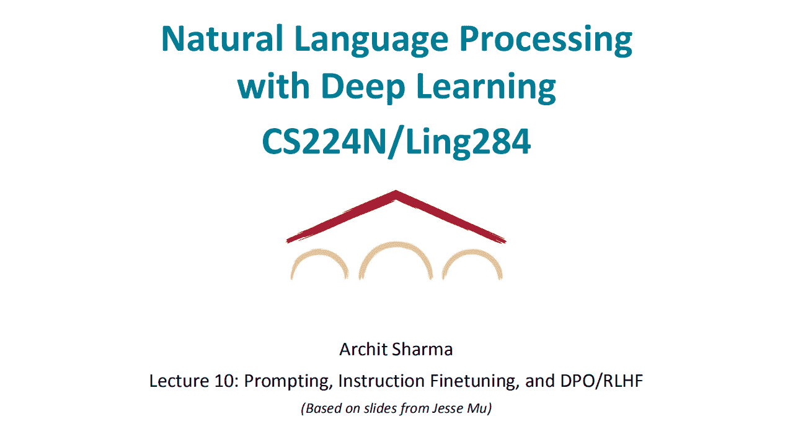

[cs224n-spr2024-lecture10-prompting-rlhf.pdf](https://internal-api-drive-stream.feishu.cn/space/api/box/stream/download/all/D8iubSWkQosJ5OxLX7YcK7cenDf)

## 第11讲：基准和评估（Benchmarking and Evaluation）

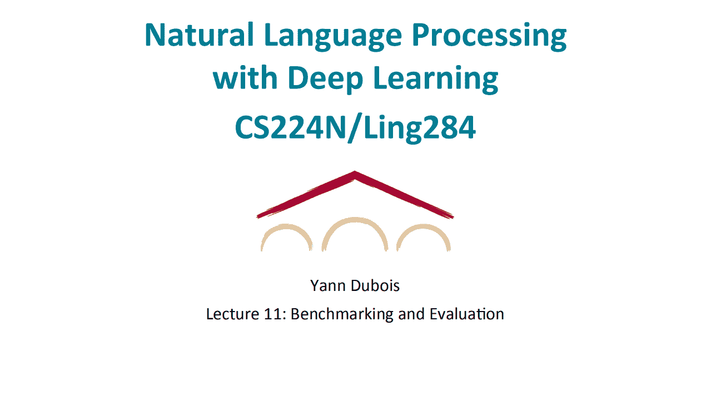

[cs224n-spr2024-lecture11-evaluation-yann.pdf](https://internal-api-drive-stream.feishu.cn/space/api/box/stream/download/all/R09lb4IIsoV6NaxtkIRcdXO6nhc)

## 第12讲：高效神经网络训练（Efficient Neural Network Training）

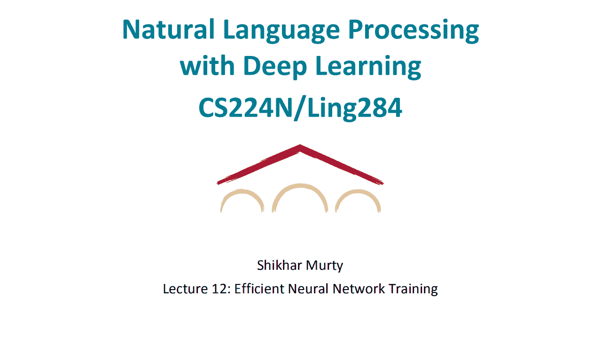

[cs224n-spr2024-lecture12-training-shikhar.pdf](https://internal-api-drive-stream.feishu.cn/space/api/box/stream/download/all/Us2nbM7cWoQxLHxslJhcE2sNnod)

## 第13讲：Speech Brain-Computer Interfaces for Restoring Natural Communication

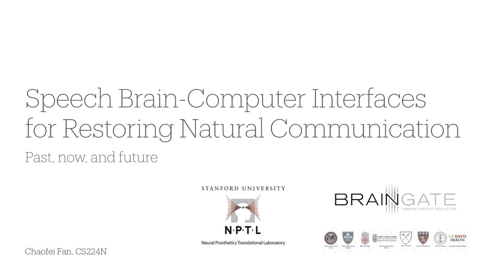

[cs224n-spr2024-lecture13-speech-bci.pdf](https://internal-api-drive-stream.feishu.cn/space/api/box/stream/download/all/KeOAbhRQrosUcjxSxenchTzynvh)

## 第14讲：推理和智能体（Reasoning and Agents）

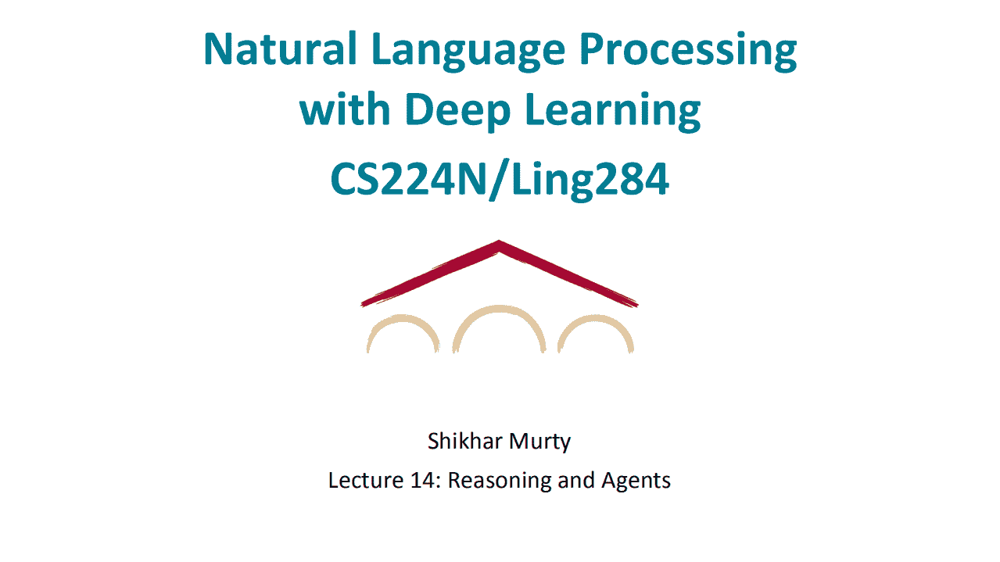

[cs224n-spr2024-lecture14-agents-shikhar-updated.pdf](https://internal-api-drive-stream.feishu.cn/space/api/box/stream/download/all/XbTzbU0RKoiAYcxmRW3c8bPBnKg)

## 第15讲：Life after DPO

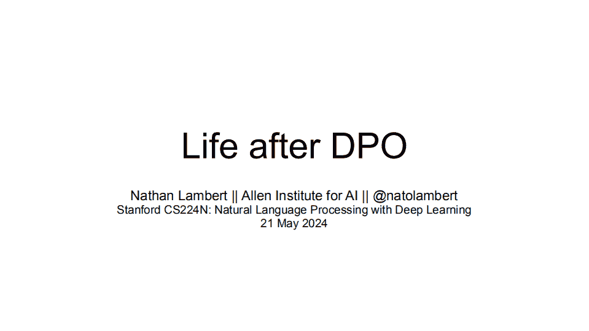

[cs224n-spr2024-lecture15-life-after-dpo-lambert.pdf](https://internal-api-drive-stream.feishu.cn/space/api/box/stream/download/all/BLsObJ6FYon4nPxQNdgcFBtznDh)

## 第16讲：ConvNets, Tree Recursive Neural Networks and Constituency Parsing

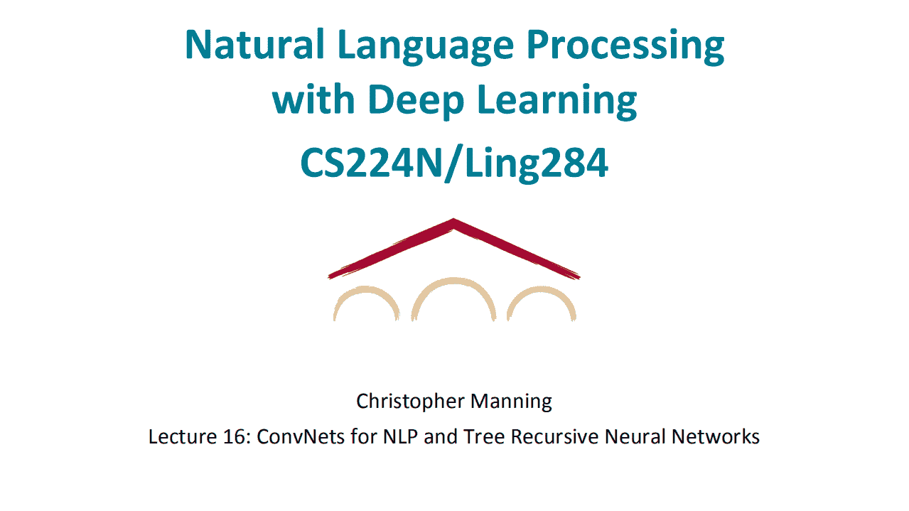

[cs224n-spr2024-lecture16-CNN-TreeRNN.pdf](https://internal-api-drive-stream.feishu.cn/space/api/box/stream/download/all/IDFlb6GC3oAD9oxg7YIcn6QUnNf)

## 第18讲：NLP, linguistics, and philosophy

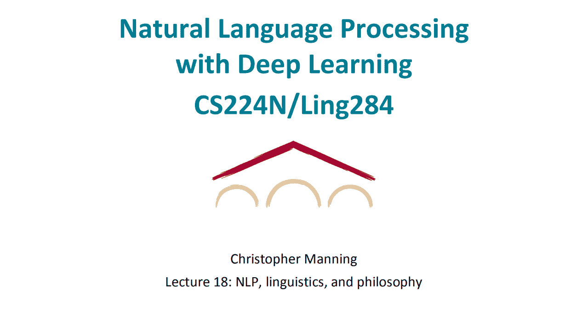

[cs224n-spr2024-lecture18-nlp-linguistics-philosophy.pdf](https://internal-api-drive-stream.feishu.cn/space/api/box/stream/download/all/PJvkbhjZLoNBOYxFWDAca7CXn2c)