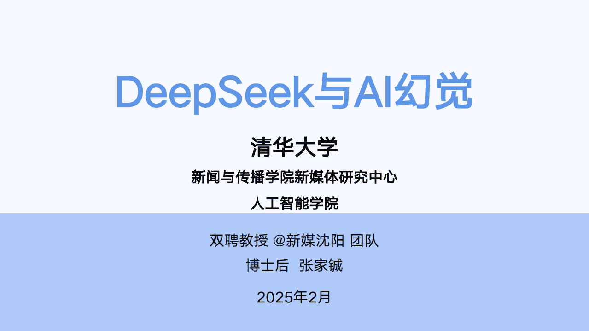

# 【清华大学】DeepSeek普及课

> 来源：[https://kcn9ut4m7icc.feishu.cn/docx/Kv1ydysIHoFE7XxqQq5cXtyOnIb](https://kcn9ut4m7icc.feishu.cn/docx/Kv1ydysIHoFE7XxqQq5cXtyOnIb)

[清华大学AI课01：DeepSeek从入门到精通.pdf](https://internal-api-drive-stream.feishu.cn/space/api/box/stream/download/all/EJgPbaxcAoW08Fx8EF0cySlNnFf)

[清华大学AI课02：DeepSeek赋能职场.pdf](https://internal-api-drive-stream.feishu.cn/space/api/box/stream/download/all/N4q7b1hFco1GhJxyZxjc367OnMb)

[清华大学AI课03：普通人如何抓住 DeepSeek 红利.pdf](https://internal-api-drive-stream.feishu.cn/space/api/box/stream/download/all/ILn1bKxMqoFSbsxBq1UciFzqnRc)

[清华大学AI课04：DeepSeek+DeepResearch：让科研像聊天一样简单(1).pdf](https://internal-api-drive-stream.feishu.cn/space/api/box/stream/download/all/Dcpzb1RuCoSEJ8xMEKfcADifnhd)

[清华大学AI课05：DeepSeek与AI幻觉.pdf](https://internal-api-drive-stream.feishu.cn/space/api/box/stream/download/all/BudmbUStboHh6bxdKoCcF8RYnsd)