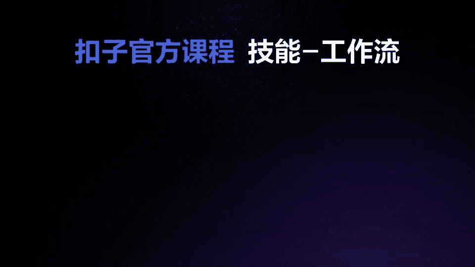
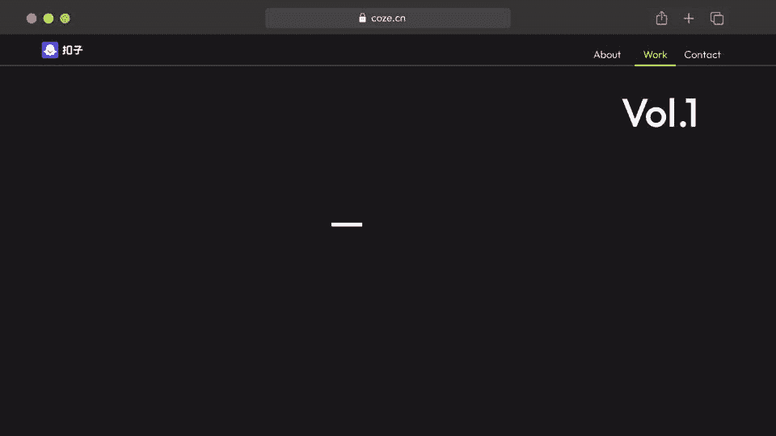

# 📣 扣子官方教程&宣传片（对外版）

> 来源：[https://kcn9ut4m7icc.feishu.cn/docx/MU2gdBhluo1aCJx9g5Sc1vwWnte](https://kcn9ut4m7icc.feishu.cn/docx/MU2gdBhluo1aCJx9g5Sc1vwWnte)

> 合作：[bd@coze.cn](mailto:bd@coze.cn)

> 扣子官网：coze.cn

> 可以通过应用商城搜索「扣子」下载扣子app版

> 扣子使用手册：https://www.coze.cn/docs/guides/welcome

### **🔍 扣子2.5宣传片**

[扣子2.5【1080p】【结尾带二维码】-0414.mp4](https://internal-api-drive-stream.feishu.cn/space/api/box/stream/download/all/ClMhbNivqoGs4gx7of5csb2Mnif)

### **🔍 扣子编程全面升级**

[扣子编程4k.mp4](https://internal-api-drive-stream.feishu.cn/space/api/box/stream/download/all/WI7ibWTGZol2Xxx0F62cV0Mun9d)

### 🦞 养虾课程回放

0304 高玩秘籍公开！扣子直播季第一场~

0305 Openclaw高玩秘籍公开！扣子3月直播季第二期~

0310 养虾教学！新人也能用的高手秘籍——扣子3月直播季第三场

0311养虾教学！大神攻略，公开新玩法——扣子3月直播季第四场

0312养虾教学！行业大咖带你进阶修虾——扣子三月直播季第五场

0313养虾教学！扣子x飞书带你开启全新养虾体验~

0317养虾妙招！头部博主带你玩转AI——扣子三月直播季第六场

0318养虾妙招！业内高手公开神级操作-扣子3月直播季第七场

### **🔍 扣子2.0宣传片**

[扣子2.0宣传片.mp4](https://internal-api-drive-stream.feishu.cn/space/api/box/stream/download/all/SlkFb36PNoic8xxMKEecz5GCnDm)

### **🔍 扣子- 校园版宣传片**

[扣子空间-开学季校园宣传片.mp4](https://internal-api-drive-stream.feishu.cn/space/api/box/stream/download/all/VIZxbZqLVoICa0xGu0UcJUtjnpp)

### **🔍 扣子- 设计功能上新**

[扣子空间设计宣传片.mp4](https://internal-api-drive-stream.feishu.cn/space/api/box/stream/download/all/KmAdbiRSbo1RsoxtgeNcWktZnyd)

### **🔍 扣子- PPT 功能上新**

[扣子空间PPT功能.mp4](https://internal-api-drive-stream.feishu.cn/space/api/box/stream/download/all/Hr1ab77Ploqh1nxOfXycVozPnxb)

### **🔍 扣子-简单介绍**

[飞书20250418-160742.mp4](https://internal-api-drive-stream.feishu.cn/space/api/box/stream/download/all/XqbIbQKIioRFB2xoEADc00GTnsL)

### 🔍 扣子：有人用扣子做了一个MV？

[扣子空间快速了解.mp4](https://internal-api-drive-stream.feishu.cn/space/api/box/stream/download/all/MsCqbNOyToFGbgxtJhWc9fIJnqI)

### **🔍 扣**子 x 国科大他山社团：用 AI 探索日月星辰

[传播版 - 修改版.mp4](https://internal-api-drive-stream.feishu.cn/space/api/box/stream/download/all/UzWFbKipzotcUvxU1VZcN3OFneb)

### **🔍 扣**子 1.5 宣传片

[扣子1.5宣传片.mp4](https://internal-api-drive-stream.feishu.cn/space/api/box/stream/download/all/JzyXbRQekop0LuxgWLIcOWfGnHb)

官方教程来了！！手把手带你搭建 AI Bot

九节课，带你用最浅显易懂的方式一起玩转扣子、解锁未来～

### 🔍 第一节：AI Agent & 扣子介绍

1.  大模型的痛点

1.  什么是Agent

1.  什么是扣子

1.  扣子的功能和优势

1.  扣子的主页、个人空间、Bot商店、插件商店、工作流商店、团队空间、模型广场

1.  优质 Bot 体验：《读书小助手》、《爸妈防骗助手》

[第一期 Agent与扣子介绍 (2).mp4](https://internal-api-drive-stream.feishu.cn/space/api/box/stream/download/all/UYKxboQdQo1aAWxvKYecz0DWnJY)

### 🔍 第二节：扣子助手、人设与对话体验 - 快速上手

1.  提示词及作用

1.  提示词如何写

1.  LUI与GUI的区别

1.  如何提升扣子的对话体验

1.  实操：通过扣子助手搭建一个《高情商老板回复话术Bot》

[扣子官方教程-第二课.mp4](https://internal-api-drive-stream.feishu.cn/space/api/box/stream/download/all/Rg0iboUJ2om4VwxBJAYcxysen4d)

### 🔍 第三节：技能：插件  - 快速上手

1.  Function call是什么

1.  扣子插件&插件的基本概念

1.  实操：插件的使用、自定义插件的使用&插件商店

[官方教程第三节-上（插件入门）.mp4](https://internal-api-drive-stream.feishu.cn/space/api/box/stream/download/all/N3LibUIP5oafDyxACBkcV9CAnNd)

[官方教程-第三节下（插件进阶）.mp4](https://internal-api-drive-stream.feishu.cn/space/api/box/stream/download/all/PiyobZ4nmosHhkx5FnxcoH3OnWf)

### **🔍 第四节：技能：工作流 **** - 快速上手**

1.  什么是工作流？有什么作用？ 扣子中的工作流

1.  节点介绍：输入输出/功能节点/参数/批处理/代码/选择器/意图识别/文本处理/消息节点/变量和数据库节点

1.  搭建工作流最佳实践演示：旅行计划工作流

[官方教程-第四节上（工作流）.mp4](https://internal-api-drive-stream.feishu.cn/space/api/box/stream/download/all/ANj4bGEbwoZiaVxWSt2cqRCNntc)

[官方教程-第四节中（工作流）.mp4](https://internal-api-drive-stream.feishu.cn/space/api/box/stream/download/all/GXjub7k5so5osRxn5wscLpsAnng)

[官方教程-第四节下（工作流）.mp4](https://internal-api-drive-stream.feishu.cn/space/api/box/stream/download/all/SvrObx24vou6coxMHBMcgHTpnlc)

### **🔍 扣子智能客服助手**

[扣子-智能客服.mp4](https://internal-api-drive-stream.feishu.cn/space/api/box/stream/download/all/WyIebWRuLoFyaqxsNnLcvf1Mnoh)

### **🔍 雅**思口语专家

[扣子最佳实践-雅思视频.mp4](https://internal-api-drive-stream.feishu.cn/space/api/box/stream/download/all/UwkEb7isPoJTKqxaeAoctgRPnGf)

### **🔍 扣子 1.0 宣传视频**

[扣子暖场视频-终版（无片头）.mp4](https://internal-api-drive-stream.feishu.cn/space/api/box/stream/download/all/LDgYbEa3nofsKtx3wjucDgn2nKg)

## 🙋 官方发布渠道

**🎬 扣子👸号**

**🎬 扣子视频号**

**🎬 扣子B站号**

🎬 扣子抖音号

## 🙋 设计素材

[扣子2.0品牌资产规范 -更新版](https://bytedance.larkoffice.com/wiki/VAYnwbSZWifwymkGV8AcngNhnEH)

## 🙋 更**多资料**

+   [扣子反馈渠道-功能/模板需求、提交作品/小程序、文章/教程](https://bytedance.larkoffice.com/docx/LzZTdeVFYotHl0xtKxpcJaGyn8c)

+   [扣子学习资料&官方社媒账号](https://bytedance.larkoffice.com/docx/Tm3Ddax5doHO32xHkL8cZxGMnLb)

+   [申请扣子合作、认证](https://bytedance.larkoffice.com/docx/CxaZdXQhjoeMN2xo6rOceNlyn1c)

+   [申请扣子内测功能](https://bytedance.larkoffice.com/docx/ODHHdvs4zoycNcxNbDNcOlXcnfh)