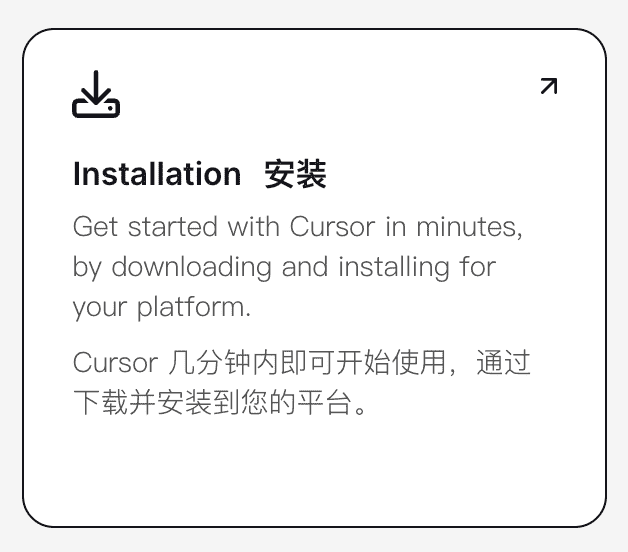
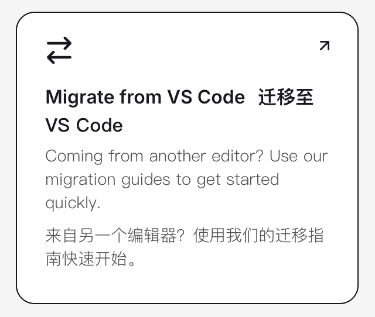
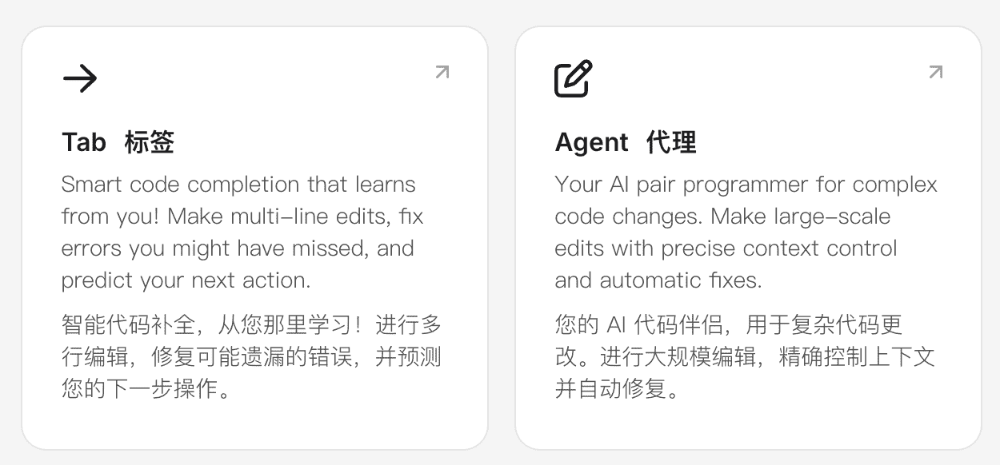
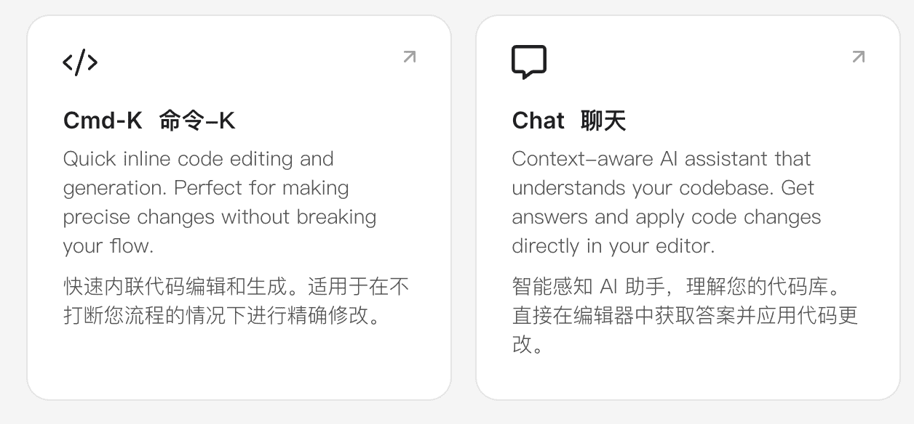

# Welcome to Cursor  欢迎来到 Cursor

> 来源：[https://kcn9ut4m7icc.feishu.cn/docx/Gw6ydLBm3oymcsx0z99csFeInJe](https://kcn9ut4m7icc.feishu.cn/docx/Gw6ydLBm3oymcsx0z99csFeInJe)

AI-powered IDE with Chat, Tab, and Agent for intelligent code development

人工智能驱动的 IDE，集聊天、标签和智能体于一体的智能代码开发工具

Cursor is a new, intelligent IDE, empowered by seamless integrations with AI. Built upon VSCode, Cursor is quick to learn, but can make you extraordinarily productive.

Cursor是一款全新的智能集成开发环境，通过无缝集成 AI 功能而增强。基于 VSCode 构建，Cursor易于学习，但能让你工作效率大大提升。

# Get started  开始使用

If you’re new to Cursor, you can get started using the guides below.

如果您是 Cursor 的新用户，可以参考以下指南开始使用。

[Installation  安装](https://kcn9ut4m7icc.feishu.cn/wiki/BGr5wPDvgiA1fVkjlaGc9SZ0n1c)[Migrate from VS Code  迁移至 VS Code](https://kcn9ut4m7icc.feishu.cn/wiki/IsntwynUSiCbr5kFNARcTWVSnEh)

# Editor  编辑

Cursor has a number of core features that will seamlessly integrate with your workflow.

Cursor拥有多项核心功能，将无缝集成到您的工作中。

Use the links below to learn more about what Cursor can do.

使用以下链接了解 Cursor 能做什么。

[Tab 标签](https://kcn9ut4m7icc.feishu.cn/wiki/BHEdwMEcpirFQpkJuUCcdkErnje) [Agent 智能体](https://kcn9ut4m7icc.feishu.cn/wiki/YyvwwPso6ikPqekqg7lc5ovMnyf)

[⌘K - 按下键盘上的 K 键](https://kcn9ut4m7icc.feishu.cn/wiki/ELBqwNzVNiTv3dkcqbMcf1Snnnc)                              [Ask  询问](https://kcn9ut4m7icc.feishu.cn/wiki/Vnxew3XzyiAqDikYfCqcgqYpnbg)

## Where did Cursor come from? Cursor从哪里来？

Code is fundamentally text, and our tools for writing it have evolved from simple text editors into increasingly intelligent development environments.

代码本质上是一种文本，我们编写代码的工具已经从简单的文本编辑器演变为越来越智能的开发环境。

Initially, we had features like syntax highlighting, to make code more readable. Then, we had features like autocomplete, to make code more efficient.

最初，我们拥有语法高亮等功能，使代码更易于阅读。然后，我们又有了自动完成等功能，使代码更高效。

These have been the standard for a long time, but with Cursor, we’re re-inventing how you work with code.

这些已经很长时间是标准了，但有了 Cursor，我们正在重新发明您如何与代码一起工作。

##

## How does it work?  如何工作？

Cursor provides the user with a few fundamental features that are only made possible by the development of LLMs (Large Language Models).

Cursor提供了一些只有通过LLMs（大语言模型）的开发才得以实现的用户基本功能。

##

## How do I get started? 如何开始？

[You can downlo](https://www.cursor.com/)ad Cursor from the Cursor website for your platform of choice. Being based on VS Code, it’s extremely easy to get started, and all the AI features are opt-in.

您可以从 Cursor 网站下载 Cursor 到您选择的平台。基于 VS Code，它启动非常简单，所有 AI 功能都是可选的。

You can also have Cursor import all your VS Code extensions and settings in one-click. To help you try Cursor, we have a 14-day free trial our of Pro plan, with no credit card required!

您可以一键导入所有 VS Code 扩展和设置到 Cursor。为了帮助您尝试 Cursor，我们提供 14 天的免费试用 Pro 计划，无需信用卡！