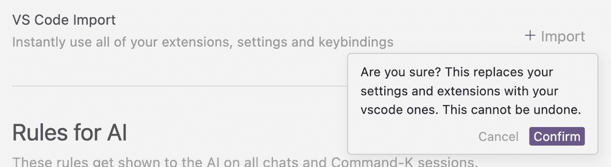
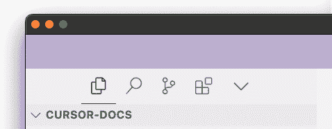

# Migrate from VS Code  迁移至 VS Code

> 来源：[https://kcn9ut4m7icc.feishu.cn/docx/GtDrdv6KUo99UHxjDuxckg2Gnad](https://kcn9ut4m7icc.feishu.cn/docx/GtDrdv6KUo99UHxjDuxckg2Gnad)

VS Code-based editor with AI features, supporting extension imports and custom configurations

基于 VS Code 的编辑器，具有 AI 功能，支持扩展导入和自定义配置

Cursor is a fork of VS Code. This allows us to focus on making the best way to code with AI, while offering a familiar text editing experience.

Cursor是一款基于 VS Code 的分支。这使得我们能够专注于打造最佳 AI 编程方式，同时提供熟悉的文本编辑体验。

## Import Extensions, Themes, Settings, and Keybindings 导入扩展、主题、设置和快捷键

You can import your VS Code configuration into Cursor with one-click. Navigate to Cursor Settings > General > Account.

您可以通过一键将您的 VS Code 配置导入 Cursor。导航至 Cursor Settings > General > Account 。

## Staying Up to Date  保持更新

We periodically rebase Cursor onto the latest version of VS Code.

我们定期将 Cursor 迁移到 VS Code 的最新版本。

## Why Not an Extension?  为什么不是扩展？

As a standalone application, Cursor has more control over the UI of the editor, enabling greater AI integration. Some of our features, like Cursor Tab and CMD-K, are not possible as plugins to existing coding environments.

Cursor – 从 VS Code 迁移 作为一个独立应用程序，Cursor 对编辑器的 UI 控制更多，从而实现更深入的 AI 集成。我们的一些功能，如 Cursor 标签页和 CMD-K，作为现有编码环境的插件是无法实现的。

## Settings  设置

You can open Cursor specific settings pane by clicking on the gear button top-right, by pressing Ctrl/⌘ + Shift + J, or with Ctrl/⌘ + Shift + P and typing Cursor Settings.

您可以通过点击右上角的齿轮按钮、按 Ctrl/⌘ + Shift + J 或使用 Ctrl/⌘ + Shift + P 并输入 Cursor Settings 来打开 Cursor 的特定设置面板。

You can open VS Code specific settings with Ctrl/⌘ + Shift + P, and then typing VS Code Settings.

您可以使用 Ctrl/⌘ + Shift + P 打开 VS Code 特定设置，然后输入 VS Code Settings 。

## Why is the Activity Bar in Cursor horizontal? 为什么 Cursor 中的活动栏是水平的？

The activity bar is horizontal by default to save room for chat. If you prefer the normal vertical activity bar you can go to the VS Code settings and set workbench.activityBar.orientation to vertical, and restart Cursor.

活动栏默认为水平，以节省聊天空间。如果您更喜欢正常的垂直活动栏，可以前往 VS Code 设置，将 workbench.activityBar.orientation 设置为 vertical ，然后重启 Cursor。