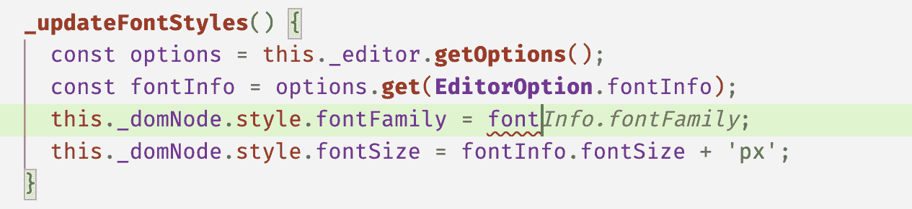

# Overview  概览

> 来源：[https://kcn9ut4m7icc.feishu.cn/docx/Hfr5dQbpUoJ7qJxUZqJcgKbnnxd](https://kcn9ut4m7icc.feishu.cn/docx/Hfr5dQbpUoJ7qJxUZqJcgKbnnxd)

AI-powered code autocomplete that suggests edits and multi-line changes based on your recent work

人工智能驱动的代码自动补全，根据您最近的工作建议编辑和多行更改

Cursor Tab is our native autocomplete feature. It’s a more powerful Copilot that suggests entire diffs with especially good memory.

光标标签是我们本地的自动补全功能。它是一个功能更强大的 Copilot，能够建议整个差异，特别是记忆能力很好。

<https://mintlify.s3.us-west-1.amazonaws.com/cursor/images/cpp/cpp-full-video.mp4>

Powered by a custom model, Cursor Tab can:

由定制模型驱动，Cursor Tab 可：

+   Suggest edits around your cursor, not just insertions of additional code.
建议在光标周围进行编辑，而不仅仅是插入额外的代码。

+   Modify multiple lines at once.
一次修改多行。

+   Make suggestions based on your recent changes and linter errors.
根据您最近的变化和代码检查错误提出建议。

Free users receive 2000 suggestions at no cost. Pro and Business plans receive unlimited suggestions.

免费用户可免费获得 2000 条建议。专业版和企业版计划享有无限建议。

##

## UI  用户界面

When Cursor is only adding additional text, completions will appear as grey text. If a suggestion modifies existing code, it will appear as a diff popup to the right of your current line.

当光标仅添加附加文本时，补全将显示为灰色文本。如果建议修改现有代码，它将以差异弹窗的形式出现在当前行的右侧。

You can accept a suggestion by pressing Tab, or reject it by pressing Esc. To partially accept a suggestion word-by-word, press Ctrl/⌘ →. To reject a suggestion, just keep typing, or use Escape to cancel/hide the suggestion.

您可以按 Tab 接受建议，或按 Esc 拒绝它。要逐字部分接受建议，请按 Ctrl/⌘ → 。要拒绝建议，只需继续输入，或使用 Escape 取消/隐藏建议。

Every keystroke or cursor movement, Cursor will attempt to make a suggestion based on your recent changes. However, Cursor will not always show a suggestion; sometimes the model has predicted that there’s no change to be made.

每次按键或光标移动，Cursor 都会根据您最近的更改尝试提出建议。然而，Cursor 并非总是显示建议；有时模型预测无需做出更改。

Cursor can make changes from one line above to two lines below your current line.

光标可以从当前行向上更改一行到向下两行。

##

## Toggling  切换

To turn the feature on or off, hover over “Cursor Tab” icon on the status bar in the bottom right of the application.

要开启或关闭此功能，将鼠标悬停在应用底部右边的“光标标签”图标上。

##

## Keyboard Shortcut  键盘快捷键

Bind Cursor Tab to a custom keyboard shortcut by selecting Settings > Keyboard Shortcuts from the Cursor menu and searching for Accept Cursor Tab Suggestions.

将光标 Tab 绑定到自定义键盘快捷键，请从光标菜单中选择设置 > 键盘快捷键，并搜索 Accept Cursor Tab Suggestions 。

##

## FAQ  常见问题解答

### Tab gets in the way when writing comments, what can I do? Tab 键在写注释时碍事，我该怎么办？

You can disable Cursor Tab for comments by going to Cursor Settings > Tab Completion and unchecking “Trigger in comments”.

您可以通过前往 Cursor Settings > Tab Completion 并取消选中“在注释中触发”来禁用 Cursor Tab 的注释功能。