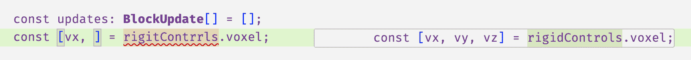
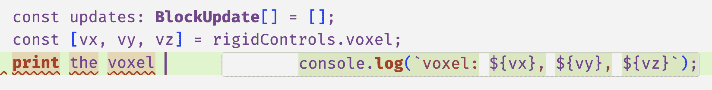

# Tab vs GitHub Copilot

> 来源：[https://kcn9ut4m7icc.feishu.cn/docx/LYZddwMWPojqQhxUQjScPrnlnDT](https://kcn9ut4m7icc.feishu.cn/docx/LYZddwMWPojqQhxUQjScPrnlnDT)

Learn how Cursor’s code editing capabilities surpass GitHub Copilot with multi-character & instructional edits

了解 Cursor 的代码编辑功能如何超越 GitHub Copilot，通过多字符和指导性编辑

##

## Tab Improvements  标签改进

The biggest difference is the way Cursor and GitHub Copilot complete code.

最大的区别在于 Cursor 和 GitHub Copilot 完成代码的方式。

GitHub Copilot can insert text at your cursor position. It cannot edit the code around your cursor or remove text.

GitHub Copilot 可以在您的光标位置插入文本。它不能编辑光标周围的代码或删除文本。

Cursor can insert text at your cursor, and much more:

光标可以插入文本到光标位置，还有更多功能：

+   Multi-character edits  多字符编辑

+   Instruction-based edits  基于指令的编辑

Further, Cursor has a history of your recent changes in the context window, so it knows what you are trying to do next.

此外，Cursor 在上下文窗口中记录了您最近的变化历史，因此它知道您接下来想要做什么。

##

## Migrate from GitHub Copilot 迁移自 GitHub Copilot

Since Cursor comes by default with GitHub Copilot, you might have GitHub Copilot and Cursor installed at the same time. We recommend turning off GitHub Copilot when you want to use Cursor.

由于 Cursor 默认包含 GitHub Copilot，您可能同时安装了 GitHub Copilot 和 Cursor。我们建议在您想使用 Cursor 时关闭 GitHub Copilot。

By[ default, Curs](https://docs.cursor.com/tab/overview#copilot-settings)or takes precedence over GitHub Copilot. If you want to use GitHub Copilot, you can disable Cursor in the settings.

默认情况下，Cursor 优先于 GitHub Copilot。如果您想使用 GitHub Copilot，可以在设置中禁用 Cursor。