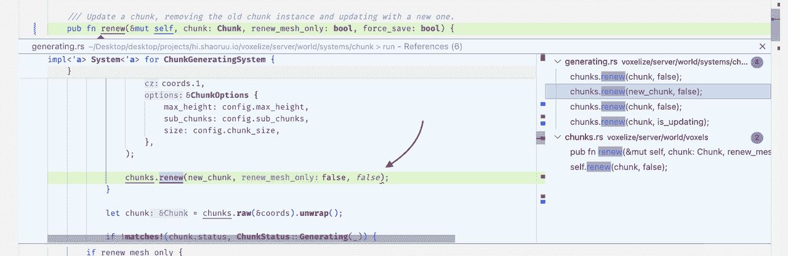
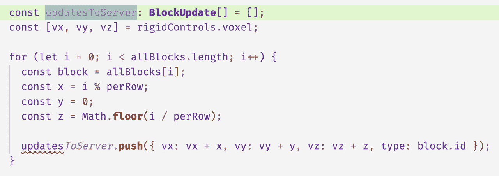

# Advanced Features  高级功能

> 来源：[https://kcn9ut4m7icc.feishu.cn/docx/TEr9dpQ0OoB73yxFANtcLT4EnLh](https://kcn9ut4m7icc.feishu.cn/docx/TEr9dpQ0OoB73yxFANtcLT4EnLh)

Learn to navigate code efficiently using Tab in peek views, prediction, and partial accepts

学习使用 Tab 在预览视图中导航代码，预测和部分接受以提高效率

## Tab in Peek  Tab 在 Peek 中

You can also use Cursor Tab in the “Go to Definition” or “Go to Type Definition” peek views. This is useful, for example, when adding a new argument to a function call.

您还可以在“转到定义”或“转到类型定义”预览视图中使用 Cursor Tab。这在例如添加函数调用的新参数时很有用。

We especially enjoy using this in vim in conjunction with gd to, for example, modify a function definition, then fix all of its usages in one go.

我们特别喜欢在 vim 中使用这个功能，结合 gd 来修改函数定义，然后一次性修复所有使用。

## Cursor Prediction  光标预测

Cursor can also predict where you will go to after an accepted edit. If available, you will be able to press tab to go to the next location, allowing you to tab-tab-tab through edits.

光标还可以预测您在接受编辑后将要前往的位置。如果可用，您将能够按 Tab 键跳转到下一个位置，让您能够通过 Tab 键快速浏览编辑。

Cursor predicted the next location, and suggested an edit there.

光标预测了下一个位置，并建议在那里进行编辑。

## Partial Accepts  部分接受

You can accept the next word of a suggestion by pressing Ctrl/⌘ and the right arrow (or by setting editor.action.inlineSuggest.acceptNextWord to your preferred keybinding).

您可以按 Ctrl/⌘ 和右箭头键接受建议的下一个单词（或通过设置 editor.action.inlineSuggest.acceptNextWord 为您喜欢的快捷键）。

To enable partial accepts, navigate to Cursor Settings > Features > Cursor Tab.

要启用部分接受，请导航至 Cursor Settings > Features > Cursor Tab 。