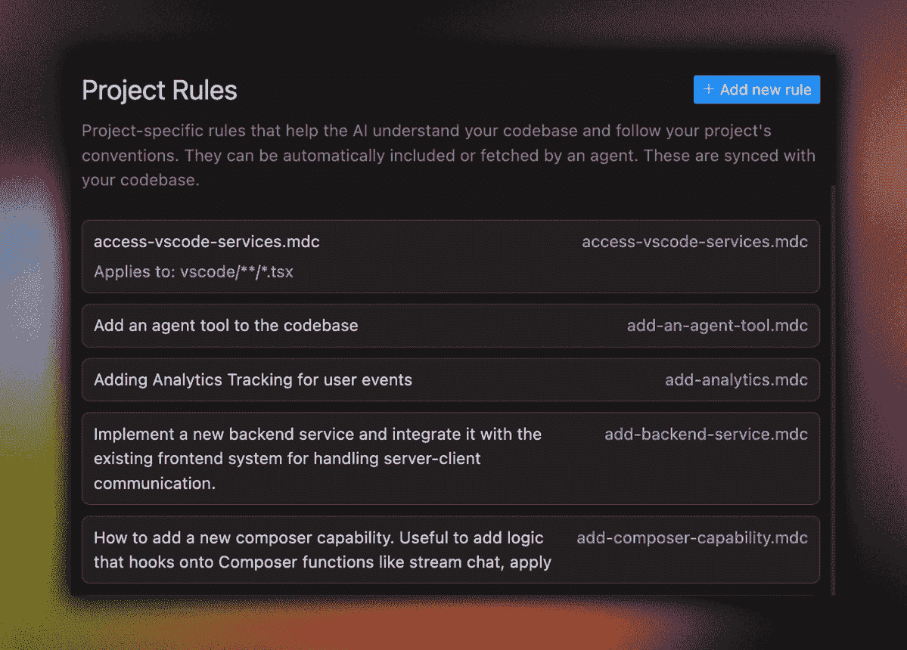
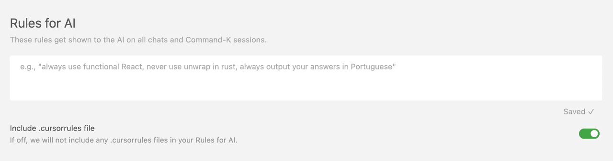

# Rules for AI  AI 规则

> 来源：[https://kcn9ut4m7icc.feishu.cn/docx/CjyKdxoX7oqtIjxhUz7cmvqtnHh](https://kcn9ut4m7icc.feishu.cn/docx/CjyKdxoX7oqtIjxhUz7cmvqtnHh)

Learn how to customize AI behavior in Cursor using project-specific and global rules

学习如何在 Cursor 中使用项目特定和全局规则自定义 AI 行为

Using rules in Cursor you can control the behavior of the underlying model. You can think of it as instructions and/or a system prompt for LLMs.

使用 Cursor 中的规则，您可以控制底层模型的行为。您可以将其视为对LLMs的指令和/或系统提示。

## Project Rules (recommended) 项目规则（推荐）

Project rules offer a powerful and flexible system with path specific configurations. Project rules are stored in the .cursor/rules directory and provide granular control over AI behavior in different parts of your project.

项目规则提供了一个强大且灵活的系统，具有路径特定的配置。项目规则存储在 .cursor/rules 目录中，并提供了对项目中不同部分 AI 行为的细粒度控制。

Here’s how they work

这里是如何工作的

+   Semantic Descriptions: Each rule can include a description of when it should be applied
语义描述：每条规则都可以包含一个描述，说明何时应用该规则

+   File Pattern Matching: Use glob patterns to specify which files/folders the rule applies to
文件模式匹配：使用 glob 模式指定规则应用到的文件/文件夹

+   Automatic Attachment: Rules can be automatically included when matching files are referenced
自动附件：当引用匹配的文件时，规则可以自动包含

+   Reference files: Use @file in your project rules to include them as context when the rule is applied.
参考文件：使用 @file 在您的项目规则中包含它们，以便在应用规则时作为上下文。

> You can reference rule files using @file, allowing you to chain multiple rules together

> 您可以使用@file 引用规则文件，允许您将多个规则链接在一起

You can create a new rule using the command palette with Cmd + Shift + P > New Cursor Rule. By using project rules you also get the benefit of version control since it’s just a file

您可以使用命令面板通过 Cmd + Shift + P > New Cursor Rule 创建新规则。通过使用项目规则，您还可以获得版本控制的益处，因为它只是一个文件。

Example use cases:  示例用例：

+   Framework-specific rules for certain file types (e.g., SolidJS preferences for .tsx files)
框架特定的某些文件类型规则（例如，SolidJS 对 .tsx 文件的偏好设置）

+   Special handling for auto-generated files (e.g., .proto files)
特殊处理自动生成的文件（例如， .proto 文件）

+   Custom UI development patterns
自定义 UI 开发模式

+   Code style and architecture preferences for specific folders
代码风格和架构偏好，针对特定文件夹

## Global Rules  全局规则

Global rules can be added by modifying the Rules for AI section under Cursor Settings > General > Rules for AI. This is useful if you want to specify rules that should always be included in every project like output language, length of responses etc.

全局规则可以通过修改 Cursor Settings > General > Rules for AI 下的 Rules for AI 部分来添加。如果您想指定应始终包含在每个项目中的规则，例如输出语言、响应长度等，这将很有用。

## .cursorrules

For backward compatibility, you can still use a .cursorrules file in the root of your project. We will eventually remove .cursorrules in the future, so we recommend migrating to the new Project Rules system for better flexibility and control.

为了向后兼容，您仍然可以在项目的根目录中使用 .cursorrules 文件。我们最终将移除.cursorrules，因此建议迁移到新的项目规则系统以获得更好的灵活性和控制。