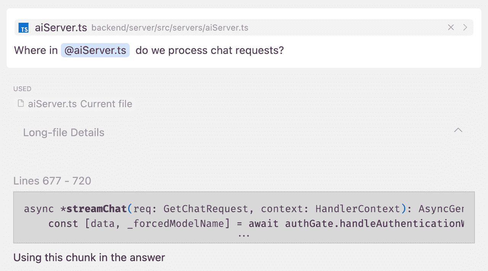

# @Files

> 来源：[https://kcn9ut4m7icc.feishu.cn/docx/Q8OVdiU2DocNHrxK2YacNzyinKh](https://kcn9ut4m7icc.feishu.cn/docx/Q8OVdiU2DocNHrxK2YacNzyinKh)

Learn how to reference files using @ in Cursor’s Chat and Cmd K, with preview and chunking features

学习如何在 Cursor 的 Chat 和 Cmd K 中使用@引用文件，带有预览和分块功能

In AI input boxes such as in Chat and Cmd K, you can reference entire files by using @Files. Also, i[f you](https://docs.cursor.com/context/@-symbols/@-code) continue to type after @, you will see your file search results after the @Code strategy.

在 AI 输入框中，如 Chat 和 Cmd K，您可以使用 @Files 来引用整个文件。此外，如果您在 @ 之后继续输入，您将在 @Code 策略后看到您的文件搜索结果。

In order to make sure the file you’re referencing is the correct file, Cursor will show a preview of the file’s path. This is especially useful when you have multiple files with the same name in different folders.

为了确保您引用的文件是正确的文件，Cursor 将显示文件路径的预览。这在您在不同文件夹中有多个同名文件时尤其有用。

###

### Chat Long File References 聊天长文件引用

In Cursor’s Chat, if the contents of a file is too long, Cursor will chunk the file into smaller chunks and rerank them based on relevance to the query.

在 Cursor 的聊天中，如果文件内容过长，Cursor 会将文件分割成更小的块，并根据查询的相关性重新排序这些块。

###

### Drag and Drop  拖放

You can drag and drop files from the primary sidebar into Composer, Chat or Cmd K to add them as context.

您可以从主侧边栏拖放文件到作曲家、聊天或 Cmd K 中，将它们添加为上下文。