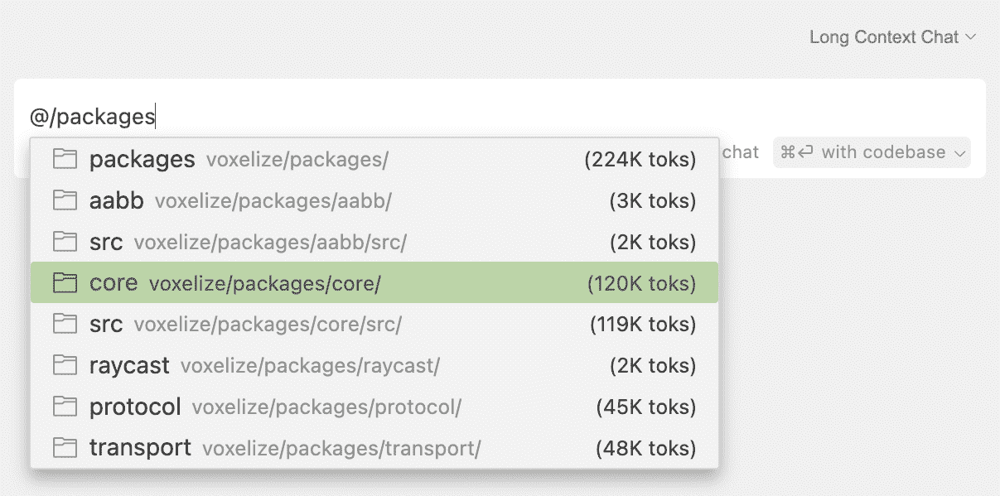

# @Folders

> 来源：[https://kcn9ut4m7icc.feishu.cn/docx/IXqCdbChIoAEdPxj8W7cCkNXnI7](https://kcn9ut4m7icc.feishu.cn/docx/IXqCdbChIoAEdPxj8W7cCkNXnI7)

Reference folders as context in Chat & Composer for enhanced AI conversations

参考文件夹作为 Chat & Composer 中的上下文，以增强 AI 对话

You can reference entire folders in Cursor as context. When using @Folders with Agent, it attaches a list of all items in the directory, which allows the Agent to search through the contents itself. This gives Agent the ability to explore and analyze the folder’s contents independently as needed for the task at hand.

您可以在 Cursor 中将整个文件夹作为上下文引用。当使用 @Folders 与 Agent 配合时，它会附加目录中所有项目的列表，这使得 Agent 能够自行搜索内容。这赋予了 Agent 根据任务需求独立探索和分析文件夹内容的能力。

