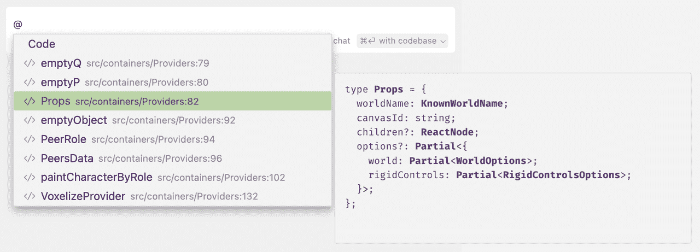
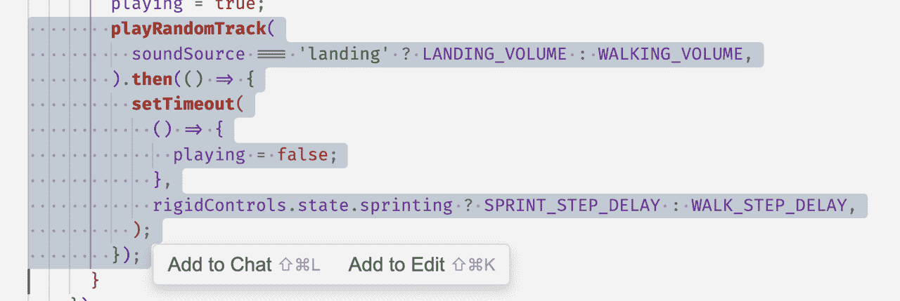

# @Code

> 来源：[https://kcn9ut4m7icc.feishu.cn/docx/Nuj5dpp65oPrtdxAKkgcmjMFnDp](https://kcn9ut4m7icc.feishu.cn/docx/Nuj5dpp65oPrtdxAKkgcmjMFnDp)

Learn to reference code using @Code symbol and keyboard shortcuts for adding code to Chat or Edit

学习使用 @Code 符号和键盘快捷键引用代码，以及将代码添加到聊天或编辑的快捷方式

To reference specific sections of code, you can use the @Code symbol.

要引用代码的特定部分，您可以使用 @Code 符号。

## Code Preview  代码预览

Similar to the [@Files](https://docs.cursor.com/context/@-symbols/@-files) symbol, Cursor will show a preview of the code’s content so you can verify that the code you’re referencing is the correct one.

与 @Files 符号类似，Cursor 将显示代码内容的预览，以便您可以验证您引用的代码是正确的。

## From the Editor  来自编辑

Another way to add code snippets as context is to select the code you want to reference, and click on either “Add to Chat” (Ctrl/⌘ Shift L) or “Add to Edit” (Ctrl/⌘ Shift K).

另一种将代码片段作为上下文添加的方法是选择您想要引用的代码，然后点击“添加到聊天”( Ctrl/⌘ Shift L )或“添加到编辑”( Ctrl/⌘ Shift K )。

These will add the selected code snippet to either the Chat input box or the currently active Cmd K prompt bar.

这些会将选定的代码片段添加到聊天输入框或当前活动的 Cmd K 提示栏中。

To add a selected code to a new chat, you can press Ctrl/⌘ L.

将选定的代码添加到新聊天中，您可以按 Ctrl/⌘ L 。