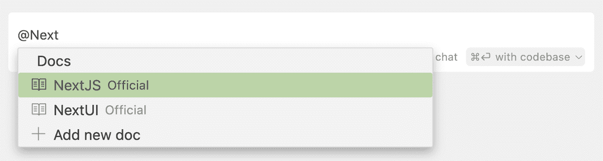
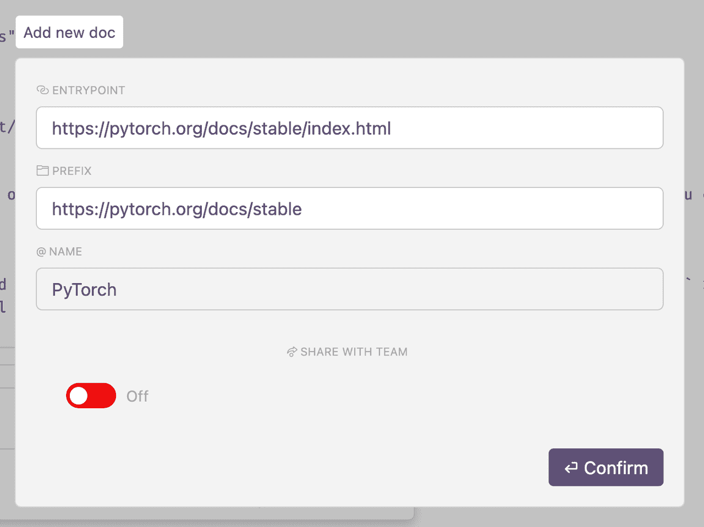
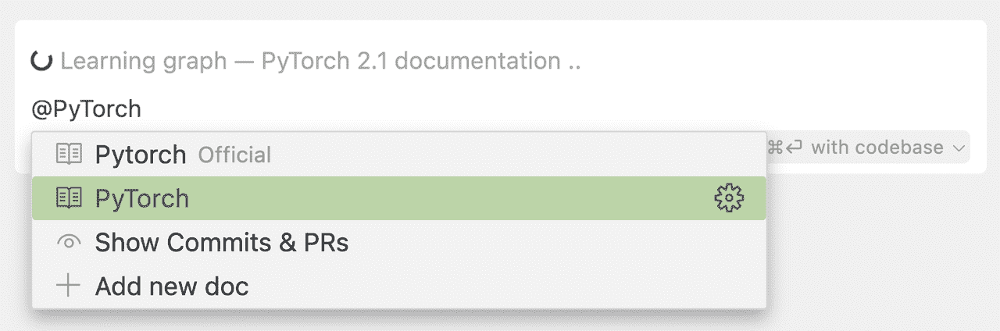
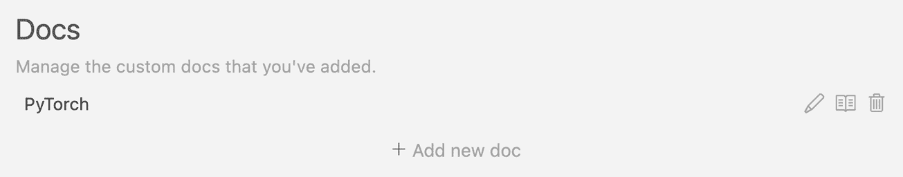

# @Docs

> 来源：[https://kcn9ut4m7icc.feishu.cn/docx/N0RQdNojcoG2nPxTDW8cRKdcn8z](https://kcn9ut4m7icc.feishu.cn/docx/N0RQdNojcoG2nPxTDW8cRKdcn8z)

Learn how to use, add, and manage custom documentation as context in Cursor using @Docs

学习如何在 Cursor 中使用、添加和管理自定义文档作为上下文，使用@Docs

Cursor co[mes ](https://raw.githubusercontent.com/getcursor/crawler/main/docs.jsonl)with a set of third party docs crawled, indexed, and ready to be used as context. You can access them by using the @Docs symbol. You can find a list of our default pre-scraped docs here.

光标附带一套爬取、索引并准备好用作上下文的第三方文档。您可以通过使用 @Docs 符号来访问它们。您可以在以下位置找到我们默认预爬取文档的列表。

##

## Add Custom Docs  添加自定义文档

If you want to crawl and index custom docs that are not already provided, you can do so by @Docs > Add new doc. The following modal will appear after you’ve pasted in the URL of your desired doc:

如果您想爬取和索引尚未提供的自定义文档，可以通过 @Docs > Add new doc 来实现。在您粘贴所需文档的 URL 后，将出现以下模态窗口：

Cursor will then index and learn the doc, and you will be able to use it as context like any other doc. Make sure to add a trailing slash to the URL if you want to index all subpages and subdirectories

光标将随后索引并学习文档，您就可以像使用其他文档一样使用它。确保在 URL 后添加斜杠，如果您想索引所有子页面和子目录。

##

## Manage Custom Docs  管理自定义文档

Under Cursor Settings > Features > Docs, you will see the docs you have added. You can edit, delete, or add new docs here.

在 Cursor Settings > Features > Docs 下，您将看到您已添加的文档。您在此处可以编辑、删除或添加新文档。

