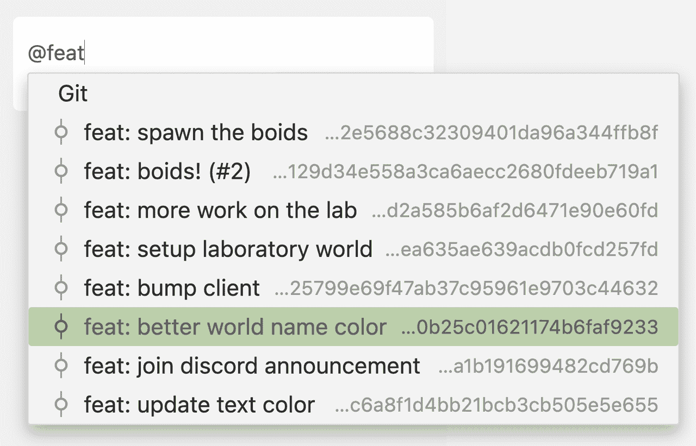
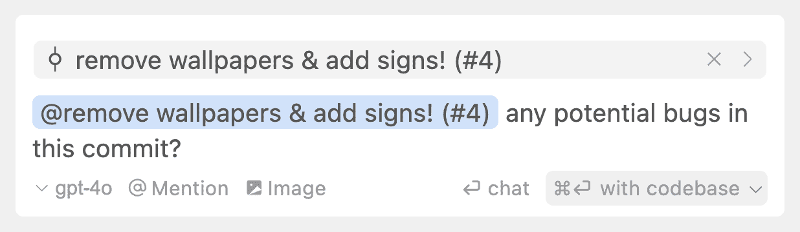
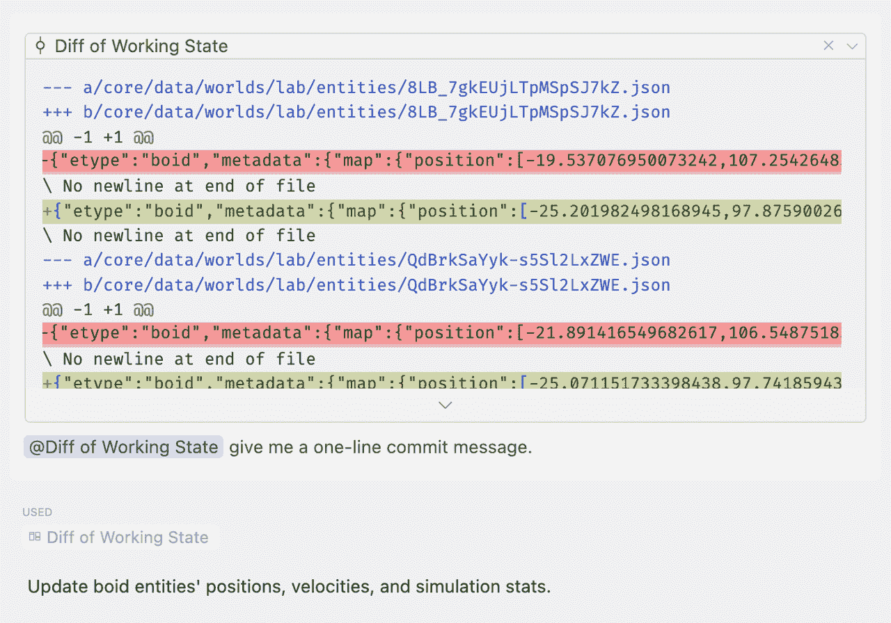

# @Git

> 来源：[https://kcn9ut4m7icc.feishu.cn/docx/EDf9dJEpjol9U5xMA33cm8B3n2g](https://kcn9ut4m7icc.feishu.cn/docx/EDf9dJEpjol9U5xMA33cm8B3n2g)

Learn how to use @Git in Cursor’s Chat to analyze diffs, find bugs, and generate commit messages

学习如何在 Cursor 的 Chat 中使用@Git 分析差异、查找错误和生成提交信息

> Currently, @Git is only supported in Chat & Composer

> 当前，仅支持在聊天和作曲器中使用 @Git

In Cursor’s Chat, you can use @Git to add git commits, diffs, or pull requests to your prompt.

在 Cursor 的聊天中，您可以使用 @Git 来添加 git 提交、差异或拉取请求到您的提示中。

## Common Use Cases  常用场景

One common use case for @Git is to allow Cursor’s AI to scan the diff and look for bugs or issues that could be caused by the diff.

一个常见的使用场景是，允许 Cursor 的 AI 扫描差异并查找可能由差异引起的错误或问题。

You could also use @Diff of Working State to generate a commit message from your current diffs.

您也可以使用 @Diff of Working State 从当前差异中生成提交信息。

