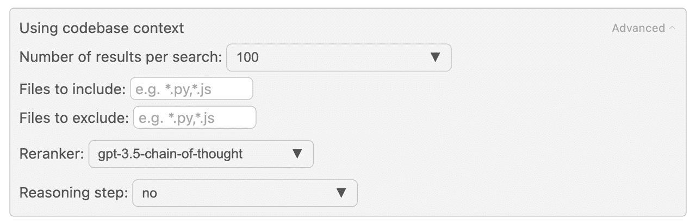
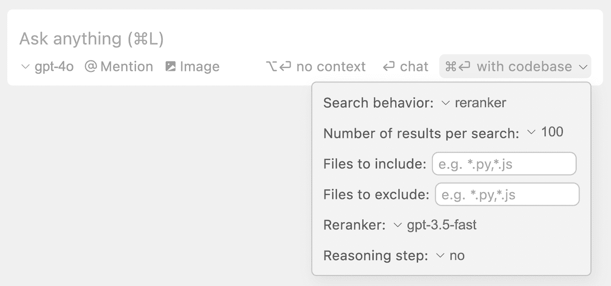

# @Codebase

> 来源：[https://kcn9ut4m7icc.feishu.cn/docx/HIcndXQnqoXZbSxyOWkcQJGAnVe](https://kcn9ut4m7icc.feishu.cn/docx/HIcndXQnqoXZbSxyOWkcQJGAnVe)

Learn how Chat processes codebase queries using gathering, reranking, reasoning, and generation steps

学习如何 Chat 通过收集、重新排序、推理和生成步骤处理代码库查询

Through @Codebase, Chat goes through these steps until it finds the most important pieces of code to use.

通过 @Codebase ，聊天会经历这些步骤，直到找到最重要的代码片段。

+   Gathering: scanning through your codebase for important files / code chunks
收集：扫描您的代码库以查找重要文件/代码块

+   Reranking: reordering the context items based on relevancy to the query
重排序：根据查询的相关性重新排列上下文项目

+   Reasoning: thinking through a plan of using the context
推理：通过一个使用上下文的计划进行思考

+   Generating: coming up with a response
生成：想出一个回应

Another way of submitting an advanced codebase query is to click on the dropdown next to the Ctrl/⌘ + Enter button and select reranker for the search behavior. This is only available when @Codebase isn’t used, otherwise @Codebase takes precedence.

另一种提交高级代码库查询的方法是点击 Ctrl/⌘ + Enter 按钮旁边的下拉菜单，并选择 reranker 以进行搜索行为。这仅在 @Codebase 未使用时才可用，否则 @Codebase 具有优先权。

