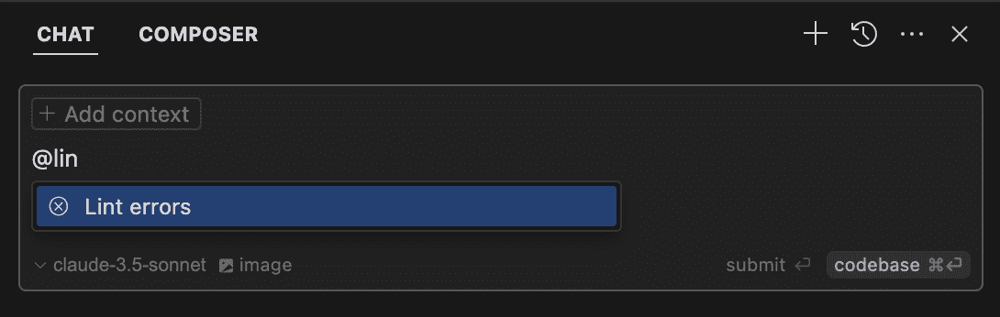

# @Lint Errors  @代码错误

> 来源：[https://kcn9ut4m7icc.feishu.cn/docx/AftKdC8ijoVmLzxrt1nce9Anntd](https://kcn9ut4m7icc.feishu.cn/docx/AftKdC8ijoVmLzxrt1nce9Anntd)

Access and reference linting errors in your codebase

访问和引用代码库中的 linting 错误

The @Lint Errors symbol automatically captures and provides context about any linting errors and warnings from your currently active file.

@Lint Errors 符号会自动捕获并为您提供当前活动文件中任何代码检查错误和警告的上下文信息。

[Composer](https://docs.cursor.com/composer) and [Agent](https://docs.cursor.com/agent) can see lint errors by default

编辑器和智能体默认可以看到代码风格错误

