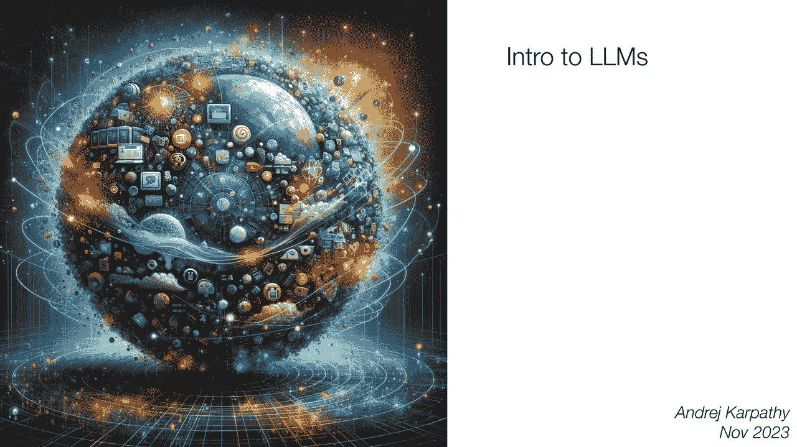
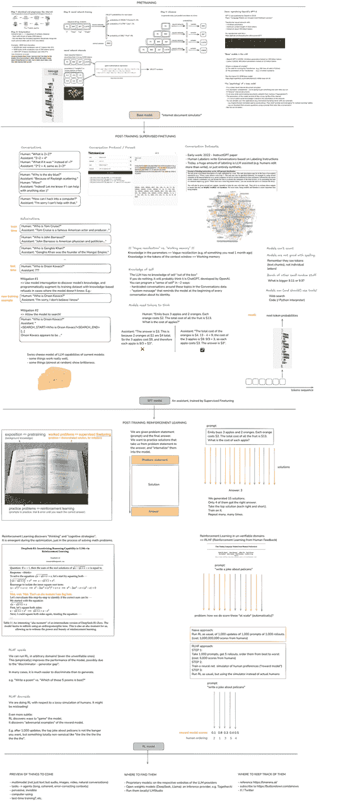
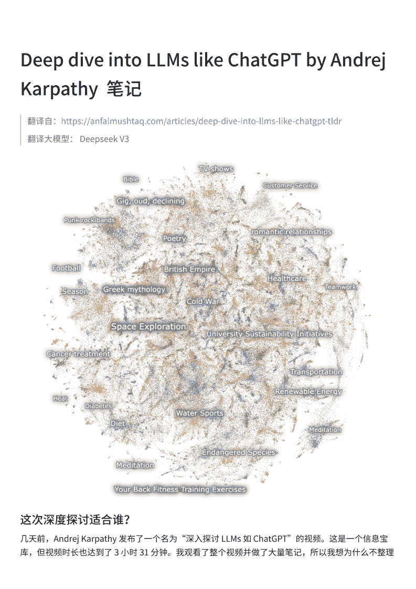
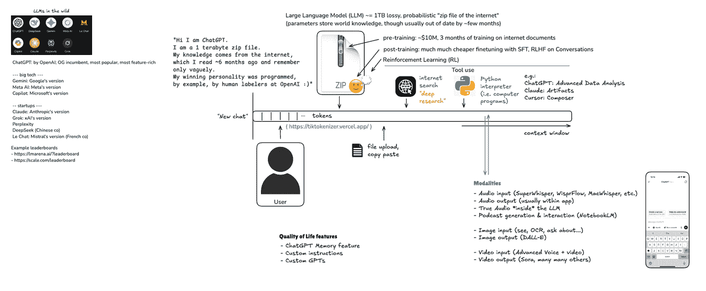

# Andrej Karpathy（安德烈·卡帕西）合集

> 来源：[https://kcn9ut4m7icc.feishu.cn/docx/Wld6dlwwnoyuMNxiy2Bcx9GbnQf](https://kcn9ut4m7icc.feishu.cn/docx/Wld6dlwwnoyuMNxiy2Bcx9GbnQf)

# 神经网络：从菜鸟到大神（Neural Networks: Zero to Hero）

## **课程介绍**

一[门从基础开始的神](https://github.com/karpathy/nn-zero-to-hero/tree/master/lectures)经网络课程。该课程是一系列视频，我们在视频中一起编写和训练神经网络。我们在视频中构建的Jupyter笔记本被保存在lectures目录中。每节课的视频描述中还包含一组练习题。（这可能会发展成更正式的内容）。

## 第1课: 神经网络与反向传播的详细入门：构建micrograd

## **The spelled-out intro to neural networks **and backpropagation: building micrograd）

神经网络的反向传播与训练。要求具备基本的Python知识，并对高中阶段的微积分有模糊的记忆。

+   【中英双语字幕】神经网络与反向传播的详细入门：构建micrograd

+   YouTube video lecture

+   Jupyter notebook files

+   micrograd Github repo

## 第2课: 语言建模的详细入门：构建makemore

## **T**he spelled-out intro to language modeling: building makemore

我们实现了一个基于字符级别的大语言模型（bigram language model），在后续视频中，我们将进一步将其复杂化，发展为类似GPT的现代Transformer语言模型。在本视频中，重点在于：(1) 介绍torch.Tensor及其细微之处，以及如何高效地用于评估神经网络；(2) 语言建模的整体框架，包括模型训练、采样以及损失评估（例如分类中的负对数似然）。

+   【中英双语字幕】语言建模的详细入门：构建makemore

+   YouTube video lecture

+   Jupyter notebook files

+   makemore Github repo

## 第3课: 构建makemore第2部分：MLP

## Building makemore Part 2: MLP

我们实现了一个多层感知机（MLP）字符级别语言模型。在本视频中，我们还介绍了机器学习中的许多基础知识（例如模型训练、学习率调整、超参数、评估、训练/开发/测试集划分、欠拟合/过拟合等）。

+   【中英双语字幕】构建makemore第2部分：MLP

+   YouTube video lecture

+   Jupyter notebook files

+   makemore Github repo

## 第**4课: 构建makemore第3部分：激活函数**与梯度，批量归一化（BatchNorm）

## **B**uilding makemore Part 3: Activations & Gradients, BatchNorm

我们深入探讨了多层感知机（MLP）的内部机制，仔细分析了前向传播激活值、反向传播梯度的统计特性，以及当它们缩放不当时可能出现的一些问题。我们还介绍了一些常用的诊断工具和可视化方法，帮助你理解深度网络的健康状况。我们学习了为什么训练深度神经网络可能会很脆弱，并引入了第一个使其变得更容易的现代创新：批量归一化（Batch Normalization）。残差连接（Residual Connections）和Adam优化器仍然是后续视频中需要讨论的重要内容。

[【](https://www.bilibili.com/video/BV1fdRPYpE3i)中英双语字幕】第4课：构建makemore第3部分：激活函数与梯度，批量归一化（BatchNorrm）

+   YouTube video lecture

+   Jupyter notebook files

+   makemore Github repo

## 第5课: 构建makemore第4部分：成为反向传播高手

## **Building makemore Part 4: Becom**ing a Backprop Ninja

我们从上一个视频中的两层MLP（带有BatchNorm）开始，手动反向传播，而不使用PyTorch的autograd中的loss.backward()。也就是说，我们通过交叉熵损失、第二层线性层、tanh激活函数、批量归一化、第一层线性层以及嵌入表进行反向传播。在此过程中，我们直观地理解了梯度是如何通过计算图反向流动的，并且是在高效的Tensor级别上，而不仅仅是像在micrograd中那样的单个标量。这有助于建立对神经网络优化方式的能力和直觉，并让你更有信心在现代神经网络上进行创新和调试。

我建议你自己完成这个练习，但同时可以跟着视频一起进行，每当遇到困[难时，可以暂停视频并查看](https://colab.research.google.com/drive/1WV2oi2fh9XXyldh02wupFQX0wh5ZC-z-?usp=sharing)我给出的答案。这个视频并不适合单纯观看。练习可以通过这个Google Colab链接进行。祝你好运 :)

+   【中英双语字幕】构建makemore第4部分：成为反向传播高手

+   YouTube video lecture

+   Jupyter notebook files

+   makemore Github repo

## 第6课: 构建 makemore 第5部分：构建 WaveNet

## **Building makemore Part** 5: Building WaveNet

我们从上一个视频中的两层MLP开始，通过树状结构使其更深，最终构建出一个类似于DeepMind的WaveNet（2016）的卷积神经网络架构。在WaveNet论文中，相同的分层架构通过因果膨胀卷积（causal dilated convolutions，尚未涉及）更高效地实现。在此过程中，我们更好地理解了torch.nn是什么、它的底层工作原理，以及典型的深度学习开发流程是什么样的（大量阅读文档、跟踪多维张量的形状、在Jupyter笔记本和仓库代码之间切换等）。

[【中英双语字幕】第6课：构建 make](https://www.bilibili.com/video/BV16CRnYiEH7)more 第5部分：构建 WaveNet

+   YouTube video lecture

+   Jupyter notebook files

## 第7课: 让我们从头开始，用代码一步步构建 GPT

## **L**et's build GPT: from scratch, in code, spelled out.

我们按照论文《Attention is All You Need》和OpenAI的GPT-2/GPT-3，构建了一个生成式预训练Transformer（GPT）。我们讨论了与ChatGPT的联系，ChatGPT已经风靡全球。我们观察了GitHub Copilot（本身也是一个GPT）帮助我们编写GPT的过程（meta :D！）。我建议人们先观看之前的makemore视频，熟悉自回归语言建模框架以及张量和PyTorch nn的基础知识，这些在本视频中被视为理所当然。

+   【中英双语字幕】让我们从头开始，用代码一步步构建GPT.

+   YouTube video lecture. For all other links see the video description.

## 第**8课: 从零构建GPT分词器**

## Let's build the GPT Tokenizer

**分词器（Tokenizer）**是大语言模型（LLMs）中一个必要且普遍存在的组件，它在字符串和标记（文本块）之间进行转换。分词器是LLM管道中一个完全独立的阶段：它们有自己的训练集、训练算法（字节对编码，Byte Pair Encoding），并且在训练后实现两个基本功能： encode() （从字符串到标记）和decode()（从标记回到字符串）。在本讲座中，我们从零开始构建了OpenAI GPT系列中使用的分词器。在此过程中，我们会发现LLMs的许多奇怪行为和问题实际上可以追溯到分词阶段。我们将探讨其中一些问题，讨论为什么分词是罪魁祸首，以及为什么理想情况下有人能找到一种方法完全删除这一阶段。

+   【中英双语字幕】从零构建GPT分词器｜Andrej Karpathy

+   YouTube video lecture

+   [minBPE code](https://github.com/karpathy/minbpe)

+   [Google Colab](https://colab.research.google.com/drive/1y0KnCFZvGVf_odSfcNAws6kcDD7HsI0L?usp=sharing)

# 大语言模型系列课程

## 大语言模型入门介绍（Intro to Large Language Models）

+   【中英双语字幕】大语言模型入门介绍

+   [YouTube原视频](https://www.youtube.com/watch?v=zjkBMFhNj_g)

+   课程讲稿：

[Intro to LLM_Andrej Karpathy.pdf](https://internal-api-drive-stream.feishu.cn/space/api/box/stream/download/all/TgZabeDmeoyZpdxnVjIcYUjCnAh)

## 从零开始复现GPT-2（1.24亿参数）

+   【中英双语字幕】让我们从零开始复现GPT-2（1.24亿参数）

+   [YouTube原视频](https://www.youtube.com/watch?v=l8pRSuU81PU)

## 深入探索像ChatGPT这样的大语言模型

#### 智能课代表

https://www.coze.cn/s/2tVOtMqMH0Q/

这是一篇面向普通观众的深入介绍，介绍了支持 ChatGPT 和相关产品的大型语言模型 (LLM) AI 技术。它涵盖了模型开发的完整训练堆栈，以及如何思考其“心理学”的心理模型，以及如何在实际应用中充分利用它们。我已经有一个大约一年前的“LLM 简介”视频，但那只是对一次随机谈话的重新录制，所以我想循环播放并制作一个更全面的版本。

+   【中英双语字幕】深入探索像ChatGPT这样的大语言模型

+   [YouTube原视频](https://www.youtube.com/watch?v=7xTGNNLPyMI)

+

[深入探索像ChatGPT这样的大语言模型_Andrej Karpathy Notes.jpg](https://internal-api-drive-stream.feishu.cn/space/api/box/stream/download/all/UuICb2sH8oxpJQxQ1U2cGVqInAd)

+

[Deep dive into LLMs like ChatGPT by Andrej Karpathy  笔记.pdf](https://internal-api-drive-stream.feishu.cn/space/api/box/stream/download/all/NHbab3RRco8e3Nx6pMGcr2xBnPd)

## 如何使用大语言模型（LLMs）

+   【中英双语字幕】如何使用大语言模型（LLMs）

+   [YouTube原视频](https://www.youtube.com/watch?v=EWvNQjAaOHw)

+

[如何使用大语言模型（LLMs）讲稿.jpg](https://internal-api-drive-stream.feishu.cn/space/api/box/stream/download/all/NWAfb1n7oo2ZkRxpN3wcOptxnVf)