# DeepMind《强化学习》课程

> 来源：[https://kcn9ut4m7icc.feishu.cn/docx/Xk78dEXABo8919xcBVrcHFZ6nkd](https://kcn9ut4m7icc.feishu.cn/docx/Xk78dEXABo8919xcBVrcHFZ6nkd)

# 课程视频链接

[【中英双语字幕】《强化学习｜Reinf](https://www.bilibili.com/video/BV1XvRhYQEXi)orcement Learning》课程

# 课件

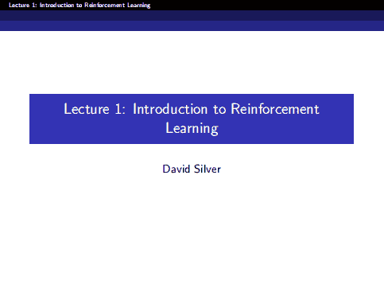

[Lecture 1-Introduction to Reinforcement Learning.pdf](https://internal-api-drive-stream.feishu.cn/space/api/box/stream/download/all/CZBgb1dteoDPWYxlFJVcqzvpnme)

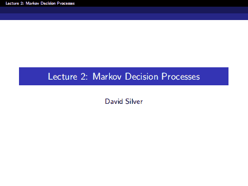

[Lecture 2-Markov Decision Processes.pdf](https://internal-api-drive-stream.feishu.cn/space/api/box/stream/download/all/KpoVbb9fsoAoWrxrCcrcba4Nnve)

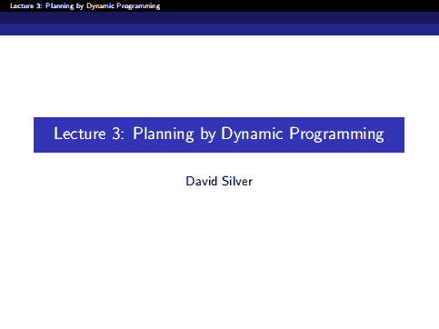

[Lecture 3-Planning by Dynamic Programming.pdf](https://internal-api-drive-stream.feishu.cn/space/api/box/stream/download/all/ILm7bWBGqo4zZ8xyQlCcHgS4ntf)

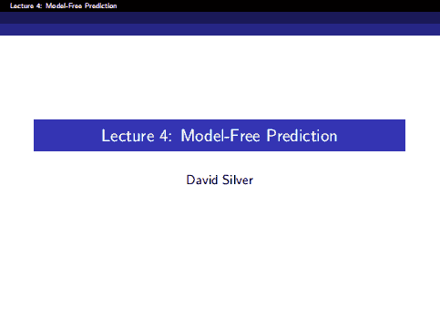

[Lecture 4-Model-Free Prediction.pdf](https://internal-api-drive-stream.feishu.cn/space/api/box/stream/download/all/OVzxbWn1hoGQcgx433rcRiR3nuA)

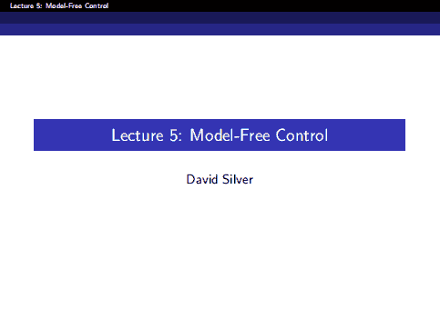

[Lecture 5-Model-Free Control.pdf](https://internal-api-drive-stream.feishu.cn/space/api/box/stream/download/all/PuxobayQ0o8XeTxT56ychWDCnCh)

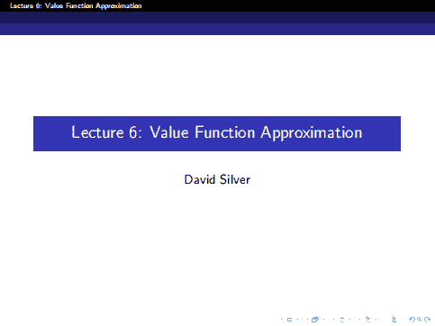

[Lecture 6-Value Function Approximation.pdf](https://internal-api-drive-stream.feishu.cn/space/api/box/stream/download/all/V2T9bRHNIoFFuQxA3bucc3vLnfb)

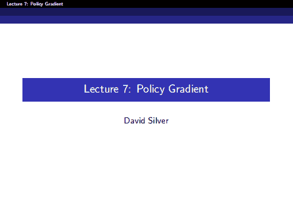

[Lecture 7-Policy Gradient Methods.pdf](https://internal-api-drive-stream.feishu.cn/space/api/box/stream/download/all/NETbbQyq3orr1wxz3GMcnXkpnTh)

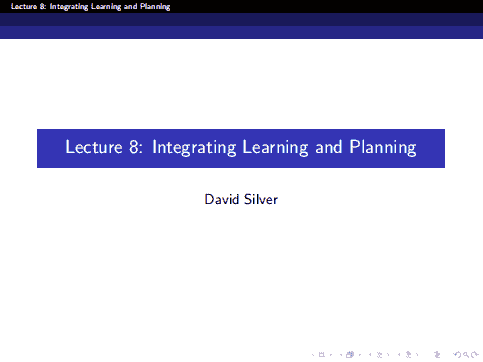

[Lecture 8-Integrating Learning and Planning.pdf](https://internal-api-drive-stream.feishu.cn/space/api/box/stream/download/all/DiOzbZrgtonjhUxDAJocZtCtnJb)

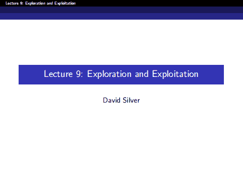

[Lecture 9-Exploration and Exploitation.pdf](https://internal-api-drive-stream.feishu.cn/space/api/box/stream/download/all/HEdNbZqZqo8sxAxILlqcawSBnM0)

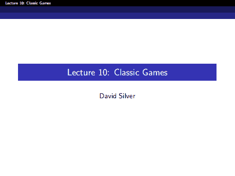

[Lecture 10-Case Study, RL in Classic Games.pdf](https://internal-api-drive-stream.feishu.cn/space/api/box/stream/download/all/PCUcbvHNwoFhk4x6fW6cvdVUnOc)

# 课后作业

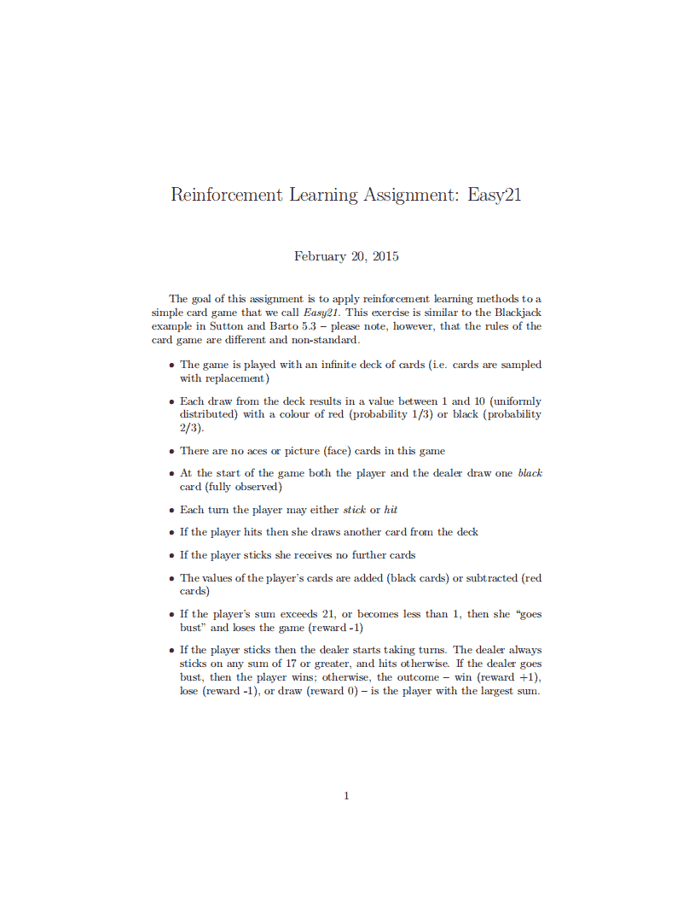

[Easy21-Johannes.pdf](https://internal-api-drive-stream.feishu.cn/space/api/box/stream/download/all/ThgNbAJr8o9gkexpjkgcJp6VnmN)