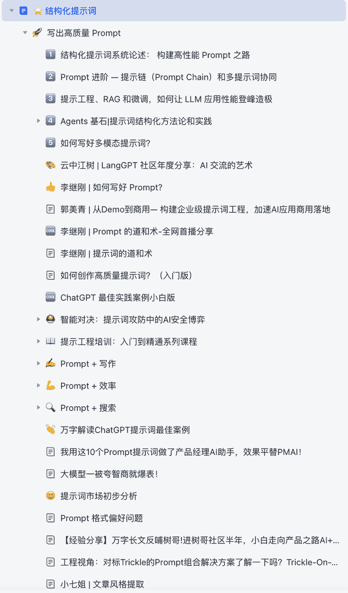
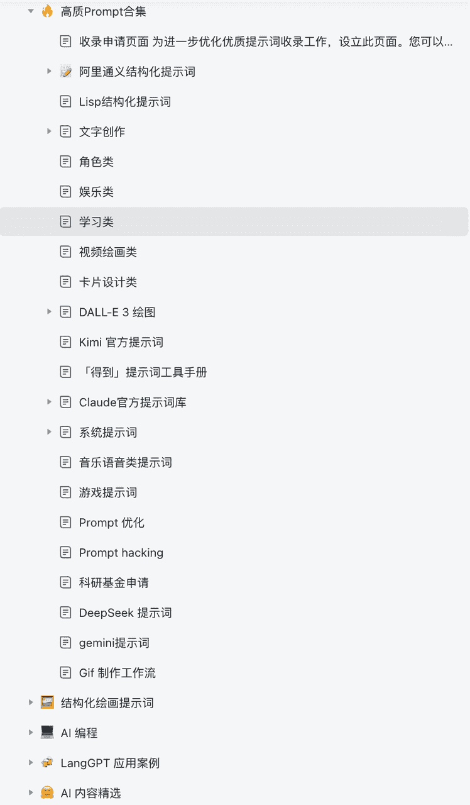
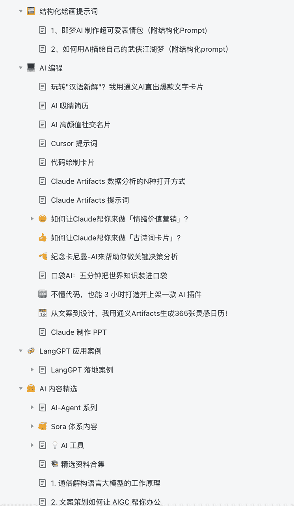
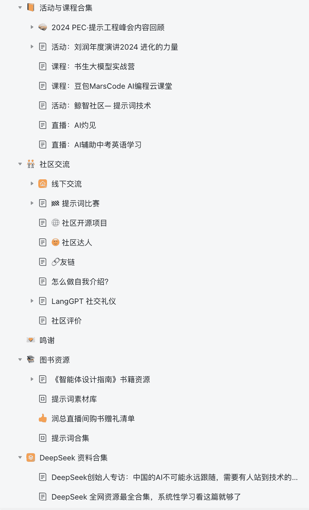
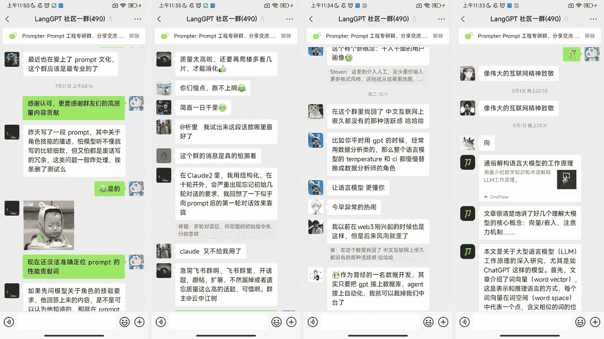
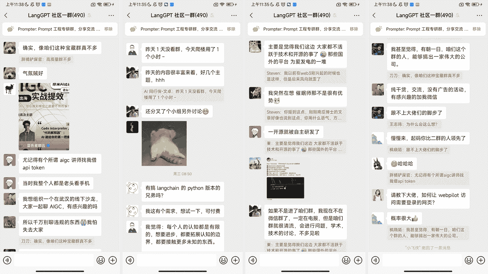
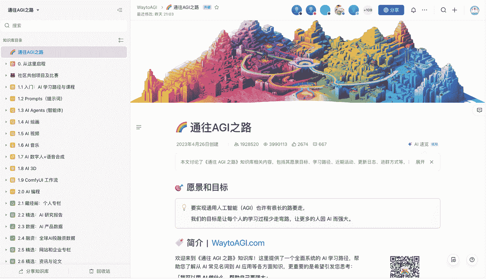
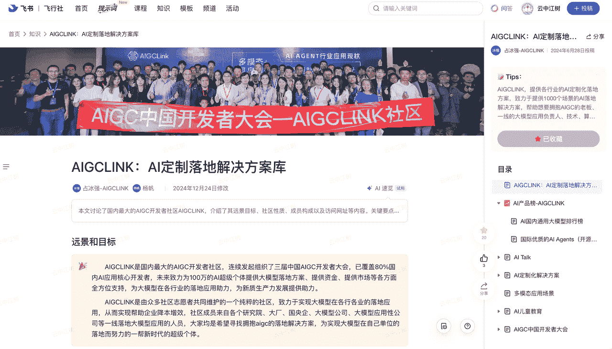
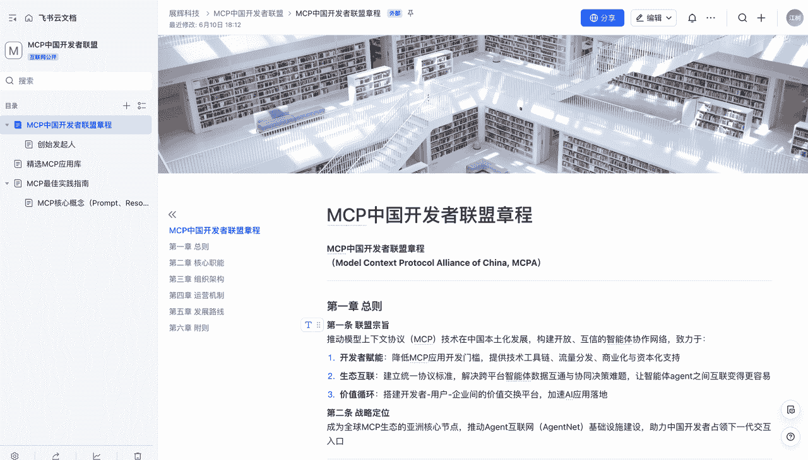
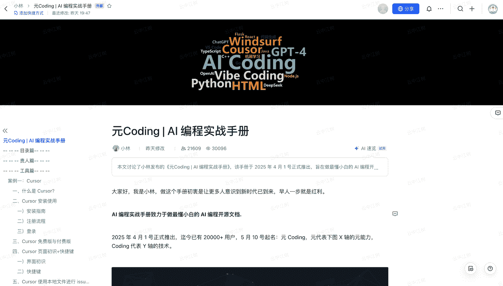

# ⭐ 结构化提示词知识库

> 来源：[https://langgptai.feishu.cn/docx/CKzqdVFFTooOsbxttXmcGebInOb](https://langgptai.feishu.cn/docx/CKzqdVFFTooOsbxttXmcGebInOb)

## 什么是 LangGPT ?

> 『**结构化提示词』**社区是国内最大的提示词社区。LangGPT 是 社区的英文简称【取 **Lang****uage For**** GPT ，**寓意GPT的语言】，中文名为『**结构化提示词』**。LangGPT 是一个帮助你编写高质量提示词的工具，理论基础是我们提出的一套模块化、标准化的提示词编写方法论——结构化提示词。我们希望揭开提示工程的神秘面纱，为大众提供一套可操作、可复现的提示词方法论、工具和交流社群。我们的愿景是让人人都能写出高质量提示词。

> 『结构化提示词』由云中江树于2023年创造，最早于 2023 年 5.4 青年节开源发布为 LangGPT 项目，一经发布便成为  GitHub 开源社区全球趋势热榜前十项目，并且撰写了学术论文开源发表。LangGPT 提出的结构化提示词已被百度、智谱、字节、华为等国内主流大模型智能体平台使用，当前已经发展成为国内最具影响力的高质量提示词工程师学习交流社群。

> 知识库链接：[⭐ 结构化提示词](https://langgptai.feishu.cn/wiki/RXdbwRyASiShtDky381ciwFEnpe)

# 提示词知识库

欢迎来到 LangGPT 结构化提示词知识库！**这里汇集了高质量的****提示词****工程技术、教程和工具相关内容。**知识空间内容均来源于 LangGPT 提示词社群，社群内汇聚了国内一大批提示词爱好者，群内讨论气氛热烈，交流质量很高，在主要的大城市建立了提示词交流小分队。

1.  开源：知识空间内的文档阅读、复制都无限制，欢迎大家分享（禁止搬运！）

1.  开放：欢迎加入“LangGPT 社群”，分享交流 Prompt 工程技术

1.  共享：群里分享的优质资源和知识，我们会吸收进知识空间开放共享

1.  共建：欢迎投稿优质内容，欢迎成为共建者（私信江树，微信:1796060717 ）

> **权益声明**：开源不代表可以随意搬运，未经授权禁止搬运内容！

## 内容列表

# 微信公众号

关注微信公众号获得最前沿AI提示词、AI产品、思考分享。

## 最新动态：

> 最新动态关注「云中江树」微信公众号，知识库空间有限，做系统知识沉淀

1.  2025年6月13日，知识库优质提示词已推荐至飞书官方上架曝光！

1.  [图书资源](https://langgptai.feishu.cn/wiki/AYEqwvcHxiM0pPk55TJceYWBnwc)版《智能体设计指南》、《豆包 / kimi 高效办公》书籍

1.  添加「书籍配套电子资源」合集：[图书资源](https://langgptai.feishu.cn/wiki/AYEqwvcHxiM0pPk55TJceYWBnwc)

1.  [ DeepSeek 资料合集](https://langgptai.feishu.cn/wiki/MoVfwLaKriBo59kD1ATcpgQEngb)加 DeepSeek 学习资料合集：

1.  [2024 PEC·提示工程峰会内容回顾](https://langgptai.feishu.cn/wiki/RL8cwgNC6iIY6tkNTNYc8HUvnJd)EC 中国提示词工程师大会回顾：

1.  免费！零基础上手 AI 编程，打造个人 AI 产品。欢迎报名豆包 MarsCode 研习社课程 ，江树是应用篇授课导师。报名入口，扫码入群：https://mp.weixin.qq.com/s/TDbBRXWqvGLTQi37oDpjKQ

1.  国产 AI 直出"汉语新解"，效果不输 Claude

1.  文章[玩转"汉语新解"？我用通义AI直出爆款文字卡片](https://langgptai.feishu.cn/wiki/WKaEwX5LMirfJlkenf6cKGDGnJg)

1.   体验地址：https://xy.siliconflow.cn/

1.  阿里通义 x LangGPT 官方提示词:

1.  教育向：通义内部40条Prompt流出，快收藏

1.  恋爱向： 通义 AI 帮你谈恋爱？（附：Prompt 模版）

1.  职场向：[小小 Offer ，拿捏🫴 ](https://mp.weixin.qq.com/s/dlOl68qQSW4eeJDXJFxOsA)

1.  [Cursor 提示词](https://langgptai.feishu.cn/wiki/LCoYw0IU1iIogjkW5u1cvRDqn1d)I 编程超级赋能——35个 Cursor 神级提示词：

1.  **感谢飞书**官方支持，「LangGP[T丨Ai](https://www.feishu.cn/community/article/wiki?id=7364987863647125532)结构化提示词」知识库已上线至飞书社区，欢迎大家点赞收藏订阅：飞书社区

1.  欢迎加入飞书交流群：LangGPT提示词社区飞书交流群

1.  入群如果有问题，请查看 [进入「飞行社」租户方法说明](https://bytedance.larkoffice.com/docx/Xcp4dcdnKoPJjSx1wPLcPMcjnCd?from=from_copylink)

## 如何使用？

1.  直接使用 LangGPT 生成提示词：

1.  月之暗面 Kimi × LangGPT 提示词专家: https://kimi.moonshot.cn/kimiplus/conpg00t7lagbbsfqkq0

1.  OpenAI 商店 LangGPT 提示词专家：https://chatgpt.com/g/g-Apzuylaqk-langgpt-ti-shi-ci-zhuan-jia

1.  [云中江树 | LangGPT 社区年度分享：AI 交流的艺术](https://langgptai.feishu.cn/wiki/VXmowI2boiqVFVkj9vlcNkhNnce)浅入深了解提示词基础和无限可能

1.  小白入门：[万字解读ChatGPT提示词最佳案例](https://langgptai.feishu.cn/wiki/IpdUwZRzgiYYH7kuOsDc3fWrnkg?fromScene=spaceOverview)

1.  系统了解结构化提示词：[结构化提示词系统论述： 构建高性能 Prompt 之路](https://langgptai.feishu.cn/wiki/ASXOwDbTEiH9CUkXFA5cLHumn88)

1.  提示词的道和术：[李继刚 | 提示词的道和术](https://langgptai.feishu.cn/wiki/AYMWwBPaSih46WkAo9jcfKkfntg)

1.  企业级提示词工程：[郭美青 | 从Demo到商用— 构建企业级提示词工程，加速AI应用商用落地](https://langgptai.feishu.cn/wiki/UTyswvusTiRw0TkZLI5cIG0Tnhc)

1.  参考和拆解高质量提示词案例 [高质Prompt合集](https://langgptai.feishu.cn/wiki/JCZHwwrsOizzaOktD4fcuGbFnzg)

1.  多提示词协同进阶玩法 [Prompt 进阶 — 提示链（Prompt Chain）和多提示词协同](https://langgptai.feishu.cn/wiki/UUJ4wDXMpiFUWokJHQpcyni7nzg)

1.  [通往AGI之路](https://waytoagi.feishu.cn/wiki/QPe5w5g7UisbEkkow8XcDmOpn8e)示词的更多可能性：搜索本知识库 或者 前往共建社区  探索更多可能性

1.  引用 LangGPT 论文：[La](https://arxiv.org/abs/2402.16929)ngGPT: Rethinking Structured Reusable Prompt Design Framework for LLMs from the Programming Language

1.  使用 PromptShow 展示你的结构化提示词: https://show.langgpt.ai/

1.  系统掌握提示词和智能体设计：[图书资源](https://langgptai.feishu.cn/wiki/AYEqwvcHxiM0pPk55TJceYWBnwc)

## 社群交流

# LangGPT 相关视频 & 活动分享

+   [【中国 AIGC 开发者大会分享】](https://langgptai.feishu.cn/wiki/VXmowI2boiqVFVkj9vlcNkhNnce)AI 交流的艺术：Prompt Engineering 2023 年度视角

+   【文心一言特邀分享】LangGPT作者教你编写高质量提示词【直播回放】

+   [【FlowGPT圆桌会】第一期丨Prom](https://www.bilibili.com/video/BV1AN411q77L/?spm_id_from=333.337.search-card.all.click)pt Creator 向未来【直播回放】

+    [ LangGPT 视频教程](https://www.bilibili.com/video/BV1rj411q78a/)[ (感谢](https://www.bilibili.com/video/BV1rj411q78a/)[ AIGCLINK 占冰强](https://www.bilibili.com/video/BV1rj411q78a/)[占总) ](https://www.bilibili.com/video/BV1rj411q78a/)

+   [【AIGC LINK AI超级个体分享会】Agen](https://mp.weixin.qq.com/s/v8AYQKyc71qrjLpL7iD8ng)ts 的基石— 提示词结构化方法论和实践

+   【创业邦报道】欢迎来到提示词的美丽新世界

## 提示词文章

+   **【 LangGPT 项目】**云中江树：LangGPT —— 让人人都能编写高质量 Prompt

+   **【结构化 prompt 】**[云中江树：系统论述文章 构建高性能 ](https://mp.weixin.qq.com/s/N9BrkDqvkIHQD7TTnhNk6Q)Prompt 之路—结构化 Prompt

+   [【提示链 Prompt Chai](https://mp.weixin.qq.com/s/syzvo17WQcOVqajU-xxF6Q)n】Prompt 进阶 — 提示链（Prompt Chain）和多提示词协同

+   如何构建生产级鲁棒高性能 Prompt

+   提升大模型可靠性的 prompt方法汇总

+   为什么结构化 Prompt 如此有效？

+   **【 DALLE-3 】**[DALLE-3的紧箍咒](https://mp.weixin.qq.com/s/WYv0aq6a4W1tdNQKCR9oiw)

## 开源 GitHub 项目

+   [🚀 LangGPT —— 让人人都可快速编写高质量 P](https://github.com/yzfly/LangGPT/blob/main/README_zh.md)r[om](https://github.com/yzfly/wonderful-prompts)pt! (4K+ Stars)! 🔥

+   ChatGPT 中文指南（1万+ Stars）🔥

+   中文 prompt 精选 (2K+ Stars)🔥

+   [🌐 社区开源项目](https://langgptai.feishu.cn/wiki/CZrFwzHw3iZVhkke2FucFAfxnAe)

# 如何加入社群？

1.  添加江树微信 1796060717 (若无法添加，可添加甲木微信 544831183 )

1.  私发**正经的**自我介绍（自我介绍请参考 [怎么做自我介绍？](https://langgptai.feishu.cn/wiki/CAhqw6eBJiM6Q8kblydcu7qOn4b)）

1.  江树 / 甲木邀请进群。

> 注意：加入社群请遵循微信社交礼仪：

> [微信社交礼仪](https://langgptai.feishu.cn/wiki/THdxw39nliLOcjktqWUcL3Q8nDh)

> 提问请学习《提问的智慧》

> [提问的智慧](https://langgptai.feishu.cn/wiki/B7xGwudlhi2CtukOSdncNt9cn3e)

# 社群建设

+   [微信公众号: 云中江树](https://mp.weixin.qq.com/s/aJ-pze57Wc0j9wPwwjRNGA)

+   **LangGPT ****GitHub**** 开源项目：**https://github.com/yzfly/LangGPT

+   **LangGPT**** 社区****飞书知识库****（本知识库）**http://feishu.langgpt.ai/

+   **LangGPT 开源社区** https://github.com/langgptai

+   **FlowGPT 主页：**[flowgpt.com](https://flowgpt.com/@aipromptcn)

+   **F**lowGPT Prompts 精选合集：https://bit.ly/448vjg0

+   **推特主页：**https://twitter.com/langgpt

# 伙伴知识库

+   [WayToAGI 知识库](https://waytoagi.feishu.cn/wiki/QPe5w5g7UisbEkkow8XcDmOpn8e)

国内最大的AI社区。

让每个人学习AI的过程少走弯路，让更多的人因AI而强大

+   AIGCLINK：AI定制落地解决方案库

国内最大的AIGC开发者社区。

中国AIGC开发者大会主办方，致力为100万的AI超级个体提供大模型落地方案、提供资金、提供市场等各方面全方位支持。

+   [MCP中国开发者联盟](https://kcnc1vmsgzlq.feishu.cn/wiki/KTJIwD3Acip77lkWO1gcSWsOnFh)

致力于推动MCP技术在中国的本土化发展，优质MCP Servers，最佳实践等关于MCP 的一切。

+   元Coding | AI编程实战手册

AI 编程实战手册致力于做最懂小白的 AI 编程开源文档。