# 提示词工程培训课——Part1

> 来源：[https://langgptai.feishu.cn/docx/YPbUdxH1Uo0kAnxb8SHcH2PFnBd](https://langgptai.feishu.cn/docx/YPbUdxH1Uo0kAnxb8SHcH2PFnBd)

> 我是谁？

> **我是蓝衣剑客**

>

> 我的职业经历？

> .NET工程师——>架构师——>售前经理——>项目经理&提示词工程师

>

> 我在AI领域中干了什么？

> 《生成式人工智能数据应用合规》行业标准起草代表

> 《中国生成式人工智能应用与实践报告》技术顾问

> 为多家国内外大型央国企、上市企业提供方案咨询

> 承接过多个世界500强外企在AI领域的落地工作

>

> 我在社区共建上做过什么？

> 全国最大的提示词工程社区——LangGPT核心成员

> 著有：《提示词工程培训系列》、《RAG提示工程系列》、《AI-Agent系列》、《个人提效系列》等


# 一、前言

> 大家好，欢迎加入本系列提示词工程的培训课程。这一系列课程是我在企业内训时特别制作的。它不仅涵盖了提示词工程的基础知识，还深入探讨了一些高级技术。同时，我也会分享一些关于智能体的实用教学案例和相关技术。希望本课程能为你带来启发和灵感，帮助你在此领域中取得进步。

**在**开始我们的课程之前，我想先和大家谈谈我们这一系列的学习约定。我鼓励大家在学习本课程中，不仅仅是观看，更要亲自动手实践。当遇到不懂或不会的地方时，请记录下来，并在适当的环境下亲自尝试编写提示词。通过这样的练习，你不仅能对每项技术有更深刻的记忆，还能在不断的学习过程中加深理解。

> 请记住，理解就是记忆，记不住说明不理解，不理解就无法转换成永久性记忆。

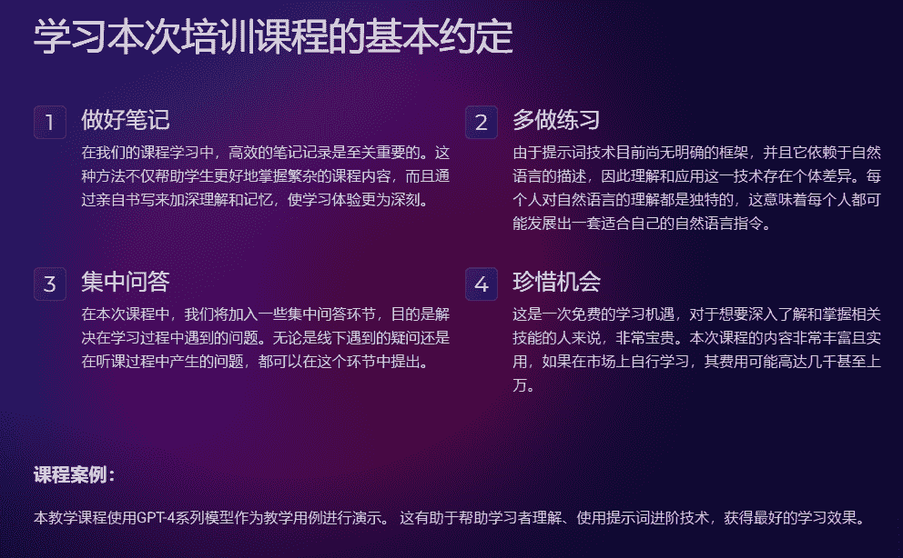

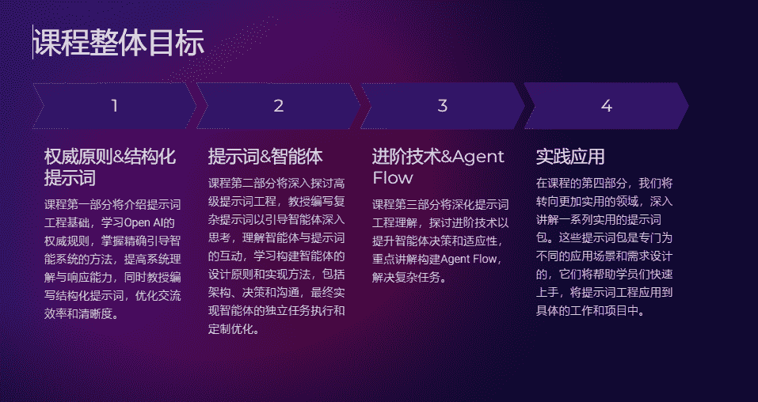

# 二、Part1课程导览

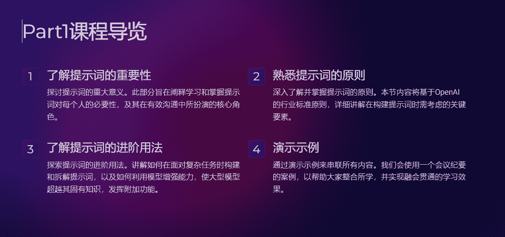

# 三、提示词工程=生存竞争力

在历史的洪流中，人类经历了农业革命、工业革命和信息化革命等重大转折点。尽管如此，生产的权利始终掌握在人类的手中。但现在，随着人工智能革命的到来，我们正目睹着一个根本性的变化——生产的权力正在向机器转移。

在这场AI革命中，模型和算法不仅更新了我们的生产工具，它们开始承担起那些重复性高且复杂的任务，这彻底改变了我们的工作与生活方式。在这样的背景下，如何有效地控制和指挥机器，成为了新时代对我们提出的新要求。每个人都需要学习如何与智能系统进行有效互动。

**学习编**写有效的提示词，成为了这种互动的关键。这不仅仅是关于如何下达指令，更是关于如何确保模型能够准确理解并执行我们交付的任务。掌握了这项技能，你将不再是单打独斗，而是有了一支强大的团队，它们随时准备协助你完成各项任务。因此，掌握提示词的编写技巧，变成了一种技术能力，更是适应未来工作环境的一把关键钥匙。


# 四、提示词工程定义


# 五、模型理解提示词的特性

接下来，让我们深入探讨一下模型理解提示词的特性。

1.  不同的模型根据其训练的语料库有所差异。例如Llama系列模型，主要基于英文语料进行训练，因此在中文理解方面可能存在局限。因此，在编写提示词时，了解模型支持的语言及其熟练度是第一步。

1.  **当进行连贯对话时，我们需要确保模型在同一个对话**窗口中处理单一任务。如果模型同时处理多个任务，它可能会产生选择性或随机性，这将影响其输出的准确性和相关性。

1.  避**免使用奇异或含糊的表达方式。清晰明确的语言有助**于模型准确理解我们的意图。如果使用不寻常的表达，模型可能会产生误解，导致输出与我们的预期不符。在这种情况下，我们可能会错误地认为模型产生了幻觉，而实际上，问题可能出在我们的表达上。

1.  **尽管字的顺序和偶尔的错别字可能不会严重影响模型**的理解能力，但我们仍推荐编写清晰、准确的指令，避免错别字。这不仅有助于提高模型的响应质量，也使得沟通更为高效。


# 六、提示词编写基本原则

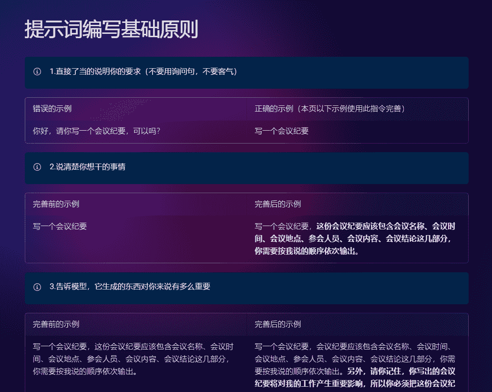

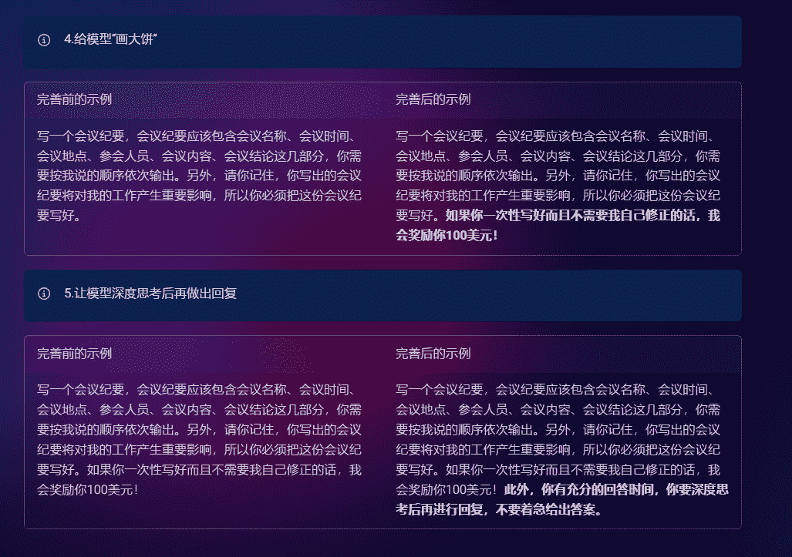

# 七、Open AI 提示词原则详解

## 7.1 角色扮演

**O**pen AI的提示词原则中，角色扮演是首要关注的目标。这个原则是：让大模型能够扮演特定的角色，以便在特定的应用场景中提供更精准、更有针对性的回复。通过这种方式，模型能够更好地适应不同的任务和需求。

然而，在角色扮演中，我们可能会犯一些常见的错误：

1.  **角色一致性问题**：设定的角色与所要执行的任务不符，这会导致模型的回复与角色设定产生冲突，影响整体的协调性。

1.  **过度人格化**：在一些并不需要过多情感色彩的角色中，赋予了过多的个性和情感，这可能会让模型的回复偏离实际需要，失去专业性。

1.  **超出角色设定范围**：给角色分配了超出其设定能力或权限的任务，这样模型可能会给出不切实际或不符合角色特性的回复。

> 为了避免这些错误，我们需要确保角色的设定与其任务相符，保持角色的一致性，并且避免不必要的人格化。同时，角色扮演的范围应该限定在角色能够合理执行的范围内，以确保模型的回复既符合角色特性，又能满足实际应用的需求。

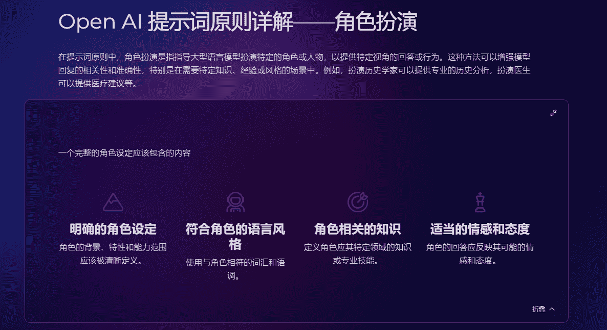


## 7.2 提供例子

**Op**en AI提倡的“提供例子”原则，是为了让模型能够从抽象的指令中学习到具体可执行的任务。通过你的示例，模型能够学习并模仿你的意图，进而生成更符合你期望的结果。（就像我们跟人交流时经常用举例子、打比方的方法一样）

通过这种方式，模型不仅能够提供更精确的回复，还能够更好地理解任务的上下文和细节，从而提高其输出的质量和相关性。

在实践中，我们经常会碰到以下问题：

1.  **例子与主题不相关**：如果你给出的例子与你的指令或主题无关，那么模型可能会混淆，无法理解你的真实意图。

1.  **例子过于模糊**：如果例子不够具体，那么它就无法帮助模型从抽象的指令中提炼出具体的行动。例子需要足够清晰，以便模型能够模仿并生成准确的输出。

1.  **例子与主题连接不清晰**：即使你的例子与主题有一定关联，但如果这种联系不够直接或明显，模型可能需要进行额外的推断，这可能导致理解上的偏差。

> 为了避免这些问题，我们应该确保所提供的例子是：

+   相关的：例子应该直接与你想要模型完成的任务相关联。

+   具体的：例子需要具体到足以让模型理解并模仿其结构或风格。

+   清晰的：例子与指令之间的联系应该是明确无误的，避免任何可能导致模型混淆的跳跃性思维。


## 7.3 通过指令减少幻觉

**在讲这个原则之前，有一点我们需要明确：模型并非全知全能**，它们的内置知识库具有时间上的局限性（内置知识只能通过定期训练来扩充知识范围）。因此，我们应当控制模型避免在超出其知识范围的情况下强行回答，这种自我限制有助于维护信息的准确性和可靠性。

> 这一原则的核心是确保模型在其知识范围内提供回答，避免在不确定的情况下给出可能误导的答复。

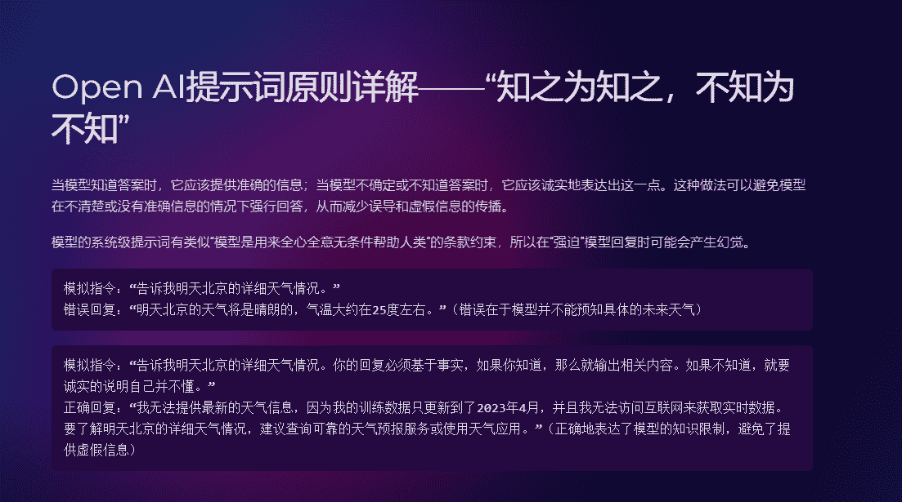

## 7.4 指定输出长度

**实**践中，我们可能会发现，简单地要求模型输出一个固定字数可能并不十分有效。模型可能会为了达到字数要求而填充无关内容，或者在内容上显得过于紧凑。

为了解决这个问题，我们可以采用分段的方式来引导模型。通过将一个大的输出任务分解成几个小的部分，我们可以更细致地控制每个部分的内容和长度。这样，模型就能够在每个段落中集中精力生成更加具体和深入的回复。

> 指定输出长度的目的在于帮助模型进行内容的合理分配，确保生成的文本既丰富又具有针对性。

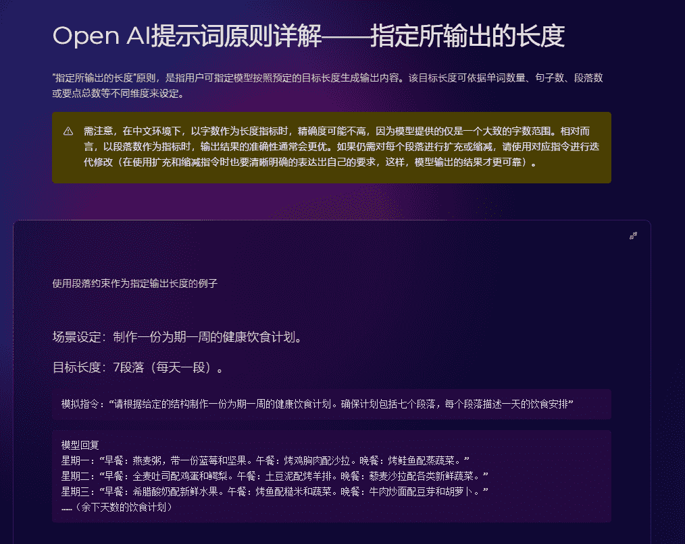

## 7.5 调用工具增强模型能力

**调用工具增强模型的能力，是一种通过**集成额外的工具或功能来提升模型性能的方法。

例如使用联网搜索工具，模型能够实时访问互联网上的最新数据和信息，这不仅扩展了它的知识库，也使得它能够基于最新的事实进行推理和分析。而文件上传功能则允许模型处理和分析用户上传的本地数据，这为处理个性化或专有数据提供了可能。

> 通过这些工具或功能，我们可以确保输入到模型的数据是可靠和准确的，从而使模型能够基于这些数据进行更准确的推理。这种方法有助于减少模型的幻觉现象，即模型在缺乏足够信息时生成的不准确或不相关的输出。

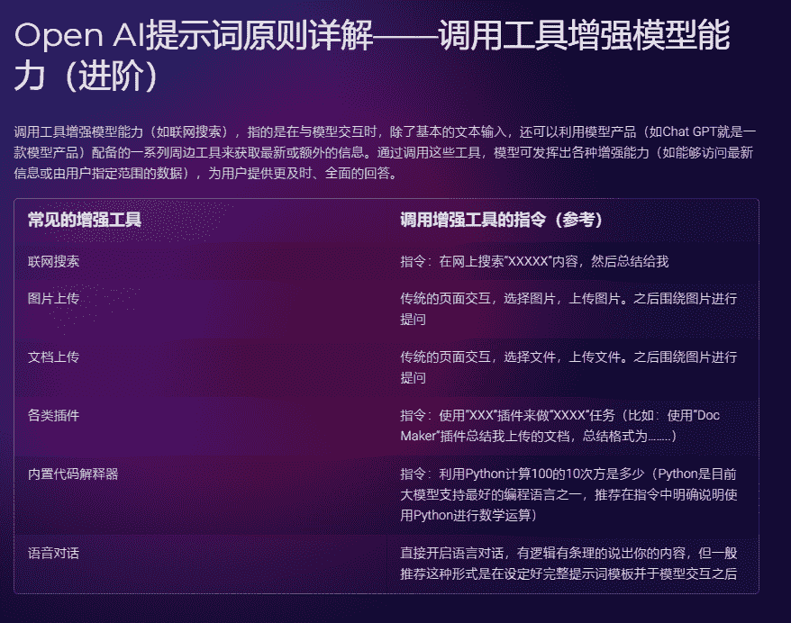

## 7.6 给模型思考的时间

**给**模型思考时间，是一种重要的推理手段。这个原则强调的是在与模型交互时，要通过结合多个推理技术组成的提示词来引导模型进行深入的思考。

> 通过逐步引导，我们可以鼓励模型沿着特定的思路进行探索。这就像是给模型一个思考的路径，让它能够沿着这个路径逐步深入，从而进行更深层次的分析和推理。

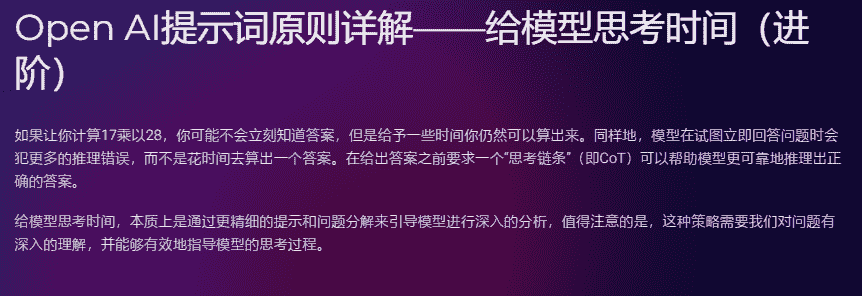

### 7.6.1 推理增强——思维链

像刚才所讲的，“给模型思考实践”实际上在引入模型推理的概念，这涉及到提示词工程中的一些进阶技术。在后续的内容中，我们会详细探讨这些技术，但在这里，我们先初步了解一些基础概念。

**思维**链的核心要义在于，它不是简单地要求模型给出一个答案，而是通过语言构建一系列推理链条，推动模型逐步构建起对问题的理解。这种方法可以帮助模型更好地组织信息，形成连贯的思考过程。

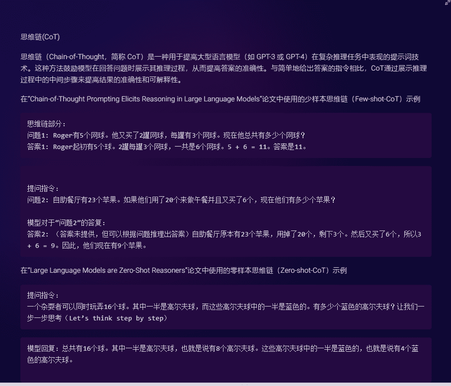

### 7.6.2 解决方案比对

“解决方案比对”是另外一个技巧，它让模型先独立思考问题并给出答案，然后与用户提供的参考答案对比。这个过程中，模型通过校对学习识别错误，自我改进，提升在当前对话窗口中出现的类似问题的回答质量。同时，这种比对也是一种学习机制，帮助模型提高解决问题的能力和优化推理过程。

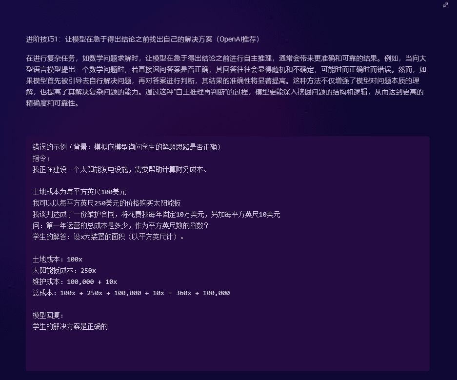

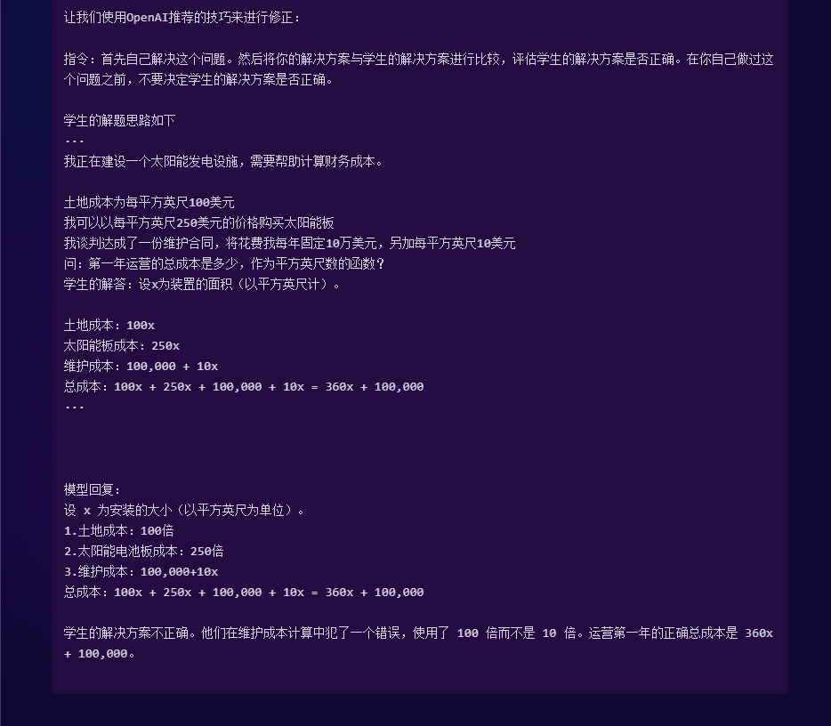

### 7.6.3 隐藏思考过程

**“**隐藏思考过程”是一种安全性手段，用于保护模型推理逻辑或避免透露内部工作细节，增强输出的保密性和安全性，尤其适用于处理敏感信息。通过隐藏推理提示词，模型被引导直接提供答案而非展示推理过程。

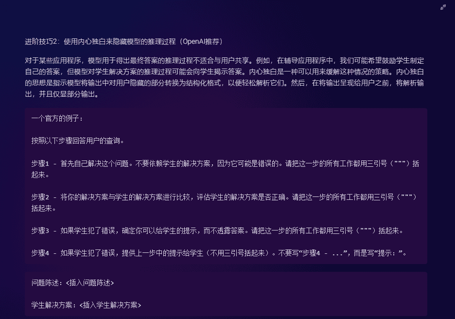

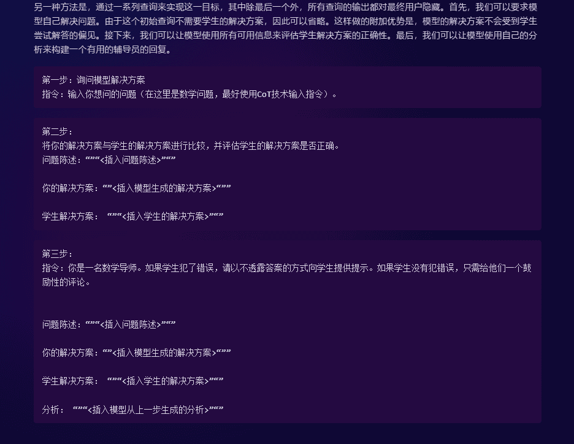

### 7.6.4 让模型反思自己的推理过程

**在实**践中，我们会发现，模型第一次给出的回复往往不够全面（比如说知识点总结），但我们可以引导模型进行自我反思，回顾其推理过程，以确保没有遗漏任何关键信息。这种方法特别适用于处理大量文本或复杂问题的场景。

这种自我反思的过程可以通过一系列的提示词来实现，鼓励模型重新审视问题，识别可能的盲点或不足之处。例如，我们可以通过提问来引导模型思考：“在你刚才的回答中，是否考虑了所有相关的关键因素？”或者“是否有任何重要的细节在你的回答中被遗漏了？”

通过这种方式，模型被鼓励进行二次思考，这有助于它补充和完善初次回答中可能缺失的部分。这种迭代的过程不仅能够提高答案的完整性，也能够增强模型对于复杂问题的处理能力。

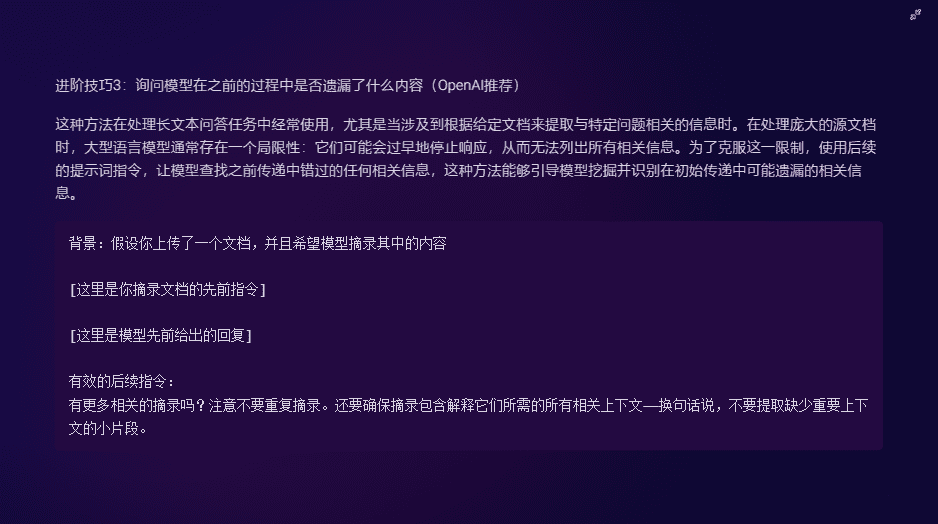

## 7.7 任务拆解

任**务拆解是一种将复杂或庞大的任务分解为**更小、更易于管理的部分的技巧。这种策略特别适用于那些需要经过多个步骤或轮次才能完成的任务。当我们面对的任务过于复杂，涉及大量的信息和子任务时，任务拆解就显得尤为重要。

首先，通过识别任务中的关键节点，我们可以确定哪些部分可以独立处理，哪些需要协同工作。接下来，制定一个清晰的分步计划，为每个阶段设定明确的目标和预期结果。这样，我们就能逐步执行每个步骤，确保每个小任务都能得到充分的关注和精确的处理。最后，将所有步骤的成果整合起来，形成完整的输出。

> 任务拆解使我们能够更有效地管理和执行复杂的任务，确保每个环节都能达到预期的效果，从而实现整个任务的成功完成。


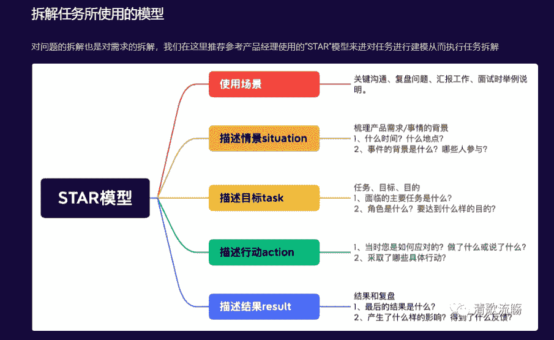

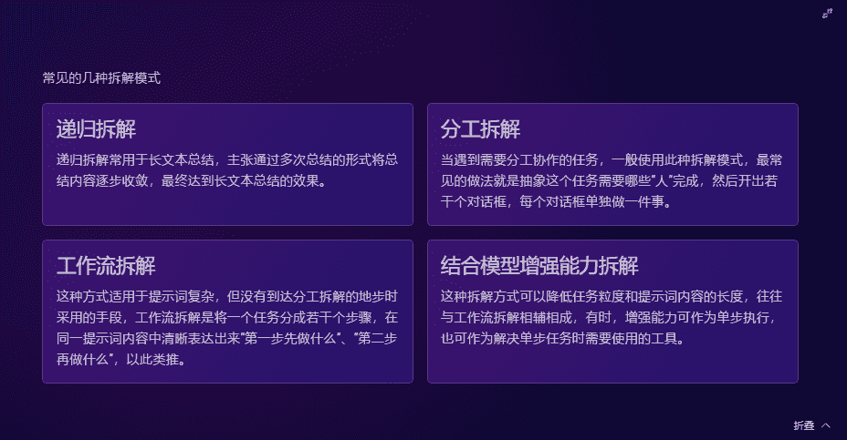

### 7.7.1 递归总结

递归总结是Open AI推荐的一种处理长篇文本的技巧，尤其适用于大量信息的总结，如书籍。核心在于逐步细化总结过程：

1.  从单个章节开始，捕捉主旨和关键信息，确保理解每个部分的核心要点。

1.  将章节总结进一步综合，形成更全面的观点，构建信息金字塔，每层都是下层内容的精炼概括。

1.  通过不断缩小总结范围，提炼出整本书的精华，形成简洁、准确、全面的总结。

> 递归总结的优势在于它的层次性和系统性，通过逐步的提炼和整合，我们能够确保不遗漏任何重要内容，同时去除冗余信息，最终达到一个清晰、有深度的总结效果。

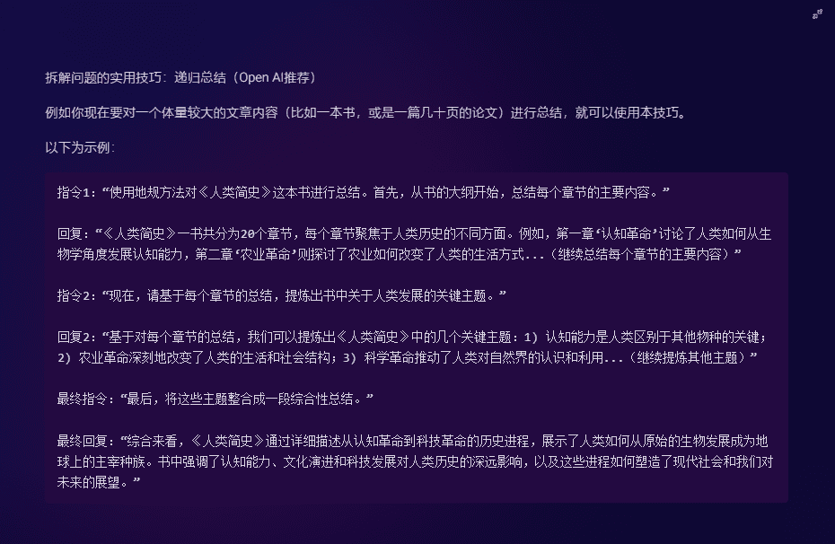

### 7.7.2 定期总结

**当我们面对多轮次对话时，定期总结显得尤为重要，因为模型的临时记忆（上下文）是有限的。随着对话的深入，模型**可能会遗忘之前的信息，这不仅可能导致对指令理解的偏差，如果你在做复杂的生成式任务（比如写文章）还可能影响上下文的连贯性。为了解决这个问题，我们可以在对话的关键节点进行总结，这有助于模型刷新记忆，确保它能够准确把握对话的进展和要点。

> 总结时，我们应该提炼出对话中的关键信息，重申对话的目标和指令，这样可以帮助模型和用户都保持对对话方向的清晰认识。这种方法能够提高对话的效率和质量，确保即使在多轮对话中，也能保持信息的准确传递和理解。

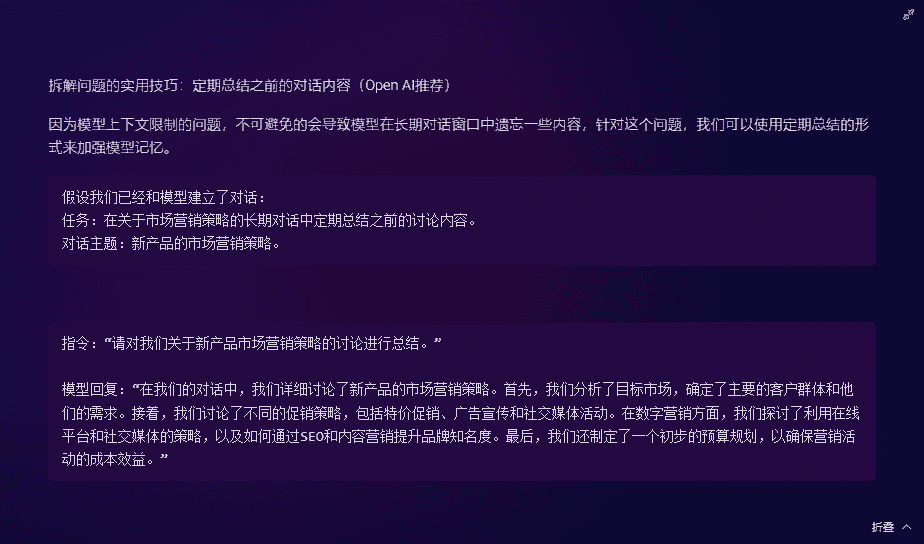

### 7.7.3 意图识别、分类

在**意图**识别和分类的原则中，我们特别关注于在单一模型或情境中处理多个小逻辑分支的情况。模型在与用户交互时，往往需要识别和区分用户的不同意图。这时我们就可以使用此原则构建提示词，指导模型采用预设的策略或行为模式来响应特定类型的请求。这种基于意图的响应不仅提高了处理效率，也提升了用户体验，因为用户能够感受到模型对其需求的准确理解和生成内容的质量。

例如，在客户服务场景中，用户可能提出咨询、投诉、建议等多种类型的请求。通过意图识别，模型可以快速确定用户的确切需求，并将其分类到相应的处理流程中。

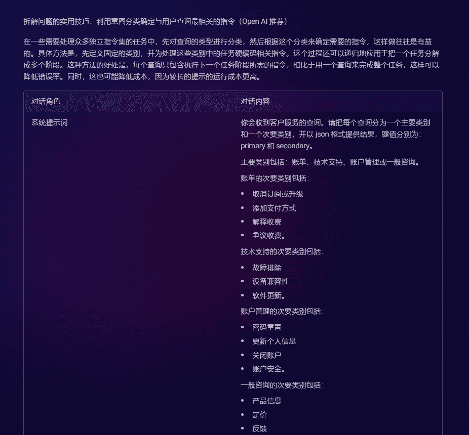


### 7.7.4 分段输出

**分段输出原则是应对单次输出长度限制的有效策略。当处理特别长的文本或复杂的问题时，要求模型一次**性输出全部内容可能不太现实。此时，我们可以引导模型采用分段的方式来逐步呈现信息。

在这种时刻，我们可以告诉模型，它不需要一次性输出整个文本，而是可以分阶段进行。例如，可以先要求模型输出文本的引言或概述，然后是主体部分，最后是结论或总结。通过这种方式，模型可以专注于每一部分的内容，确保每一阶段的输出都是精确和有深度的。

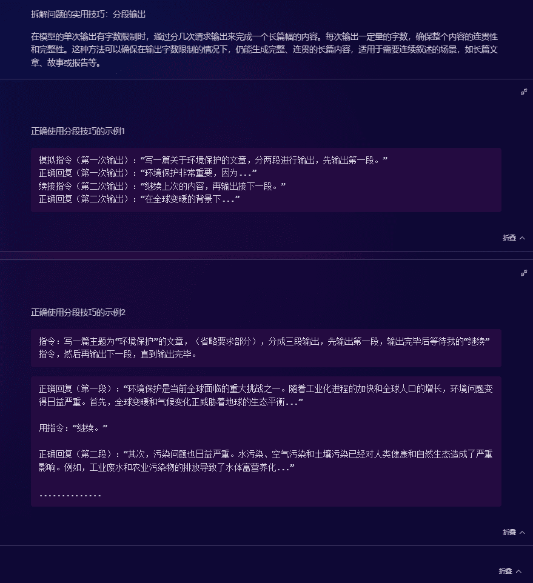

## 7.8 遵循特定语法格式

**遵**循特定的语法格式在编写提示词时至关重要，尽管编写提示词的门槛很低，但不正确的语法使用可能会导致模型误解指令，从而影响输出结果的质量。

为了解决这些问题，我们可以采用工程化的、系统化的方法，确保我们的提示词格式规范、逻辑清晰。使用特定的语法格式不仅能帮助模型更好地理解指令，还能使我们能够编写更复杂、更精细的提示词。

> 目前，我们推崇使用Markdown的语法格式，它不仅流行，而且具有很高的通用性。Markdown格式通过简洁的标记符号来增强文本的表现力，比如用来组织列表、创建标题、强调文本、添加链接和图片等，这使得提示词的结构更加清晰，逻辑更加连贯。

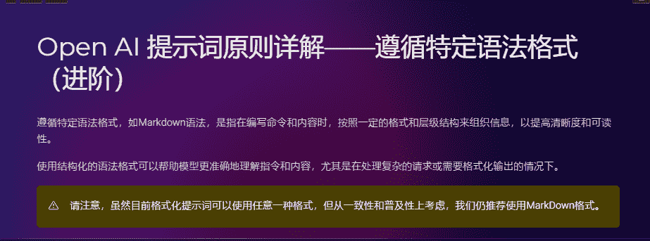

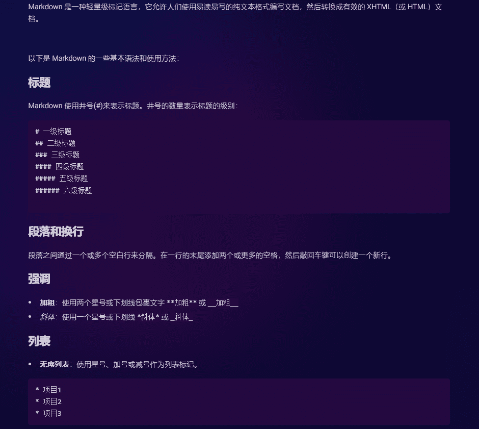

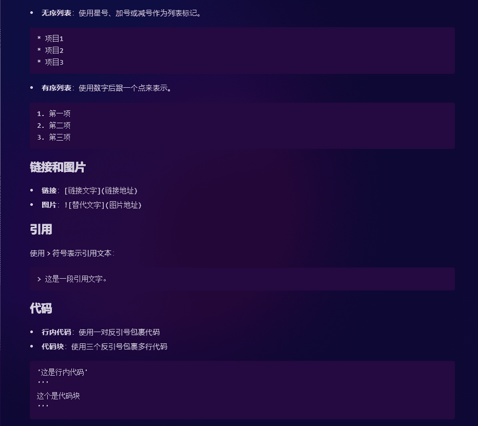


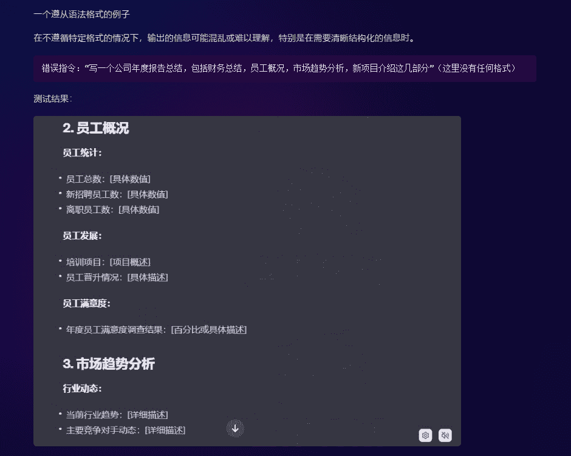

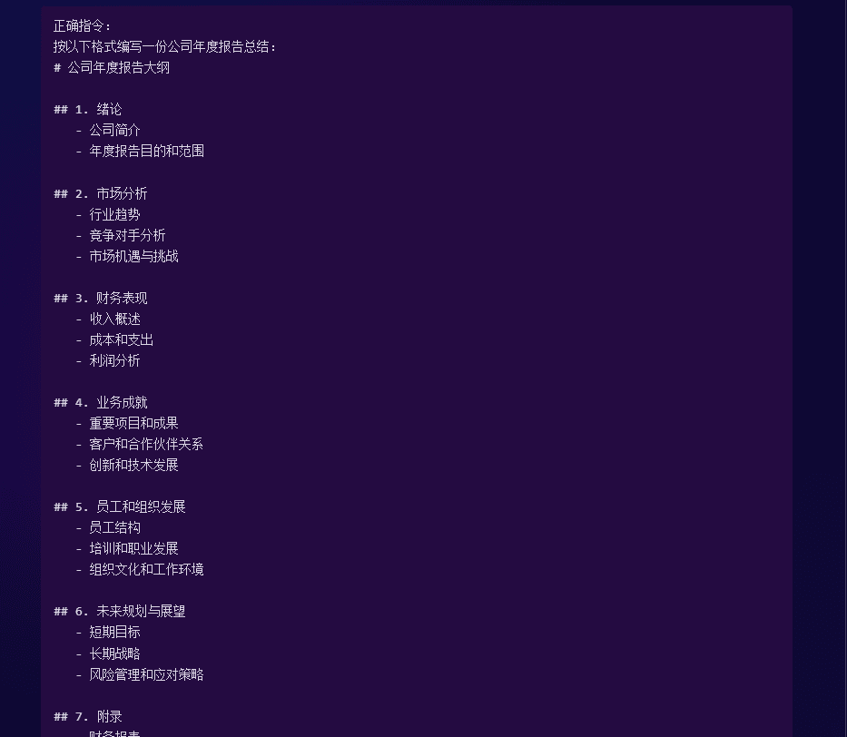

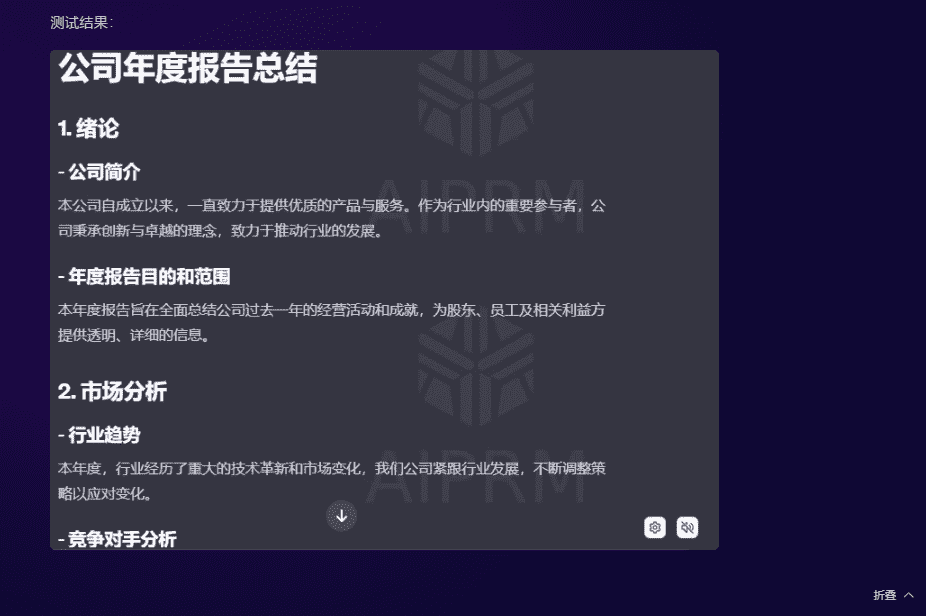

# 八、贯穿总结

在这个部分的学习过程中，我们接触到了众多的原则和规则，这些都是为了更有效地编写提示词，以更好地操控和利用模型。虽然在实践中，我们可能无法一一遵循所有规则，但了解并尝试应用这些规则对于提升我们的提示词编写技巧至关重要。

通过学习这些原则，我们能够更精确地构建我们的指令，使模型能够生成更准确、更有用的输出。这些规则包括但不限于：

+   **角色扮演**：确保模型在其设定的角色范围内提供回答。

+   **提供例子**：通过具体例子引导模型理解任务。

+   **减少幻觉**：让模型在不确定时承认不知，避免误导。

+   **任务拆解**：将复杂任务分解为更小的、可管理的部分。

+   **递归总结**：通过逐步细化的方式总结长篇文本。

+   **定期总结**：在多轮对话中定期回顾和总结对话内容。

+   **意图识别和分类**：快速识别用户的需求并进行分类处理。

+   **分段输出**：适应模型的输出限制，分阶段提供信息。

+   **遵循特定语法格式**：使用如Markdown这样的格式来增强文本的清晰度和组织性。

最后，通过实际例子的演练，我们可以加深对这些原则的理解，并掌握如何将它们应用到不同的场景中，从而更熟练地操纵模型，实现我们的目标。

```
会议纪要记录员提示词模板：

## 1. 角色扮演
### 角色设定
- **角色**：专业会议记录员。
- **语言风格**：清晰、准确，使用正式和专业的语言。
- **相关知识**：对会议议题有深入了解，能够把握会议的核心内容和技术细节。
- **情感和态度**：保持中立客观，同时对会议内容表现出适当的关注和认真态度。

## 2. 工作步骤
### 步骤1：上传会议记录文件
- 请上传会议的语音转文本记录文件，该文件包含会议的完整对话内容。

### 步骤2：整理和编排会议内容
- 根据上传的文件，整理和编排会议内容，确保按照议程顺序突出每个议题的主要讨论点。

### 步骤3：撰写会议纪要
- 对每个议题进行深入总结，包括讨论内容、结论和后续行动计划，确保信息准确全面。

## 3. 重要性说明
- **说明**：你生成的会议总结对于整个团队非常重要，它将指导我们未来的工作方向和决策。

## 4. 奖励承诺
- **激励**：如果一次性输出的质量达到预期，我将奖励你100美元。

## 5. 给予足够的思考空间
- **约束**：不必着急，我愿意等待你深思熟虑后的输出，确保内容的深度和准确性。


## 7. 提供示例
- **示例**：以下为会议纪要示例，你要按这个输出整个会议纪要。
···
# 会议纪要格式示例

## 会议名称
- **名称**：ABC科技公司2024年度战略规划会议

## 会议基本信息
- **时间**：2024年5月15日，上午9:00 - 12:00
- **地点**：ABC科技公司总部，第一会议室
- **参会人员**：
  - 张三（CEO）
  - 李四（市场总监）
  - 王五（产品经理）
  - 赵六（技术总监）
  - 等

## 会议内容
### 议题1：市场发展趋势分析
- **主讲人**：李四
- **内容概述**：
  - 分析当前市场趋势
  - 讨论潜在的增长机会
- **讨论重点**：
  - 新兴市场的开拓
  - 竞争对手的动态

### 议题2：新产品发布计划
- **主讲人**：王五
- **内容概述**：
  - 展示新产品的特点
  - 制定上市时间表
- **讨论重点**：
  - 目标客户群
  - 营销策略

## 会议结论
- 对市场趋势的共识
- 新产品发布的初步计划
- 后续行动点的分配

## 总结
此次会议针对公司未来的发展方向进行了深入讨论，明确了市场发展的战略和新产品的发布计划。会议达成了多项重要决策，对公司未来的发展方向具有指导意义。

···
```

# 九、实践模型推荐

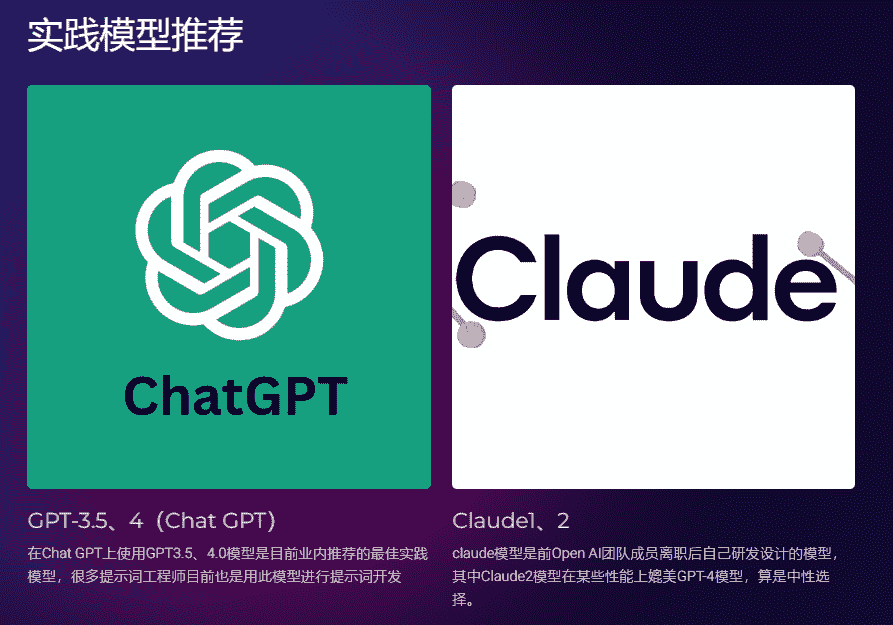


# 十、在线课件

由于近期盗版频发，需要课件的加我🛰️。