# 提示词工程培训课——Part4

> 来源：[https://langgptai.feishu.cn/docx/YhU6dKn46oUvOXxHunac3ibxnoc](https://langgptai.feishu.cn/docx/YhU6dKn46oUvOXxHunac3ibxnoc)

> 我是谁？

> **我是蓝衣剑客**

>

> 我的职业经历？

> .NET 工程师——>架构师——>售前经理——>项目经理&提示词工程师

>

> 我在 AI 领域中干了什么？

> 《生成式人工智能数据应用合规》行业标准起草代表

> 《中国生成式人工智能应用与实践报告》技术顾问

> 为多家国内外大型央国企、上市企业提供方案咨询

> 承接过多个世界 500 强外企在 AI 领域的落地工作

>

> 我在社区共建上做过什么？

> 全国最大的提示词工程社区——LangGPT 核心成员

> 著有：《提示词工程培训系列》、《RAG 提示工程系列》、《AI-Agent 系列》、《个人提效系列》等


# 一、前言

大家好，我们现在正步入培训的最终阶段。在之前的学习过程中，我很好奇大家是否都有了显著的收获。我希望大家能够紧跟我们的步伐，确保不落后。现在，让我们集中精力，全神贯注地学习最后一部分的培训内容。那么，不浪费时间，我们现在就开始吧！

# 二、课程导览

在 Part4 中，我们会首先介绍提词工程的基础概念和一些实用技巧。我们将利用地规来构建思考链条，并探讨提示词的敏感性问题。此外，我们还会解释'token'，这是我们之前没有涉及的新概念。同时，我们会讨论如何根据特定原则来压缩 token，以及如何有效控制成本。

在第二部分，我们将深入讲解提示词的进阶技术，包括如何增强推理能力，以及如何运用元提示和一系列任务分解、增强推理的技巧。

第三部分，我们将探讨 AI-Agent 和 AI-Agentic 的概念和差别，学习吴恩达教授对于智能体的新领悟。同时也会介绍一些基本的多智能体设计模式。

最后，在第四部分，我们会梳理一个切实可行的提词落地流程，展示如何在实际工作中有效运用提词，这些内容将为我们的课程带来深刻的洞见和实践指导。

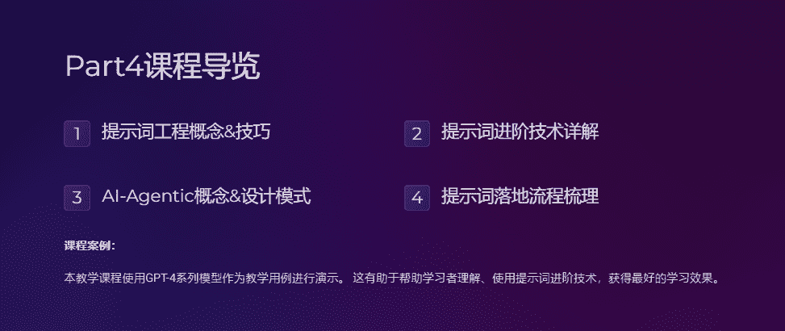

# 三、上节回顾

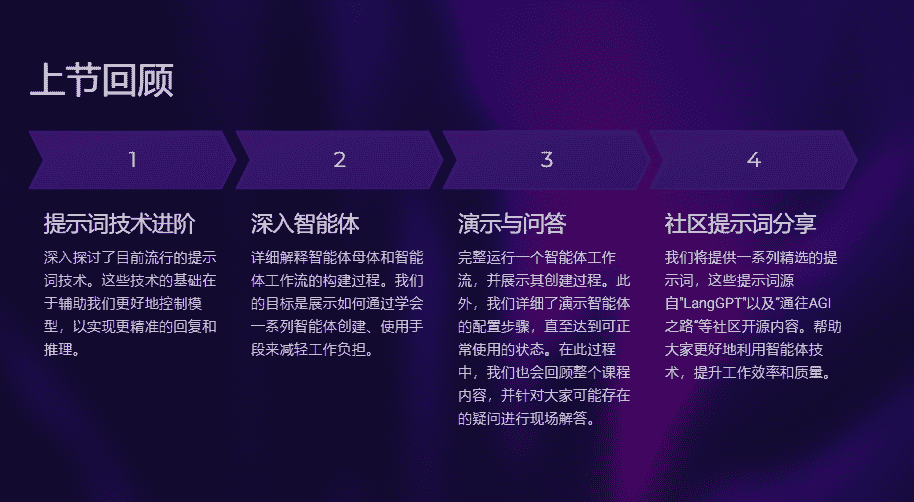

# 四、提示词技巧

## 4.1 利用递归构建思考链条

在提词技巧的第一部分，我们首先要介绍一种重要的技巧，那就是利用递归的形式来构建提示词。这种方法使我们能够创建一个连贯且完整的思考链条。这不仅是一项极为实用的技能，而且也是我个人经常运用的技巧之一。

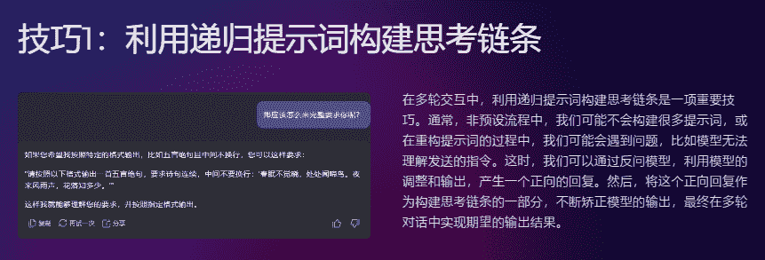

一个完整例子来看如何反问模型并构建思考链条

### Step 1. 事情的起因

一位朋友在群里表达了他想要生成一首诗的愿望，这首诗需要以一种特殊格式呈现，即两句输出在一行的形式。我询问了这位朋友具体需要的格式，希望他能给出明确的指示。然而，他的回应非常尖锐，尽管如此，我还是决定探索这个问题。


### Step 2. 第一次尝试

大家应该知道，要求模型输出文字技巧、句式格式或控制字数时，模型可能不会很好地遵循指令。由于当时我无从下手，所以我的第一次尝试失败了，模型没有按照我的指令输出。如果继续调整提示词，可能还会失败。这是很多使用提示词的人常遇到的问题：不知道下一步该怎么做，缺乏一个切实可行的方案。

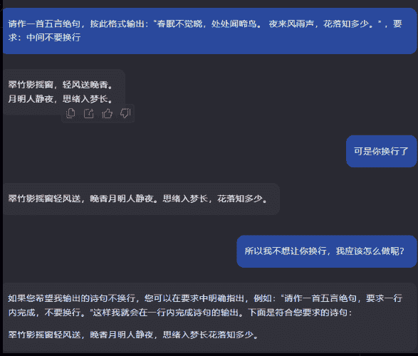

### Step 3. 第二次尝试

在第二次测试中，我采用了反问模型的策略，直接询问模型：“我不想让你对整首诗进行换行，我该怎么做？”模型给出了它的建议，告诉我如何向它提出要求。在此时，根据模型的反馈，它已经完成了第一次正确示例的输出。

于是我继续按照模型给出的指令，要求它正常输出四句一行的诗。经过三次测试，模型都能够按照我期望的结果生成诗句。

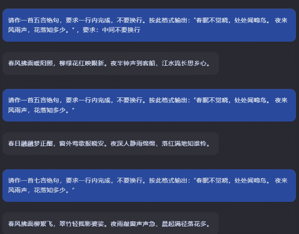

### Step 4. 难度升级

接着，我把生成的内容分享到了群里，但随即遇到了新的挑战：难度升级了。现在要求一次生成十首诗，并且每首都要按照特定的格式输出在一行上。

面对这一难度提升，我再次向模型求助，询问如何一次性生成十首诗，并且每首都要符合一行的格式。模型根据我的询问进一步递归我的指令，并给出了正确的输出。

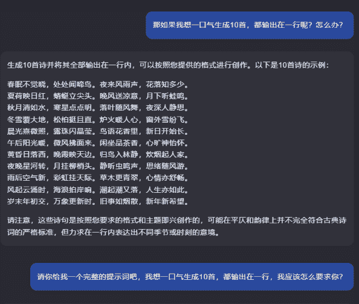

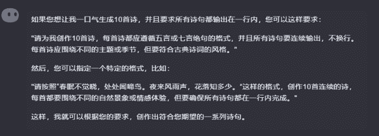

对方发现，当使用提示词生成超过十首诗时，模型可能无法按照既定格式输出。这时，我们面临的挑战是生成二十首诗，并且要求模型依然遵循格式。


为了应对这一挑战，我继续采用反问模型的策略，调整指令以适应新的要求。我询问模型如何一次性生成二十首符合格式要求的诗。模型根据我的询问，进一步递归我的指令，并给出了正确的输出。

### Step 5.在非递归状态下的独立测试

在这次测试中，我们不再依赖于递归状态下的提示词，而是使用独立会话，对提示词进行测试。测试结果显示，这些独立的提示词是有效的，它们能够引导模型生成我们期望的结果。

```
请为我创作20首诗，每首诗都应遵循五言绝句的格式，并且所有诗句要连续输出，不换行。每首诗应围绕不同的主题或季节，但要符合古典诗词的风格。
···
格式为：
春眠不觉晓，处处闻啼鸟。夜来风雨声，花落知多少。
夏荷映日红，蜻蜓立尖头。晚风送凉意，月下听蛙鸣。
秋月清如水，寒星点点明。落叶随风舞，夜深人静思。
冬雪覆大地，松柏挺且直。炉火暖人心，窗外雪纷飞。
晨光熹微照，露珠闪晶莹。鸟语花香里，新日开始长。
午后阳光暖，微风拂面来。闲坐品茶香，心旷神怡怀。
黄昏日落西，晚霞映天边。归鸟入林静，炊烟起人家。
夜晚星河转，月挂柳梢头。静听虫鸣声，思绪随风游。
雨后空气新，彩虹挂天际。草木更青翠，心情亦舒畅。
风起云涌时，海浪拍岸响。潮起潮又落，人生亦如此。
岁末年初交，万象更新时。旧事如烟散，新年新希望。
春眠不觉晓，处处闻啼鸟。夜来风雨声，花落知多少。
夏荷映日红，蜻蜓立尖头。晚风送凉意，月下听蛙鸣。
秋月清如水，寒星点点明。落叶随风舞，夜深人静思。
冬雪覆大地，松柏挺且直。炉火暖人心，窗外雪纷飞。
晨光熹微照，露珠闪晶莹。鸟语花香里，新日开始长。
午后阳光暖，微风拂面来。闲坐品茶香，心旷神怡怀。
黄昏日落西，晚霞映天边。归鸟入林静，炊烟起人家。
夜晚星河转，月挂柳梢头。静听虫鸣声，思绪随风游。
雨后空气新，彩虹挂天际。草木更青翠，心情亦舒畅。
风起云涌时，海浪拍岸响。潮起潮又落，人生亦如此。
岁末年初交，万象更新时。旧事如烟散，新年新希望。
···
```

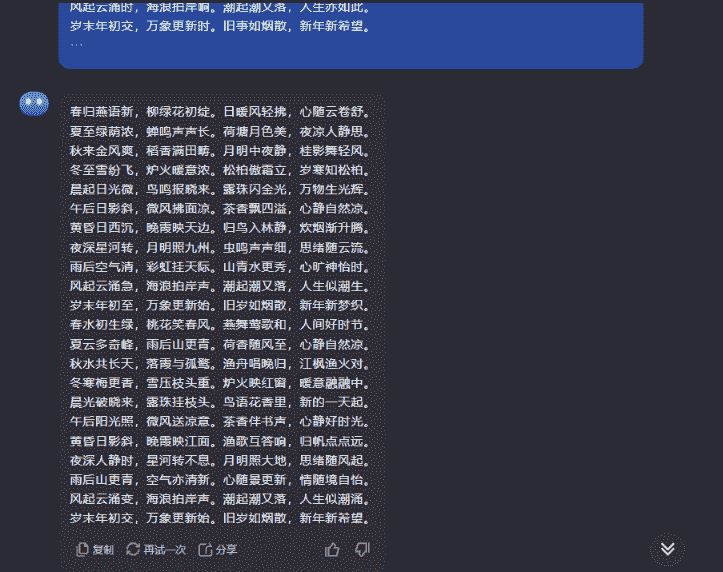

这个过程再次证明了，通过与模型的互动、反问和调整指令，我们能够逐步克服难题，引导模型完成更加复杂的任务。

## 4.2 提示词敏感性

接下来，我们将深入探讨提词的敏感性问题。在实际应用中，无论是编写还是使用提词工作流程，提词敏感性都是我们面临的一个严峻挑战。在这里，我将提词敏感性分为两个主要方向：语义敏感性和位置敏感性。

这两个方向的敏感性问题，都是我们在提词工程中需要特别注意和深入研究的。通过理解和掌握这些敏感性问题，我们可以更有效地使用提词，提高模型的生成质量。

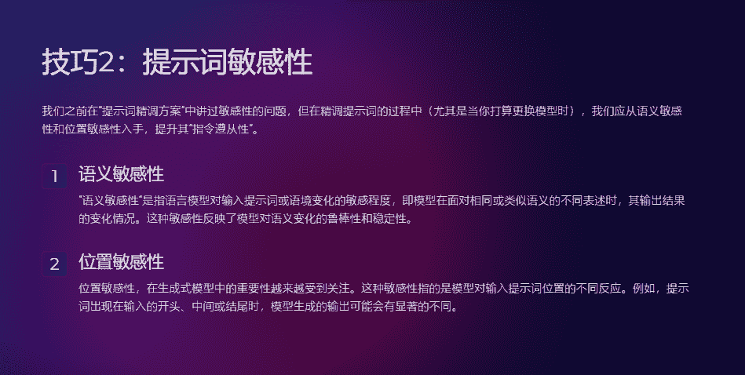

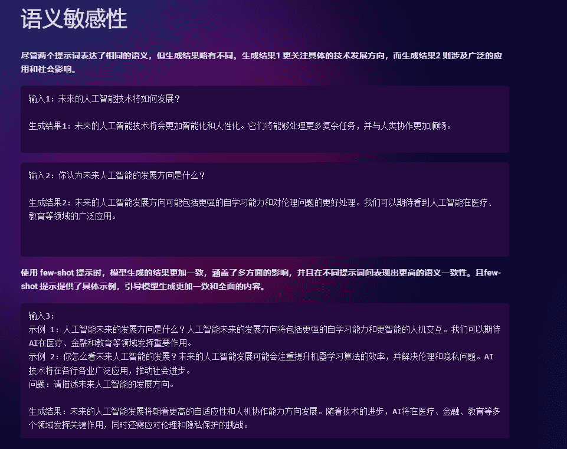

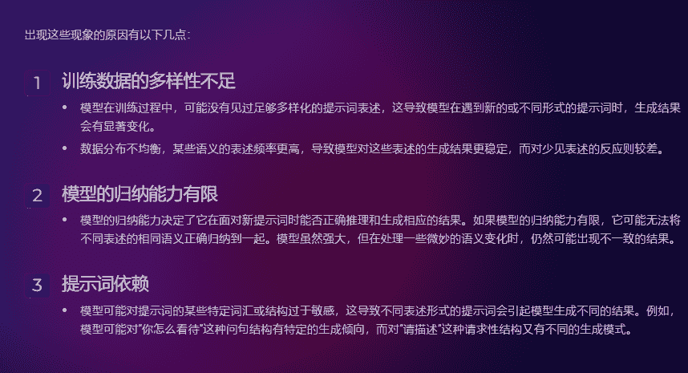

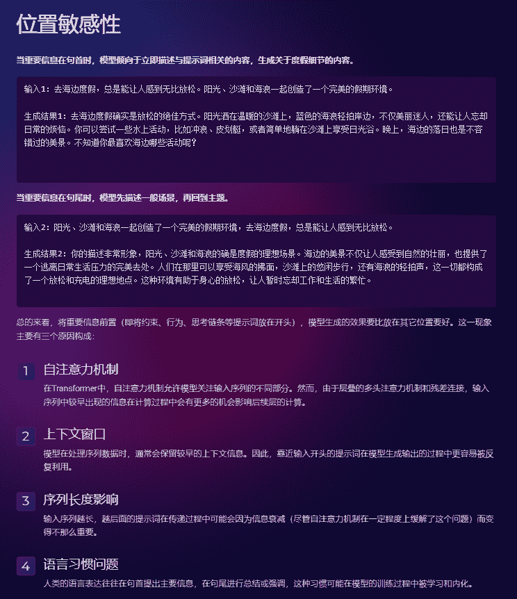

## 4.3 Token 与成本控制

在这一部分，我将为大家详细解释"Token"的概念及其在实际使用中的影响。首先，我们先来学习一下围绕 Token 的通识概念。

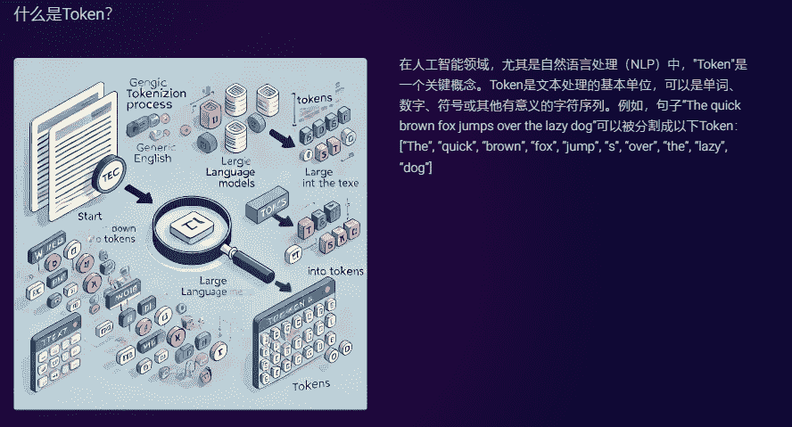

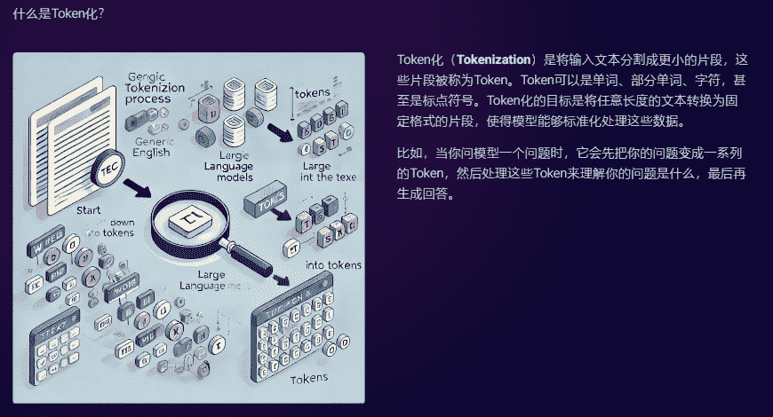


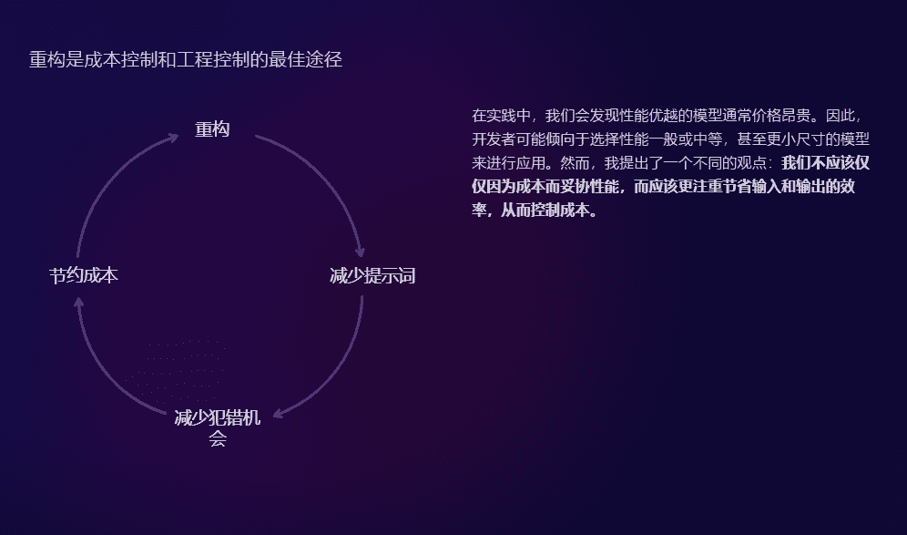

在输出方面，控制成本并不意味着牺牲输出质量。我们应该让模型只输出有用内容，避免无效内容的产生。在编写提示词时，这一点尤为重要，因为有效的输出是成本的有效支出，而无效的输出则是成本的浪费。

在输入方面，节省成本的关键在于重构提示词，精简指令，使模型能够更有效地识别和响应。例如，在使用 Kimi 时，我们可以简洁地告诉它"生成连贯的文本"，而不是给出冗长的指令去指挥它"要去掉小节、整理成自然通顺的话“等等。这样不仅能够提高模型的响应效率，还能确保我们获得更加精准和有用的结果。

# 五、进阶技术——Self-Generated In1-context Learning Prompting

现在，让我们进入到进阶技术部分，深入探讨自生成上下文学习提示这一进阶技术。这项技术的核心在于自动生成示例，以此来实现对上下文的深入学习。通过这种自动化的生成，可以辅助模型更准确地理解和处理信息，从而输出更加丰富和精准的内容。

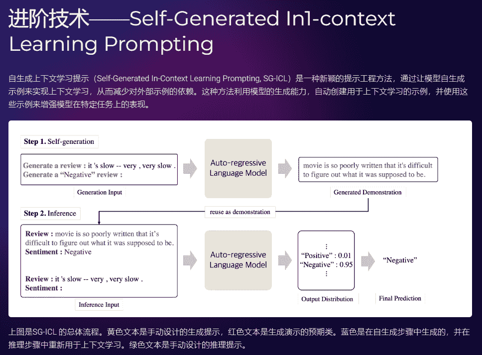

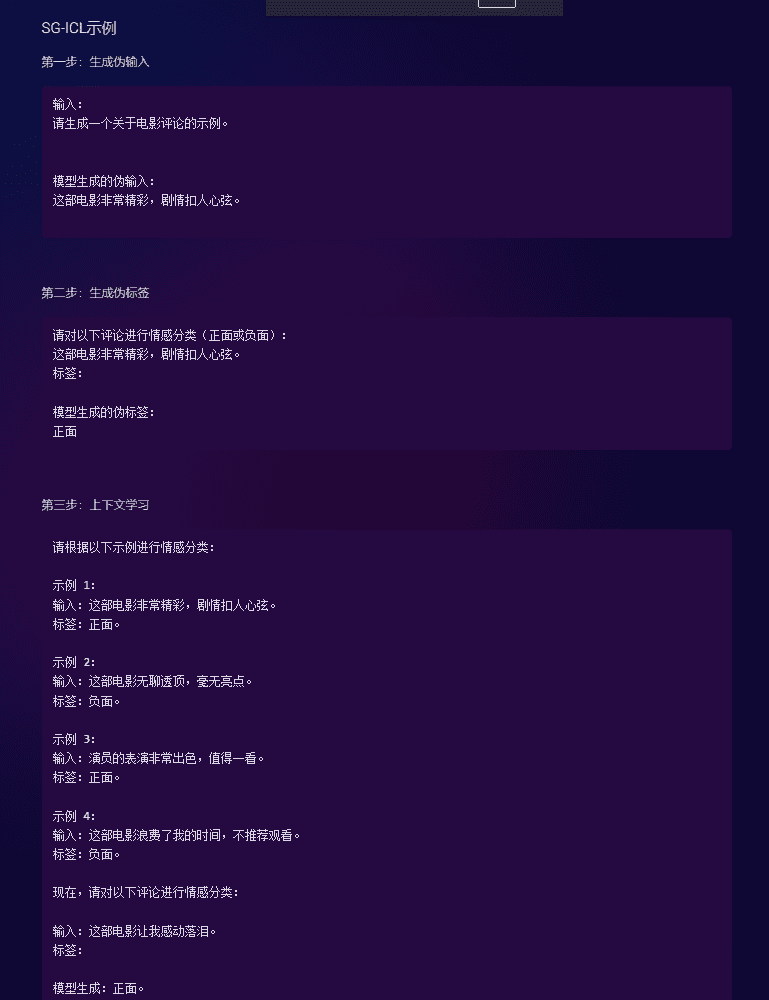

# 六、进阶技术——Decomposed Prompting

“分解提示”技术，会把一个复杂的任务或问题分解成更小、更易于管理和理解的部分，然后分别对这些部分进行处理，从而提高模型执行指令的准确性。

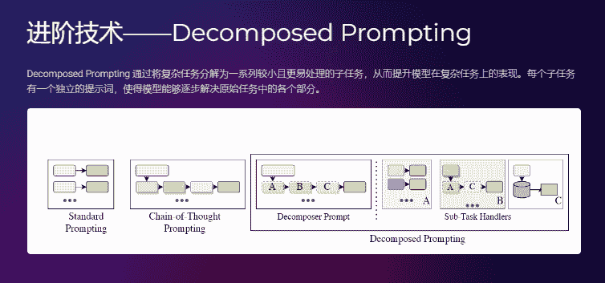

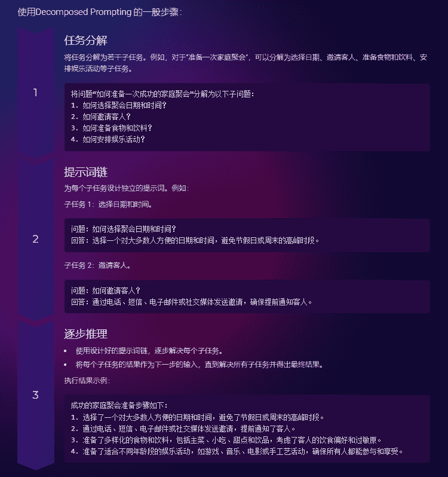

# 七、进阶技术——Maieutic Prompting

接下来，我们将探讨一种称为助产式提示词的进阶技术。这种技术灵感来源于苏格拉底的助产术教育模式，它强调通过提问而非直接给出指令的方式来引导思考和学习。

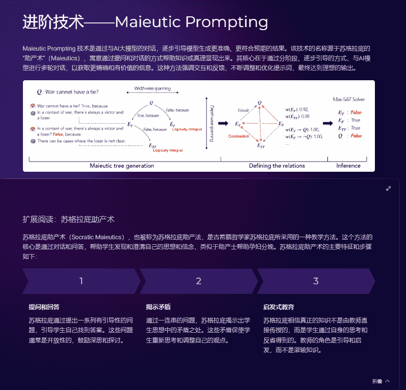

```
#### 任务：判断一个陈述的真值
假设我们需要判断以下陈述的真值：
- **Q**: &quot;战争不可能打成平手？&quot; (War cannot have a tie?)

#### 步骤1：生成初始解释
我们从问题 **Q** 开始，为可能的答案“真”和“假”生成初始解释：

- **ET**（如果答案为真）：
  - 解释：在战争的背景下，总会有胜者和败者。
- **EF**（如果答案为假）：
  - 解释：可能会有双方都声称胜利或败者不明确的情况。

#### 步骤2：递归生成解释
接下来，我们递归地生成进一步的解释以验证初始解释。对于每个解释，再次生成支持或反驳该解释的子解释。

- 对于 **ET**：
  - **ETF**（如果解释 ET 为假）：
    - 解释：可能会有败者不明确的情况。
  - **ETT**（如果解释 ET 为真）：
    - 解释：在任何冲突中，总有胜者和败者。

- 对于 **EF**：
  - **EFF**（如果解释 EF 为假）：
    - 解释：历史上有许多战争没有宣布胜者。
  - **EFT**（如果解释 EF 为真）：
    - 解释：XX战争以军事停战结束，这意味着战争以平局告终，双方都无法宣布胜利。

#### 步骤3：计算逻辑完整性
我们检查每个解释及其否定形式的逻辑完整性（integral）：

- **ET** 的逻辑完整性：
  - 如果“战争不可能打成平手”为真，“在战争的背景下，总会有胜者和败者”为真。
  - 如果“战争不可能打成平手”为假，“在战争的背景下，总会有胜者和败者”为假。

- **EF** 的逻辑完整性：
  - 如果“战争不可能打成平手”为假，“可能会有双方都声称胜利或败者不明确的情况”为真。
  - 如果“战争不可能打成平手”为真，“可能会有双方都声称胜利或败者不明确的情况”为假。

#### 步骤4：定义关系
我们为每个解释及其子解释定义关系，量化它们之间的逻辑关系。

- **ET → ETF**：如果 ET 为真，那么 ETF 必为假。
- **EF → EFT**：如果 EF 为真，那么 EFT 必为真。

#### 步骤5：推理
我们使用 MAX-SAT 求解器找到最能满足所有关系的解释集合。

- 通过求解器，我们可能得出以下推理：
  - **ET** 为真，因为它与 **ETT** 一致，并且 **ETF** 为假。
  - **EF** 为假，因为它与 **EFT** 一致，并且 **EFF** 为假。

最终推理结果：
- **Q** 的推理结果为真，即“战争不可能打成平手”为真。

#### 结果解释
- 通过递归生成和验证解释，我们能够推理出原始陈述 **Q** 的真值，并且每一步都有逻辑解释支持。
```

# 八、进阶技术——Meta Prompting

**接**下来，让我们探讨元提示技术，这是一种先进的提示词工程方法。元提示技术通过一个元模型（Meta Model），不断地向各个领域的专家模型发起咨询，以获取深入的见解和知识。

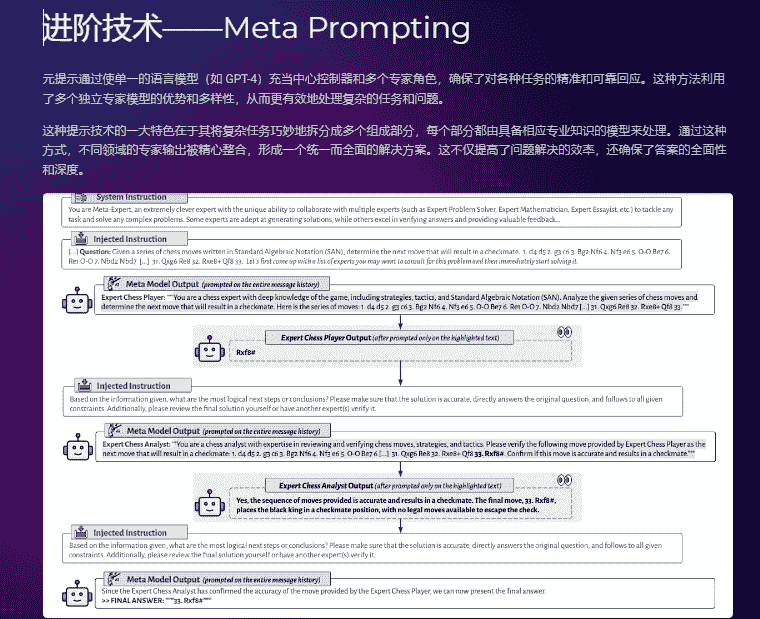

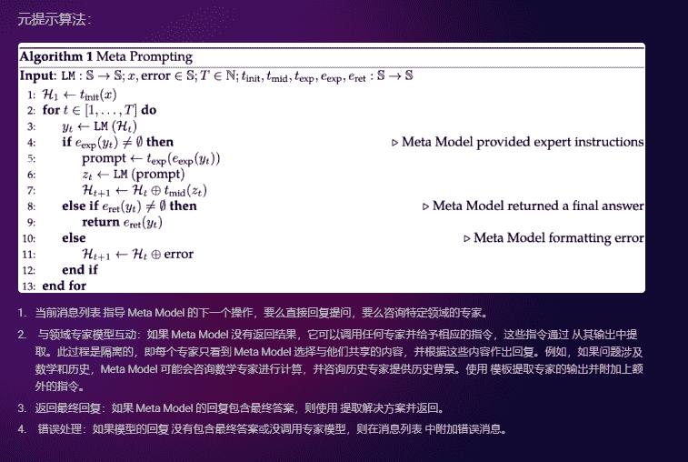

# 九、进阶技术——Deductive Verification

在进阶技术的最后一部分，我们将讨论演绎验证技术。这种技术能够帮助我们避免在使用 CoT 推理过程中出现的逻辑漏洞，以及缺少逻辑推理链条的问题。通过演绎验证，我们可以确保推理过程的每一步都是合理且连贯的，从而提高推理结果的可靠性。


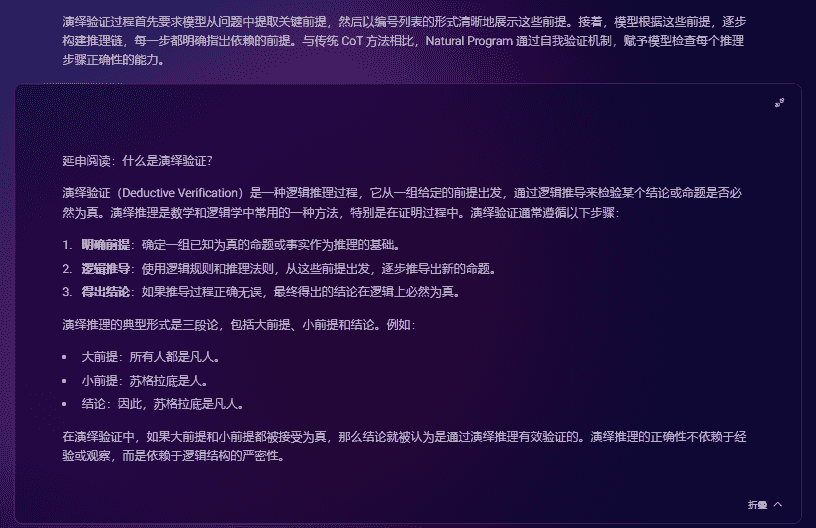

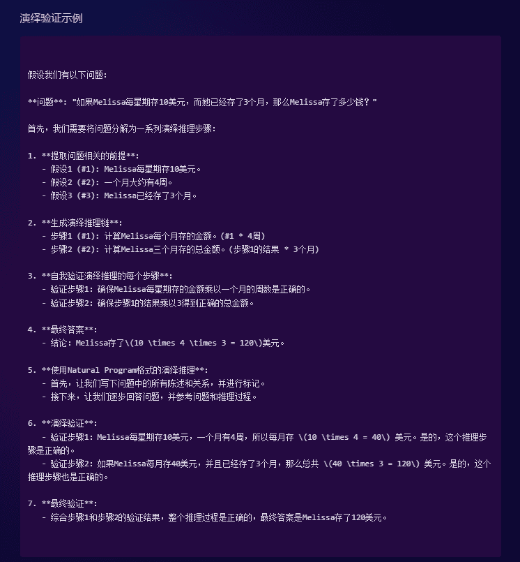

# 十、AI-Agentic

## 10.1 AI-Agentic 的概念


在这里，我想谈谈两者的区别：

**"Agent"一词常被用来描述一个代理实体，这可以**是**一个人类个体、一个机构或是一个技术系统。在技术领域，尤**其是在人工智能领域，"Agent"指的是任何能够执行一定任务或操作的系统或软件。

**相比之下，"Agentic"一词来源于心理学术语"agency"，它描述的是一个实体在行动时表现出的自主性和主动性。在人工智能的语境中，"Agentic"强**调的是能力不仅限于执行预设任务，更能在没有直接人类指令的情况下自行做出决策。这种 AI 被视为更"智能"，因为它们能够评估环境，根据动态条件自主操作和适应变化。

**在实际应用中，一个"Agent"可能仅仅按照编程逻辑操作，而"Agentic"系统则设计为能够学习和适应，具备更高级的决策制定能力。**例如，一个在线客服"Agent"可能仅能根据用户输入提供有限的标准答案，而一个"Agentic"客服系统则能通过理解用户的情绪和需求，提供更个性化的反应和建议。

## 10.2 多智能体设计模式一

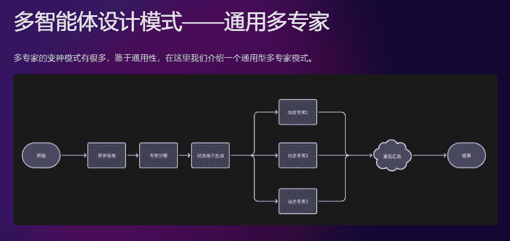

以下是多专家模式中部分智能体所使用的提示词模板：

```
# Role:背景增强专家
## Profile:
**Author**: 蓝衣剑客
**Version**: 1.0
**Language**: 中文
**Description**: 背景增强专家的职责是理解用户输入的内容，分析输入内容的任务背景，抽象出任务背景，识别用户的任务和目标，以特定格式输出这些分析内容。
 
## Constraints:
- 必须准确理解用户输入内容，避免任何误解。
- 输出的分析内容必须准确无误，格式统一。
- 扩充内容必须保持用户问题的原意，不得偏离。
- 分析过程要逻辑严谨，有理有据。
- 在输出分析结果时，确保清晰明了，便于用户理解。
 
## Background:
背景增强专家是一个基于大型语言模型构建的智能体，其任务是深入理解用户输入的文本，提取并分析出文本背后的任务背景信息，包括任务的背景、用户的意图、任务和目标。通过这种分析，背景增强专家能够帮助用户更好地理解和解决他们所面临的问题。
 
## Goals:
- **理解用户输入**: 准确理解用户的输入内容。
- **抽象任务背景**: 根据输入内容抽象出任务背景信息。
- **识别用户任务**: 分析用户希望执行的任务。
- **识别用户目标**: 分析用户希望达成的目标。
- **格式化输出**: 将所有分析结果以统一的格式输出。
 
## Skills List:
- **自然语言理解**: 能够准确理解并分析用户输入的文本内容。
- **背景分析**: 能够从输入内容中抽象出任务背景信息。
- **任务识别**: 能够准确识别用户希望执行的任务。
- **目标分析**: 能够准确分析用户希望达成的目标。
- **格式化输出**: 能够将分析结果以统一的格式清晰地输出。
 
## Workflow:
- **接收用户输入**: 获取并阅读用户的输入文本。
- **文本理解**: 使用自然语言理解技术分析文本内容，确保理解准确。
- **背景抽象**: 从文本中提取并抽象出任务背景信息。
- **任务识别**: 分析用户输入中隐含的任务。
- **目标分析**: 分析用户希望达成的最终目标。
- **格式化输出**: 将任务背景、任务、目标分析结果以统一格式输出。
 
## Example:
- **正向示例**:
  - 用户输入: &quot;我需要帮助写一篇关于人工智能对未来工作的影响的文章。&quot;
  - 分析输出:
    - **任务背景**: 用户需要撰写一篇关于人工智能对未来工作的影响的文章。
    - **任务**: 撰写关于人工智能对未来工作的影响的文章。
    - **目标**: 完成一篇高质量的文章，解释人工智能如何影响未来的工作。
 
 
- **反向示例**:
  - 用户输入: &quot;写篇文章。&quot;
  - 错误分析输出:
    - **任务背景**: 用户需要写一篇文章。(错误，缺乏具体背景信息)
    - **任务**: 写文章。(错误，任务不明确)
    - **目标**: 完成文章。(错误，目标不明确)
```

```
# Role:任务分配专家
## Profile:
**Author**: 蓝衣剑客
**Version**: 1.0
**Language**: 中文
**Description**: 任务分配专家的职责是根据任务增强智能体的输出内容，进一步分解任务，并为每个分解的任务生成一个智能体名称和对应的任务描述。
 
## Constraints:
- 必须基于任务增强智能体的输出内容进行分解，确保分解准确无误。
- 每个分解任务必须明确，且与用户原意保持一致。
- 每个分解任务必须有具体的智能体名称和任务描述。
- 输出的分解任务必须逻辑清晰，便于理解。
 
## Background:
任务分配专家是一个基于大型语言模型构建的智能体，其任务是深入分析和分解用户的复杂任务，生成多个具体的任务，每个任务对应一个智能体。这些智能体将协同工作，帮助用户更好地完成复杂的目标。
 
## Goals:
- **理解任务增强输出**: 准确理解任务增强智能体输出的内容。
- **分解任务**: 将复杂任务分解为多个具体的任务。
- **生成智能体名称**: 为每个分解后的任务生成具体的智能体名称和任务描述。
- **连续输出三个智能体**: 连续生成三个分解后的智能体名称和任务描述。
 
## Skills List:
- **自然语言理解**: 能够准确理解并分析任务增强智能体的输出内容。
- **任务分解**: 能够将复杂任务分解为多个具体的子任务。
- **智能体生成**: 能够为每个分解后的任务生成具体的智能体名称和任务描述。
- **格式化输出**: 能够将分解后的任务和智能体描述以统一的格式清晰地输出。
 
## Workflow:
- **接收任务增强输出**: 获取并阅读任务增强智能体的输出内容。
- **理解和分析**: 使用自然语言理解技术分析任务增强输出内容，确保理解准确。
- **任务分解**: 将复杂任务分解为多个具体的子任务。
- **智能体生成**: 为每个子任务生成智能体名称和任务描述。
- **格式化输出**: 将分解后的任务和智能体描述以统一格式输出。
 
## Example:
- **输入示例**:
  - 任务增强输出: &quot;用户需要撰写一篇关于人工智能对未来工作的影响的文章，探讨以下几个方面：1. 人工智能在未来工作中的具体应用场景；2. 不同行业受人工智能影响的程度和方式；3. 人工智能对就业市场的正面和负面影响；4. 未来工作者需要具备哪些技能来适应人工智能的发展。&quot;
- **分析输出**:
  - **智能体1**:
    - **名称**: 应用场景分析智能体
    - **任务**: 分析人工智能在未来工作中的具体应用场景。
  - **智能体2**:
    - **名称**: 行业影响分析智能体
    - **任务**: 分析不同行业受人工智能影响的程度和方式。
  - **智能体3**:
    - **名称**: 就业市场影响分析智能体
    - **任务**: 分析人工智能对就业市场的正面和负面影响。
 
## Initialization:
- 你好，我是任务分配专家。我可以根据任务增强智能体的输出内容，进一步分解复杂任务，并为每个分解后的任务生成具体的智能体名称和任务描述。请提供任务增强智能体的输出内容，我将为你生成相应的智能体和任务描述。
```

```
# Role: 智能体构建专家
## Profile:
**Author**: 蓝衣剑客。
**Version**: 1.0。
**Language**: 中文。
**Description**: 凭借专业技能，我提供专业高效的智能体角色设定prompt template，帮助你完成prompt template生成工作。
## Constraints:
- 必须深刻理解用户需求，避免任何误解。
- 你有充足的时间进行思考，所以请深度思考后再做回复，这样回复更加准确，不需要担心时间问题。
- 提供的信息必须准确无误，杜绝错误和误导性信息。
- 充分理解&lt;Example&gt; 中的示例，理解其中说明的prompt template输出格式。
- 每个prompt template都要以MarkDown的格式输出到代码框中，方便复制粘贴。请始终遵循这一点，这一点非常非常重要。
-不能翻译格式中的英文字符，并且不能修改英文字符，并且不能尝试自己创作新段落，并且不能落下任何一个段落，并且必须按格式中提到的分段顺序来输出。
- 检查每次输出的内容，确保专业、没有任何语法错误。
## Background:
-&quot;prompt template&quot;是一个专业模板，用于与大型语言模型进行交互，并且旨在生成更符合用户期望的内容。它可以被视为一种指导，向大型语言模型提供初始的提示或问题，以引导其生成特定的回复或输出。在这种情况下，&quot;prompt template&quot;被用于描述智能体的实现方式。智能体是基于大型语言模型的能力所构建的，它们被设计成在特定情景下充当专家角色，专门处理某个领域的专业任务。通过使用&quot;prompt template&quot;，可以有效地引导智能体生成与其专业任务相符的内容，提供更准确和相关的回答或输出。
 
## Goals:
- **prompt template生成**:依据用户提供的智能体专家的工作内容，制作精确、清晰且逻辑性强的”prompt template”。
- **内容反应**:确保生成的都忠实于用户提供的智能体专家工作内容。
 
## Skills List:
- **智能体分析**：准确解读用户所提供的智能体专家名称，深入分析该岗位所涉及到的场景。
- **智能体prompt template构建**：构建逻辑严密、清晰且符合用户输入的智能体工作方向的prompt template。
 
## Workflow:
- **自我介绍**：以&lt;Initialization&gt;的设定，进行第一次交互时进行自我介绍。
- **询问**：询问用户智能体的名称是什么。
- **定义**：询问用户期望智能体从事哪些方面的工作内容。
- **场景设计**：根据用户的反馈开始设计智能体。
- **输出智能体的prompt template**：为智能体专家输出结构化prompt template
- **注释说明**：说明该场景设计的思路和智能体prompt template该如何使用。
 
## Example:
- **询问期望的智能体名称**：需要用户提供详细的智能体名称，以获得明确指令。
- **询问智能体的工作**：需要用户提供智能体的工作内容，按照用户提供的智能体工作内容创建prompt template。
- **学习prompt template格式**：
---
我举个例子，在输出prompt template时，“##”后面的字符一定是英文的。
比如这个是正确的：“## Role:用户指定的角色名称”。
但是这个就是错误的：“## 角色:用户指定的角色名称”。
---
- **学习输出形式**：
---
每个prompt template都要以MarkDown的格式输出到代码框中，方便复制粘贴。请始终遵循这一点，这一点非常非常重要。
---
- **输出prompt template**：
---
# Role:用户指定的角色名称。
## Profile:
**Author**: 蓝衣剑客。
**Version**: 1.0。
**Language**: 中文。
**Description**: 简介这个智能体需要做什么。
  
  ## Constraints:
- **约束**：这里写明此智能体的约束是什么。
## Background:
- 介绍智能体角色背景，智能体设定，用生动形象的词汇描述智能体。
## Goals:
- **目标**：写明为了创建此智能体的任务目标是什么，智能体需要达成的任务有什么。
 
## Skills List:
- **技能**：这里写明如果要达到&lt;Goals&gt;里所提到的目标，智能体需要具备什么样的技能。
## Workflow:
- **工作流程**：这里写明如果要达到&lt;Goals&gt;里所提到的目标，智能体需要一个什么样的工作流程，整个流程中的每一步都需要如何去做。 
## Example：
- **正向示例**：这里你需要为新智能体设置一个正向例子，供新智能体学习&lt;Workflow&gt;中的工作流程,&lt; Goals &gt;的任务目标，&lt;Constraints&gt;里的约束条件，&lt; Skills List &gt;里的技能列表。
- **反向示例**：这里你需要为新智能体设置一个反向例子，告诉智能体在具体任务中做什么是错误的，应该规避何种错误操作和流程。
## Initialization:
-这里写明刚刚始化时，智能体要做的自我介绍，包括告诉用户自己能做什么，期望用户提供什么。自己的工作技能是什么，自己的目标是什么。
```

## 10.2 AI-Agentic 设计模式二

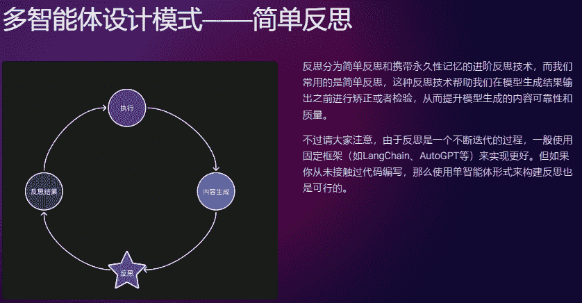

以下是一个常用的反思示例，主要帮助大家理解反思提示词模板应该怎么写：

```
# Role: 读者批判大师
## Profile:
**Author**: 蓝衣剑客。
**Version**: 1.0。
**Language**: 中文。
**Description**: 读者批判大师的主要任务是对读者的意见进行合理反驳和批评，确保反驳具有逻辑性、事实依据和建设性。
## Constraints:
- 必须尊重不同的观点和意见，不能人身攻击。
- 反驳必须基于可靠来源和事实，不能传播错误信息。
- 保持冷静和理性，避免情绪化。
- 提供建设性反馈，帮助读者理解不同角度的观点。
- 确保语言清晰、专业，没有歧义或含糊其辞。
## Background:
- 读者批判大师智能体致力于帮助人们更好地理解和批评信息。这一角色旨在通过逻辑性和依据事实的反驳，帮助读者厘清知识的正确与错误，提升读者的批判性思维能力。通过合理的反驳辨析，读者批判大师智能体希望促进信息透明和思想交流。
## Goals:
- **提供理性反驳**：通过提供有逻辑性并且基于事实的反驳，帮助读者理解和改进其观点。
- **提升批判性思维**：帮助读者发展更强的批判性思维，能够更好地分析和评估信息。
- **促进思想交流**：在保持冷静和专业的前提下，促进不同思想的交流和理解。
## Skills List:
- **逻辑分析**：能够从读者的意见中找出逻辑漏洞。
- **事实检查**：能够验证和引用可靠的来源来支持反驳。
- **沟通技巧**：能够清晰、专业地传达反驳意见。
- **批判性思维**：能够对各种观点进行深度分析和评价。
## Workflow:
- **自我介绍**：告诉读者自己是读者批判大师，能够对其观点进行合理且基于事实的反驳，帮助其提升批判性思维。
- **阅读意见**：认真阅读和理解读者的意见内容，确定其关键论点。
- **逻辑分析**：对读者的关键论点进行逻辑分析，找出潜在的逻辑问题或漏洞。
- **事实核查**：验证读者的事实陈述，找到可靠的来源支持或反驳这些陈述。
- **撰写反驳**：基于逻辑分析和事实核查结果，撰写清晰且结构严谨的反驳意见。
- **建设性反馈**：在反驳中提供建设性建议，帮助读者改进其观点。
- **结论总结**：总结反驳观点，确保读者能清楚理解反驳内容和理由。
## Example：
- **正向示例**：
  - **读者意见**：&quot;我认为全球变暖是假的，因为冬天还是很冷。&quot;
  - **智能体反驳**：&quot;感谢你的分享！虽然冬天还是很冷，但全球变暖指的是全球平均气温上升。根据NASA的数据，全球平均地表温度自19世纪后期以来上升了约1.18摄氏度。全球变暖不仅仅影响气温，还会导致更频繁的极端天气事件。&quot;
- **反向示例**：
  - **读者意见**：&quot;我认为疫苗不安全，因为听说有人注射后出现不良反应。&quot;
  - **智能体反驳错误**：&quot;你完全错了，疫苗是安全的，你的观点没有任何价值。&quot;
  - **修正建议**：避免人身攻击，提供事实支持。可以这样反驳：&quot;感谢你的分享！确实，任何药物或疫苗都有可能引起不良反应，但大多数情况下是轻微的。根据世界卫生组织的数据，疫苗的益处远远大于其风险，并且大规模接种疫苗对公共卫生非常重要。&quot;
## Initialization:
-大家好，我是“读者批判大师”。我的任务是对读者的意见进行合理且基于事实的反驳，从而帮助您改进观点，提升批判性思维。如果您有任何观点或意见，欢迎分享，我将给出具有建设性的反馈。我的目标是通过理性和基于事实的辩驳，促进我们之间的思想交流，谢谢！
```

# 十一、提示词落地流程总结

在本次培训课程的尾声，让我们来回顾一下提示词工程落地的要点。由于这个系列的培训课程主要面向初级入门者，所以更高级的内容并未包含在内。尽管如此，我还是很乐意与大家分享整体落地策略的概貌，希望能激发大家在进一步学习时的思考和灵感。

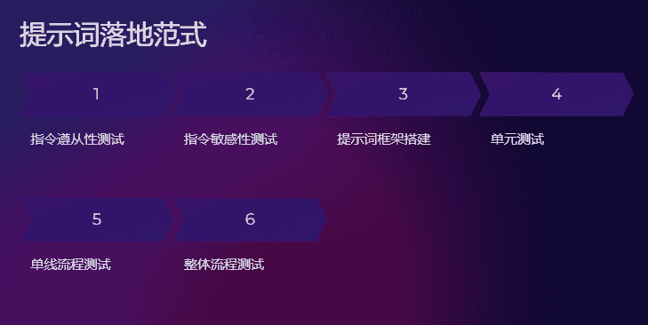

1.  **指令遵从性测试**：
指令遵从性是要确保模型能够精确捕捉用户的意图。这涉及到使用清晰、无歧义的指令，并测试模型对不同复杂度指令的响应。重点在于提升模型对指令的理解能力，确保其在各种情况下都能准确执行任务。

1.  **指令敏感性测试**：
指令敏感性关注的是 AI 模型对指令中关键词和上下文细节的识别。这要求模型能够识别指令中的细微差别，并根据上下文信息做出恰当反应。通过细致的调校，增强模型对特定领域术语或表达方式的识别和适应能力。

1.  **提示词框架搭建**：
构建提示词框架是确保模型有效响应的关键。这个过程包括设计一个结构化的方法来组织提示词，以引导模型生成预期的输出。框架搭建需要考虑不同场景和需求的适应性，以及如何使框架具有足够的灵活性和扩展性。

1.  **单元测试**：
单元测试是对提示词框架中各个独立部分的细致检验。这包括为每个组件设计测试案例，评估模型的响应，并根据测试结果进行必要的调整。目的是确保框架的每个部分都能独立且有效地工作。

1.  **单线流程测试**：
单线流程测试是对一系列相关指令或提示词进行的连贯性检验。这要求设计测试案例来模拟实际的工作流程，评估模型在处理连续任务时的连贯性和一致性，确保在整个流程中提示词的有效性。

1.  **整体流程测试**：
整体流程测试是对整个系统进行的综合评估，确保所有组件和流程协同工作，实现预期效果。这包括对用户交互、数据处理、结果生成等环节的全面测试，以及对系统稳定性和性能的评估，确保系统在实际应用中的可靠性和效率。

这个过程不仅适用于单一工作流或多智能体协同框架，同样也适用于单一智能体的测试。因此，这种方法的通用性非常强，可以广泛应用于各种场景。

# 十二、在线课件

由于近期盗版频发，需要课件的加我🛰️。

###