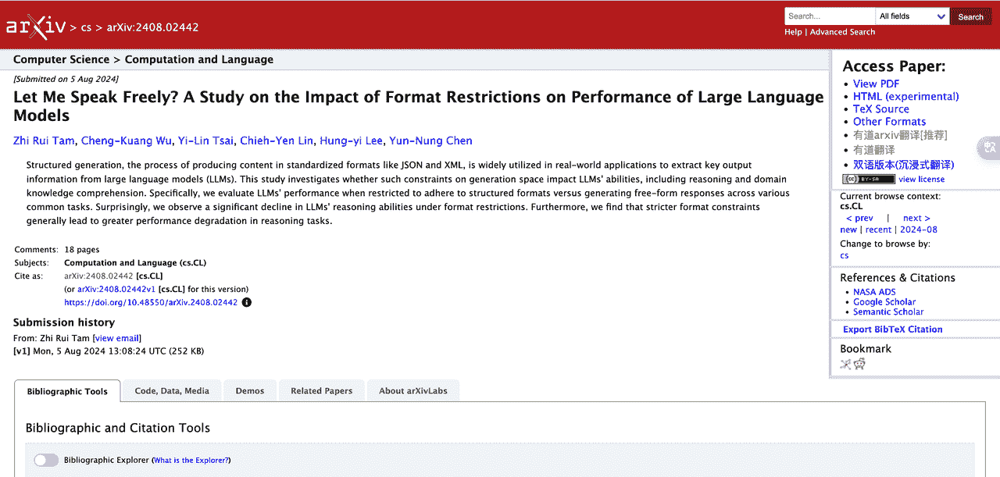

# Prompt 格式偏好问题

> 来源：[https://langgptai.feishu.cn/docx/A2PadHAgfo3kp4xMnjfcQtINnkg](https://langgptai.feishu.cn/docx/A2PadHAgfo3kp4xMnjfcQtINnkg)

## 先上结论

### 不同 LLMs 不同数据格式**有偏好:**

+   GPT 更喜欢 YAML, Markdown 格式

+   Claude 更喜欢XML格式

+   Gemini/Gemma 则更倾向于 JSON格式。

### 格式限制对 AI 性能有影响：

+   分类任务：**格式限制可能提高了准确性**，因为它减少了可能的答案选择，从而降低了错误率。

+   **推理任务：在格式限制下**，LLMs的推理能力显著下降，尤其是在JSON模式下。

缓解方法：改为两步完成：（1）推理 （2）格式调整

## 参考论文

+   https://arxiv.org/abs/2408.02442

《Let Me Speak Freely? A Study on the Impact of Format Restrictions on Performance of Large Language Models》

## 参考资料

+    LLM推理性能受输出格式影响，JSON最严重