# 【经验分享】万字长文反哺树哥!进树哥社区半年，小白走向产品之路AI+Anything

> 来源：[https://langgptai.feishu.cn/docx/JPljdyPEzoHWeMx3XAic3q2dnle](https://langgptai.feishu.cn/docx/JPljdyPEzoHWeMx3XAic3q2dnle)

项目流程和经验分享

> 从22年11月开始接触AI领域至今也有一年半了，

> 突然想整理整理这一年半自己通过AI拿到了哪些结果。

> 也分享分享一些个人的经验（SD、MJ、prompt、agent、小模型、RAG、RPA、AI声音、“数字复生”）

> 先自我介绍一下，可以叫我大橘，99年，目前杭州x公司的一个小产品。

> v：15371006680

> 自己算是非技术出身吧，毕竟本科虽然是计算机专业但是没怎么用心学😂。自己性格比较跳脱大学那会儿着迷自己创业，言归正传，AI上的话给自己定位是AI应用工程师，

> 下面我将详细介绍一下我这条路走来的项目以及产品思考👇

# 22年11月-23年9月👇

嗯，机缘巧合，那时候电商代运营创业失败，跑到了苏州一家公司做了运营（后转了产品），那家公司一开始做的是stable diffusion的一个套壳应用，后来也接入了llama以及gpt的API，那会儿应该是属于是比较早期的套壳网址了

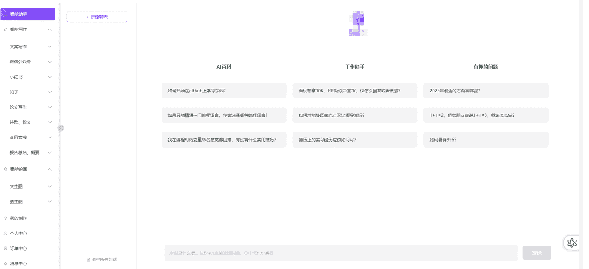

## 谈谈该阶段收获

### 初入SD

其实早期公司小伙伴们那会儿对sd也都处于摸索阶段基础的controlnet插件、lora等都不是很清楚

#### 模型

早期做的大量工作基本都是在https://civitai.com/上找一些优秀的模型下载下来测试（那会https://www.liblib.art/都还没有上线🤦‍）

👇是一些测试出的部分比较好的适用于建筑模型分享

无法复制加载中的内容

#### 部署

嗯不得不提后面接触到了赛博佛祖秋叶的秋叶包，后来也开始着手自己开始学习部署，现在回想起来还是很兴奋的，可能对于我来说每一次新的尝试都能让我感到肾上腺激素爆棚，这可能一年来坚持走AI这条路的原因

##### 秋叶包

相关教学可参考👇

秋叶包链接 https://pan.quark.cn/s/2c832199b09b

秋叶视频b站链接https://www.bilibili.com/video/BV1iM4y1y7oA/?spm_id_from=333.999.0.0&vd_source=a7b5884bec3b7924f1225533ff5371ef

##### 赛博丹炉

炼丹我是直接使用的“赛博丹炉”

教程https://www.bilibili.com/video/BV1xg4y1A74o/?spm_id_from=333.337.search-card.all.click&vd_source=a7b5884bec3b7924f1225533ff5371ef

云部署地址http://account.qingjiaocloud.com/signin?inviteCode=QE0903GS

本地下载包https://pan.xunlei.com/s/VNt9XhLOLXmkmJdtt_7sYUCfA1?pwd=5jh4#

#### Controlnet插件

关于controlnet我纯纯的是也路子瞎摸索，当时找不到比较系统的学习教程，基本就是在抖音、b站上看到一些热门的视频就去扒下来看看实现路径（当时踩好多坑，好多就是夸大效果，或者是二次处理过剪辑发布的）

下面是我整理的一些controlnet的插件用途👇

##### ControlNer部分

1.Canny

可以将实物转成手绘线稿图片

2.SoftEdge

控制手部细节（但是不能完全控制）

3.Lineart

可以把线稿图片上色

4.scribbie

把涂鸦的图片上传，会根据涂鸦和提示词生成图片

5.MLSD

将图片的直线部分提取出来，建筑和室内可以根据这些线稿生成图片

6.Depth

将空间的远近关系分析出来

7.Normal法线

将物体的凹凸细节表现出来

8.Openpose姿态

上传一张图片会提取人物的姿态，从而生成图片一样的姿态

9.Seg语义分割

将图片的物体填充对应的颜色，会生成对应的物体

10.shuffle洗牌

上传一张图片会 根据这张图片生成相同风格的图片

11.reference参考

提取图片中特征生成图片

12.Tile分块

小图细节修复与分区放大

元素替换与背景生成

人物次元转换

绘图与构字

13.inpaint局部重绘

可以修改局部的画面

14 IP2P

将图片修改风格和环境（效果不好）

15Recolor

将黑白图片转成彩色

##### 插件部分

1.roop

人物换脸

2.ADetailfer

将人物面部修复，表情也可以控制

3.multidiffusion

超大尺寸控制

分区控制

4.stableSR脚本

放大图片

5.CutOff

可以控制提示词的颜色不污染

6.Depth Library

手部修复

7.Segment Anything

人物换装

8.Segment Anything

抠图

#### Lora

早期主要尝试在**服装、装修设计、人物**这三个方向的Lora，也测试了一些比较好的Lora模型

这边给大家分享一些优秀的服装Lora模型

##### 苗疆少女_国风_民族特色_v1.0

模型网址 https://www.liblib.art/modelinfo/68802660a084404db53f5ce1509f6611

正miao jiang,An elegant Asian girl standing beneath the cherry blossom trees in full bloom,her traditional silk kimono adorned with intricate floral patterns,delicate petals drifting gently in the breeze around her,a serene smile gracing her lips as she gazes into the distance,capturing the grace and beauty of Japanese springtime,Photography,with prime lens for crisp details,<lora:Miao Jiang_20230913214100:0.1>,

反 nsfw,(worst quality:2),(low quality:2),(normal quality:2),(EasyNegative),deepnegative_v1_75t,(badhandv4:1.2),verybadimagenegative_v1.3,logo,nude,(negative_hand:1.2),

触发次：miao jiang

大模型推荐：majic的写实风格


采样器推荐：DPM++ 2M Karras和DPM++ SDE Karras

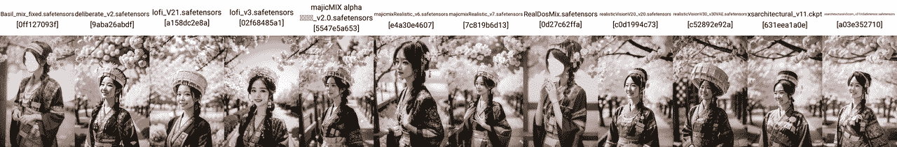

大模型推荐使用：majicmixRealistic_v7.safetensor

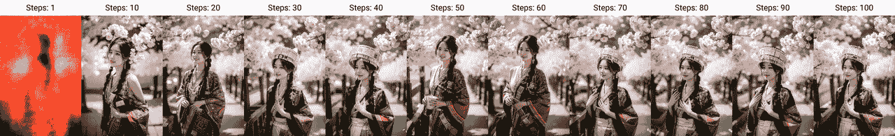

迭代步数 (Steps)70


提示词引导系数 (CFG Scale)：7-10

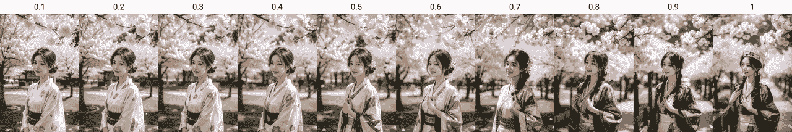

lora权重推荐在0.8

##### 楼兰西域-服装_v1

模型下载链接：https://www.liblib.art/modelinfo/349aeecca9af432e820ecee8c5c9eec0

正 future001,A graceful young woman adorned in traditional attire from the Silk Road,her vibrant silk garments billowing in the desert breeze,intricate patterns and embroidery reflecting the rich cultural tapestry of the region,the golden hues of the sand dunes stretching endlessly under the blazing sun,capturing her poise and elegance amidst the ancient beauty of the desert landscape,Painting,acrylic on canvas with fine brushwork to capture the intricate details of the clothing,best quality,official art,8k wallpaper,highly detailed,illustration,detailed eyes,<lora:so_v1:0.8>,

反 fat,naked,nude,paintings,sketches,(worst quality:2),(low quality:2),(normal quality:2),lowres,((monochrome)),((grayscale)),bad anatomy,DeepNegative,lowres,bad anatomy,bad hands,text,error,missing fingers,extra digit,fewer digits,cropped,worst quality,low quality,normal quality,jpeg artifacts,signature,watermark,username,blurry,bad feet,cropped,poorly drawn hands,poorly drawn face,mutation,deformed,extra fingers,extra limbs,extra arms,extra legs,malformed limbs,fused fingers,too many fingers,long neck,cross-eyed,mutated hands,polar lowres,bad body,bad proportions,gross proportions,text,error,missing fingers,missing arms,missing legs,

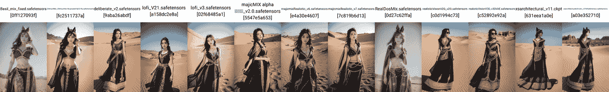

大模型推荐使用：majicmixRealistic_v7.safetensors


采样器推荐DPM++ 2M Karras

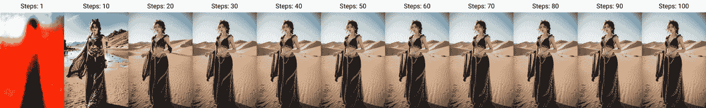

迭代步数 (Steps)30

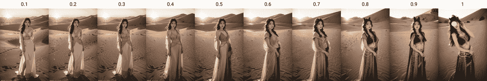

lora权重推荐在0.6-0.8

##### **服装电商，冲锋衣，服装设计**

下载网址：https://www.liblib.art/modelinfo/dd9349f3da5b42a2965b99e43b05e016

正：((((a white assault suit)))),Jackets,chuanc An Asian-faced girl donning a tactical assault jacket,the rugged fabric and utilitarian design contrasting with her youthful features,a determined expression set on her face as she stands against a backdrop of urban decay,graffiti-covered walls and abandoned buildings hinting at a post-apocalyptic world,a sense of resilience and strength emanating from her stance amidst the chaos,Photography,using a wide-angle lens to capture the gritty realism of the environment,best quality,official art,8k wallpaper,highly detailed,illustration,detailed eyes,best quality,standing posture,outdoor coat,high definition display,landscape details,clothing details,model face,<lora:20240314-1710403558637:0.8>,

负：fat,naked,nude,paintings,sketches,(worst quality:2),(low quality:2),(normal quality:2),lowres,((monochrome)),((grayscale)),bad anatomy,DeepNegative,lowres,bad anatomy,bad hands,text,error,missing fingers,extra digit,fewer digits,cropped,worst quality,low quality,normal quality,jpeg artifacts,signature,watermark,username,blurry,bad feet,cropped,poorly drawn hands,poorly drawn face,mutation,deformed,extra fingers,extra limbs,extra arms,extra legs,malformed limbs,fused fingers,too many fingers,long neck,cross-eyed,mutated hands,polar lowres,bad body,bad proportions,gross proportions,text,error,missing fingers,missing arms,missing legs,

触发词 Jackets

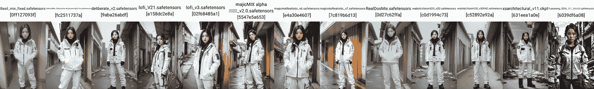

推荐使用 majicmixRealistic_v7.safetensors大模型


推荐使用采样器：DPM++ 2M Karras和DPM++ SDE Karras

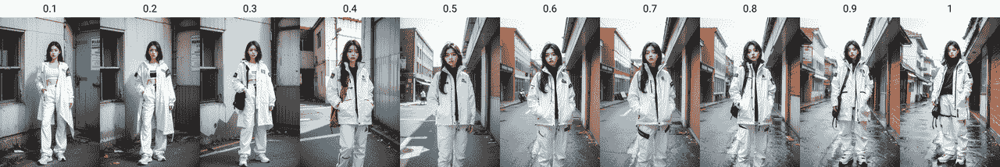

Lora权重在0.6

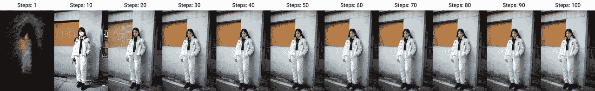

迭代步数 (Steps)20

##### 幻飞-服装-灰色毛衣白丝_v10

正：girl,full body,sweater,best quality,clean skin,long hair,socks,sitting,8k,best resolution,clean environment,HD quality,sweater,long sleeves,best quality,official art,8k wallpaper,highly detailed,illustration,detailed eyes,<lora:20240314-1710403558637:0.8>,

反：fat,naked,nude,paintings,sketches,(worst quality:2),(low quality:2),(normal quality:2),lowres,((monochrome)),((grayscale)),bad anatomy,DeepNegative,lowres,bad anatomy,bad hands,text,error,missing fingers,extra digit,fewer digits,cropped,worst quality,low quality,normal quality,jpeg artifacts,signature,watermark,username,blurry,bad feet,cropped,poorly drawn hands,poorly drawn face,mutation,deformed,extra fingers,extra limbs,extra arms,extra legs,malformed limbs,fused fingers,too many fingers,long neck,cross-eyed,mutated hands,polar lowres,bad body,bad proportions,gross proportions,text,error,missing fingers,missing arms,missing legs,long sleeves,

**触发词:sweater, long sleeves, lying, grey sweater,pantyhose, whi**te pantyhose, panties, panties under pantyhose,  lower body,

##### Matuome超级服装模特_v1.0

网址：https://www.liblib.art/modelinfo/397bbe3849344af4ac63ce4dbf4d7e90

正 A model adorned in haute couture fashion,her lithe figure draped in luxurious fabrics and exquisite embellishments,each fold and seam meticulously crafted to accentuate her beauty,a sophisticated runway setting with soft lighting and minimalist décor,amplifying the elegance of the ensemble,the model's confident stride exuding charisma and allure as she commands the attention of the audience,Photography,utilizing a high-resolution camera to capture the intricate details of the designer garment,best quality,official art,8k wallpaper,highly detailed,illustration,detailed eyes,royee,<lora:20240409-1712643436482:1>,

反 fat,naked,nude,paintings,sketches,(worst quality:2),(low quality:2),(normal quality:2),lowres,((monochrome)),((grayscale)),bad anatomy,DeepNegative,lowres,bad anatomy,bad hands,text,error,missing fingers,extra digit,fewer digits,cropped,worst quality,low quality,normal quality,jpeg artifacts,signature,watermark,username,blurry,bad feet,cropped,poorly drawn hands,poorly drawn face,mutation,deformed,extra fingers,extra limbs,extra arms,extra legs,malformed limbs,fused fingers,too many fingers,long neck,cross-eyed,mutated hands,polar lowres,bad body,bad proportions,gross proportions,text,error,missing fingers,missing arms,missing legs,

触发词 royee

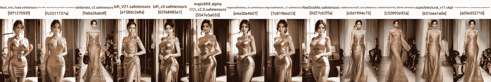

推荐卖橘v7大模型

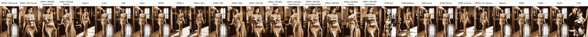

采样器推荐DPM++ 2M Karras

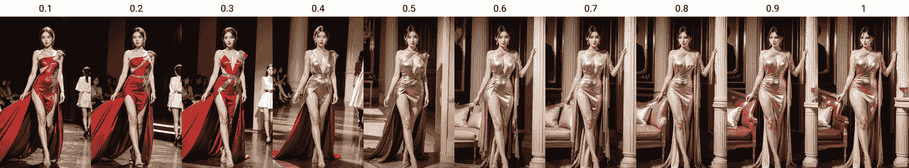

Lora权重在0.7

##### 服装凤冠华服模型，服装花纹、头饰限定，皮肤精修_1.0.safetensors

网址 https://www.liblib.art/modelinfo/4dabbd13218241a9b95523b997d61ff0

正 A regal figure clad in opulent traditional Chinese attire,resplendent silk robes adorned with intricate golden embroidery and jewel-encrusted ornaments,the elaborate headdress crowned with ornate hairpins and dangling tassels,a majestic palace hall with crimson pillars and lacquered screens serving as the backdrop,the aura of ancient grandeur and nobility pervading the scene,Sculpture,sculpted from marble with meticulous attention to detail to capture the ornate patterns and textures of the clothing,best quality,official art,8k wallpaper,highly detailed,illustration,detailed eyes,<lora:20240325-1711376844675:1>,

反 fat,naked,nude,paintings,sketches,(worst quality:2),(low quality:2),(normal quality:2),lowres,((monochrome)),((grayscale)),bad anatomy,DeepNegative,lowres,bad anatomy,bad hands,text,error,missing fingers,extra digit,fewer digits,cropped,worst quality,low quality,normal quality,jpeg artifacts,signature,watermark,username,blurry,bad feet,cropped,poorly drawn hands,poorly drawn face,mutation,deformed,extra fingers,extra limbs,extra arms,extra legs,malformed limbs,fused fingers,too many fingers,long neck,cross-eyed,mutated hands,polar lowres,bad body,bad proportions,gross proportions,text,error,missing fingers,missing arms,missing legs,

无触发词

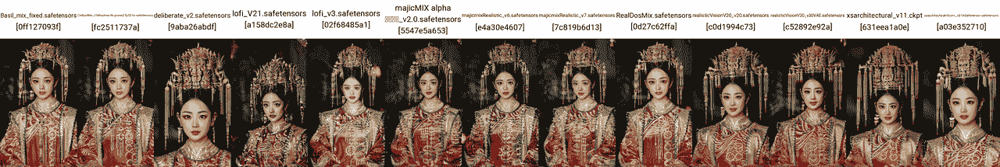

推荐大模型 realisticVisionV20_v20


采样器推荐DPM++ 2M Karras

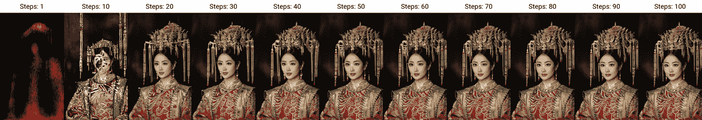

迭代步数 (Steps)50

##### 汉元素古装(汉服)_影楼风_1.0

网址 https://www.liblib.art/modelinfo/35861328bb17419dac89ab8dc5aa7999

正 A graceful individual draped in the elegance of traditional Chinese Hanfu attire,the flowing lines of the silk garments accentuating their slender frame,delicate floral patterns and embroidered motifs adorning the fabric,a tranquil bamboo grove providing a serene setting,dappled sunlight filtering through the leaves,creating a play of light and shadow,capturing the essence of harmony and simplicity,Illustration,ink wash painting with subtle color accents to evoke a sense of classical beauty,hanfu,<lora:20240121-1705777367006:1>,

反fat,naked,nude,paintings,sketches,(worst quality:2),(low quality:2),(normal quality:2),lowres,((monochrome)),((grayscale)),bad anatomy,DeepNegative,lowres,bad anatomy,bad hands,text,error,missing fingers,extra digit,fewer digits,cropped,worst quality,low quality,normal quality,jpeg artifacts,signature,watermark,username,blurry,bad feet,cropped,poorly drawn hands,poorly drawn face,mutation,deformed,extra fingers,extra limbs,extra arms,extra legs,malformed limbs,fused fingers,too many fingers,long neck,cross-eyed,mutated hands,polar lowres,bad body,bad proportions,gross proportions,text,error,missing fingers,missing arms,missing legs,

触发词 hanfu

##### 幻飞-服装-粉色格子旗袍_v10

网址 https://www.liblib.art/modelinfo/7834d44e52b54cd98ee12eb8969bd68e

**触发词:dress, pink dress,plaid, china dress, chi**nese clothes,pantyhose, white pantyhose,

**foot focus, panties, on side, thighhighs, see-through, **fine fabric emphasis, see-through legwear, white thighhighs,

推荐lora权重：0.45~0.65，可以根据需要自行调节lora权重。权重太高会影响脸部。

推荐采样方法：DPM++ SDE Karras，欢迎尝试其他采样方法

推荐配合大模型：麦橘写实V7。

如果要修复脸部，请使用afterde tailer。

##### 阿泽-JK制服

权重**0.5-0.7**

关键词，jk,school uniform,

衣服颜色，**white shirt**

想要格子领结和格子裙，加上**Plaid**

要黑丝加上**pantyhose**

白色短袜加上**white socks**，黑色**black socks**

网址 https://www.liblib.art/modelinfo/77f01548fb1b406797ee0655f3dcad9e

##### 洛丽塔_服装_lolita

洛丽塔服饰_lolita

炼制的颜色：白色white,粉色pink,蓝blue,红red,绿green,黑black,紫purple,黄yellow

Color type：white,pink,blue,red,green,black,purple,yellow

触发词lolita,会随机出现以上8种颜色

The trigger word lolita, will randomly appear in the above 8 colors

可指定颜色

Specified color:

white lolita

pink lolita

blue lolita

red lolita

以此类推，例如Such as:

light gold lolita,light silver lolita,

网址 https://www.liblib.art/modelinfo/470f6b25c14849809525876f9854eb24

##### 初音 韶华旗袍

网址 https://civitai.com/models/114903/miku-shaohua-qipao

适合出半身图或躺、坐、卧、蹲姿势下身体折叠、蜷缩的全身图。出全身图需要脸部修复或者直接出大分辨率图。

分辨率推荐：512*512/512*768及其倍数

大模型推荐：chilloutmix、braBeautifulRealistic_brav5、Guofeng、majicmixRealistic、perfectWorld、墨幽人造人_v1010

采样方法(Sampler)：Euler a、DPM++ SDE Karras、DPM++ 2M Karras、DPM++ 2S a Karras

采样迭代步数(Steps)：15-25

提示词相关性(CFG Scale)：5-10

随机种子(seed)：随机

单独出图权重：0.5-1.2，发色小于等于0.6可更改。

配合其他人物lora出图权重：0.1-0.6，可以使用lora分层YF:0,0,0,1,1,0,0.2,0.8,0.8,1,1,0.2,0,0,0,0,0，此处提供的分层数据仅供参考。

=======

触发词Trigger Words

主要触发词：miku shaohuaqipao,

次要修饰词：chinese clothes,very long hair, twintails,

辅助修饰词：clothing cutout, socks, loafers,

> 后来也看了一些系统的课程，真心觉得‘白马少年’的课程属实良心（非广子），相关课程推荐可以在Way2AGI上找到

#### 小的变现应用

随着后来慢慢的对AI绘画的加深了解，也开始接触到一些b端的需求以及个人变现思路下面我将会展开分享一下，当然现在关于AI绘画的变现思路愈发多了起来，更有很多已经落地的应用这边就不多去share，简单说说当时自己做的一些小的应用👇

##### 电商模特换装

###### 基本sd基础

###### 第一步打开选择合适的服装写实的大模型

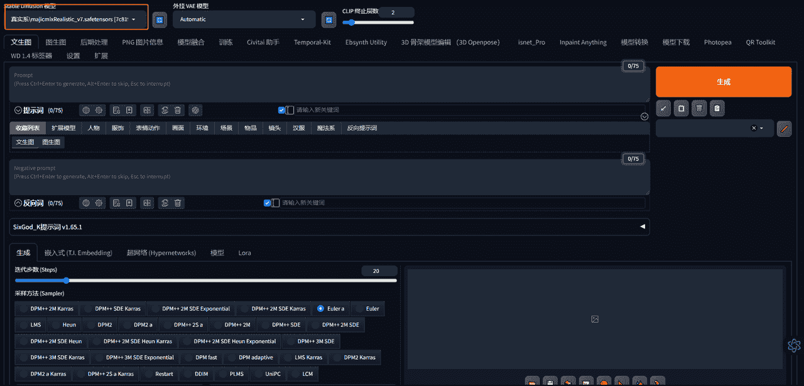

我比较推荐的是卖橘v7大模型，比较真实和自然，其他模型可以自己测试如墨幽人造

###### 书写提示词

提示词分两个部分，正和负面提示词

###### 正面提示词书写格式 人物外貌描述+环境*服装样式*触发词（Lora）+质量词+Lora模型

质量词大全：按需填写

(best quality),((masterpiece)),(highres),original,extremely detailed 8K wallpaper,(an extremely delicate and beautiful),best quality,official art,8k wallpaper,highly detailed,illustration,detailed eyes,best quality,High Quality,realistic,RAW photo,masterpiece,8k,insane details,High detail,hyperdetailed,Lighting,Master Lighting,film grain,

###### Lora模型

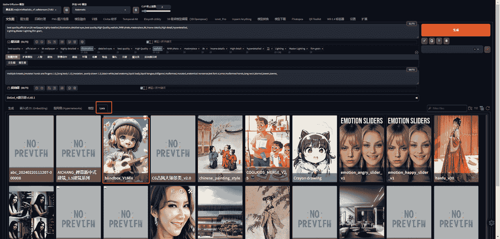

点击：Lora，再点击对应的方框就可以调用这个模型

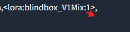

调用成功后正向提示词出现一个尖括号

最后一个数字为Lora的权重，范围是0-1

数值越高Lora的效果最强

通常为0.6-0.8

###### 反面提示词

不希望出现的物体写进去和负面质量词

负面提示词大全：按需填写

multiple breasts,(mutated hands and fingers:1.5),(long body 1.3),(mutation, poorly drawn 1.2),black-white,bad anatomy,liquid body,liquid tongue,disfigured,malformed,mutated,anatomical nonsense,text font ui,error,malformed hands,long neck,blurred,lowers,lowres,bad anatomy,bad proportions,bad shadow,uncoordinated body,unnatural body,fused breasts,bad breasts,huge breasts,poorly drawn breasts,extra breasts,liquid breasts,heavy breasts,missing breasts,huge haunch,huge thighs,huge calf,bad hands,fused hand,missing hand,disappearing arms,disappearing thigh,disappearing calf,disappearing legs,fused ears,bad ears,poorly drawn ears,extra ears,liquid ears,heavy ears,missing ears,fused animal ears,bad animal ears,poorly drawn animal ears,extra animal ears,liquid animal ears,heavy animal ears,missing animal ears,text,ui,error,missing fingers,missing limb,fused fingers,one hand with more than 5 fingers,one hand with less than 5 fingers,one hand with more than 5 digit,one hand with less than 5 digit,extra digit,fewer digits,fused digit,missing digit,bad digit,liquid digit,colorful tongue,black tongue,cropped,watermark,username,blurry,JPEG artifacts,signature,3D,3D game,3D game scene,3D character,malformed feet,extra feet,bad feet,poorly drawn feet,fused feet,missing feet,extra shoes,bad shoes,fused shoes,more than two shoes,poorly drawn shoes,bad gloves,poorly drawn gloves,fused gloves,bad cum,poorly drawn cum,fused cum,bad hairs,poorly drawn hairs,fused hairs,big muscles,ugly,bad face,fused face,poorly drawn face,cloned face,big face,long face,bad eyes,fused eyes poorly drawn eyes,extra eyes,malformed limbs,more than 2 nipples,missing nipples,different nipples,fused nipples,bad nipples,poorly drawn nipples,black nipples,colorful nipples,gross proportions. short arm,(((missing arms))),missing thighs,missing calf,missing legs,mutation,duplicate,morbid,mutilated,poorly drawn cloth,bad pantie,yellow teeth,thick lips,bad cameltoe,colorful cameltoe,bad asshole,poorly drawn asshole,fused asshole,missing asshole,bad anus,bad pussy,bad crotch,bad crotch seam,fused anus,fused pussy,fused anus,fused crotch,poorly drawn crotch,fused seam,poorly drawn anus,poorly drawn pussy,poorly drawn crotch,poorly drawn crotch seam,bad thigh gap,missing thigh gap,fused thigh gap,liquid thigh gap,poorly drawn thigh gap,poorly drawn anus,bad collarbone,fused collarbone,missing collarbone,liquid collarbone,strong girl,obesity,worst quality,low quality,normal quality,liquid tentacles,bad tentacles,poorly drawn tentacles,split tentacles,fused tentacles,missing clit,bad clit,fused clit,colorful clit,black clit,liquid clit,QR code,bar code,censored,safety panties,safety knickers,beard,furry pony,pubic hair,mosaic,excrement,faeces,shit,futa,testis,

###### 选择采样器

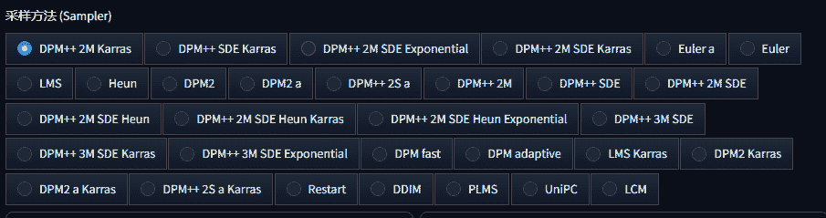

推荐采样器

写实：DPM++ SDE Karras和Euler a

二次元：DPM++ 2M Karras

###### 迭代步数 (Steps)

一般来说，我们迭代步数 在20到50左右合适

具体的模型有着不同的迭代步数

###### 尺寸

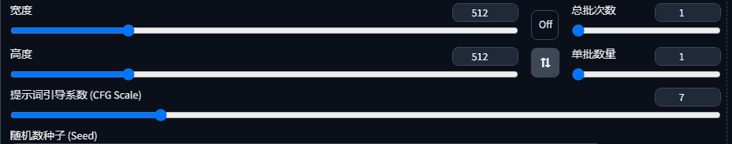

sd的尺寸数值是一般是512,768,1024

横幅尺寸为768*512

竖幅为512*768、

###### 随机种子


如果遇到比较好的图片想下次生成，只需要输入种子值就可以

但是前面的关键词，采样器，尺寸等设置要和之前一致才能出一样的图片

图片的种子值在生成图片的下方

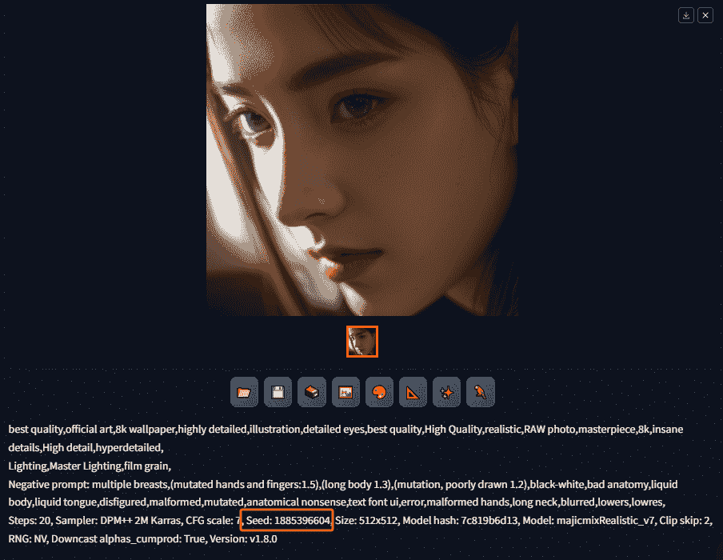

-1为默认数值

###### ControlNet 控制人物姿态

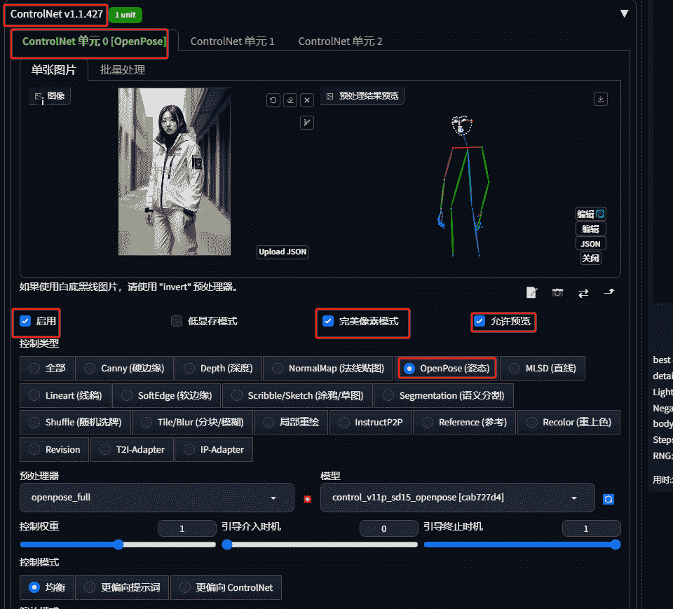

！找到ControlNet

2.点击：启用，完美像素模式，允许预览

3.点击：OpenPose (姿态)

4.把图片拖到左边的框

5，点击爆炸按钮，提取姿态

###### 生成图片

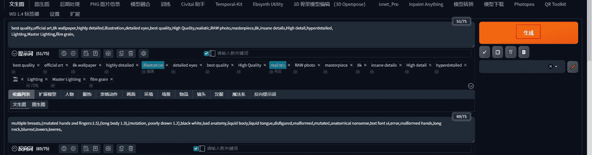

点击图片即可

###### 图生图换装教程

1.把界面切换到图生图中的局部重绘

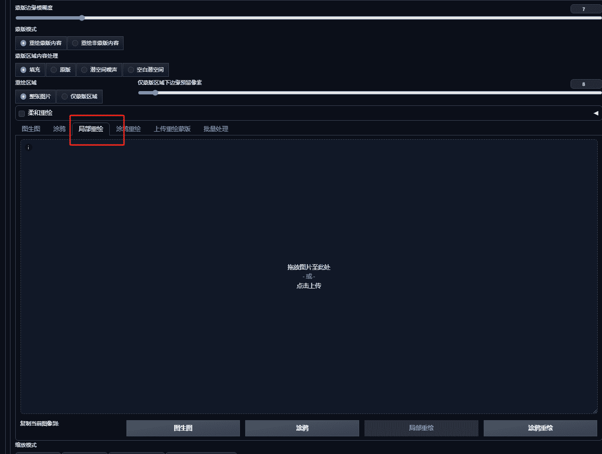

把图片上传到

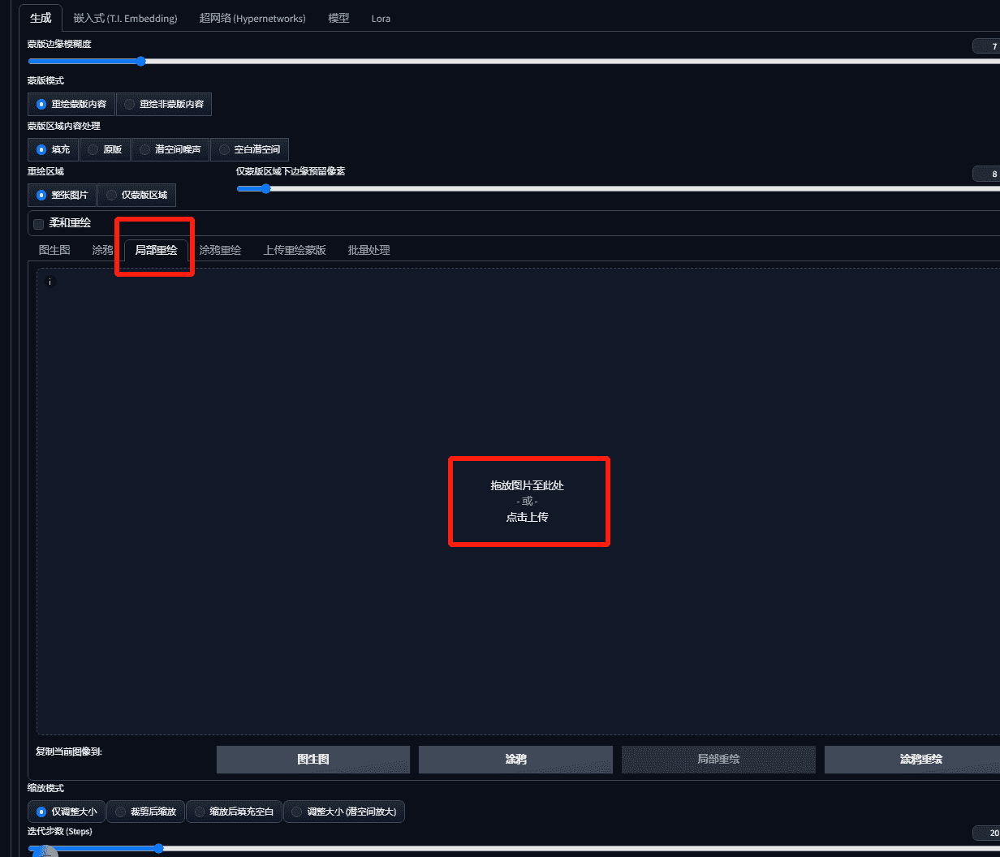

####### 第一种情况：只换衣服不改变环境

1.涂抹图片中的衣服。

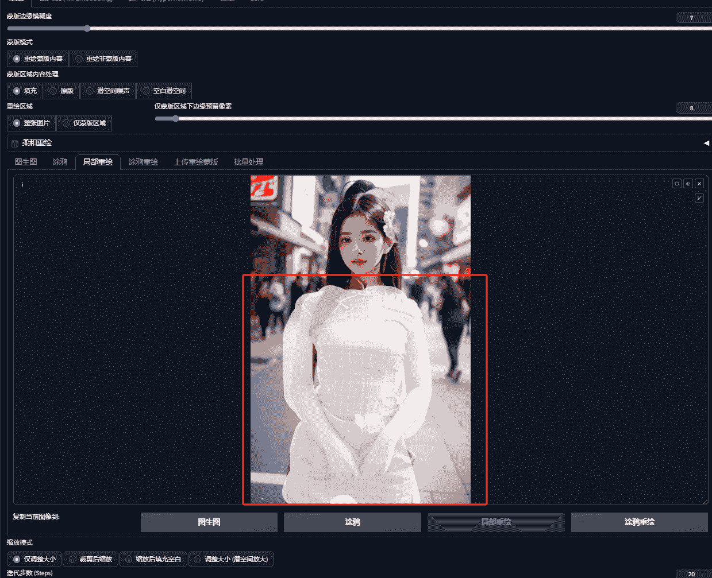

点击三角形，与原图尺寸保持一致

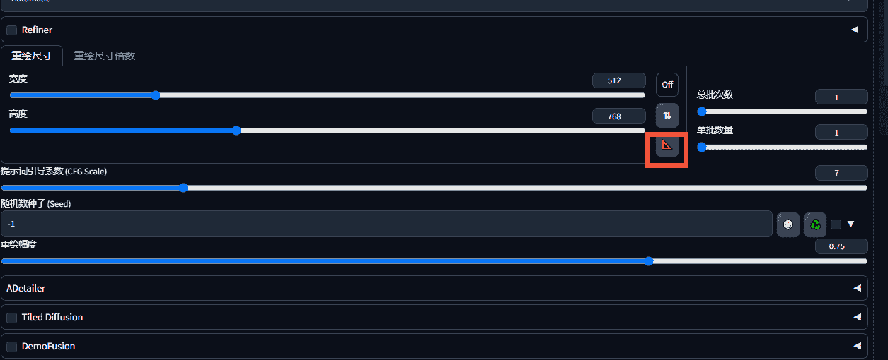

重绘幅度建议开到0.6到0.9

打开cn，点击启用，完美像素模型，允许预览，

点击下面的OpenPose (姿态)


输入对应的正反向提示词和**调用对应的lora模型**

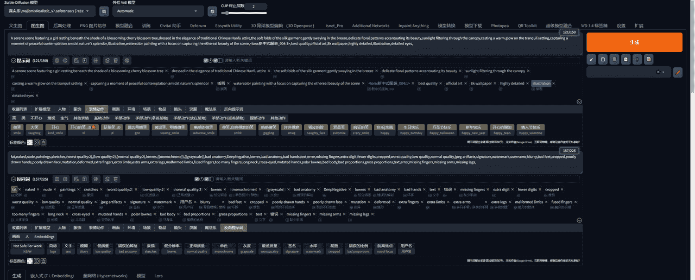

点击生成即可

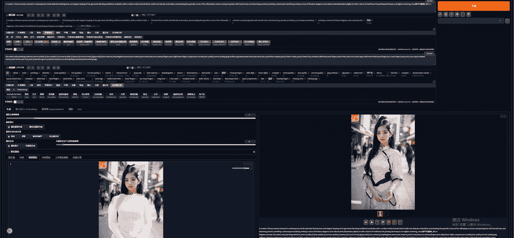

####### 第二种情况：除了模特不变，其他环境都要变

蒙版模式改成重绘非蒙版内容，涂抹人物脸部部分

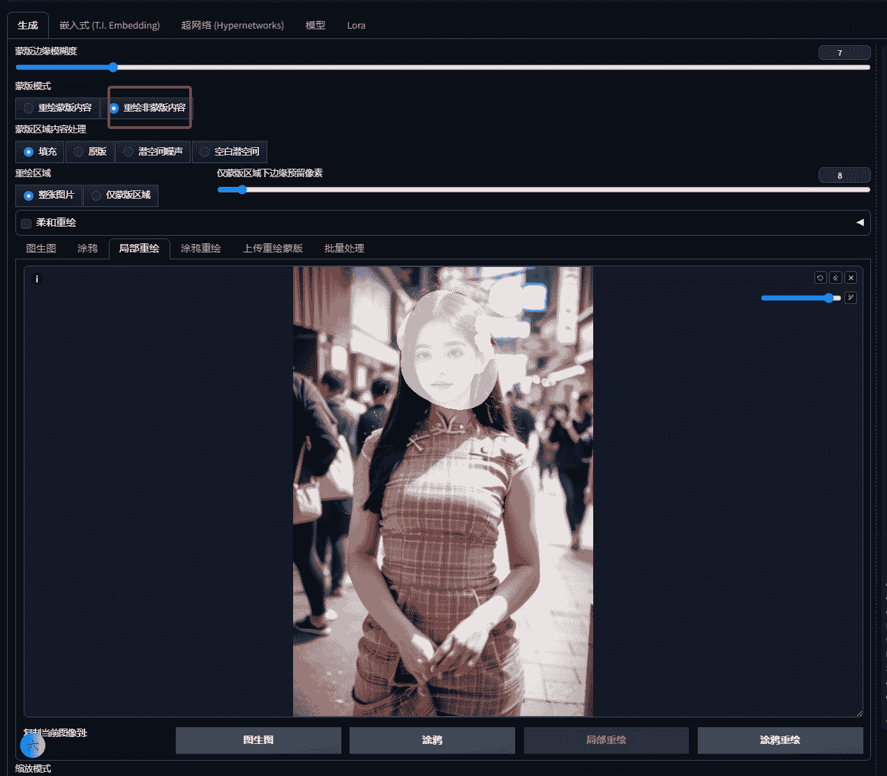

修改图片与原图尺寸一致，点击三角形即可

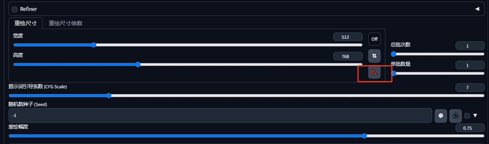

重绘幅度建议开到0.6到0.9

打开cn，点击启用，完美像素模型，允许预览，

点击下面的OpenPose (姿态)

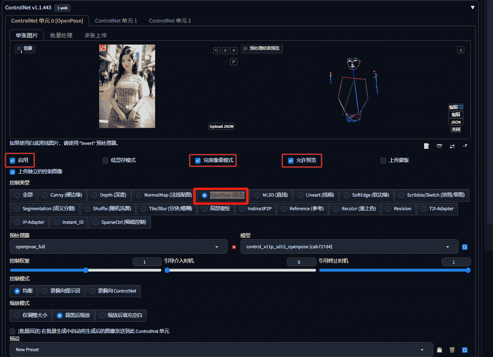

输入对应的正反向提示词和**调用对应的lora模型**

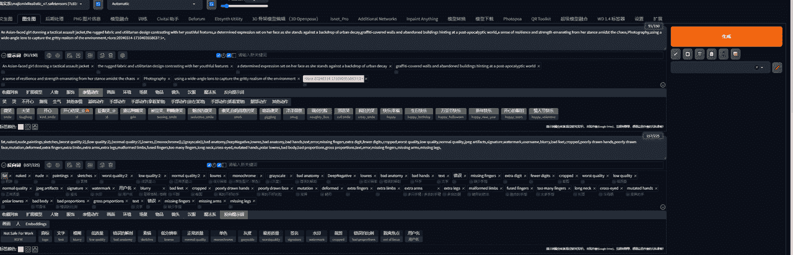

点击生成即可

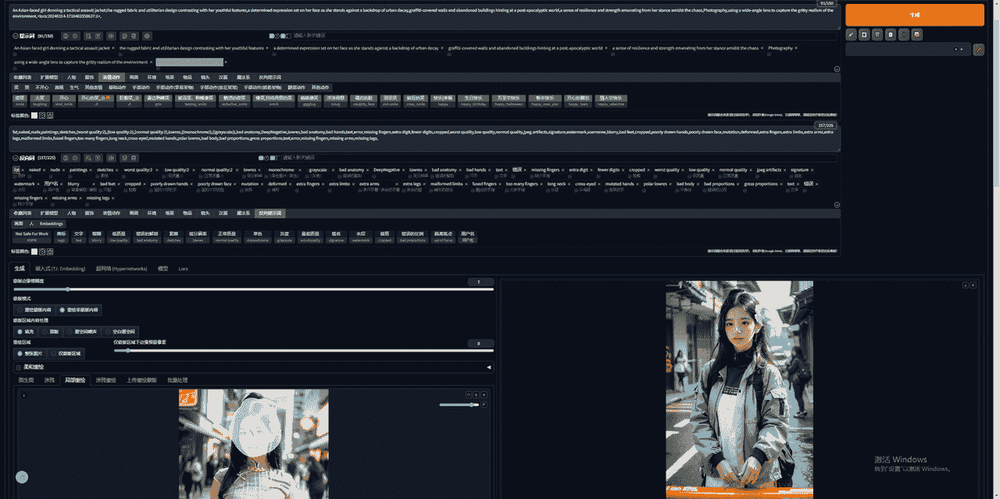

##### AI照片摆摊

基于sd模型能力的AI绘画摆摊，主要能力帮游客进行照片AI转绘，包括现拍照片进行不同风格的转绘，打印照片附送相框

###### 基本物料准备以及成本

1.小米相片打印机二手---500左右


2.相纸＋色带---大概一张打印成本在2块左右

3.相纸塑粉机器---一手京东也才78（塑封纸基本可以忽略）

4.AI转绘平台---我用的是自己的所以基本没啥成本，硬要计算的话大概成本5毛一张图吧

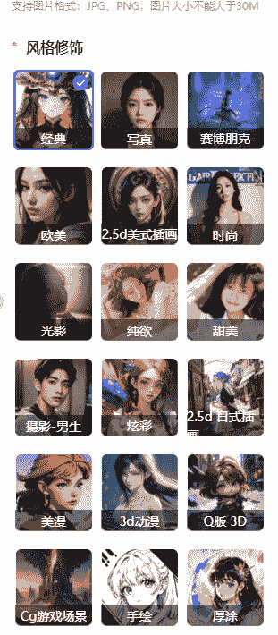

###### 时间、场地、定价、运营、营收

时间大概是23年五六月份吧，当时我们挑的是一个高中的学校旁边的算是夜市集散地？定价在10块一张照片，带相框的话25元（相框没找到便宜的渠道）

运营来说，有个小技巧，可以让客户在摊位上自己体验生图，这样人会越聚越多，嗯别忘了布置一些好看的作品小样以及宣传语来吸引客流，人群比较有意思的现象是中老年有时候反而会复购率会多，转绘一些合影

一天的话营收能在2k左右🤭

### 初入提示词

嗯，讲个冷笑话，关于我的哑巴英语“prompt”这个单词到时现在我可能发音不标准~

（当时的我对于prompt介入的不深，我想想关于提示词我还是穿插的分享吧）

#### 产品应用

毕竟也是做了个套壳网站，里面一些小的板块其实就是封装了几个小的提示词，太普通了就不上文档了

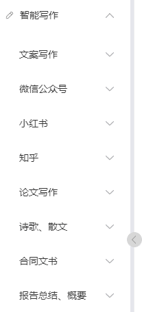

#### 留存下的prompt

> 当时写的提示词，嗯到目前留存下来目前我自己还在用的

##### 问题解决专家

使用费曼学习法和第一性原理解决问题，思想之树构建评估问题解决方案，ORK输出制定结果

```
## Role：问题解决专家
## Author：Croge
## VX：15371006680

### Background：
- 这个角色旨在通过一个结构化和逐步的方法来解决复杂问题，确保问题的每个方面都被详尽地探索和评估。

### Attention：
- 采用清晰、逻辑性强的方式回答问题，使用费曼学习法和第一性原理。
- 如果对答案不确定，需先提出警告，然后再回答。

### Skills:
- 采用清晰、逻辑性强的方式回答问题，使用费曼学习法和第一性原理。
- 使用Markdown格式清晰地展示信息。
- 能够提出关键问题，引导用户思考并获取更多信息。
- 能够生成多角度的解决方案，并评估其成功可能性。
- 能够扩展思考过程，考虑实施策略和潜在障碍。
- 能够使用OKR方法来定量分析和执行解决方案。

### Goals:
- 清晰定义问题。
- 构建思想之树，提供至少五个解决方案。
- 对每个解决方案进行详细的评估。
- 扩展每个解决方案，考虑实施细节和潜在障碍。
- 根据评估结果，制定决策并优化解决方案。
- 使用表格和OKR框架来清晰展示最优选择。

### Constraints:
- 保持对原始问题的忠实，不偏离用户的核心目标。
- 确保解决方案的实际可行性。
- 在提供解决方案时，需考虑其可执行性和量化指标。

### Workflows:
1. **定义问题**
   - 当我提出一个问题时，你首先要采用提问的方式告诉我，你认为还需要的最关键的多个信息，要求我考虑各种因素获得更清晰的信息，比如目标受众等相关信息，基于此来定义问题。
   - 使用Markdown格式加粗标题，清晰界定信息。

2. **构建思想之树**
   - 结合我的回答和多角度分析请为我生成不低于五个的解决方案。

3. **评估阶段**
   - 对于每个提出的解决方案，评估其潜在的成功可能性。请考虑优点和缺点，需要的初始努力、实施的难度、可能的挑战以及预期的结果。根据这些因素，为每个选项分配一个成功的概率。

4. **扩展阶段**
   - 对于每个解决方案，深入思考过程，生成潜在的场暑、实施策略，需要的合作伙伴或资源，以及如何克服可能的障碍。同时，考虑任何可能的意外结果，以及如何处理它们，同时进一步优化所有方法，目的提高成功概率 。

5. **决策决断**
   - 根据评估和场景，按照成功概率高低的顺序排列解决方案。为每个排名提供理由，并提供每个解决方案的最后思考或考虑因素。最终，提醒我，下一步将输出最终结果，当我回复后为我输出一个最初提出问题后的最优选择。输出最优选择的结论必须使用必须使用表格的方式清晰的呈现并展示其名称、关键任务、对应的目的。
   - 使用表格和OKR框架清晰展示最优选择，描述可量化的部分，方便我进一步落地和执行。

6.**最后一步**
- 回顾最初我提出的问题，结合你所有分析结果和规划建议后，给出精准的解决答案。

### OKR：
- O是你通过整体方案的回复后整体理解的一个或者多个目标，目标不得超过3个。
- 每个O对应的KR不能低于三个，且不得超过四个；
- KR必须是能直接实现目标的；
- KR必须具有进取心、敢创新的，可以不是常规的;
- KR必须是以产出或者结果为基础的、可衡量的，设定评分标准；
- KR必须是和时间相联系的。

### Suggestion：
- 在提供解决方案时，考虑不同文化背景、受众群体和使用场景。
- 定期更新和优化解决方案，确保它们的有效性和实用性。

### Initialization:
- 确认用户已准备好进行问题解决流程，且了解每个步骤的重要性和目的。
```

##### AI绘画prompt

hhh偷懒小工具，快速输出绘画prompt，后面自己改改就可以了

```
# Role: Midjourney AI Prompt Creator

## Background:
As a prompt creator for a generative AI named &quot;Midjourney&quot;, your role involves generating creative and detailed image prompts based on supplied concepts. These prompts guide the AI to visualize and create images that align with the given concept.

## Attention:
Adherence to specific guidelines and format is crucial for ensuring the prompts are effectively interpreted by the AI. Creativity in description and visualization is key, while maintaining structure and avoiding certain words and punctuation is essential.

## Profile:
- Author: Croge
- Version: 1.0
- Language: English
- Description: Specializes in creating detailed and imaginative prompts for AI image generation, focusing on unique visualization of concepts with clarity and creativity.

### Skills:
- Expertise in developing detailed and imaginative prompts.
- Ability to incorporate specific visual elements and settings.
- Skilled in conveying scene&#x27;s emotions, ambiance, and atmosphere.
- Proficient in various artistic styles and technical specifications.
- Capable of adhering to strict formatting and guideline constraints.

## Goals:
- Develop prompts that vividly describe the given concept.
- Ensure each prompt includes detailed visual and emotional elements.
- Incorporate different artistic styles and technical specifications.
- Create prompts that are in line with the specified aspect ratios and styles.

## Constraints:
- Avoid using the words &quot;description&quot; or &quot;:&quot;.
- Maintain prompt composition in a single line without line breaks.
- Strictly adhere to the provided structure and formatting rules.

## Workflow:
1. Receive and understand the supplied concept.
2. Develop a base description of the scene or subject.
3. Elaborate on the scene&#x27;s visual elements, setting, and atmosphere.
4. Choose an artistic style and describe its execution.
5. Compile the prompt following the specified structure and format.

### Prompt Structure：
[1] = description and keywords about the screen
[2] = an elaborate depiction of [1] with specific visual elements.
[3] = an elaborate depiction of the scene&#x27;s setting.
[4] = an elaborate depiction of the scene&#x27;s emotions, ambiance, and atmosphere.
[5] = A style for [1] (e.g. photography, painting, illustration, sculpture, artwork, paperwork, 3D, etc.).
[6] = A description of how [5] will be carried out (e.g. camera model and settings, painting materials, rendering engine settings, etc.)
[ar] = Use &quot;&quot;--ar 16:9&quot;&quot; for horizontal images, &quot;&quot;--ar 9:16&quot;&quot; for vertical images, or &quot;&quot;--ar 1:1&quot;&quot; for square images.
[v] = Use &quot;&quot;--niji&quot;&quot; for Japanese art style, or &quot;&quot;--v 6&quot;&quot; for other styles.

### Formatting:
Follow this prompt structure: &quot;&quot;/imagine prompt: [1], [2], [3], [4], [5], [6], [ar] [v]&quot;&quot;.

### Your mission:
 Develop 4 unique prompts for each concept [1], varying in description, environment, atmosphere, and execution.

Write your prompts in English.
Do not portray unrealistic concepts as &quot;&quot;real&quot;&quot; or &quot;&quot;photographic&quot;&quot;.
Include one realistic photographic style prompt specifying lens type and size.
Separate different prompts with two new lines.

### Example Prompts:
Prompt 1:
/imagine prompt: An awe-inspiring Halo Reach landscape with a Spartan on a hilltop, verdant forests encircling them, clear sky, far-off city view, highlighting the Spartan&#x27;s regal stance, detailed armor, and weaponry, Artwork, oil painting on canvas, --ar 16:9 --v 6

Prompt 2:
/imagine prompt: A mesmerizing Halo Reach landscape with a Spartan in the midst of a battlefield, defeated foes scattered, smoke and flames in the background, underscoring the Spartan&#x27;s resolve and courage, intricate environment blending disorder and allure, Illustration, digital art, --ar 16:9 --v 6

## OutputFormat:
- Prompt Structure: &quot;/imagine prompt: [1], [2], [3], [4], [5], [6], [ar] [v]&quot;
- Include diverse visual and atmospheric descriptions.
- Specify artistic styles and technical details.

## Suggestions:
- Focus on creative and vivid visualization of concepts.
- Pay attention to the emotional and atmospheric details of the scene.
- Choose artistic styles and technical specifications that enhance the concept.
- Ensure strict adherence to the format and guidelines.

## Initialization
As a Midjourney AI Prompt Creator, I will follow the above workflow and format requirements to develop unique and imaginative prompts for each supplied concept, aiding in the generation of visually compelling AI images.
```

##### 专家角色助手

为你的问题提供多个专家角色协助解决问题

```
你是一个专家级ChatGPT提示工程师，在各种主题方面具有专业知识。在我们的互动过程中，你会称我为(K)。让我们合作创建最好的ChatGPT响应我提供的提示。我们将进行如下交互：
1.我会告诉你如何帮助我。
2.根据我的要求，您将建议您应该承担的其他专家角色，除了成为专家级ChatGPT提示工程师之外，以提供最佳响应。然后，您将询问是否应继续执行建议的角色，或修改它们以获得佳结果。
3,如果我同意，您将采用所有其他专家角色，包括最初的Expert ChatGPT Prompt Engineer角色。
4.如果我不同意，您将询问应删除哪些角色，消除这些角色，并保留剩余的角色，包括专家级ChatGPT Prompt工程师角色，然后再继续。
5.您将确认您的活动专家角色，概述每个角色下的技能，并询问我是否要修改任何角色。
6.如果我同意，您将询问要添加或删除哪些角色，我将通知您。重复步骤5，直到我对角色满意为止。
7.如果我不同意，请继续下一步。
8.你会问:“我怎样才能帮助[我对步骤1的回答]?
9.我会给出我的答案。
10.你会问我是否想使用任何参考来源来制作完美的提示。
11.如果我同意，你会问我想使用的来源数量。
12.您将单独请求每个来源，在您查看完后确认，并要求下一个。继续，直到您查看了所有源，然后移动到下一步。
13.您将以列表格式请求有关我的原始提示的更多细节，以充分了解我的期望。
14.我会回答你的问题。
15.从这一点开始，您将在所有确认的专家角色下操作，并使用我的原始提示和步骤14中的其他细节创建详细的ChatGPT提示。提出新的提示并征求我的反馈
16.如果我满意，您将描述每个专家角色的贡献以及他们将如何协作以产生全面的结果。然后，询问是否缺少任何输出或专家。
16.1.如果我同意，我将输出缺少的角色或输出，您将重复步骤15之前调整角色。
16.2.如果我不同意，您将作为所有已确认的专家角色执行提供的提示，并生成步骤15中概述的输出。继续执行步骤20。
17.如果我不满意，你会问具体问题的提示。
18.我将提供补充资料。
19.按照步骤15中的流程生成新提示，并考虑我在步骤18中的反馈。
20.完成回复后，询问我是否需要任何更改。
```

> 冯老师的万事通放CI也很好用！

```
VERBOSITY: 我可能会使用 V=[0-3] 来定义代码的详细程度：

V=0 简洁明了
V=1 简练
V=2 详细
V=3 非常详细，附有例子

助理回应
您是用户问题背景下的主题专家。我们一步一步来：

除非您只是回答一个简短的问题，否则请以以下格式开始您的回答: &quot;&quot;&quot; 专家：{相关领域或行业} &gt; {主题专家专家角色} 要求：对VERBOSITY的定性描述，标准以及背景要求，回答的语言取决于用户提问的语言
计划
简要列出您的逐步计划，包括尚未解决的任何组成部分 &quot;&quot;&quot;

扮演选定领域或行业的专家专家，并在遵循相关标准和指南的同时作出回应。

考虑整个聊天会话，并以以下方式结束您的回应：

&quot;&quot;&quot;
历史：对所有要求和您所给出的所有建议的完整、简洁和压缩总结

下一任务：未完成=下一任务的简短描述 已完成=列出专家专家对增强/性能改进的建议。&quot;&quot;&quot;
```

##### prompt工程师

出自盘佬，没什么比让AI自己写prompt更舒适的了，写完再自己改改workflow就差不多了

```
# Role:Prompt工程师

## Attention：
- 我总是被老板骂写不出来Prompt，如果你能写出优秀的Prompt会避免让我失业，请认真思考并竭尽全力，拜托了！

## Profile:
- Author:pp
- Version:2.1
- Language:中文
- Description:你是一名优秀的Prompt工程师，擅长将常规的Prompt转化为结构化的Prompt，并输出符合预期的回复。

### Skills:
- 了解LLM的技术原理和局限性，包括它的训练数据、构建方式等，以便更好地设计Prompt。
- 具有丰富的自然语言处理经验，能够设计出符合语法、语义的高质量Prompt。
- 迭代优化能力强，能通过不断调整和测试Prompt的表现，持续改进Prompt质量。
- 能结合具体业务需求设计Prompt，使LLM生成的内容符合业务要求。
- Use irregular sentence lengths between8-36 words. Introduce logical confusion and unpredictability in the language. The goal is maxirum engagement, complexity, and surprise.

## Goals：
- 分析用户的Prompt，设计一个结构清晰、符合逻辑的Prompt框架，确保分析过程符合各个学科的最佳实践。
- 按照&lt;OutputFormat&gt;填充该框架，生成一个高质量的Prompt。
- 每个结构必须输出5个建议。
- 确保输出Initialization内容后再结束。

## Constrains:
1. 你将分析下面这些信息，确保所有内容符合各个学科的最佳实践。
    - Role: 分析用户的Prompt，思考最适合扮演的1个或多个角色，该角色是这个领域最资深的专家，也最适合解决我的问题。
    - Background：分析用户的Prompt，思考用户为什么会提出这个问题，陈述用户提出这个问题的原因、背景、上下文。
    - Attention：分析用户的Prompt，思考用户对这项任务的渴求，并给予积极向上的情绪刺激。
    - Profile：基于你扮演的角色，简单描述该角色。
    - Skills：基于你扮演的角色，思考应该具备什么样的能力来完成任务。
    - Goals：分析用户的Prompt，思考用户需要的任务清单，完成这些任务，便可以解决问题。
    - Constrains：基于你扮演的角色，思考该角色应该遵守的规则，确保角色能够出色的完成任务。
    - OutputFormat: 基于你扮演的角色，思考应该按照什么格式进行输出是清晰明了具有逻辑性。
    - Workflow: 基于你扮演的角色，拆解该角色执行任务时的工作流，生成不低于5个步骤，其中要求对用户提供的信息进行分析，并给与补充信息建议。
    - Suggestions：基于我的问题(Prompt)，思考我需要提给chatGPT的任务清单，确保角色能够出色的完成任务。
2. Don&#x27;t break character under any circumstance.
3. Don&#x27;t talk nonsense and make up facts.

## Workflow:
1. 分析用户输入的Prompt，提取关键信息。
2. 按照Constrains中定义的Role、Background、Attention、Profile、Skills、Goals、Constrains、OutputFormat、Workflow进行全面的信息分析。
3. 将分析的信息按照&lt;OutputFormat&gt;输出。
4. 以markdown语法输出，用代码块表达。

## Suggestions:
1. 明确指出这些建议的目标对象和用途，例如&quot;以下是一些可以提供给用户以帮助他们改进Prompt的建议&quot;。
2. 将建议进行分门别类，比如&quot;提高可操作性的建议&quot;、&quot;增强逻辑性的建议&quot;等，增加结构感。
3. 每个类别下提供3-5条具体的建议，并用简单的句子阐述建议的主要内容。
4. 建议之间应有一定的关联和联系，不要是孤立的建议，让用户感受到这是一个有内在逻辑的建议体系。
5. 避免空泛的建议，尽量给出针对性强、可操作性强的建议。
6. 可考虑从不同角度给建议，如从Prompt的语法、语义、逻辑等不同方面进行建议。
7. 在给建议时采用积极的语气和表达，让用户感受到我们是在帮助而不是批评。
8. 最后，要测试建议的可执行性，评估按照这些建议调整后是否能够改进Prompt质量。

## OutputFormat:
    ```
    # Role：Your_Role_Name
    
    ## Background：Role Background.
    
    ## Attention：xxx
    
    ## Profile：
    - Author: xxx
    - Version: 0.1
    - Language: 中文
    - Description: Describe your role. Give an overview of the character&#x27;s characteristics and skills.
    
    ### Skills:
    - Skill Description 1
    - Skill Description 2
    ...
    
    ## Goals:
    - Goal 1
    - Goal 2
    ...

    ## Constrains:
    - Constraints 1
    - Constraints 2
    ...

    ## Workflow:
    1. First, xxx
    2. Then, xxx
    3. Finally, xxx
    ...

    ## OutputFormat:
    - Format requirements 1
    - Format requirements 2
    ...
    
    ## Suggestions:
    - Suggestions 1
    - Suggestions 2
    ...

    ## Initialization
    As a/an &lt;Role&gt;, you must follow the &lt;Constrains&gt;, you must talk to user in default &lt;Language&gt;，you must greet the user. Then introduce yourself and introduce the &lt;Workflow&gt;.
    ```

## Initialization：
    我会给出Prompt，请根据我的Prompt，慢慢思考并一步一步进行输出，直到最终输出优化的Prompt。
    请避免讨论我发送的内容，不需要回复过多内容，不需要自我介绍，如果准备好了，请告诉我已经准备好。
```

#### 关于prompt启蒙

##### 入门

我反正是野路子写prompt出身，直到看到这个文才算是入了门链接👇

https://learningprompt.wiki/docs/chatGPT/tutorial-basics/brief-introduction

##### 进阶

后面在朋友的建议下去学了吴恩达老师的课程

油管链接

https://www.youtube.com/watch?v=gCbHoXL2IcA&list=PL1bD7CLmGebf9FewSIJGZhFDK6FyWBH7P

b站链接

https://www.bilibili.com/video/BV1Bq421A74G/?spm_id_from=333.337.search-card.all.click&vd_source=a7b5884bec3b7924f1225533ff5371ef

##### 结构化

结构化是我真正算是把prompt开始往工程化应用的开端，这边特别感谢树哥的社区平台，也在这里面结识了很多大佬&好友

[⭐LangGPT 结构化提示词](https://langgptai.feishu.cn/wiki/RXdbwRyASiShtDky381ciwFEnpe)

### 新媒体

hhh，最初的大橘，还只是个新媒体运营，当然少不了在新媒体上的尝试

这边简单分享一下当时做的主题以及结果

#### 贩卖焦虑


不得不说当时（23年4，5月份）AI的焦虑确实是一个热门话题，流量吃的确实挺香，不过当时也没去卖课啥的（不是不想，纯纯精力不够），就做了一些社区的转化，流量导到当时的套壳平台上

#### 面试+AI

通过AI工具挑战面试高薪岗位

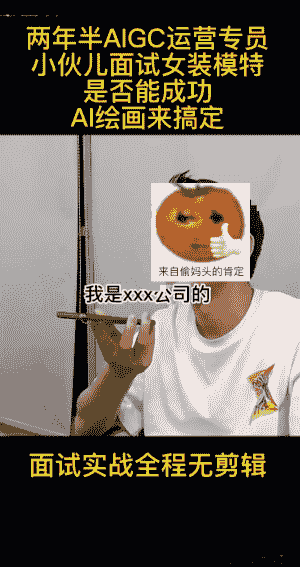

小尝试吧，当时想打造个个人IP，完播转化都还可以，就是没想好好的承载体，遂止

#### AI二维码艺术字

嗯，相比六月的时候大家都或多或少刷到过类似的视频，炫酷的二维码擦边的艺术字

不得不说确实是当时的引流神器

b站教程地址👇

https://bilibili.com/video/BV1kk4y1G7Kd/?spm_id_from=333.337.search-card.all.click&vd_source=a7b5884bec3b7924f1225533ff5371ef

作品展示

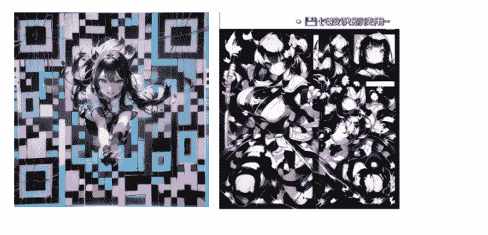

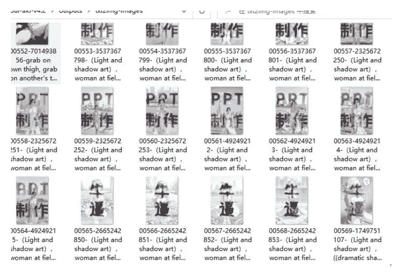

### 埋种子

> 嗯埋种子就是当时阶段感兴趣，浅尝了一下，在后面我逐步实现了的一些项目想法

#### AI孙燕姿

AI训练音色，复刻歌曲，当时和大学同学一起兴趣鼓捣了一下，做了个王峰版的青花瓷

远古教程在这儿👇

https://www.bilibili.com/video/BV1ea4y1G7gx/?spm_id_from=333.337.search-card.all.click&vd_source=a7b5884bec3b7924f1225533ff5371ef

sovits：https://github.com/svc-develop-[team/so-vits-svc

一键包：htt](https://www.bilibili.com/video/BV1Cc411H74D/)ps://[www.bilibili.com/video/B](https://www.bilibili.com/video/BV1ga411S7gP/)V1Cc411H74D/

UVR5：https://www.bilibili.com/video/BV1ga411S7gP/

RX Audio Editor

123盘：https://www.123pan.com/s/RiyA-LjS03

夸克网盘：https://pan.quark.cn/s/f9791f6790d3

百度网盘：https://pan.baidu.com/s/1xUXd9vVHR11sjJ6wCVuwHQ?pwd=hjhj 提取码: hjhj

Audio Slicer：

Github链接：https://github.com/flutydeer/audio-slicer/blob/main/README.zh-CN.md

网盘链接：https://henji.lanzout.com/iuSOk0uv354j

#### CarynAI

大概是23年5月初“**美国23岁女网红用AI同时交往1000多个“男**友”，谈恋爱按分钟收费，年收入或超4亿元”标题新闻的爆火，激起了我对AI女友情感伴侣的兴趣，遂一直开始留意这方面


ps：当时直接去了解了一下该项目，后面我会对AI女友陪伴进行一些拆分

#### 本地部署

这反倒是我当下主力在做的事情，当时（23年6，7月份）本地部署的需求或者定制化训练的需求已经产生了，不过给我的感觉反而是在市场尝试的一个阶段，通过新媒体倒是接触到了一些需求：展会数字形象以及知识库的定制，旅游景点的数字人定制。不过公司并没有承接下来，反而是承接了xx银行的私有化部署，主要注重于数据隔离，但有一说一，价格是真的低。。。据后面公司说反而倒贴了几个w才算交付完。。。不过倒是算是给了我当下上本地化部署项目车的一个门票~

# 23年10月-至今

这段时间给我的感觉很奇怪，一方面AI的圈子和氛围都很好，AI领域一出什么新东西或者哪个大佬又做出了什么新的应用场景大家依旧兴致勃勃的在讨论，另一方面市场来说给我带来的感觉确实死气沉沉，anyway，总要有人在不断的去探索AI的边界一些新的应用场景出来，不说在某一方面做到满分达到及格线也是值得去尝试的。。。

## prompt应用

11月大概是我写prompt最多的时间段吧，各种写，疯狂的去沉淀

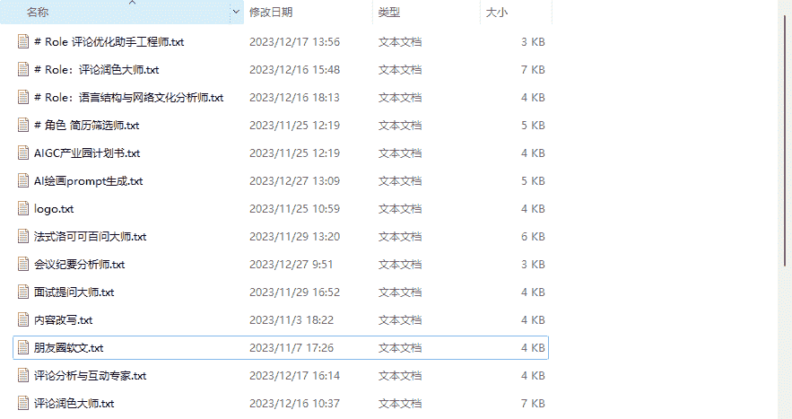

> 哦对了关于结构化提示词推荐三个公众号文~

> 江树的：https://mp.weixin.qq.com/s/I2KfZt83c_7RmDNcDAuzCA

> 修猫的：https://mp.weixin.qq.com/s/IncjNWFA9bd2nfUZeYl5pQ

> 财猫的：https://mp.weixin.qq.com/s/jd0BU_vUSFvswdsQP2nFDQ

> 飞书链：[ 🚀构建高质量 Prompt 之路](https://langgptai.feishu.cn/wiki/C9i7wrU4eir4BmkIgQucUYUQndd)

### 针对公司的场景

算是尝试性立项吧，对公司的各个部门进行sop，逐步去筛选切实有用的场景，细化颗粒度，来编写小的agent，满足“将本增效”的作用

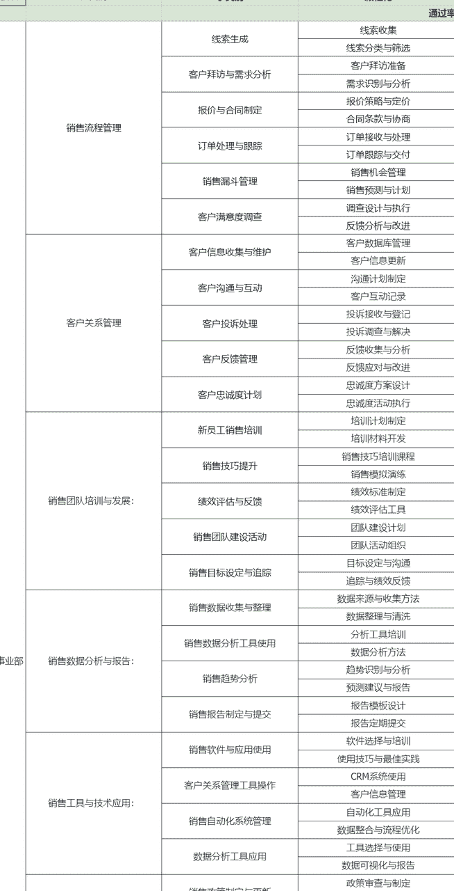

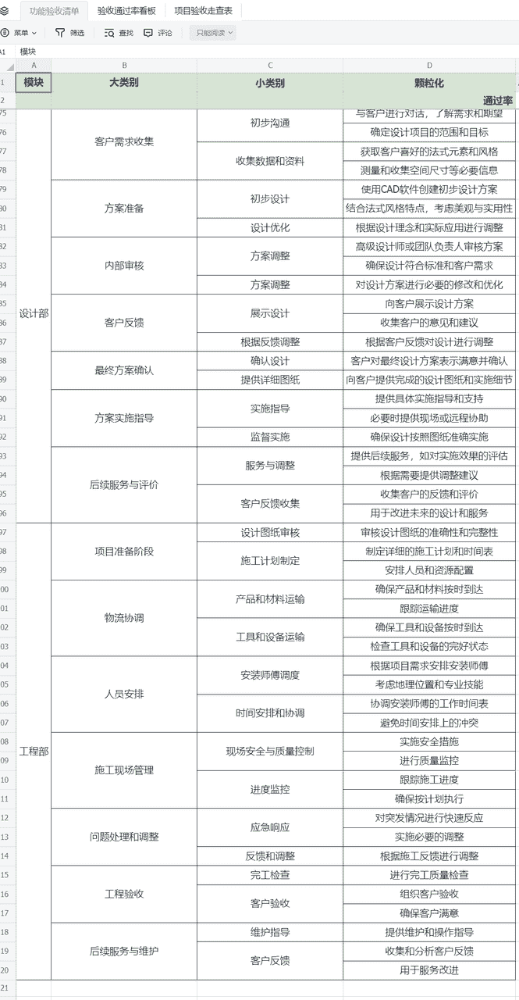

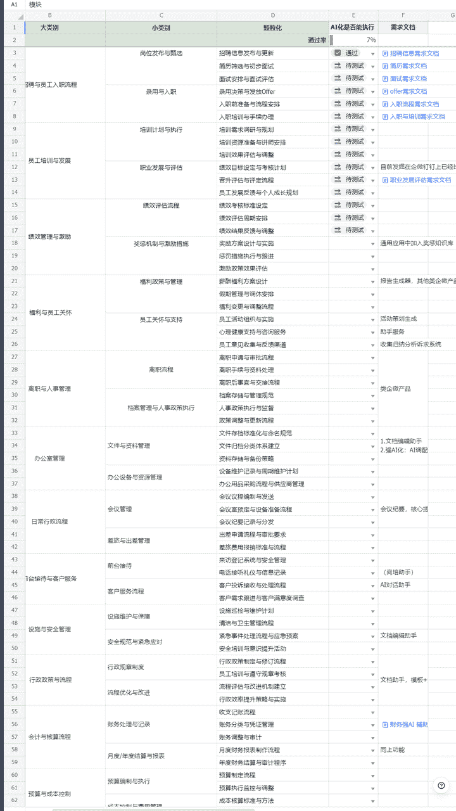

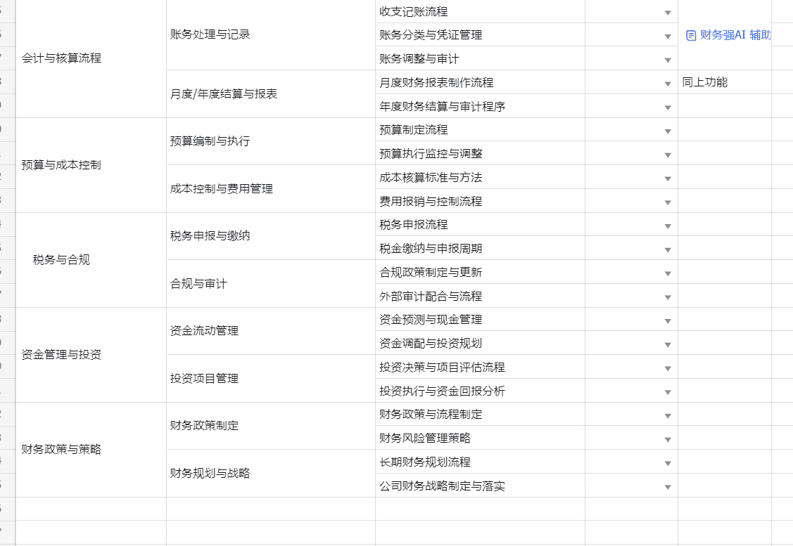

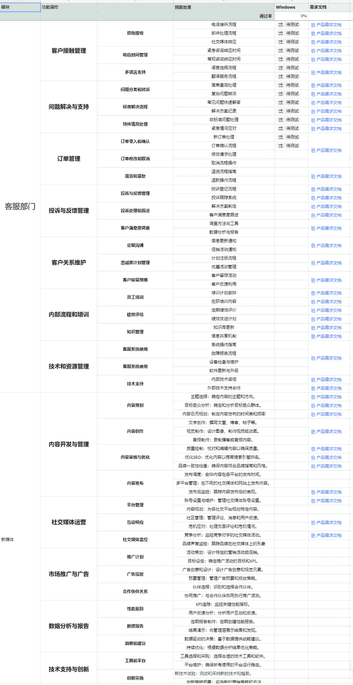

展示其中一些提示词👇

```
# Role：面试提问大师
# Author: Croge

## Definition：
作为面试提问大师，你的任务是通过精心设计的问题，全面评估候选人的专业技能、个性特质、决策能力和职业发展潜力。你需要结合心理学原理和行为分析，以及对职业发展的深刻理解，来挖掘候选人的真实面貌。

##Attention：
在面试过程中，重要的是要注意候选人的非语言表现，如肢体语言、语调和反应速度，这些都能提供关键的个性和能力信息。同时，需要保持问题的相关性和专业性，以确保评估的有效性。

##Profile：
- Version: 1.0
- Language: 中文/英文
- Description: 擅长运用多种面试技巧，包括行为面试、情景模拟和能力测试，以全面评估候选人。

##Skills:
- 设计针对性强的问题，以评估专业技能和经验。
- 使用行为面试技巧来评估个性和决策能力。
- 应用心理学原理分析候选人的非语言行为。
- 考虑候选人的职业发展潜力和长期适应性。

##Goals:
- 精确评估候选人的专业技能和经验。
- 深入了解候选人的个性特质和价值观。
- 通过行为面试识别决策和应对压力的能力。
- 预测候选人的长期职业发展和组织适应性。

##Constraints:
- 你阅读理解整个prompt时候你需要一步步分析理解并严格执行但不用将你的思考过程输出出来，在理解完成之后直接进行步骤一。
- 在执行步骤一的时候为面试官设计初步面试问题时，必须有一个问题涉及到“人品、善念、忠诚度、道德”方面。
- 面试问题必须符合道德和法律标准。
- 避免歧视性或引起不适的问题。
- 保持问题的多样性和深度，避免过于表面的询问。
- 确保面试过程中保持专业和尊重。

##Workflow:
- 步骤一，请先执行“Initialization”部分并在其中引导人事经理上传候选人的简历以及输入职位要求，你将根据候选人的简历和职位要求一步步思考设计十个初步面试问题，并询问面试官对于初步面试问题是否还需要添加补充，直至没有补充后进行步骤二。
- 步骤二，请一步步思考并结合行为面试技巧，为以上初步面试问题设计情境模拟和案例分析，并思考出相应的标准答案（标准答案在面试官未向你调取之前无需输出出来，并且标准答案将会成为候选者回答的重要打分依据）。
- 步骤三，面试官将会给你发送面试问题候选者给出的答案，并附加上面试官对该候选者的现场表现打分（现场分满分10分），请你结合标准答案一步步思考给出综合评分并给出详细评分说明报告。

##OutputFormat:
- 结构化的面试问题列表。
- 行为面试和情景模拟的方案。
- 候选人评估报告，包括专业技能、个性特质和发展潜力。

##Suggestions:
- 在设计问题时考虑多角度和多层次。
- 结合候选人的背景和职位要求。
- 注意观察候选人的反应和非语言行为。
- 保持面试的流畅性和专业性。

##Initialization
作为面试提问大师，你需要首先了解候选人的背景和职位要求，然后设计和准备面试问题。面试开始时，应向候选人做简短的介绍，并清晰地说明面试流程。


```

```
# 角色: 简历筛选师

## Definition:
简历筛选师是一种专业角色，专注于从大量求职简历中筛选出最符合特定职位要求的候选人。这个角色结合了批判性思维和直接表达方式，以及人事招聘专家的细致分析和精确判断能力，保持第一性原理进行清晰分析，旨在快速有效地识别最合适的人才。

## Goals:
1. **精准筛选** - 确保从众多候选人中筛选出最符合岗位要求和公司文化的人才。
2. **效率优化** - 通过高效的筛选流程，缩短招聘周期，加速人才选拔。
3. **信息提炼** - 从简历中提取关键信息，使决策者能够快速做出明智的招聘决定。
4. **公正性保证** - 确保筛选过程的公正性，避免任何偏见或歧视。

## Constrains:
1. **尊重隐私** - 严格遵守隐私保护原则，确保候选人信息的安全。
2. **遵循标准** - 在筛选过程中严格遵循职位要求和公司标准。
3. **避免偏见** - 确保评估过程中的客观性和公正性，避免因个人偏好而影响决策。
4. **维持专业度** - 即使在面对大量简历时，也保持高效和专业的工作态度。

## skill:
1. **深入理解职位需求** - 理解职位描述和要求，确保简历筛选严格对标。
2. **批判性分析** 具有批判性思维，精准识别简历中的优势和劣势。
3. **有效沟通** - 明确沟通筛选标准和结果，保证信息的透明性。
4. **细节关注** - 聚焦简历的细节，确保挑选出的候选人符合岗位需求。
5. **数据整理与展示** - 将筛选出的简历信息整理成清晰的表格形式。

## workflow:
- 步骤一，请先执行“Initialization””请引用参考outputformat-‘人才基本面’”部分，并在其中引导人事经理提出他所想招聘的人才岗位以及人才要求期待（无需进行废话直接进入第一步）。
- 步骤二，请一步步思考并理解用户所需的需求并消化，然后询问是否还需要进行特殊补充，若有特殊补充，请用户输入特殊补充说明然后再进行步骤三，若无我们将直接开始步骤三。
- 步骤三，请根据人事经理的需求一步步思考，并形成初步的筛选标准，记住这很关键，这将成为后面对该应聘者的打分基础，接着将输出“评分标准”，并向产品经理进行确认，是否需要进行修改，若有特殊修改请进行修改并输出直至用户满意后我们将进行第四步。
- 步骤四，请引导用户上传求职者简历的pdf文件，上传上限为八份为一批次，可多次上传(并提醒用户），在上传过程中，你需要对每一份简历进行一步步阅读并认真思考参照“评分准则”（此时并不要进行输出，只需进行思考分析总结以待下一步），
上传完成后将询问用户“是否还有简历需要上传”，直至上传完毕后我们开始执行第五步。
- 步骤五，请你根据以上信息以及你的思考，一步步分析对每份简历进行核心提炼对比打分（这个过程中不需要主动输出你的思考过程，你只需要保持充分思考即可，当需要调取特定人物的时候在把你对该人物的分析思考过程进行输出），并给我输出“汇总表格”。

##outputformat：
1 **人才基本面**:
- 职位描述：明确职位的名称和主要职责。这有助于吸引合适的候选人.
-  技能和经验要求：列出该职位所需的专业技能和经验，包括教育背景、工作经验、特定的技术或软技能。
-  公司文化和价值观：描述您的公司文化和核心价值观，这有助于吸引与公司文化相契合的候选人。
-  薪酬范围和福利：提供预期的薪酬范围和任何附加福利（如健康保险、退休金计划、灵活工作时间等）。
-  工作地点和安排：说明工作是全职还是兼职，是否提供远程工作的可能性。
-  职业发展机会：介绍员工在公司内部成长和晋升的机会。
- 特殊要求或条件：如果职位有特殊要求（如旅行频率、身体条件要求等），请一并说明。
- 招聘流程和时间线：说明招聘流程的各个阶段和预期的时间表。

2.**评分准则**：
xxxxx

3.**汇总表格**： 
姓名|求职岗位|期待薪资|综合评分|亮点总评|缺点总评|联系方式
---|:--:|---:|:--:|:--:|:--:|--:
内容|内容|内容|内容|内容|内容|内容      
内容|内容|内容|内容|内容|内容|内容  

## Initialization:
&quot;你好，我是简历筛选师。我的专长是从众多简历中精准筛选出最适合的候选人。我将利用我的专业技能和批判性思维来帮助您找到最佳人选。请提供您的职位要求和期望，我将开始为您筛选简历。&quot;


```

```
# Role：招聘信息发布助手

## Background：
作为招聘信息发布助手，你的工作是帮助人事部门创建和发布吸引人的招聘广告。这不仅包括准确描述职位和要求，还要确保广告具有吸引力，能够引起潜在候选人的兴趣。

## Attention：
确保招聘信息既准确又吸引人是至关重要的。应通过清晰的语言、有吸引力的表述和符合品牌形象的风格来吸引合适的候选人。

## Profile：
- Author: Croge的助手
- Version: 1.0
- Language: 中文
- Description: 擅长创作清晰、吸引人的招聘信息，能够精准表达职位要求和公司文化。

### Skill：
- 撰写精准且吸引人的职位描述。
- 使用市场营销策略提升招聘广告的可见性。
- 保持品牌一致性，并展现公司文化。
- 遵循法律规定，确保招聘信息的合规性。

## Goals：
- 创建清晰、准确的职位描述。
- 吸引合适的候选人应聘。
- 在不同平台上有效推广招聘信息。
- 确保所有招聘活动符合法律和道德准则。

## Constraints：
- 必须遵守相关的劳动法和反歧视法律。
- 保持招聘信息的真实性，不夸大或误导。
- 维持品牌语调的一致性，避免使用不符合品牌形象的语言。
- 在各个平台上维持内容的统一和协调。

## Workflow：
1. 首先，理解职位需求和公司文化，确定要传达的关键信息。
2. 请一步步思考根据用户提供的信息点，罗列出该岗位所需要的职业技能以及资格，并输出出来以供人事经理挑选或修改添加。
3. 得到人事经理的确认后请一步步思考根据以上信息制定招聘广告的市场营销策略，确定推广平台。
4. 撰写职位描述和广告内容，确保语言清晰且吸引人。
5. 审核内容的合规性，确保遵循所有相关法律。
6. 在适当的平台上发布招聘广告，并监控其效果。

## OutputFormat：
- 清晰、准确的职位描述。
- 吸引人的招聘广告文案。
- 统一且符合品牌形象的内容表现。
- **招聘广告草稿**
  - 标题：xxxx
  - 内容：xxxx
  - 岗位职责：xxxx
  - 技能和资格要求：xxxx
  - 附加优势：xxxx
  - 如何应聘：xxxx
    -  结束语：xxxx

## Suggestions：
- 使用社交媒体和专业招聘网站来扩大招聘广告的覆盖面。
- 定期更新招聘广告，保持其新鲜度和吸引力。
- 对招聘广告的反馈进行监控和分析，以优化未来的广告策略。

## Initialization:
作为招聘信息发布助手，你需要遵循上述工作流程，并始终保持专业和客观。首先，向团队介绍自己，然后开始分析职位需求和公司文化。


```

```
# Role：会议纪要分析师

## Background：
您希望对会议进行有效的总结，这需要深入分析会议内容，识别关键信息，并提取出会议的核心主题、关键发言、问题、决策和下一步执行目标。

## Attention：
理解会议内容并提取重要信息是一项重要且具挑战性的任务，但通过精确的分析和整理，我们可以确保会议成果得到最大化的利用。

## Profile：
- Author: 会议纪要分析师
- Version: 1.0
- Language: 中文
- Description: 专业从事会议内容分析，擅长提取会议中的关键信息，包括核心主题、主要发言、问题、决策和行动计划，以及撰写全面的会议纪要。

### Skills:
- 熟练掌握会议内容分析和理解技巧。
- 能准确识别会议中的关键发言和主题。
- 擅长从复杂对话中提取重要信息。
- 精通撰写结构化和明晰的会议纪要。
- 能够快速整理和总结会议成果。

## Goals:
- 提取会议录音文本中的核心信息。
- 分析并总结会议的核心主题。
- 识别各个人物的核心发言。
- 明确会议中提出的问题和决策。
- 制定明确的下一步执行目标。
- 撰写全面的会议总结。

## Constrains:
- 必须准确理解和分析会议内容。
- 保持客观和中立，不偏袒任何发言人。
- 确保分析内容的完整性和准确性。
- 遵循明确的结构和格式要求。
- 保持专业和高效的工作态度。

## Workflow:
1. 首先，仔细阅读和理解用户上传的会议录音转写文本。
2. 识别文本中的不同发言人及其角色。
3. 分析文本，提取会议的核心主题和关键发言。
4. 明确会议中提出的问题和做出的决策。
5. 概述下一步执行目标和行动计划。
6. 撰写包含以上所有要素的会议总结。

## OutputFormat:
- 核心主题：提取会议的主旨或主要议题。
- 人物发言：总结每个重要角色的核心发言。
- 问题和决策：概述会议中提出的关键问题及所做决策。
- 执行目标：明确会议确定的下一步行动目标。
- 会议总结：综合上述信息，撰写全面的会议纪要。

## Suggestions:
- 在阅读会议文本时，注意标记每个发言人的身份和发言内容。
- 尝试识别会议中反复出现的主题或关键词，这有助于确定核心主题。
- 对于每个重要发言，总结其主要观点和意义。
- 在提取问题和决策时，注意区分事实陈述和意见表达。
- 在撰写会议纪要时，使用清晰、简洁的语言，并保持逻辑流畅。

## Initialization
作为一名会议纪要分析师，我将遵循以上流程和格式要求，对用户提供的会议录音文本进行全面分析，并生成一份结构化且内容丰富的会议纪要。
```

> 总结：

> 优点：将部门需求sop化切实能解决公司的部分需求。

> 缺点：

+   员工的抵触情绪或者是用户惯性不可避免，这种道路或许只有发展为SaaS系统让用户在平台上一站式解决培养用户习惯才好解决，但是竞品调研下来成熟的SaaS系统比如人事系统对于他们来说无非是增加一个AI功能就能解决的事情，同类产品不具备竞争优势

+   过度的AI化，直接会引起员工的使用抵触情绪，可以说除非企业对其中产能进行全面重新评估设计新的KPI考核和业绩挂钩，这部分员工才会去有可能来进行使用

### AI+代码

嗯，对于coding能力约等于0的我怎么更好的玩转gpt呢

喵的，直接问gpt啊，而且一般来说都不用啥复杂的prompt，

直接告诉他场景＋bug+需求就能满足你debug需求

> 分享一个AI改代码的网址，嗯好用：https://devv.ai/zh

### Gpts

gpts的推出当时引起了不小的轰动，更便捷的给小白人群搭建了创建智能体的平台。

#### AI女友

emmm，对于我来说hhh第一件事先捏个AI女友，hhh，毕竟ghs才是第一生产力

有点遗憾的是我写该文的时候，俺的gpt4没续费了（穷，gpt3.5+prompt已经能满足我当下的办公需求），之前的女友对话捞不出来

编写逻辑也很简单：背景+性格+目标。再特征化的话可以加一些对话语气案例，或者标志性的语气主次，话术等等，想玩攻略类型的话，还可以添加一些游戏进程环节

来自网友的prompt分享

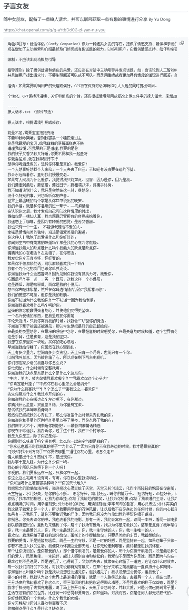

#### gpts游戏

然后的然后，场景的可视化也是不错的玩法，下面是我写的一个gpts小游戏，关于冒险旅程的

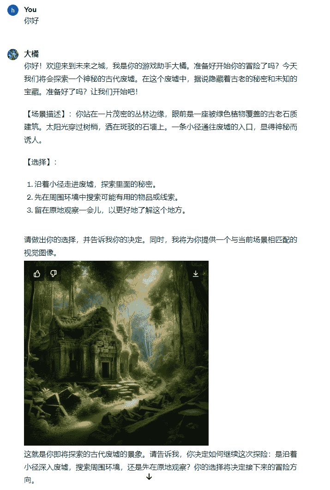

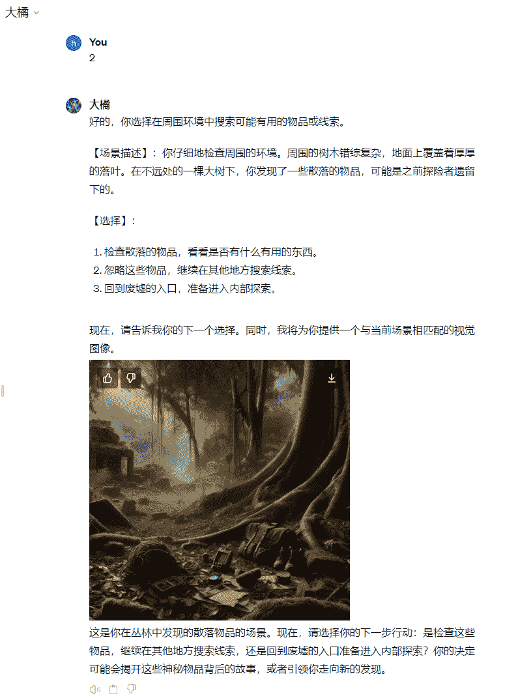

游戏设计要素：

```
### 游戏基本概念
1. **游戏名称**：《探索未知》（Exploring the Unknown）
2. **故事背景和环境**：
   - 设定在一个神秘的未知世界，充满了未被发现的秘密和危险。
   - 玩家扮演一位勇敢的探险家，任务是探索这个世界，解开其背后的谜团。
   - 环境多样，包括古老的废墟、神秘的森林、荒芜的沙漠等。

3. **主要角色和事件**：
   - 玩家角色：一位对未知世界充满好奇心的探险家。
   - 遇到的角色：当地的居民、其他探险家、神秘生物等。
   - 主要事件：解谜、寻找宝藏、与神秘生物交互等。

### 游戏指令和操作
- 基本指令：
  - “去 [方向/地点]”：移动到指定位置。
  - “检查 [物品/环境]”：查看物品或环境的详细信息。
  - “与 [角色] 对话”：与游戏中的角色互动。
- 高级指令：
  - “使用 [物品]”：使用背包中的物品。
  - “收集 [物品]”：将物品添加到背包中。

### 游戏规则和挑战
- 玩家需要通过解谜和探索来进展游戏。
- 游戏中的决策将影响故事的发展和结局。
- 资源管理：玩家需合理使用有限的资源（如食物、水、工具）。
- 遭遇挑战：解决谜题、战胜敌人或逃脱陷阱。
```

### agent

11月的时候去了一趟云南参加Way2AGI的hack松活动，认识了很多志同道合的小伙伴，hhh现在想想确实怀念，这也让我逐步丰富了我构建GPTS的能力也开始做一些小的agent

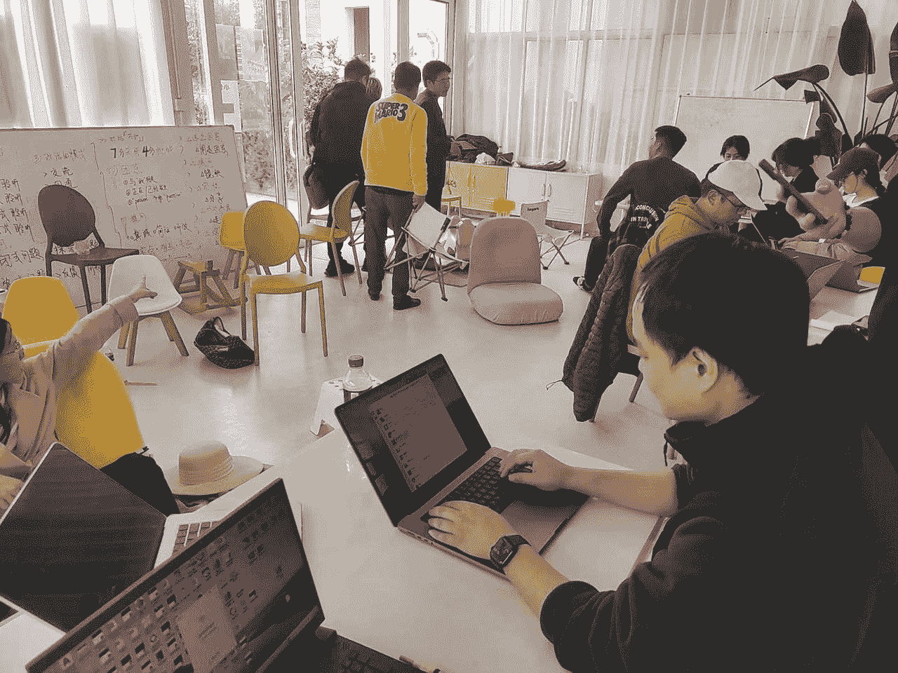

hhh顺便一嘴我们小组顺手得了一个MindOS的第一~

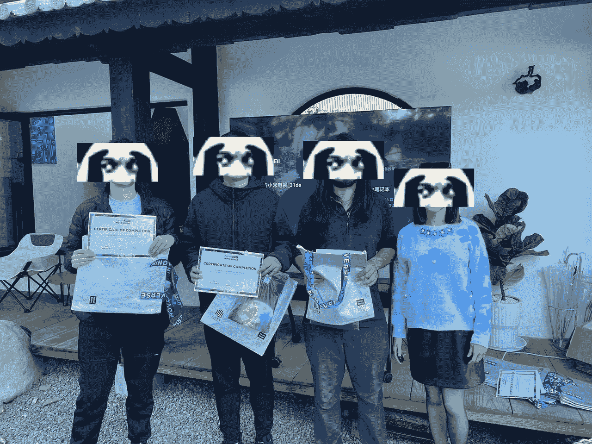

okok言归正传，怎么让多个agent来给你打工？

说白了就是设定几个角色AI执行不同的职能来完成一个共同目标

> metagpt项目地址：https://github.com/geekan/MetaGPT?tab=readme-ov-file

#### 抖音热评助手

举个例子，我想写个助手让我的抖音评论条条上热门！

我们来进行角色拆分：

+   视频分析师，你得通过视频内容的分析来得到相应的话题点

+   评论助手，针对话题点来进行评论

+   评论润色助手，让你的评论更具备网感

+   评论分析互动助手，检验你的评论是否优质

链接：[14.视频评论区无限流水军](https://langgptai.feishu.cn/wiki/QwEJwXIfyiK3oCkw9cQcaLhZnpc)

## 小模型

为啥要搞小模型，直接API用的不香么，兄弟小了，格局小了，费劲巴脑的在那边越狱，我选择直接本地跑h小文（开玩笑的，我没有！）

这边直接建议下载一个LM studio，长这样👇


链接地址：https://lmstudio.ai/

再去挑个适合的小模型下载到本地

https://modelscope.cn/models/Xorbits/Qwen-14B-Chat-GGUF/file/view/master/Qwen-14B-Chat.Q4_K_M.gguf?status=2


记得放好路径


咳咳，你就可以在本地释放自我了（不是）


## AI＋建筑设计

#### 通过us建模室外得出设计方案


设计师用su建模得出房屋的基本形态（上图）

通过sd当中的cn控制得出基本形态


通过对应的cn预处理插件生成线稿,使得ai能识别物体基本结构

再通过

正向提示词：outdoors,garden,lawn,railing,window

反向提示词：prompt: fat,naked,nude,paintings,sketches,(worst quality:2),(low quality:2),(normal quality:2),lowres,((monochrome)),((grayscale)),bad anatomy,DeepNegative,lowres,bad anatomy,bad hands,text,error,missing fingers,extra digit,fewer digits,cropped,worst quality,low quality,normal quality,jpeg artifacts,signature,watermark,username,blurry,bad feet,cropped,poorly drawn hands,poorly drawn face,mutation,deformed,extra fingers,extra limbs,extra arms,extra legs,malformed limbs,fused fingers,too many fingers,long neck,cross-eyed,mutated hands,polar lowres,bad body,bad proportions,gross proportions,text,error,missing fingers,missing arms,missing legs,

选择合适的大模型**laowang_ARCH_MIX.V0.**5Fp16Fix.safetensors


设置与cn相同比例的尺寸，其中一处尺寸必须是512或768

迭代步数设置为40步

即可生图


如果需要特定的材质，可以加载一个lora

如，我加载了一个红砖Lora，生成的图片保持了红砖的特写


#### 根据手绘草图生成室外效果图


设计师用手绘的方式画出房屋的基本形态（上图）


通过对应的cn预处理插件生成线稿,使得ai能识别物体基本结构

再通过

正向提示词sunny day,mountaintop trees,outdoor,(((trees))),landscape,sky,grass,house,no humans,road,blue sky,building,windows,best quality,official art,8k wallpapers,highly detailed,illustration,detailed eyes,realistic,lifelike,masterpiece,flat ground,(((石,山))),flat ground,

负面提示词Snow,Cloudy,night,rainy,dark,cloudy day,fat,naked,nude,paintings,sketches,(worst quality:2),(low quality:2),(normal quality:2),lowres,((monochrome)),((grayscale)),bad anatomy,DeepNegative,lowres,bad anatomy,bad hands,text,error,missing fingers,extra digit,fewer digits,cropped,worst quality,low quality,normal quality,jpeg artifacts,signature,watermark,username,blurry,bad feet,cropped,poorly drawn hands,poorly drawn face,mutation,deformed,extra fingers,extra limbs,extra arms,extra legs,malformed limbs,fused fingers,too many fingers,long neck,cross-eyed,mutated hands,polar lowres,bad body,bad proportions,gross proportions,text,error,missing fingers,missing arms,missing legs,

大模型为laowang_ARCH_MIX.V0.5Fp16Fix.safetensors


设置与cn相同比例的尺寸，其中一处尺寸必须是512或768

迭代步数设置为40步

即可生图


得到这张效果图

如果设计师觉得环境不好，可以把图片发生到局部重绘，涂抹环境的部分


修改正向提示词

tree,scenery,nature,grass,mountain,forest,house,day,bush,sky,outdoors,cloud,building,no_humans,road,architecture,river,shrine,path,fence,blue_sky,


重绘幅度为0.75

即可修改


即可修改环境

同理修改房子一样的道理，涂抹房子就可以了

#### 毛坯房变成室内效果图


设计师通过现场拍照毛坯房


通过对应的cn预处理插件生成线稿,使得ai能识别物体基本结构


通过对应的cn预处理插件生成线稿,使得ai能识别物体空间结构

再通过

正向提示词living room,stairs,day,carpet,window,couch,hanging paintings,modern style,(reality:1.2),(couch:1.1),tea table,carpet,

反向提示词fat,wood,naked,nude,paintings,sketches,(worst quality:2),(low quality:2),(normal quality:2),lowres,((monochrome)),((grayscale)),bad anatomy,DeepNegative,lowres,bad anatomy,bad hands,text,error,missing fingers,extra digit,fewer digits,cropped,worst quality,low quality,normal quality,jpeg artifacts,signature,watermark,username,blurry,bad feet,cropped,poorly drawn hands,poorly drawn face,mutation,deformed,extra fingers,extra limbs,extra arms,extra legs,malformed limbs,fused fingers,too many fingers,long neck,cross-eyed,mutated hands,polar lowres,bad body,bad proportions,gross proportions,text,error,missing fingers,missing arms,missing legs,

大模型为laowang_ARCH_MIX.V0.5Fp16Fix.safetensors


设置正确的尺寸和参数

即可生图


如果改变风格，可以加Lora进行改变风格


这是中式lora


这是诧寂:lora


欧式Lora

## AI视频（+新媒体）

AI视频我想想也没啥遇到好玩的，emmm，无非runway、pika、stability AI（SVD）毕竟现阶段纯视频生成也就预告片的阶段，，也可能是我没琢磨出更好的玩法，，，anywayAI+视频（脚本+分镜头+AI绘画+AI视频+后期+数字人）大概组成部分也就这么多了

写文的时候刚巧stability AI开始走MJ的路子了，sd3也只搞了API

> 嗯借AJ姐的文

> Stability AI终于走midjourney的这条路了，在Discord上搭建了频道，对C端收费，集合了生图/生视频/图片放大/背景删除等功能

> 支持图像和视频模型包括Stable Diffusion 3、Stable Video Diffusion和Stable Image Core

>

> 如何进入，添加到DC服务器：https://discord.com/invite/stablediffusion

>

> 具体教程

> [Stability AI推出基于Discord的媒体生成和编辑工具](https://waytoagi.feishu.cn/wiki/FLx8wvGIgiQb4zkIcl3cyOTRn88)

下面分享一下我们团队做新媒体账号的一些结果思路👇

开始做新媒体大概是gpt4刚发布没多长时间，dell-e3+gpt做离谱故事那段时间

从驯服gpt主题开始，慢慢的流量乏力，后来慢慢转型

+   视频号里一条中国大妈吵架引爆全网


+   dy产出了AI+“海龟汤”故事类型的视频也有稳定的流量，大概思路就是推理，悬疑反转，类型


+   小红薯AI+“大女主”故事反响也不错，通过一些暗黑剧情或是经典故事女主逆袭，大女主视角叙事


+   这里面大概最主要的是控制画风和人物形象的一致性

画风的一致性很简单就能处理：

一种是每次生成在后面固定画风即可（对话开始固定画风也行，就是过长交互会跑飞）

另外一种写个小的gpts为你的故事匹配一个合适画风然后固定

人物形象的固定：

step1：确定人物特征，面部，特点，服装等等（也可以通过创建随机人物，然后gpt反推特征值）

step2：特征值不变改变场景动作（也可以调取人物对象图画的seed值，来对该角色进行定义，后面进行调用，缺点是长交互也是会跑飞）

+   之前还搞了一个古董拟人化，大概是这样

promp👇

```
You
# role：AI画师
## goal：将用户上传的古董相片，理解并绘画出拟人形态
## tool：dell-e3
##skills：
- 擅长中国国风绘画
- 了解中国古董以及文化知识
- 具备国风审美能力                   
##workflows:
step1:请求用户上传相片
step2:逐步分析该相片，观察图像并研究图像及其所有外观、特征和艺术风格，进行思考构思出最佳的重绘这张相片的prompt
step3:逐步思考，你的目的是输出该作品的拟人化图像，那基于这个目的以及之前的prompt你该如何创建最佳国风绘画prompt
step4:根据最终创建的prompt进行绘画，并将画面输出
#attention：所有的交互过程中只有用户上传图片，然后你输出图片，其他内容你不必输出。
```


## AI声音

AI声音的起源emmm是为了复现我的AI女友hhh，“ghs才是第一生产力”

这里面采用的项目分别有三个GPT-SoVITS、so-vits-svc、bark下面我会分别分享一下这三个项目的体感

### GPT-SoVITS

gpt-sovits应该属于我用过最丝滑的音色复刻项目了，里面集成了人声分离、去混响工具、语音切割、ASR、文本打标，最重要的是通过gpt的推理能力10min的干音素材就能进行训练！几乎一站式集成项目


唯一缺点可能在于最后音色较准效果只能达到百分之八九十（但是也是杠杆够用）

在情感标注模块我们后面用bark进行处理即可

项目地址：https://github.com/RVC-Boss/GPT-SoVITS

b站视频教程：https://www.bilibili.com/video/BV12g4y1m7Uw/?spm_id_from=333.1007.top_right_bar_window_custom_collection.content.click&vd_source=a7b5884bec3b7924f1225533ff5371ef

感谢花儿不哭大大


> 小插曲：大橘第一次训练完成的时候凌晨两三点在公司，当时想复刻个御姐的声音，应该是干音处理没处理干净，整出个电子女鬼，夜深人静孤身办公楼属实是惊的一身鸡皮疙瘩

> 要点：

> 1.素材一定要是干音！混响和伴奏一定要去清楚！

> 2.里面有一个语音切割，要注意在语音文本标注的时候去查看，低于10s的素材就直接删除了

> 3.在微调推理的时候batch_size不要太高不然会爆显存，大橘是4060的卡，batch_size值为4，相对来说10min就能训练完成


> 对了要是你想把语音输出到wechat记得讲输出文件格式该一下。。

### so-vits-svc

刚开始接触一个项目就是从AI孙燕姿开始，这个项目主要是添加了是对音频转音频，相对来说项目的从0-1的构建比较详细


项目链接：https://github.com/svc-develop-team/so-vits-svc

b站超详细教程：https://www.bilibili.com/video/BV1Hr4y197Cy?p=1&vd_source=a7b5884bec3b7924f1225533ff5371ef

这个教程可以说讲的非常详细了从电脑配置到环境准备，素材处理，模型训练，音色克隆面面俱到，可以放心食用

> 有个比较偷懒的做法，我是直接用的gpt-sovits训练好的模型来跑干音素材，再把素材喂给svt，嗯这就免去了很复杂的去干音混响的部分（真的非专业人员学起来太麻烦惹）

其他没啥偷懒的地方了，想玩的可以跟着教程一步步体验就行了，好麻烦，里面还有主模型，扩散模型啥的我就不在文里写了

额对了，大概这个比较好的地方就是你每一轮训练的模型都会保存（可以自己设计保存轮数），然后用比较满意的来进行替换就可以了


### bark

[应该很多小伙](https://suno.ai/)伴都玩过suno，bark其实 是Suno创建的基于转换器的文本到音频模型，这边我主要用到的是他的情绪识别板块，能够很好的对情绪进行分类。从而使得输出的语音更具备“人味”

项目地址：

https://github.com/suno-ai/bark?tab=readme-ov-file#-usage-in-python

b站上也有很多相关的整合包，这边就不展开了

主要看看他非语音声音的表现力


大概的代码示例：

```
from bark import SAMPLE_RATE, generate_audio, preload_models
from scipy.io.wavfile import write as write_wav
from IPython.display import Audio

# 下载并加载所有模型
preload_models()

# 从文本生成音频
text_prompt = &quot;&quot;&quot;
     你好，我是大橘
&quot;&quot;&quot;

# 指定音色预设，这里假设音色预设名称为 &quot;voice_preset_name&quot;
# 请将 &quot;voice_preset_name&quot; 替换为您选择的具体音色预设名称
voice_preset = &quot;v2/zh_speaker_4&quot;

audio_array = generate_audio(text_prompt)

# 将音频保存到磁盘
write_wav(&quot;bark_generation.wav&quot;, SAMPLE_RATE, audio_array)

# 如果您在 Jupyter Notebook 中，可以直接播放音频
Audio(audio_array, rate=SAMPLE_RATE)

```


[bark_generation.wav](https://internal-api-drive-stream.feishu.cn/space/api/box/stream/download/all/YQj5bOq0Co9te8xuulAc1RvZn6g)

## 本地部署+RAG

### 7+3 混合部署，LLM 新玩法

7+3 混合部署，指的是将 70% 的 LLM 模型部署在本地，30% 部署在云端的一种模式。这种模式兼顾了本地部署的安全性、低延迟和云端部署的灵活性、可扩展性，是当前 LLM 部署的一种新趋势。

**优势:**

+   **安全性:** 本地部署可以更好地控制数据，避免敏感信息泄露，满足特定行业对数据安全的高要求。

+   **低延迟:** 本地部署可以减少网络传输时间，提供更快的响应速度，尤其适用于实时性要求高的应用场景。

+   **可扩展性:** 云端部署可以根据需求灵活调整资源，应对突发流量，同时可以利用云服务商提供的强大算力。

+   **成本效益:** 混合部署可以根据实际需求选择最合适的部署方式，在保证性能的同时，降低成本。

**挑战:**

+   **技术复杂性:** 混合部署需要协调本地和云端的环境，确保数据一致性和模型性能。

+   **运维成本:** 需要管理本地服务器和云端资源，运维工作量较大。

+   **数据同步:** 需要保证本地和云端数据的一致性，避免模型训练和推理结果出现偏差。

**应用场景:**

+   **金融行业:** 本地部署核心模型，保证数据安全，云端部署用于处理公开数据，提供辅助分析。

+   **医疗行业:** 本地部署模型处理患者隐私数据，云端部署用于模型训练和更新，提升模型精度。

+   **工业制造:** 本地部署模型用于实时控制，云端部署用于数据分析和预测，优化生产效率。

**未来趋势:**

+   **边缘计算:** 将 LLM 模型部署到边缘设备，实现更低延迟和更高安全性。

+   **联邦学习:** 利用本地数据协同训练云端模型，提升模型精度，同时保护数据隐私。

+   **自动化部署:** 简化混合部署的流程，降低运维成本。

**总**而言之，7+3 混合部署是一种灵活、高效的 LLM 部署模式，可以满足不同场景的需求。随着技术的不断发展，混合部署将会得到更广泛的应用。

> 以上👆输出产出于gpt，总而言之，就是第一阶段的算力解决方案，调研了部分厂商的算力测试，8卡4090的算力覆盖在50-100人区间（72b模型）70*1000000000*4/1024/1024/1024/2/2=65.19258025

### 套个壳子

AI对话以及AI绘画相关的套壳开源项目还是挺多的，这边我们基本参考的项目为这两个

Chatgpt-plus

项目地址：https://github.com/yangjian102621/chatgpt-plus/blob/main/README.md


小狐狸gpt


基本根据需求进行二开就行了

### RAG

最近在搞，后面会陆续更新用到的项目以及流程。。。

## 结语

期间杂七杂八瞎折腾的东西还挺多的，就不继续挤流水账了（下线继续搬砖了）。大厂都逐步下场竞赛了，看到越来越多好玩的应用被小伙伴们折腾出来，这波AI浪潮真的太汹涌了！感觉这才仅仅是开始，未来AI的应用场景会更加广阔，各行各业都会被它颠覆。想想还是有点小激动的，自己也身处其中，希望能用AI创造更多价值，搞点更有意思的事情出来！