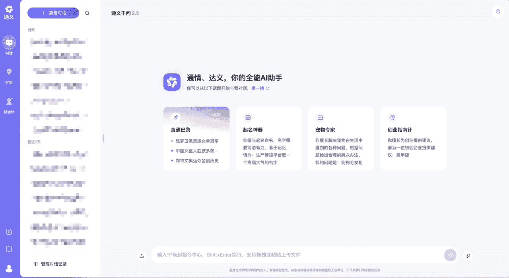

# 阿里通义结构化提示词

> 来源：[https://langgptai.feishu.cn/docx/WsoLdsNcGoKexcxpgGicRlbTn6O](https://langgptai.feishu.cn/docx/WsoLdsNcGoKexcxpgGicRlbTn6O)

# 通义千问——通情达意的全能 AI 助手

有过大模型落地应用经验的一定都知道，通义千问系列模型的能力有多能打~ 私有化部署扛把子一哥！

+   https://tongyi.aliyun.com/qianwen

通义千问系列模型综合能力非常优秀，对结构化提示词支持程度也很好，这也是江树日常使用最多的模型之一。

本页面用于收录 阿里通义千问 x LangGPT 系列专属高质量结构化提示词，提示词、思路拆解、应用效果等。

**你们想知道的关于阿里通义千问 x** LangGPT 的结构化提示词的一切~