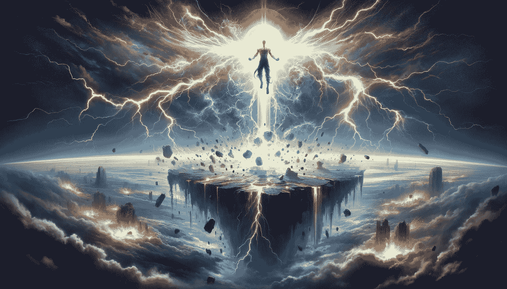

# 神帝觉醒：天岛陨落

> 来源：[https://langgptai.feishu.cn/docx/YsY9dJkoeod9WuxnWPOcyHISnOc](https://langgptai.feishu.cn/docx/YsY9dJkoeod9WuxnWPOcyHISnOc)



```
On the foundation of the previously described scene of a floating island plummeting towards the earth amidst a tumultuous sky with lightning, add a figure of a person breaking through to the God Emperor realm. This individual stands heroically on the island, amidst the chaos of its descent, energy radiating from them in powerful waves. Their breakthrough emits an overwhelming aura, contrasting sharply with the surrounding devastation. Lightning arcs towards them, as if drawn by their newfound power, illuminating their form in a spectacle of light and energy. This moment captures the pinnacle of achievement and power, set against a backdrop of apocalyptic destruction, emphasizing the contrast between human perseverance and natural calamity. The art style is epic and dynamic, focusing on the dramatic interplay of light and shadow to highlight the figure&#x27;s monumental achievement.
```