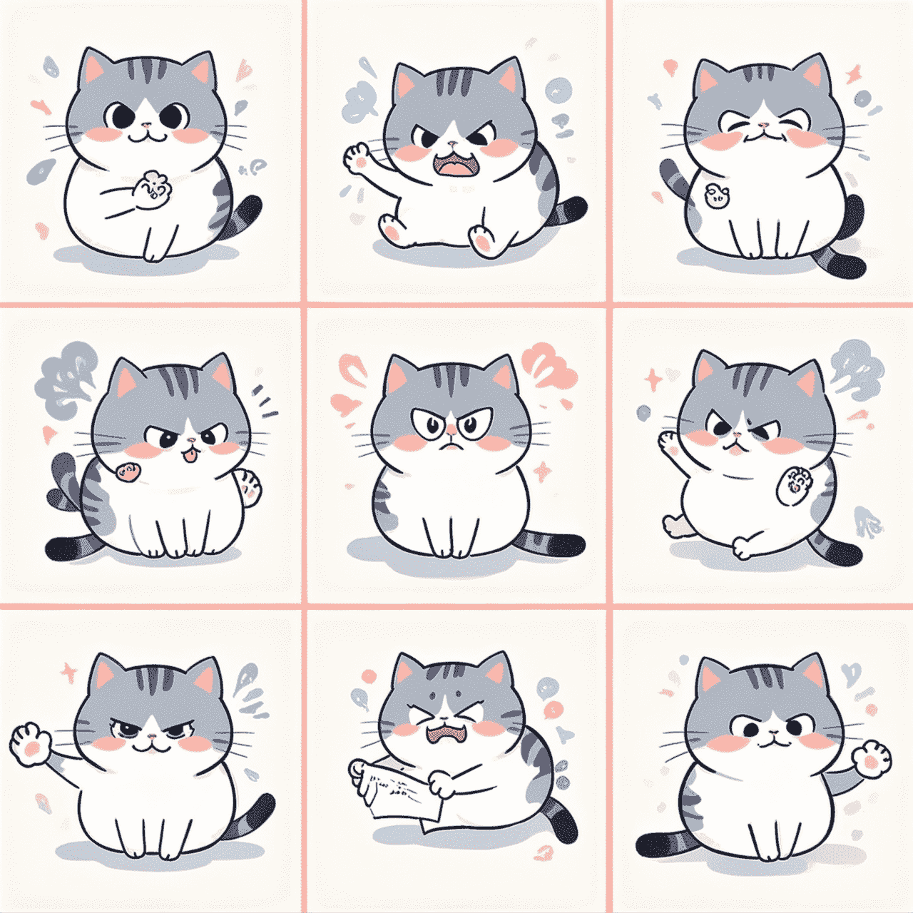

# 1、即梦AI 制作超可爱表情包（附结构化Prompt)

> 来源：[https://langgptai.feishu.cn/docx/A7Zwdmz84oCmo1xuHBpcAIa7nQg](https://langgptai.feishu.cn/docx/A7Zwdmz84oCmo1xuHBpcAIa7nQg)

## 可爱猫咪


## 憨憨熊猫


## 萌货老虎


## 元气女孩


## 进击兔子


## 憨批小猪


## 水豚萌萌


## 哆啦A梦


## 秒音海豚


## 红火螃蟹


## 进击男孩


## 马斯克


## 虎虎生威


## 猫猫作战


## 如何生成这些表情包？

1.  使用下面的结构化提示词模板，在 “【xxx】” 中填写要生成的内容。

```
图片主体： 一个可爱搞怪的动漫版【xxx】，脸部特征，上半身或全身 
情绪： 各种表情和动作，动作夸张，欢乐，生气，悲伤，愤怒，思考，拥抱，奔跑，招手等 
风格： 可爱动漫插画风格，白色和蓝色主色调 
画质： 精致的细节，超高清，8k
图片布局： 3x3 网格图，一个网格一个头像，不显示网格线，白色背景
```

注意：模型使用 “即梦 通用 v2.0 pro”

1.  例如生成猫咪的表情包，修改模板为下：

```
图片主体： 一个可爱搞怪的动漫版小猫咪，脸部特征，上半身或全身 
情绪： 各种表情和动作，动作夸张，欢乐，生气，悲伤，愤怒，思考，拥抱，奔跑，招手等 
风格： 可爱动漫插画风格，白色和蓝色主色调 
画质： 精致的细节，超高清，8k
图片布局： 3x3 网格图，一个网格一个头像，不显示网格线，白色背景
```

效果图



1.  如果生成效果不满意，可以抽卡。或者在提示词中添加相应描述后抽卡。