# 2、如何用AI描绘自己的武侠江湖梦（附结构化prompt）

> 来源：[https://langgptai.feishu.cn/docx/FGr2dHXx4oJQgHxBaZNcqemTnhf](https://langgptai.feishu.cn/docx/FGr2dHXx4oJQgHxBaZNcqemTnhf)

"仗剑走天涯"、"快意恩仇"、"笑傲江湖"......

谁没幻想过自己是个风华绝代的少年侠客？谁没憧憬过那至死不渝的江湖恋歌？如今，借助AI，我们终于有机会将这个梦想付诸现实，创作出自己的武侠故事。

老规矩，先看效果~

## 《墨竹问道：熊猫大侠的江湖传奇》

山雾缭绕间，年轻的熊猫侠客墨竹立于崖边。斗笠遮颜，利剑伴身，蓄势待发。远处人间烟火，近处青竹婆娑，墨竹深吸一口气，迈出了探索世界的第一步。

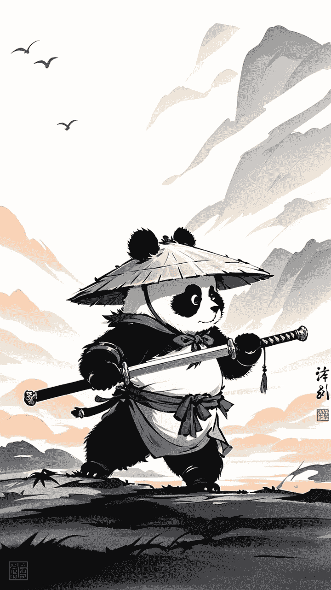

墨竹的足迹如泼墨般洒落山川大地。峭壁如刀，他攀之若履平地；江河似墨，他渡之若凌波微步。每一程山水，都在他心中留下难以磨灭的印记。

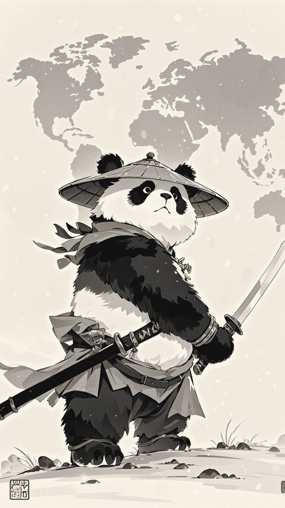

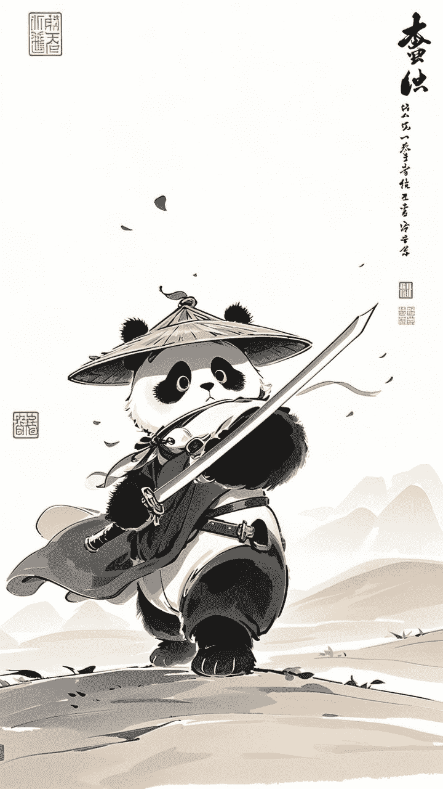

他在晨曦中练拳，在月光下舞剑。山间的清风成了他的陪练，溪水的潺潺是他的配乐。

他的剑法如行云流水，每一招一式都宛如丹青泼洒。

暮色四合，他的剑影与星光交织，在夜空中勾勒出美丽的弧线。

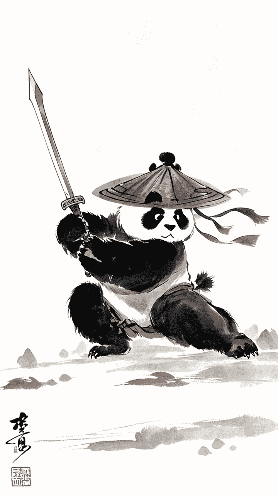

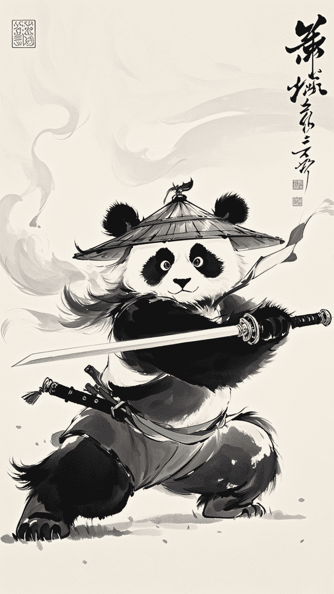

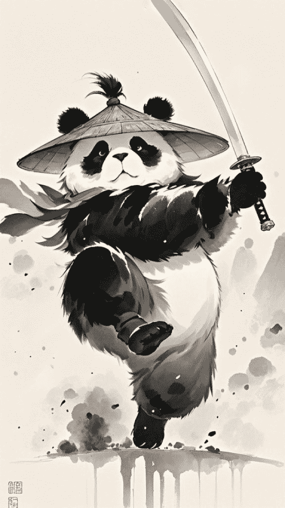

在一个落英缤纷的春日，墨竹邂逅了同样游历江湖的女侠雪梅。两人一见如故，意气相投。从此，墨竹与雪梅结伴同行，他们的身影在江湖中形成一幅动人的双熊图。

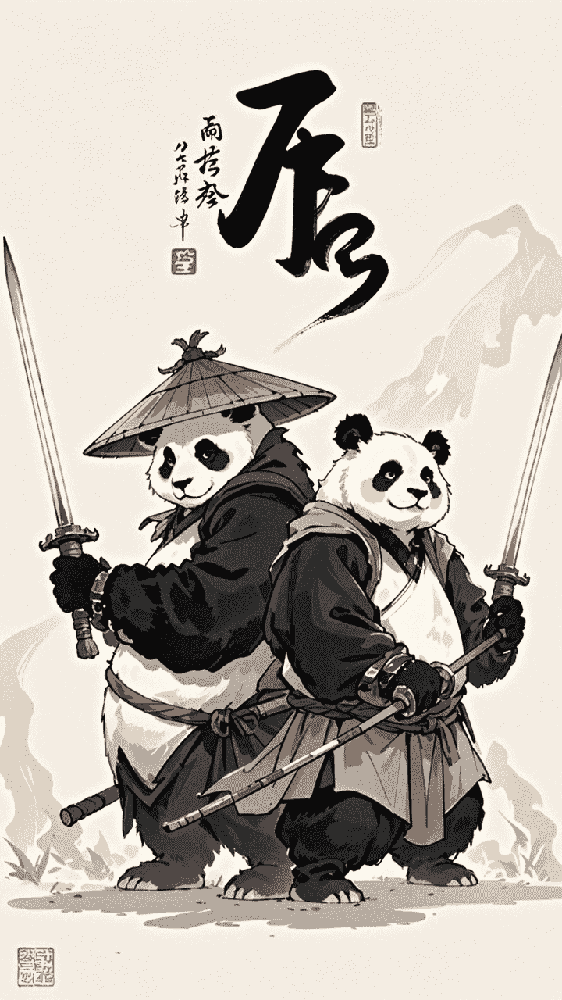

他们在溪边分享鲜嫩的竹笋，在月下对饮清酒。即便身处险境，只要彼此在侧，便如同回到无忧无虑的童年。

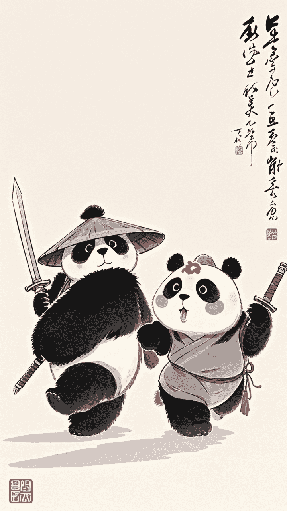

然而，这幅美好的画卷却被人类的恐惧和偏见涂抹。墨竹和雪梅被视为不祥之兆，遭到围剿。

在一个风雨如晦的夜晚，无数利剑包围了他们。刀光剑影中，墨竹和雪梅失散了。

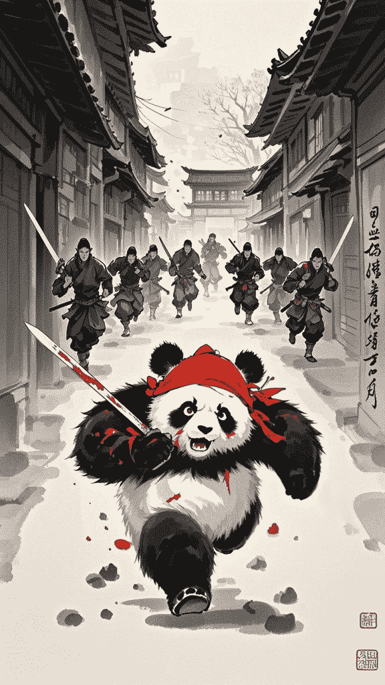

当墨竹找到雪梅时，她已经倒在一片血泊之中。墨竹将她抱在怀里，泪水如断了线的珍珠。

雪梅最后的笑容，如凋零的梅花，永远定格在墨竹的心底。

悲痛欲绝的墨竹，在心中立下血誓。

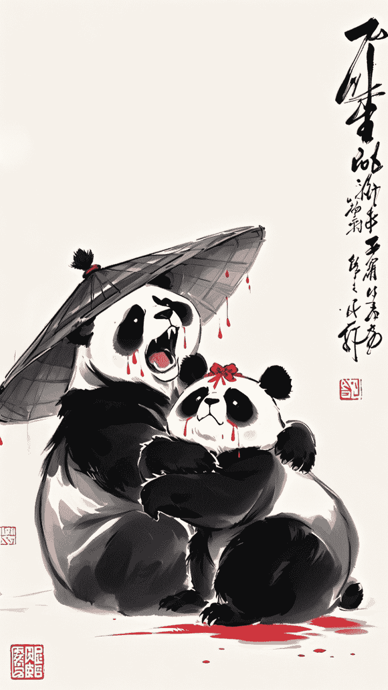

复仇！他的身影在群敌中穿梭，剑气如墨，染黑了整个夜空。

雷电为他的怒吼伴奏，暴雨为他的悲伤哭泣。

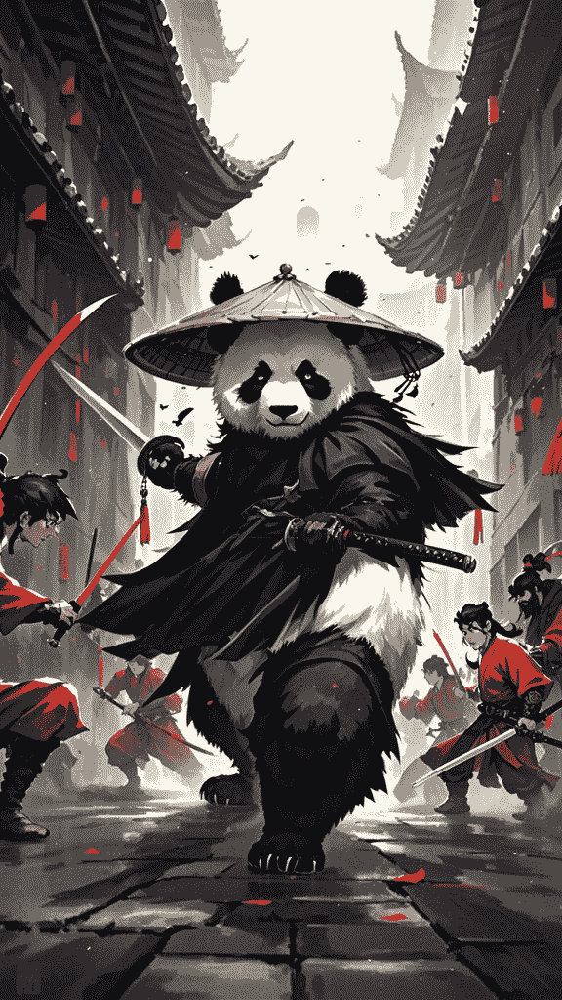

他的剑如泼墨挥毫，每一击都蕴含着对雪梅的思念。

最终，仇敌倒下，墨竹完成了他的血色复仇。然而，胜利的喜悦却如一缕轻烟，很快消散在风中。

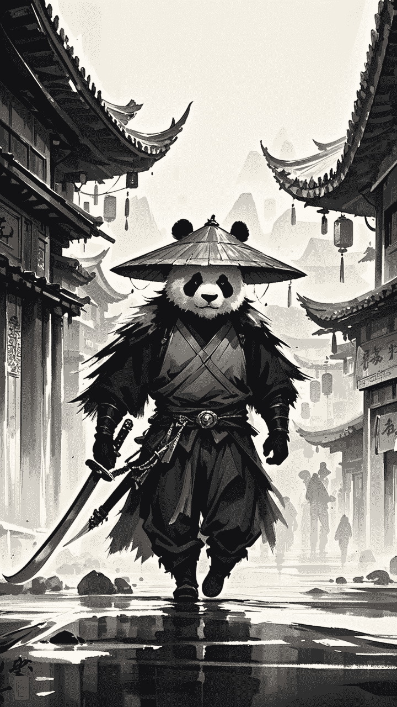

当一切尘埃落定，墨竹站在满目疮痍的战场中央，感到一阵前所未有的空虚。

他望向远方，那里有他和雪梅曾经描绘的美好蓝图。

墨竹轻叹一声，擦拭干净剑刃，决定就此归隐山林。他明白，这是雪梅会希望他走的道路。

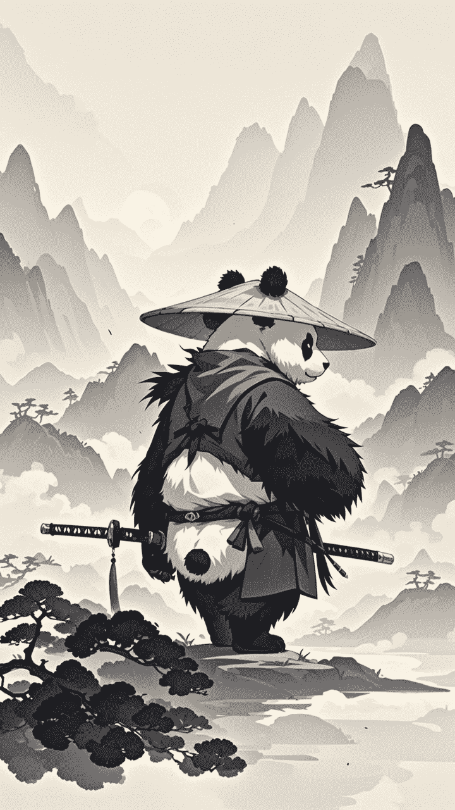

图：即梦AI

文： Claude

### 图片生成提示词模板：

在【】中添加人物或场景、动作描写

```
图片主体：一个仗剑走天涯的侠客大熊猫，脸部特征，上半身或全身，戴斗笠的大侠形象，【可爱】
情绪和动作：手握一把宝剑，【落凤斩：出手的时候有一个侧半身的回旋。】
风格：水墨风，大写意，留白，极简风格，白色和黑色主色调
画质：大师级杰作，精致的细节，超高清，8k
图片布局：主体居中，纯白色背景
```

模型： 即梦AI 图片 2.0 Pro