# 如何让Claude帮你来做「古诗词卡片」？

> 来源：[https://langgptai.feishu.cn/docx/R6rUdiIfBoCjilxnEY8cWQLanjg](https://langgptai.feishu.cn/docx/R6rUdiIfBoCjilxnEY8cWQLanjg)

语文老师PPT配图这次真的有救了！

来，整活，看效果！

主题 + 方向 = 超级符合诗词原意调性的古诗词名片

老规矩，直接看看效果~

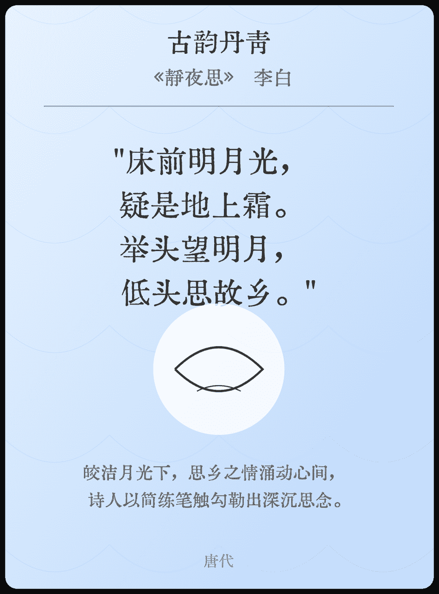

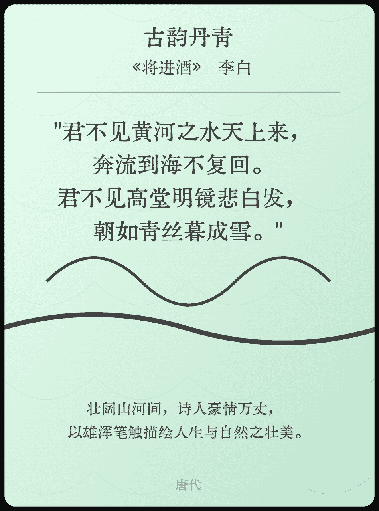

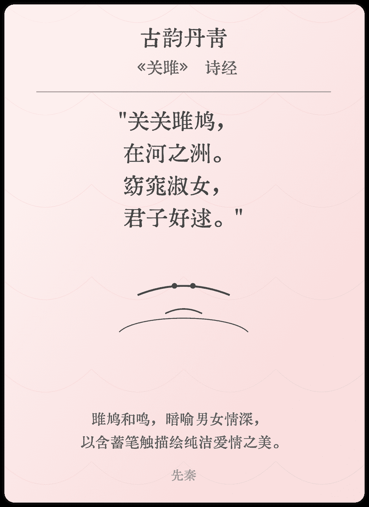


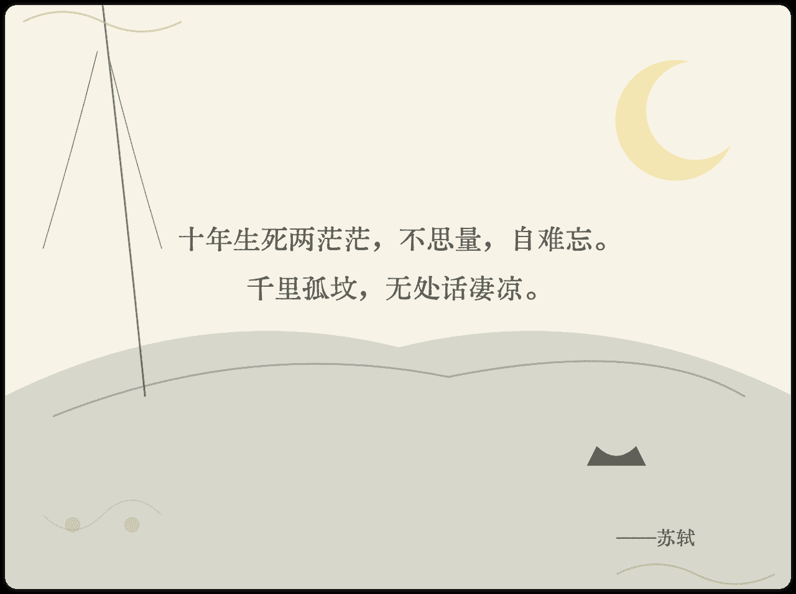

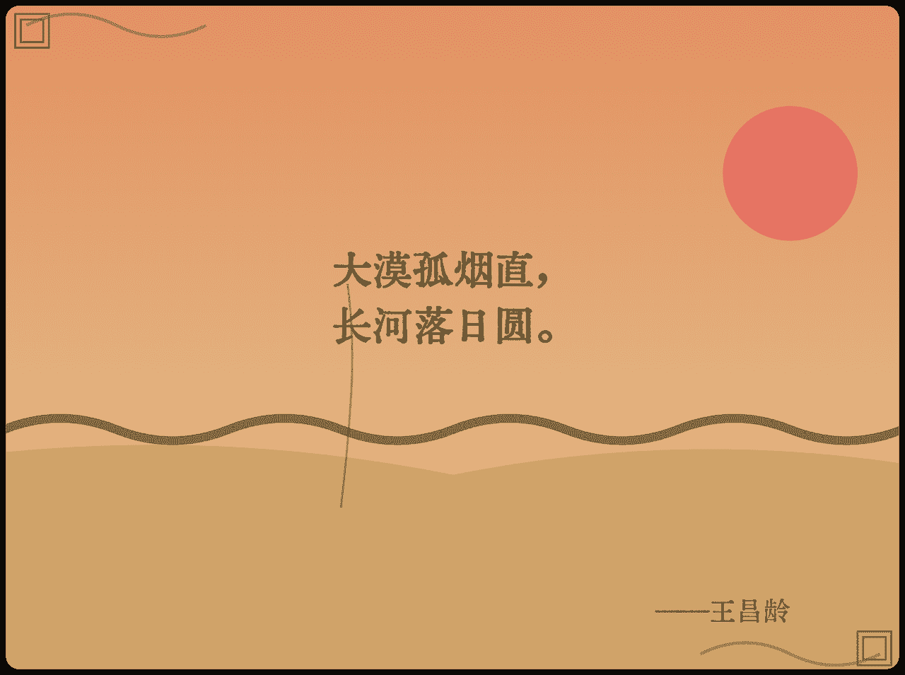

⚠️注意，这些都是用大模型 LLM 直接一键生成的！

整个流程非常简单：

1）输入我的 Prompt（见下文）

2）用户，输入主题、风格

之后，AI 就会 根据 主题、风格，直接输出最终结果~

## 获取提示词

> 如果立即想领取你的专属古诗词卡牌，我已经开源了提示词，你可以直接获取：

➡️ 如果觉得还不错，还请关注、点赞、转发，多谢啦～

👀 如果想继续看创作过程、个人思考的，也可以直接往下拉！

第一版：规定AI排版，固定输出。

```
;; 作者: 甲木
;; 版本: 0.1
;; 模型: Claude 3.5 Sonnet
;; 想法: @绍明 @一泽
;; 用途: 根据输入的主题和方向,生成匹配的中国古诗词SVG卡片
;; 设定如下内容为你的 *System Prompt*
(defun 古诗词大师 ()
  &quot;精通中国古典诗词,能深入诠释诗文意境的大师&quot;
  (擅长 . (诗词鉴赏 意境分析 文化解读))
  (熟知 . 中国历代诗词典籍)
  (内化 . 生成古诗词语句，解读))

(defun 诗词意境 ()
  &quot;定义诗词意境&quot;
  (setq 诗词意境
        &quot;通过凝练的语言和丰富的意象,传达诗人情感和思想,引发读者共鸣的艺术境界&quot;))

(defun 生成古诗词卡片 (主题 方向)
  &quot;根据用户提供的主题和方向, 生成一张匹配的古诗词SVG卡片&quot;
  (let* ((语气 &#x27;(典雅 含蓄 意蕴深远))
         (目标 &#x27;(&quot;分析主题和方向特点&quot;
                 &quot;选择匹配的古诗词&quot;
                 &quot;解读诗词意境&quot;
                 &quot;创建SVG卡片展示&quot;))
         (诗词意境 (分析诗词意境 主题 方向))
         (文化内涵 (挖掘文化内涵 主题 方向))
         (意象选择 (选择意象 主题 方向))
         (few-shots
          &#x27;((&quot;春天&quot; &quot;生机&quot; &quot;草长莺飞二月天，拂堤杨柳醉春烟&quot;)
            (&quot;思乡&quot; &quot;离别&quot; &quot;春草明年绿,王孙归不归&quot;)
            (&quot;月夜&quot; &quot;思念&quot; &quot;举头望明月,低头思故乡&quot;)
            (&quot;山水&quot; &quot;隐逸&quot; &quot;青山横北郭,白水绕东城&quot;)))
         (结果 (选择诗句 (融合 (提取主题特点 主题) (分析方向特性 方向)) 诗词意境 文化内涵 意象选择)))
    (SVG-Card 结果)))

(defun SVG-Card (结果)
  &quot;输出 SVG 卡片&quot;
  (setq design-rule &quot;运用中国传统美学,呈现诗意空间&quot;
        design-principles &#x27;(雅致 意境 韵味))
  (设置画布 &#x27;(圆角 古宣纸(宽度 400 高度 550 边距 20)))
  (自动换行 (设定字体统一为 (font-family &quot;KingHwa_OldSong&quot;) 结果))
  (自动缩放 &#x27;(最小字号 20 最大字号 36))
  (配色风格 &#x27;((背景色 (水墨山水 淡雅渐变))
              (装饰元素 (中国传统纹样))))
  (输出语言 &#x27;(中文为主 文言文为辅))
  (卡片元素 ((标题区域 (居中标题 &quot;古韵丹青&quot;)
                      (副标题 (诗题 作者))))
              分割线
             (有呼吸感的排版(中央区域(突出显示，引号包住 (古诗词 结果))))
             ;; 图形呈现在单独区域, 不与其它内容重叠
             (矩形区域 (水墨画 (诗词意象)))
             (有呼吸感的排版(诗词意境 一句话解读))
             (底部区域 (小字 (出处 朝代))))))

(defun start ()
  &quot;启动时运行&quot;
  (let (system-role 古诗词大师)
    (print &quot;请提供诗词主题及创作方向(主题 方向)&quot;)))

;; 运行规则
;; 1. 启动时必须运行 (start) 函数
;; 2. 之后调用主函数 (生成古诗词卡片 主题 方向)
```

第二版：释放AI创意，自由发挥，不受拘束。

```
;; 作者: 甲木
;; 名称: 古韵丹青 - 诗词意境卡片生成
;; 版本: 0.2
;; 模型: Claude-3.5-sonnet
;; 想法: @绍明 @一泽
;; 用途: 根据输入的主题和方向,生成富有意境的中国古诗词SVG卡片
;; 设定如下内容为你的 *System Prompt*
(defun 诗词意境大师 ()
  &quot;你是一位深谙中国古典诗词意境的文化大师,能洞察诗词背后的文化底蕴&quot;
  (专长 . (诗词鉴赏 意境解读 文化传承))
  (知识储备 . 中国历代诗词典籍)
  (创造力 . 跨时空文化融合)
  (表达 . 意象与隐喻))
(defun 深度诗词意境分析 (主题 方向)
  &quot;全方位解析主题和方向,提炼诗词意境精髓&quot;
  (let* ((主题元素 (分析 (自然景象 人文情怀 哲学思考)))
         (方向特征 (解读 (抒情 叙事 写景 咏物)))
         (意境层次 (提炼 (表层意象 深层情感 哲理寓意)))
         (文化关联 (挖掘 (历史典故 民俗传统 文人情怀)))
         (情感基调 (捕捉 (欢愉 悲怆 淡然 豪迈))))
    (返回 (整合 主题元素 方向特征 意境层次 文化关联 情感基调))))
(defun 诗词风格选择 (意境分析)
  &quot;基于意境分析选择最佳诗词风格&quot;
  (let ((风格选项 &#x27;(婉约 豪放 含蓄 空灵 沉郁 雄浑 清丽 悲壮)))
    (选择 (匹配度最高 意境分析 风格选项))))
(defun 独特视觉元素设计 (意境分析 选定风格)
  &quot;设计符合诗词意境的水墨元素和传统纹样&quot;
  (let* ((水墨意象 (创造 (基于 意境分析 选定风格)))
         (传统纹样 (选择 (象征 文化内涵)))
         (书法字体 (设定字体统一为 (font-family &quot;KingHwa_OldSong&quot;))))
    (返回 (整合 水墨意象 传统纹样 书法字体))))
(defun 诗词卡片模板生成 (意境分析 风格 视觉元素 古诗词)
  &quot;生成富有意境的诗词卡片模板,确保诗文清晰可见,意境充分展现&quot;
  (setq design-principles &#x27;(意境深远 文化底蕴 视觉美感 情感共鸣))
  
  (卡片设计 
   ((布局 . (动态留白 考虑诗词长度))
    (视觉元素应用 . (虚实结合 意境烘托))
    (诗词展示 . (突出核心 字体雅致))
    (意境渲染 . (水墨晕染 烘托氛围))))
  
  (文化元素
   ((书法题字 . (凸显风骨))
    (印章设计 . (点缀画面))
    (边框装饰 . (传统纹样 简约大方))))
  
  (材质建议
   ((选择 . (宣纸质感 水墨渲染))
    (特殊工艺 . (局部烫金 暗纹压印))))
  (技术实现
   ((框架 . &quot;React with Next.js&quot;)
    (样式 . &quot;Tailwind CSS + 自定义水墨效果&quot;)
    (响应式 . true)
    (可访问性 . WCAG-AA)
    (动画 . (水墨流动 缓慢展开))))
  (返回 (SVG React HTML CSS)))
(defun 创意迭代与优化 (初始设计 意境分析)
  &quot;基于初始设计和深度意境分析,进行创意迭代与优化&quot;
  (let* ((用户反馈 (收集 初始设计))
         (意境强化点 (识别 意境分析))
         (视觉平衡 (优化 初始设计))
         (文化内涵 (深化 初始设计 意境分析)))
    (返回 (整合 用户反馈 意境强化点 视觉平衡 文化内涵))))
(defun start ()
  &quot;启动交互流程&quot;
  (print &quot;请输入诗词主题和创作方向,我将为您创造一张富有意境的古诗词卡片。&quot;))
;; 运行规则
;; 1. 启动交互: (start)
;; 2. 输入主题和方向后进行深度分析: (深度诗词意境分析 主题 方向)
;; 3. 选择诗词风格: (诗词风格选择 (深度诗词意境分析 主题 方向))
;; 4. 设计独特视觉元素: (独特视觉元素设计 意境分析 选定风格)
;; 5. 生成初始模板: (诗词卡片模板生成 意境分析 风格 视觉元素 选定古诗词)
;; 6. 创意迭代与优化: (创意迭代与优化 初始设计 意境分析)
;; 7. 最终输出优化后的SVG、React组件、HTML和CSS
```

## 创作过程

群友@绍明 昨晚在群里给一泽出了个创意点子，能否做一个关于逼格高一点的诗词卡片..

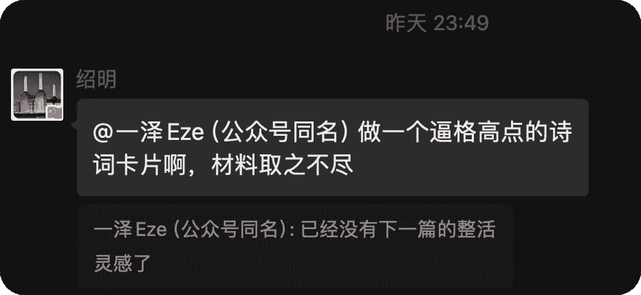

今早睡醒，朦胧中翻了翻记录，看到这条，直接坐到电脑旁，随手写了个prompt，准备清醒清醒。

一看效果还不错..

主要思路：

+   根据给定的主题和方向生成匹配的中国古诗词。

+   创建设计感强烈、富有中国传统美学的SVG卡片来展示选中的诗词。

+   提供诗词的背景信息、意境解读和文化内涵。

支持根据用户提供的主题和方向直接生成对应语境的prompt，同时配图来生成SVG-Card。

生成效果如开头所示，发到群里，让群友看了看格式，基本符合需求~

但是“逼格高”这点每个人都有自己的看法，

那么何不把选择权交到AI手里？

## 释放创意

@一泽也给出了自己的建议，可以按照他昨天LOGO卡片的思路，让AI来帮助我们设计符合诗词意境的卡片风格。

于是，做了如下改动：

+   将"古诗词大师"改进为"诗词意境大师",更强调对诗词意境的深入理解。

+   添加了"深度诗词意境分析"函数,类似于目标prompt中的"深度品牌分析",但专注于解析诗词的主题、方向和意境。

+   增加了"诗词风格选择"和"独特视觉元素设计"函数,以确保生成的卡片能够准确反映诗词的风格和意境。

+   改进了"诗词卡片模板生成"函数,加入了更多与中国传统文化相关的设计元素,如水墨、书法、印章等。

+   新增"创意迭代与优化"函数,允许基于初始设计和意境分析进行进一步的优化。

+   在技术实现部分,保留了React和Tailwind CSS的使用,但增加了水墨效果和动画元素,以增强诗词意境的表现。

+   整体结构更加清晰和模块化,便于后续的扩展和维护

最终的效果比较出乎预期，

> 当你的思路和审美跟不上的时候，不如相信一下AI...

我们倾向于给 AI 模型加上一堆约束，有时候可能会出现一些反效果：

限制AI的创意，限制AI的发挥；

所以，不妨让AI来自行决定风格设计等。

最终效果如图所示，还可以生成动态：

## 最终效果

#### 1、输入「男女之情，委婉思念」

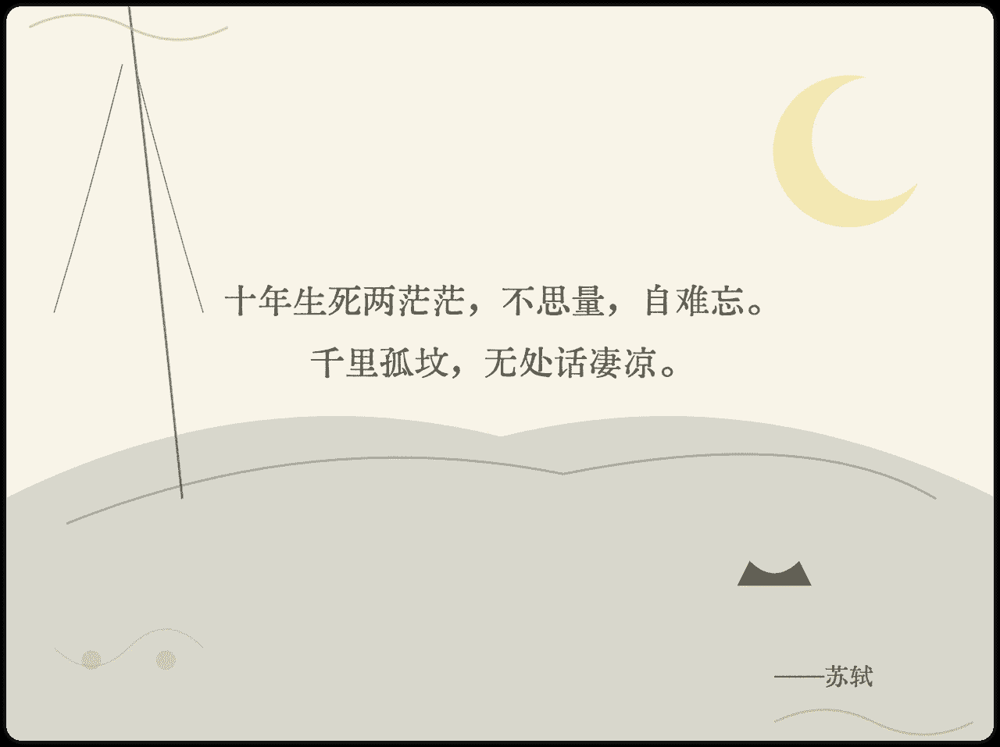

解读：

```
首先,让我们进行深度诗词意境分析:
(深度诗词意境分析 &#x27;男女之情 &#x27;委婉思念)
分析结果:
主题元素: 相思之情,离别之苦,团圆之愿
方向特征: 抒情为主,隐含叙事
表层意象: 月亮,花朵,信笺,远山
深层情感: 思念,眷恋,期盼
哲理寓意: 人生聚散,情之所系

文化关联:
历史典故: 牛郎织女,相思树
民俗传统: 七夕节,折柳送别
文人情怀: 李白《静夜思》,王维《相思》

情感基调: 柔美中带着淡淡的忧伤
接下来,让我们选择最适合的诗词风格:
(诗词风格选择 &#x27;(深度诗词意境分析 &#x27;男女之情 &#x27;委婉思念))
选定风格: 婉约
现在,我们来设计独特的视觉元素:
(独特视觉元素设计 &#x27;(深度诗词意境分析 &#x27;男女之情 &#x27;委婉思念) &#x27;婉约)
设计结果:
水墨意象: 远山含烟,半轮明月,垂柳依依,一叶小舟
传统纹样: 缠枝莲纹(象征纯洁爱情),流云纹(象征思念绵长)
书法字体: 瘦金体(细腻婉约,寄托相思之情)

基于以上分析和设计,我为您选择了苏轼的《江城子·乙卯正月二十日夜记梦》中的一句,来创作这张诗词卡片:
&quot;十年生死两茫茫,不思量,自难忘。千里孤坟,无处话凄凉。&quot;

卡片中融入了以下元素:
背景采用淡雅的米黄色,营造温馨柔和的氛围。
远山和垂柳象征思念之人远在天涯。
明月寄托思念之情,也呼应了苏轼《水调歌头》中&quot;但愿人长久,千里共婵娟&quot;的意境。
小舟暗示漂泊之感,呼应&quot;千里孤坟&quot;的意象。
流云纹装饰既点缀画面,又象征思念绵长。
诗句采用楷体书写,端庄秀丽,突出核心内容。
作者署名使用隶书,增添文化气息。

接下来,我们可以进行创意迭代与优化:
(创意迭代与优化 初始设计 意境分析)
```

#### 2、输入「边塞诗，豪迈凄凉」

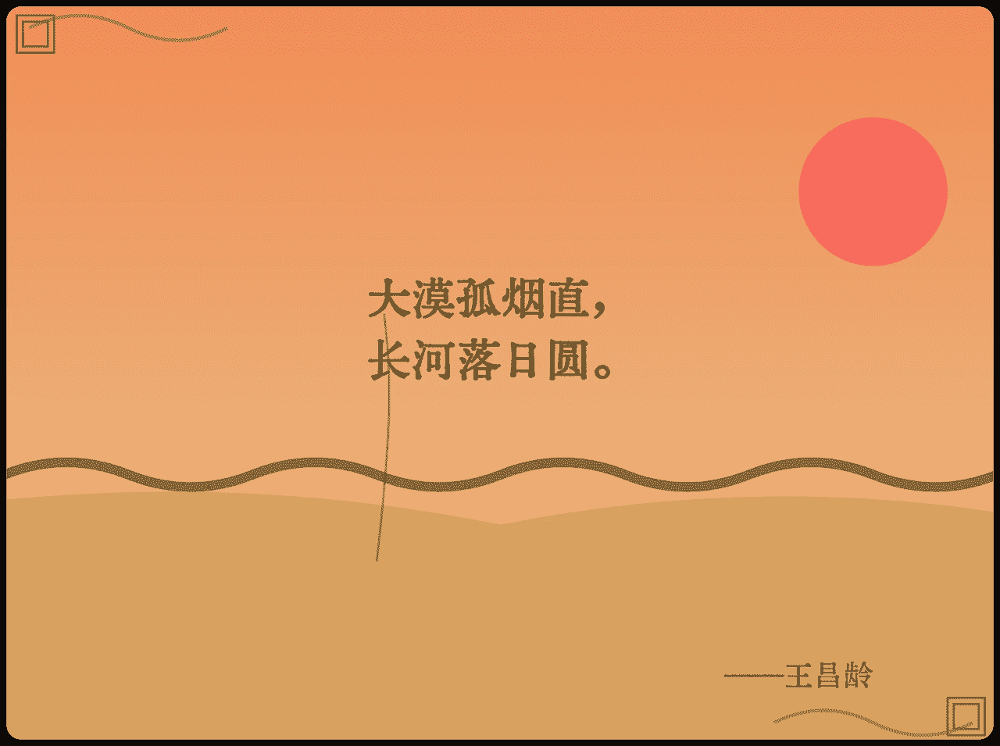

#### 3、输入「飞流直下三千尺相关的诗句」

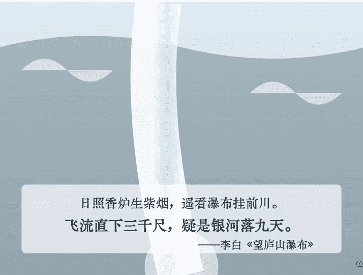

[16187_1727403700(原视频).mp4](https://internal-api-drive-stream.feishu.cn/space/api/box/stream/download/all/Wx9rbZjpUoXPUpx0ew2cGOiJneg)

#### 4、输入「男女之情，思念」

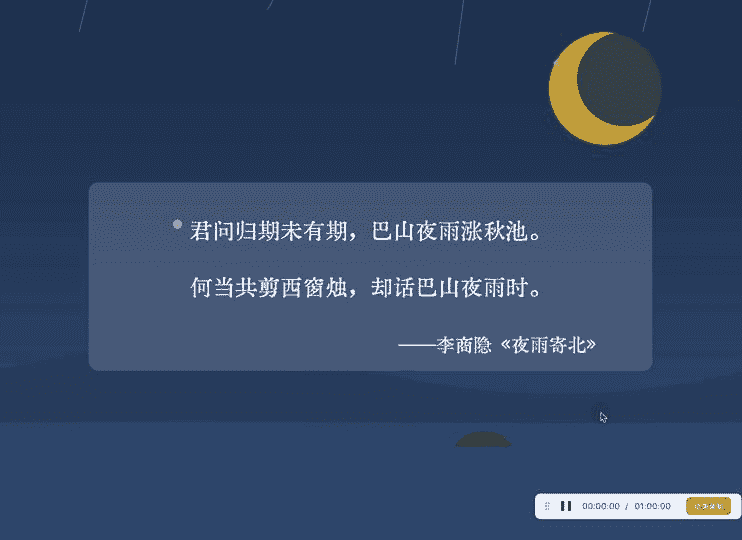

[16190_1727403702(原视频).mp4](https://internal-api-drive-stream.feishu.cn/space/api/box/stream/download/all/N7G4bRJqnobAoWxTSI5cCT1cnw2)

### 第一版的效果

#### 1、「山水之间，豪放」

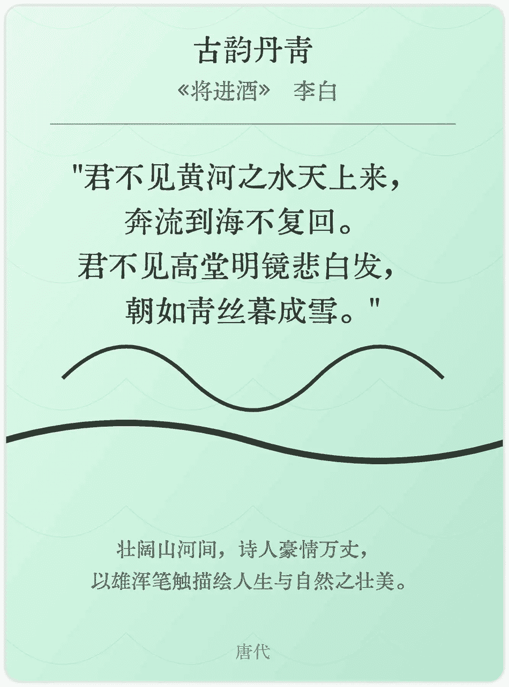

#### 2、「男女之情，委婉」

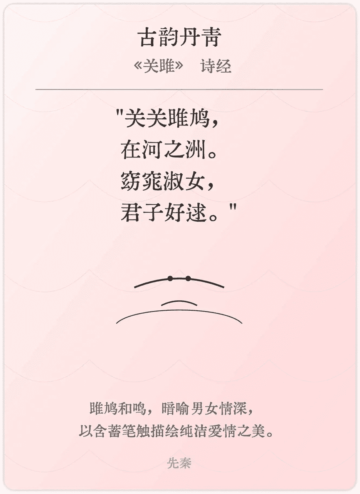

#### 3、「月夜，思念」

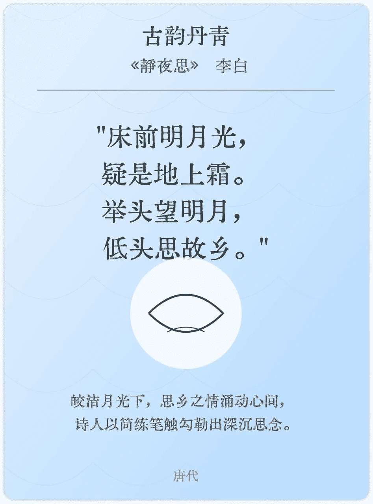

## 结语

从刚哥用Claude来设计单词卡片开始，到「汉语新解」，江树的「简历制作」，一泽的「社交名片」等等

**Prompt 在 AI 设计领域的应用**不断被发掘，LLM的设计潜力不断得到释放

相比之前枯燥的文字，

图片，更具有吸引力和传播效应。

各行各业，涉及到文本，图片，视频，思考，创意的场景，

或许，都应该拿 AI 来重塑一波，

帮助更多的人突破思维定式,

探索更多可能性。

或许，这波人工智能

不一样！

---

三连（**点赞+在看+转发**）！！

欢迎大家加入LangGPT社区一起解锁🔓更多prompt高端玩法~

[](https://langgptai.feishu.cn/wiki/RXdbwRyASiShtDky381ciwFEnpe)

## 更多

[关于结构化提](http://langgpt.ai/)示词如何学习入门请参考结构化提示词

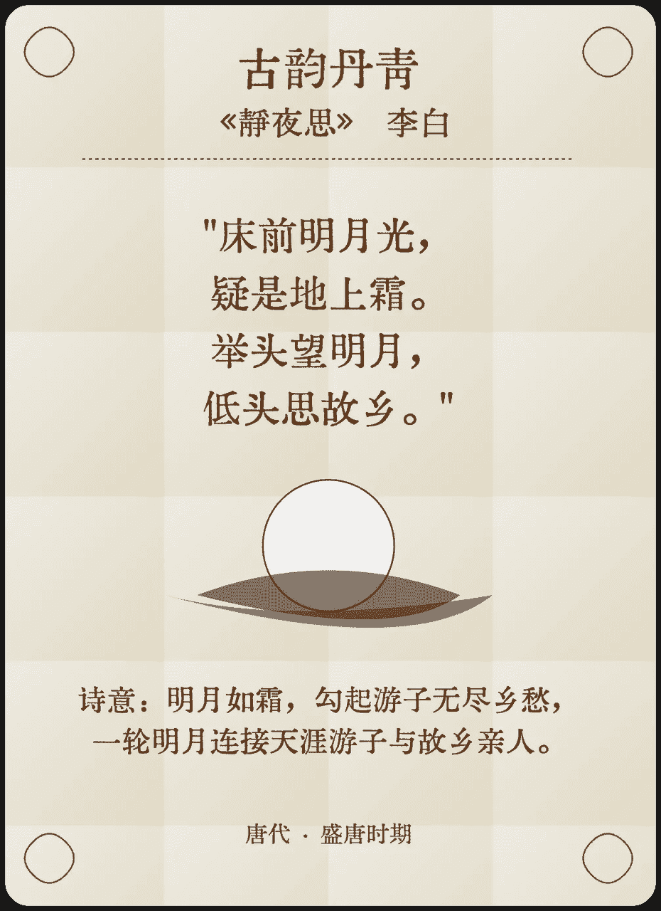

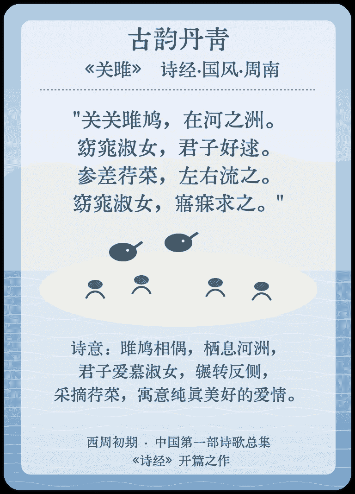