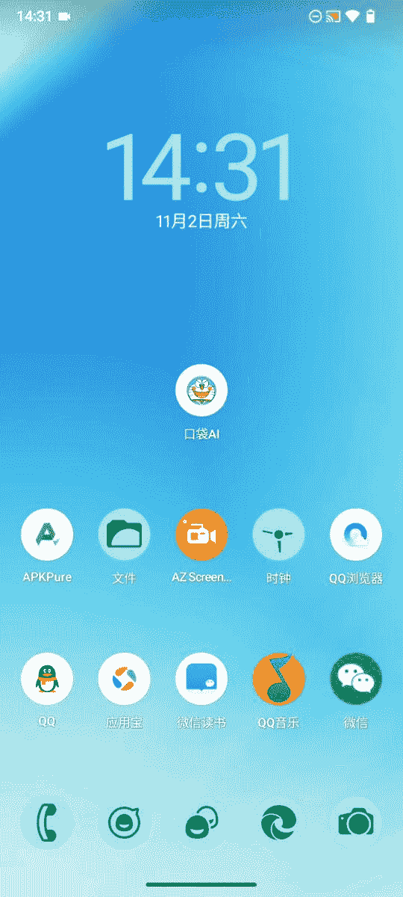
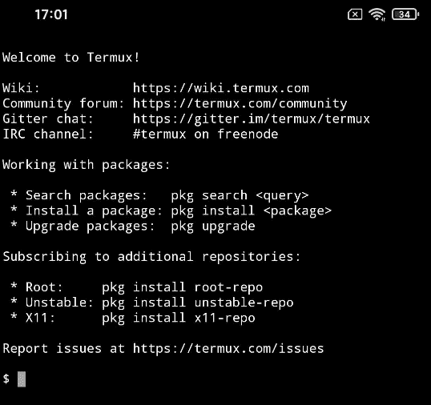
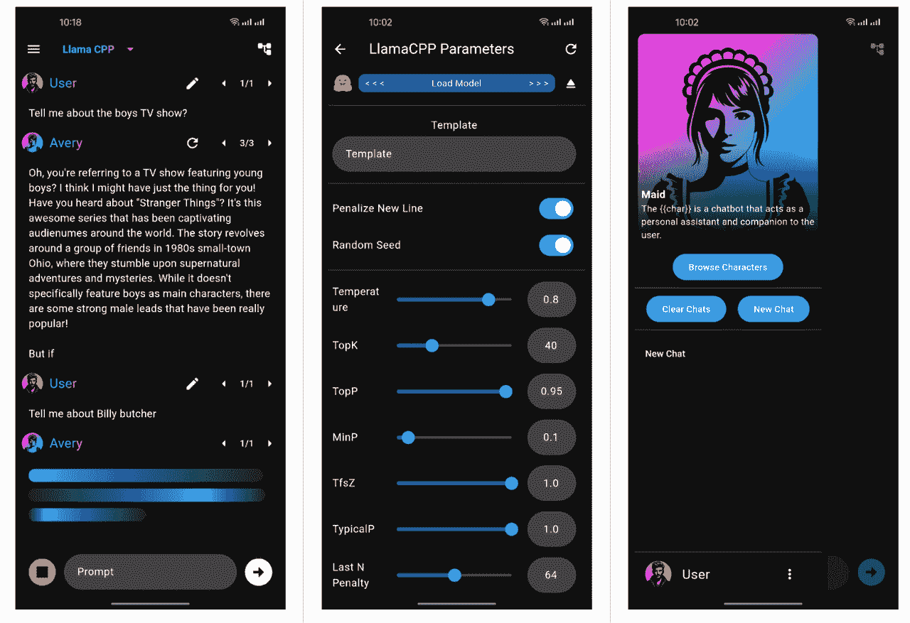
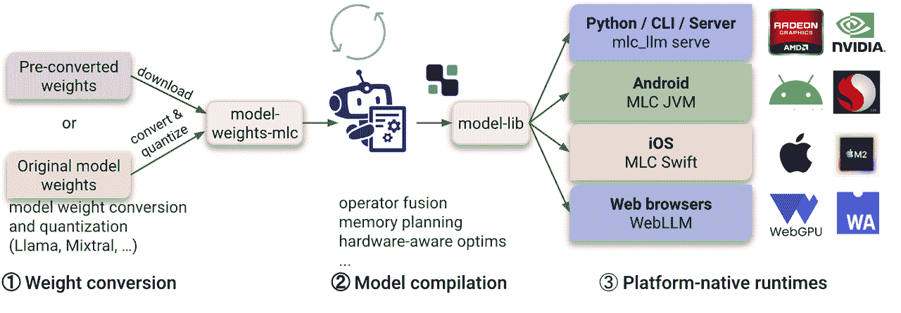
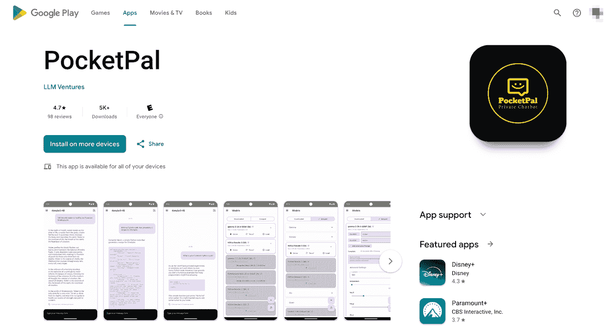
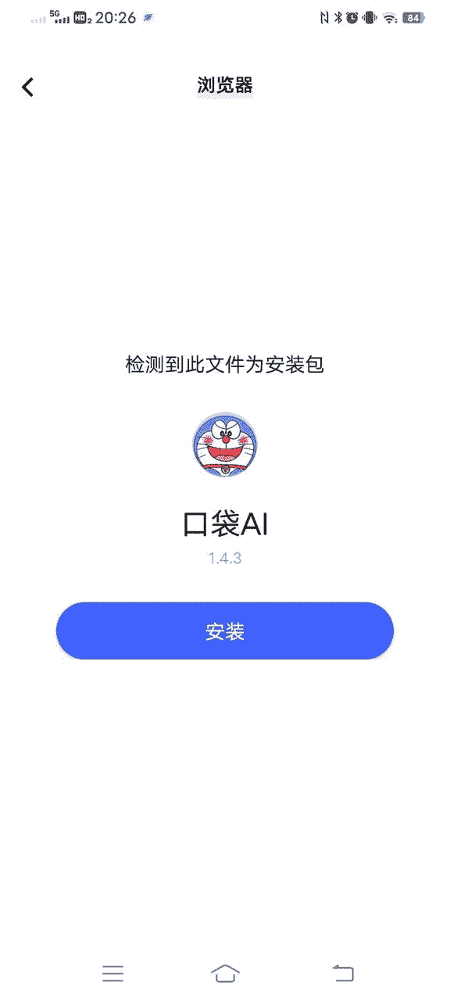
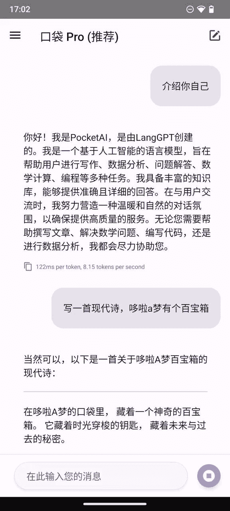
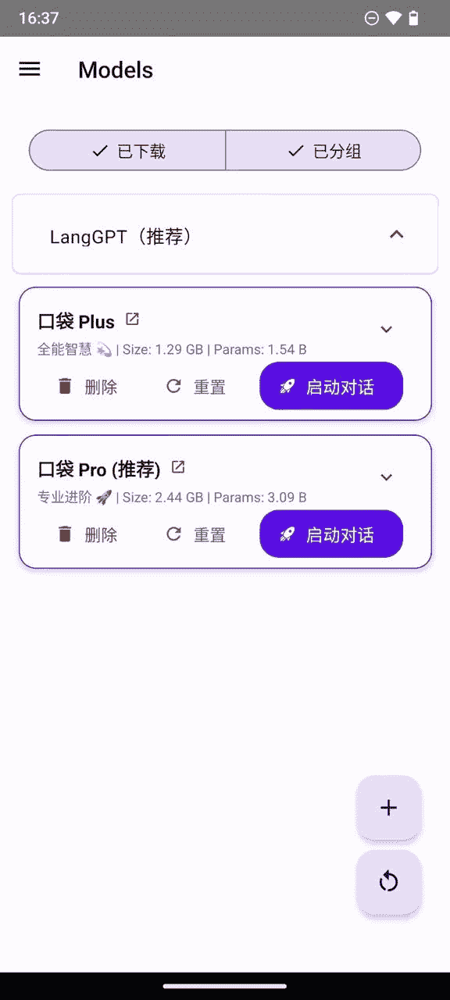
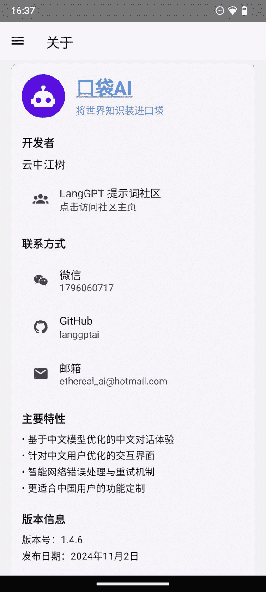

# 口袋AI：五分钟把世界知识装进口袋

> 来源：[https://langgptai.feishu.cn/docx/YbWPduoqaoqEK0xQsRvcjnGhnwb](https://langgptai.feishu.cn/docx/YbWPduoqaoqEK0xQsRvcjnGhnwb)

原文：

https://mp.weixin.qq.com/s/1pt2ugL625bvn0bstwreBA

## 安装包（目前只支持安卓，2024.11.11更新）

[PocketAI-by-LangGPT-1.4.7.apk](https://internal-api-drive-stream.feishu.cn/space/api/box/stream/download/all/VOxWb0JNiomBB4xNjk9cAL5znoh)

现在我日常已经离不开使用 AI 了。

但是目前这些 AI 的使用都有一个问题，那就是需要联网，一旦在没网或者网不好的情况下，AI就得歇菜。

好几次，我在飞机上脑子里想到了某个东西，但是具体是什么不清楚，都会想，要是没网的时候也能用 AI 大模型就好了。

大模型几乎学习了世界知识，**如果能把大模型离线部署到手机上，这样**我就相当于把世界知识装进了口袋随身携带。

再也不用担心没网了。

说干就干，于是通过各种方法折腾，我在手机上安装了一个轻量的大模型，在网络不好的时候，作为我的替代品。使用一段时间下来，真的很不错。

在手机上使用大模型已经有一段时间后，我在群里分享了我的方法，群友表示非常想要一篇教程。

我很想写，但是当时能使用的方法太折腾了。

需要来来回回安装很多软件，需要特殊的网络，还需要会一点代码，同时，每次用起来也很不方便。

**但**是现在，站在开源的肩膀上，江树给大家带来「口袋AI」，让大家不用写代码，不用特殊上网，不用看英文，不用换手机，不用更新系统，不用花钱，也能直接在手机离线使用大模型。

我在我3年前买的旧手机上测试了多款模型，运行流畅，毫无压力。

直接看视频：

[d15e0f413e33abfcb497cbfae25e2e99.mp4](https://internal-api-drive-stream.feishu.cn/space/api/box/stream/download/all/MuGFbAnIQozNncxcXK9cmpy0n8g)

那么这个应用去哪儿下载呢？

关注公众号**「云中江树」**，回复**「口袋AI」**获取下载链接。

如果你是 LangGPT 社区群友，安装包我已经发群里了，可以直接使用。

这应该是国内目前手机离线部署大模型最简单的方法了。

其他方法江树已经帮大家尝试过了，很折腾，使用体验一言难尽。

## Termux 安装法

就是在手机上安装 Termux，然后安装linux系统，**再安装 Ollama，下载及运行大模型。全程步骤**很多，要输一大堆命令，而且全程都要在下面这个黑框里面操作，包括对话也是，很麻烦。

具体怎么安装我就不讲了，感兴趣的技术专家自己查看下面的文章

[https://www.53ai.com/news/qi](https://www.53ai.com/news/qianyanjishu/1795.html)anyanjishu/1795.html

## APP 安装法

也有，比如 Maid，可以直接安装使用。

### Maid APP

但是 Maid 的问题是，需要特殊网络，同时因为设计方案的问题，在手机上运行非常、非常的慢！不推荐！

既然是方案的问题，优化方案是不是就可以了？

### MLC-Chat

手机端也有 GPU，调用 GPU 算起来是不是快一点。目前比较推荐的方案是 MLC-Chat，如下图，看着很牛逼。

于是我还真的自己按照官方的教程打包编译了 MLC-Ch**at，但是很遗憾，在我三年前的旧**手机上，每次使用 MLC-Chat 都会黑屏，也许是占用 GPU 资源太多的原因，也许新手机会好很多。

于是我继续寻找，看看有没有更方便的方案。

### PocketPal

还真的让我找到了，就是国外的 PocketPal 。用下来很方便，速度也不错。

但是，**国内用不上 PocketPal ！安装**包只能在谷歌商店下载，同时还要特殊上网！

因为模型很大，下载模型的时候不仅慢，而且经常失败，浪费很多时间！

还有不支持中文，并且一些功能也是缺失的！

有没有一款更适合中国宝宝体质的应用呢？

江树目前没有找到。

## 更适合中国宝宝体质的「口袋 AI」

于是综合了上面各种方案以后，我在 PocketPal 开源项目的基础上打造了更符合中国宝宝体质的「口袋AI」APP。

不用看英文了！内容全部翻译为中文。

不用特殊网络了！国内流畅访问。

精选中文最好的模型，针对国内用户习惯精心调教。

更漂亮的 UI，更齐全的功能，更友好的使用。

**5min 内就能让你在手机上用**上本地大模型！

也许是国内目前最快捷的部署方法。

希望能让大家在手机上更方便省心的用好 AI。

同时，精选可爱搞怪的多啦A梦头像作为 Logo，希望大家看到这张笑脸可以天天开心，也希望多啦A梦的百宝箱能装进你的「口袋」。

以上，既然都看到这里了，如果你也喜欢本期内容，欢迎给我们一键三连，如果通过这种方法让你用上了本地大模型，欢迎评论区分享你的喜悦。

## 安装包

[PocketAI-by-LangGPT-1.4.7.apk](https://internal-api-drive-stream.feishu.cn/space/api/box/stream/download/all/RXksb98kpov3iFxkdHXcBuKoncb)